# Control Logic Design

## 1. Why a Control Unit

- A digital system has two parts: **data processor** (registers, ALU — handles data) and **control unit** (generates the signals that drive the data processor).
- Control unit outputs: select/enable lines for registers, timing signals that trigger microoperations.
- Control unit inputs: external inputs + status conditions (flags) coming back from the data processor.
- Control unit's **next internal state** depends on its present state and these status/external inputs — i.e. it is a sequential circuit (an FSM).

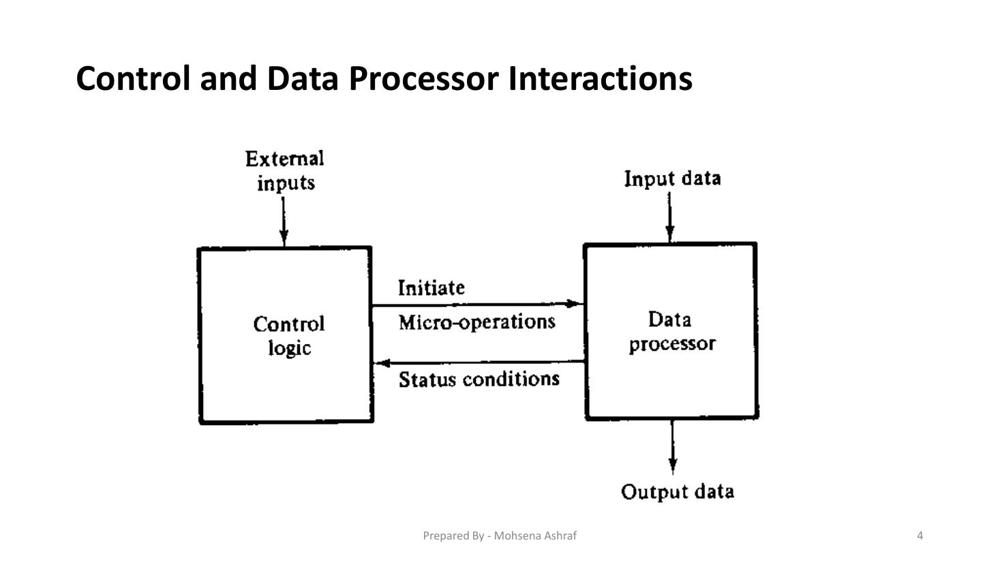

Read this diagram as: Control logic reads **status conditions** from the data processor and external inputs, and in return sends **initiate microoperation** pulses. The data processor itself reads/writes actual data.

## 2. How Control Behaviour Is Specified

- **Timing diagram** — shows when each control signal is active relative to the clock.
- **Flowchart** — shows the sequence of steps/decisions of the algorithm (this is what you design from).

Design flow used for every worked example in this lecture:
1. State the problem.
2. Decide equipment (registers, ALU, flags needed).
3. Draw the algorithm as a flowchart.
4. Specify the data processor (block diagram of registers + ALU + control lines).
5. Design the control logic (convert flowchart → state diagram → equations/circuit).

## 3. Four Ways to Build a Control Unit

| Method | Idea | Devices |
|---|---|---|
| One Flip-Flop per State | one FF = one state, bit propagates FF→FF | SSI/MSI (hard-wired) |
| Sequence Register + Decoder | n-bit counter + decoder gives 2ⁿ state lines | SSI/MSI (hard-wired) |
| PLA Control | same as above but decoder + decision logic folded into one PLA | LSI |
| Microprogram Control | states/outputs stored as words in a ROM | LSI |

Hard-wired (methods I & II) = fixed logic, must be rewired for any change.
PLA / microprogram (methods III & IV) = just reprogram the PLA or swap the ROM.

### 3.1 One Flip-Flop per State

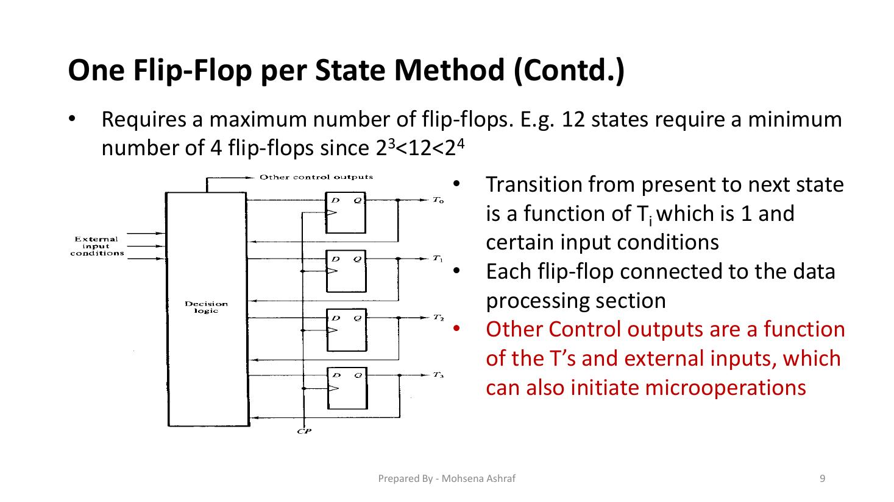

- One FF per control state; exactly one is 1 at a time (the "token" state).
- Decision logic decides which FF gets set next, based on which Tᵢ is currently 1 and the external inputs.
- n states need n flip-flops (wasteful but simple): e.g. 12 states → still needs 12 FFs here (not log₂12), unlike the next method.
- No external inputs + repeating sequence ⇒ reduces to a **ring counter**, hence the nickname "ring-counter controller".

### 3.2 Sequence Register and Decoder Method

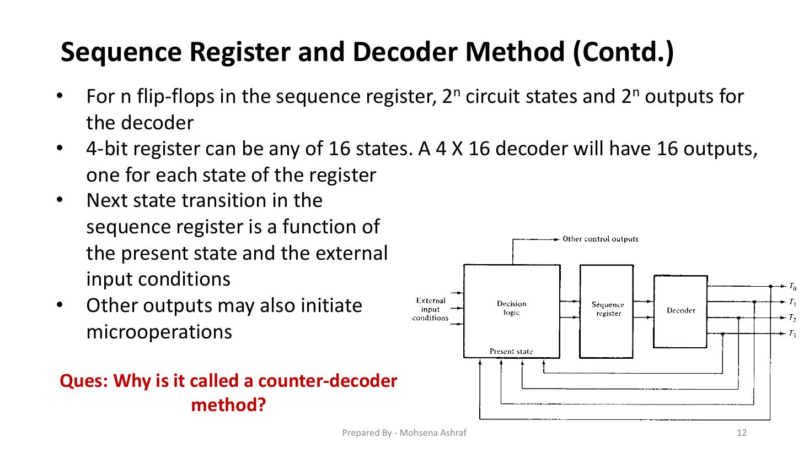

- n flip-flops are used as a **binary counter** (the sequence register), so n FFs give 2ⁿ states.
- A decoder turns the binary count into one-hot Tᵢ lines (same style outputs as method 1, but far fewer flip-flops).
- 4 FFs → 16 states → a 4-to-16 decoder.

> **Why "counter-decoder method"?** Because the sequence register behaves like a binary counter that just counts through states (incrementing each clock unless decision logic forces a jump), and the decoder turns each count value into a one-hot state line — i.e. counter + decoder = the two building blocks that name the method.

### 3.3 PLA Control

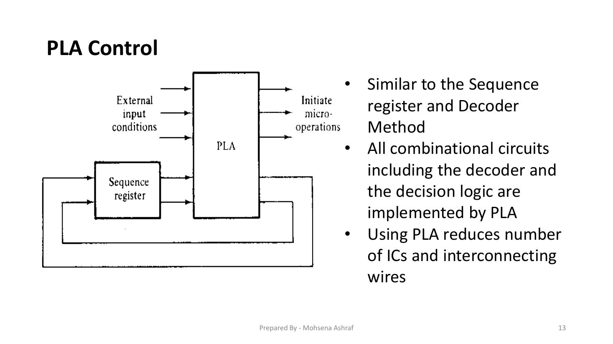

- Same structure as 3.2, but the decoder AND the decision logic are both merged into a single PLA (Programmable Logic Array).
- Advantage: fewer ICs, fewer wires — the "logic" is just one programmed chip.
- The external sequence register still holds the present state; PLA computes (a) which microoperations fire now, and (b) the next value for the sequence register.

### 3.4 Microprogram Control

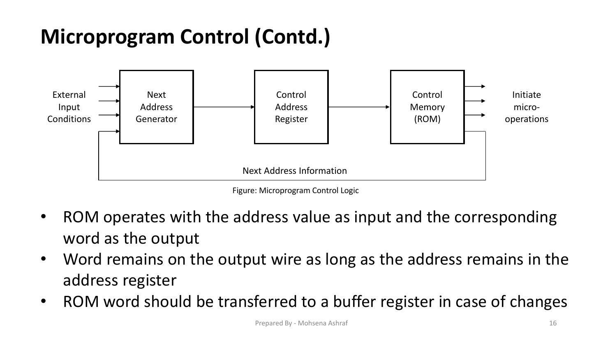

- Control signals are not built from gates — they are **stored as data** in a ROM.
- Each ROM word = **microinstruction**; a sequence of them = **microprogram**.
- Pipeline: `Next Address Generator → Control Address Register (CAR) → Control Memory (ROM) → outputs (initiate microoperations)`, with a feedback path "Next Address Information" back into the address generator.
- ROM output stays valid as long as its address stays in CAR; if the output must latch/hold, route it through a buffer register.
- To change behaviour: just burn a new ROM — no rewiring (this is the whole appeal over hard-wired control).

---

## 4. Worked Example 1 — Hardwired Control for Sign-Magnitude Adder/Subtractor

**Problem:** build hardware that adds or subtracts two signed (sign-magnitude) binary numbers, and flag an overflow.

### Step 2 — Equipment Configuration

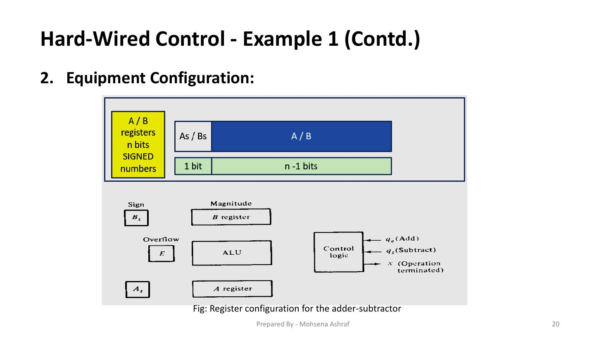

- `A`, `B` registers hold magnitude; `As`, `Bs` hold sign bits separately (sign-magnitude, not 2's complement).
- `E` = overflow flip-flop. `qa` = Add request, `qs` = Subtract request, `x` = operation-terminated flag.

### Step 3 — Derivation of the Algorithm

All ± combinations reduce to **4 cases** using `(±A) − (±B) = (±A) + (∓B)` (subtraction = flip B's sign then add):

- Same signs → **add** magnitudes, result sign = common sign.
- Different signs → **subtract** smaller from larger, result sign = sign of the larger operand.

So the whole algorithm boils down to: compare signs → add or subtract magnitudes → fix the sign → done.

**Flowchart and resulting Control State Diagram** (the two must be read side-by-side — every flowchart box becomes one control state Tᵢ):

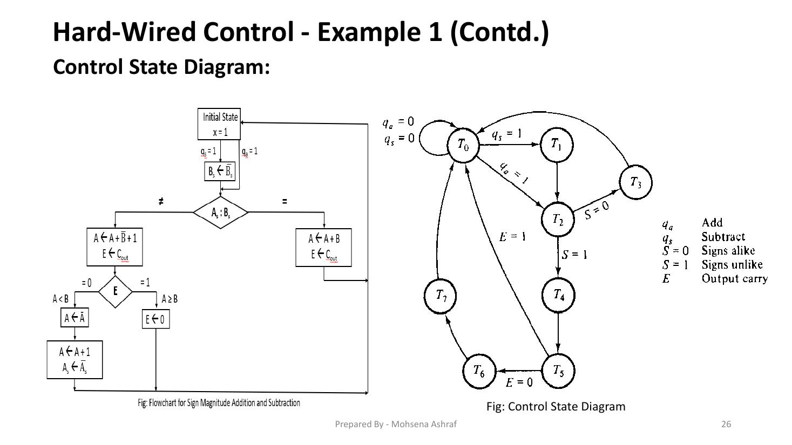

How to read the flowchart (left):
1. `x=1`: initial state, wait for `qa` (add) or `qs` (subtract).
2. If subtract (`qs=1`): complement `Bs` first (turns subtraction into addition of a negated B).
3. Compare `As : Bs`. If equal → straight add: `A ← A+B, E ← Cout`. If not equal → do magnitude subtraction: `A ← A + B̄ + 1, E ← Cout` (2's-complement-style subtract using 1's complement + carry-in).
4. After subtracting, check `E` (=borrow/overflow flag reused as "A≥B?"):
   - `E=1` ⇒ `A≥B`, result already correct, just clear `E`.
   - `E=0` ⇒ `A<B`, result came out negated, so complement `A`, add 1, and flip `As`.
5. Return to initial state `T0`.

Mapping to states `T0…T7` (right diagram): each rectangle/diamond of the flowchart becomes a circle; `qa`, `qs`, `S` (signs alike/unlike), and `E` act as the transition conditions.

**Key exam trap** (explicitly called out in the slides):

> In state `T4`, `E ← Cout` only becomes valid **after** the next clock edge — by which time control has already moved to `T5`. So you must check `E` **in T5**, not in T4, even though `E` was computed during T4.

An equally valid alternative wiring (shown hand-drawn in the slides) checks `Cout` directly at `T4` instead of waiting to check `E` at `T5` — both designs are correct as long as they respect the hardware timing constraint and match the required behaviour:

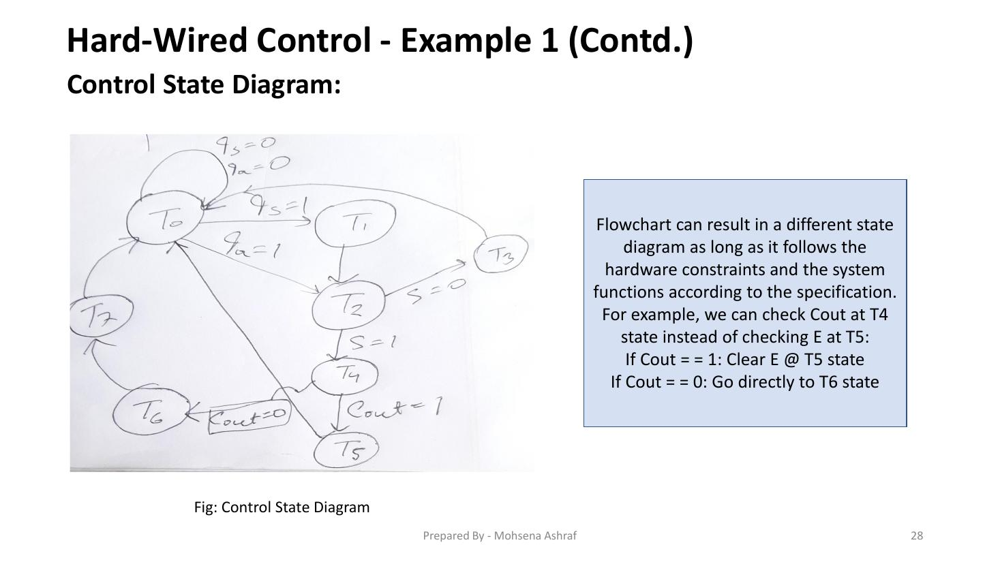

**Takeaway for exam questions:** a flowchart does not have exactly one correct state diagram — different valid hardware refinements are acceptable as long as (a) a condition is only checked in the state *after* it becomes valid, and (b) the final input/output behaviour matches the spec.

### Step 4 — Data Processor Part

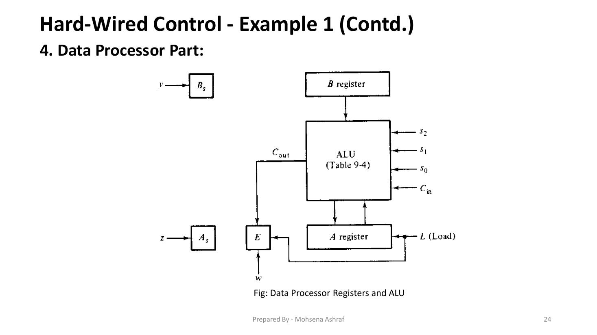

ALU takes `B register`, `A register`, select lines `s2 s1 s0`, carry-in `Cin`, produces `Cout`; outputs load back into `A` and the overflow flip-flop `E` (also fed by external control line `w` to clear it, and `L` to load it).

### Step 5 — Control Logic Design

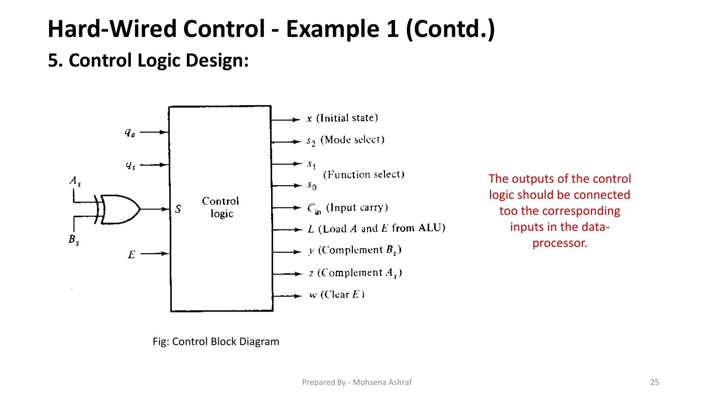

- Inputs to control: `qa`, `qs`, `As`, `Bs` (XORed together into a single "signs differ" signal `S`), `E`.
- Outputs: `x`, `s2 s1 s0` (ALU function select), `Cin`, `L` (load A/E), `y` (complement Bs), `z` (complement As), `w` (clear E).
- **Rule to remember:** every control output must be wired to the matching input pin on the data processor diagram above — this "wiring match" is literally how you check your own design is complete.

### Turning the state diagram into gate equations

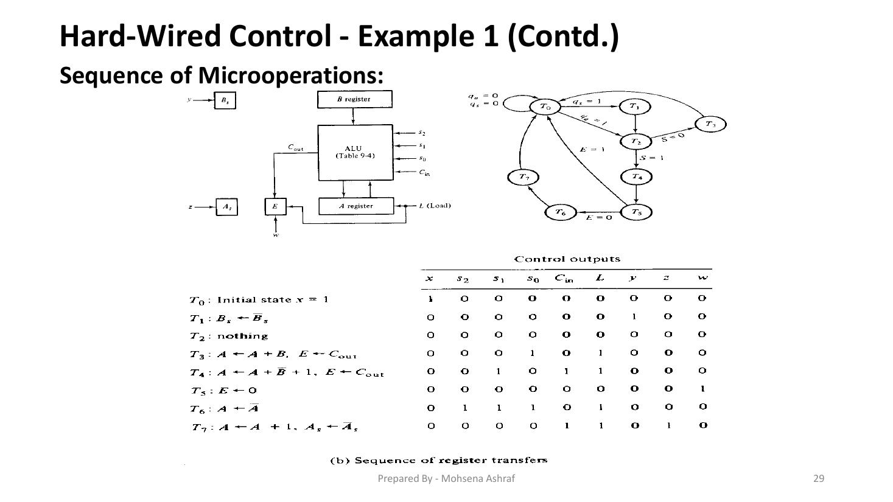

For every state `Tᵢ`, write down which microoperation fires and which output bits must be 1 for that to happen (this table). Example: in `T3`, `A ← A+B, E ← Cout` needs `s0=1, L=1` (checked from the ALU function-select table referenced as "Table 9-4").

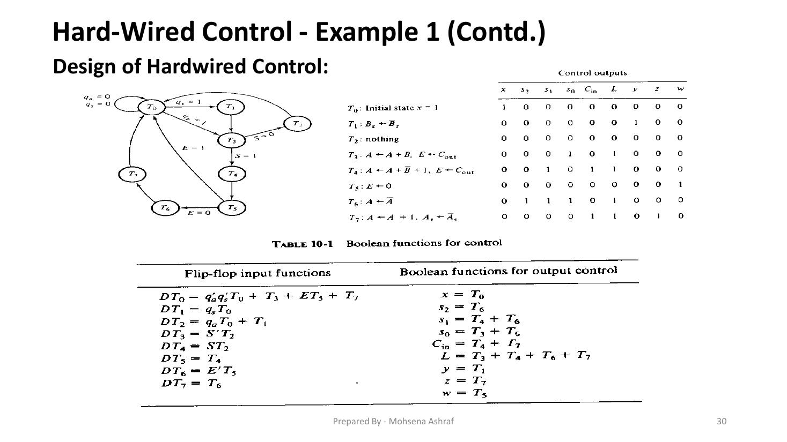

Two kinds of equations come out of the state diagram directly:
- **Flip-flop input equations** (next-state logic), e.g. `DT3 = S'·T2` — meaning: "set T3 next if currently in T2 and signs matched (S=0)". Read straight off the arrows into each Tᵡ node, OR-ed over every incoming arrow.
- **Output equations**, e.g. `s2 = T6` — meaning: "assert s2 whenever we're in T6" (a state can feed several outputs at once, and multiple states can OR into the same output, e.g. `L = T3+T4+T6+T7`).

**Method, step by step, for any such question:**
1. For each state `Tᵢ`, list every arrow pointing *into* it and the condition on that arrow.
2. `D(Tᵢ) = OR of (source-state · condition)` for every incoming arrow.
3. For each output signal, OR together every state in which that output must be 1 (read this off the microoperation table, not the diagram).
4. Implement `D` equations with D flip-flops; implement output equations with AND/OR gates (or a PLA, see §3.3).

### Same Example, Done as Microprogram Control

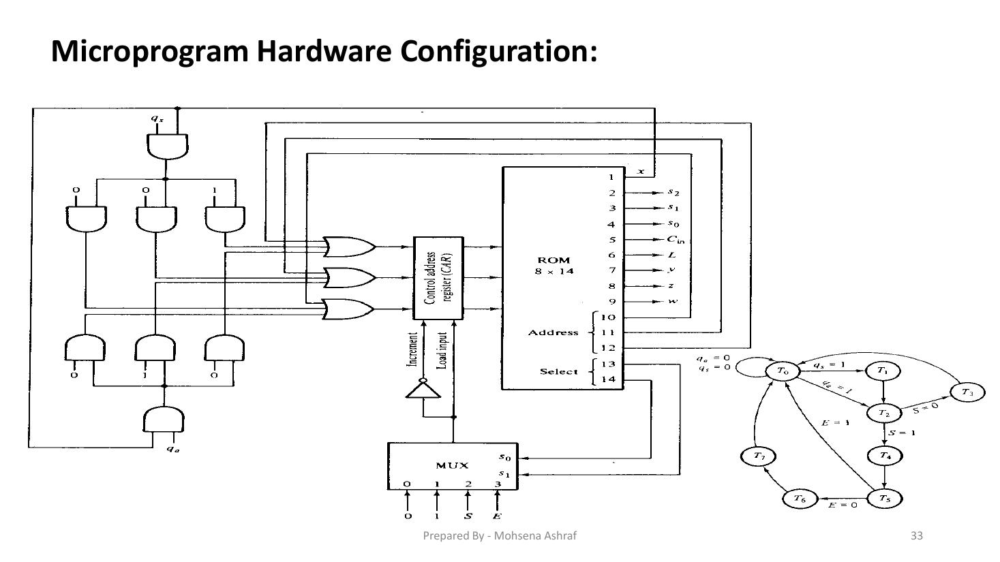

- The 8 states (`T0..T7`) become **8 ROM addresses** (3-bit CAR).
- ROM word width = control outputs (9 bits: `x,s2,s1,s0,Cin,L,y,z,w`) + **3 address bits** (next address) + **2 select bits** (how to pick the next address) = 14 bits total (hence an "8×14" ROM).
- A MUX chooses what gets loaded into CAR next; its select lines are exactly the 2 "select" bits coming out of the ROM word itself:

| Select bits | Meaning |
|---|---|
| 00 | increment CAR (go to next sequential address) |
| 01 | load address field into CAR unconditionally |
| 10 | load if `S=1`, else increment |
| 11 | load if `E=1`, else increment |

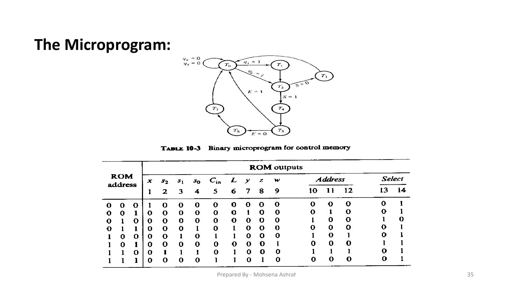

**How to read/derive such a table in an exam:** for every ROM address (= state), write its 9 output bits exactly as in the hardwired output table, then decide: does the next state depend on a condition? If yes, put the "if condition true" target address in the Address field and pick the matching Select code (10 for S, 11 for E); if it's a plain fall-through, Select=00 and the address field is irrelevant (counter just increments).

---

## 5. Worked Example 2 — Hardwired Control for Binary Multiplication

**Problem:** multiply two signed, sign-magnitude binary numbers using shift-and-add.

**Manual trace (what the hardware mechanises):**

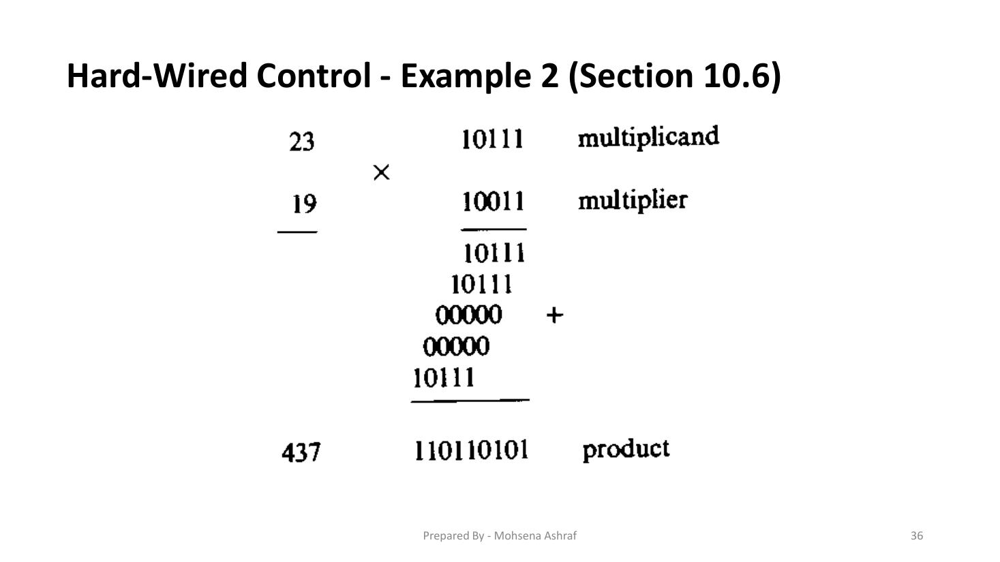

Rule used every step: look at the **last (rightmost) bit of the multiplier**.
- If it is 1 → add the multiplicand into the running partial product, then shift the whole thing right.
- If it is 0 → just shift right (no add).
Repeat once per multiplier bit; after `k` shifts (k = number of multiplier bits) you have the full product in the combined A-Q register.

### Step 2 — Equipment Configuration

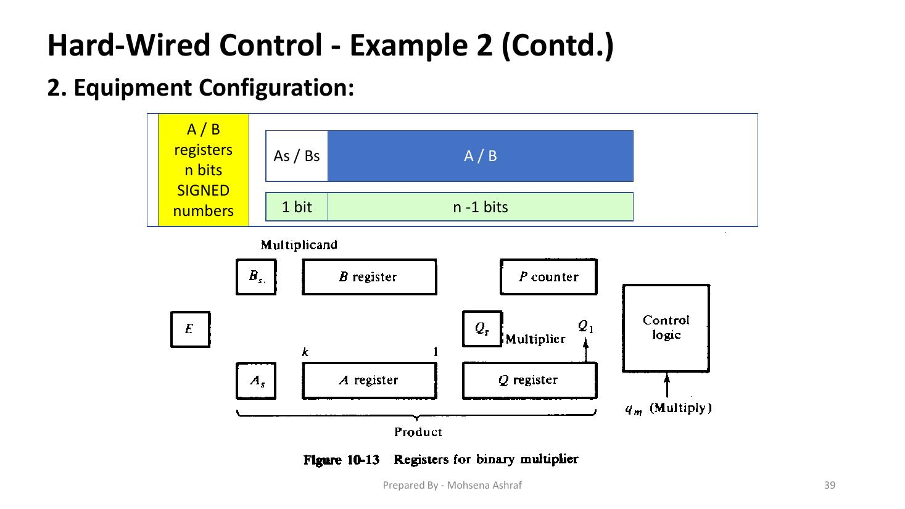

- `B`/`Bs` = multiplicand (magnitude/sign); `Q`/`Qs` = multiplier (magnitude/sign) — `Q1` is specifically its rightmost bit, the one being tested each cycle.
- `A` = accumulates the partial product; `E` = carry-out catcher for each add; `P` (sequence counter) = counts down from `k` to 0, telling the control unit when to stop.
- Combined register `EAQ` is shifted right together each cycle — this is the hardware version of "write the partial product, shift".

### Step 3 — Algorithm / Flowchart

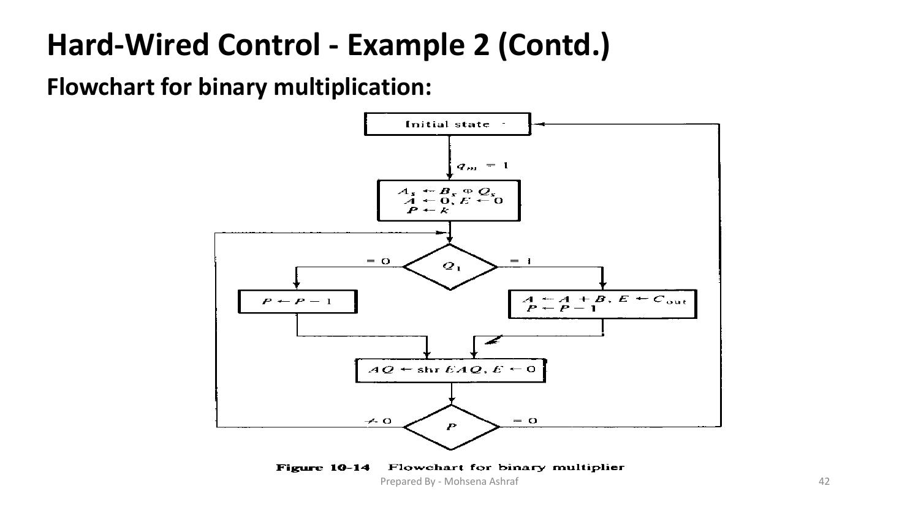

Reading it top to bottom:
1. Start (`qm=1`): `As ← Bs⊕Qs` (sign of product = XOR of the two input signs — same signs give 0 = positive). Clear `A`, `E`; load `P ← k`.
2. Test `Q1` (current rightmost multiplier bit):
   - `Q1=1`: `A ← A+B, E ← Cout` (add multiplicand), then `P ← P−1`.
   - `Q1=0`: just `P ← P−1` (skip the add).
3. Shift: `AQ ← shr EAQ, E ← 0` (shift the 3-register combo right by one, dropping the old E and feeding a fresh 0 in from the top).
4. Test `P`: if `P≠0` loop back to step 2; if `P=0` the product is complete — go to Initial state.

### Control State Diagram (only 4 states needed!)

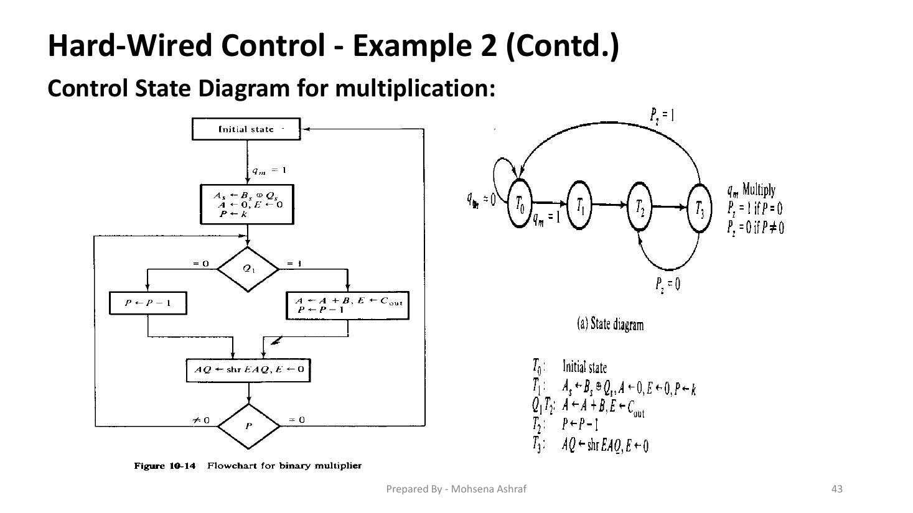

Notice this design is much more compact than Example 1 — only `T0,T1,T2,T3` — because several flowchart boxes are merged into a single state using **conditional output logic** rather than one state per box:
- `T0`: idle, waiting for `qm=1`.
- `T1`: initialize (`As←Bs⊕Qs, A←0, E←0, P←k`).
- `T2`: conditionally add (`A←A+B, E←Cout`) **only if** `Q1=1` — this is why it's labelled `Q1T2` in the table: the microoperation only fires when `Q1` is true, but the *state* advances regardless. Then `P←P−1` always.
- `T3`: shift (`AQ←shr EAQ, E←0`), then either loop to `T2` (`Pz=0`, more bits left) or back to `T0` (`Pz=1`, done — `Pz` is a "P is zero" flag).

**Lesson for exam questions:** you don't need a separate state for every conditional branch — if an operation is small enough to be gated by an AND with the condition signal, you can keep both branches inside one state and only change what the *data processor* does, not the *control state*. This is the efficient way to answer "design a minimal state diagram" questions.

### Step 4 — Data Processor Specification

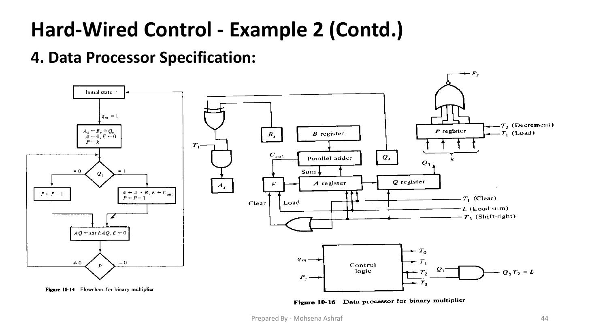

Key wiring to notice (useful for "explain this block diagram" questions):
- `As ← Bs⊕Qs` is built from one XOR gate gated by `T1`.
- `P register` only has two external control lines: `T1` (load `k`) and `T2` (decrement) — matches the flowchart exactly.
- `Q1T2 = L` (AND gate) is the literal hardware form of "`Q1=1` AND we're in `T2`" that produces the Load-sum pulse.

### Step 5 — Hardwired Control with JK Flip-Flops

Because only 4 states exist, 2 flip-flops (`G2G1`) are enough (`00,01,10,11` encode `T0..T3`).

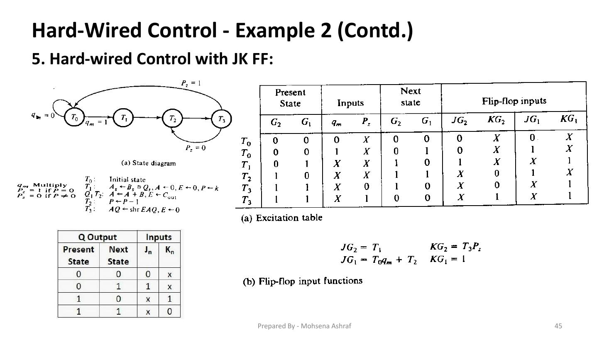

**Method for this kind of question (state assignment → JK equations):**
1. Assign binary codes to each state (`T0=00, T1=01, T2=10, T3=11` here).
2. For every present-state/input combination, write the next state the state diagram says to go to.
3. For each flip-flop bit that must flip, use the known JK **excitation table** (present→next ⇒ required J,K), shown here as the small 4-row reference table:

| Present | Next | J | K |
|---|---|---|---|
| 0 | 0 | 0 | x |
| 0 | 1 | 1 | x |
| 1 | 0 | x | 1 |
| 1 | 1 | x | 0 |

4. Fill those J/K values into the big excitation table row by row, then simplify (K-map or inspection) to get equations like:
`JG2 = T1`, `KG2 = T3·Pz`, `JG1 = T0·qm + T2`, `KG1 = 1`.

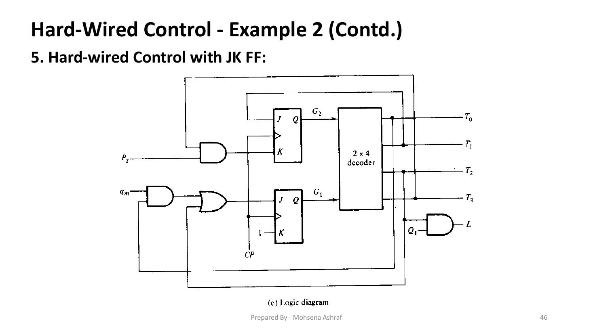

This is simply those four equations drawn as gates feeding two JK flip-flops, whose `G2G1` outputs go through a 2×4 decoder to regenerate one-hot `T0..T3` lines (exactly like method 3.2) plus the `Q1·T2=L` AND gate reproduced from the data-processor diagram.

### PLA Version of the Same Control Unit

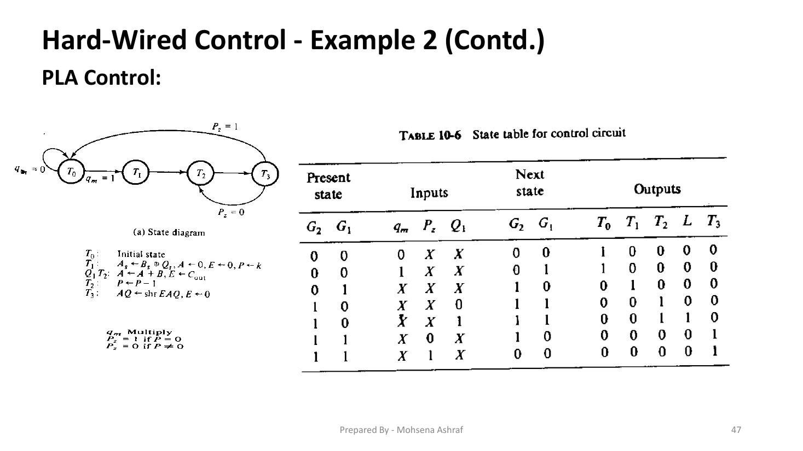

Same present-state/next-state/output table as the JK design, but now you are not deriving flip-flop equations — you are deriving a **PLA truth table** (inputs → outputs directly, dashes `X` mean "don't care").

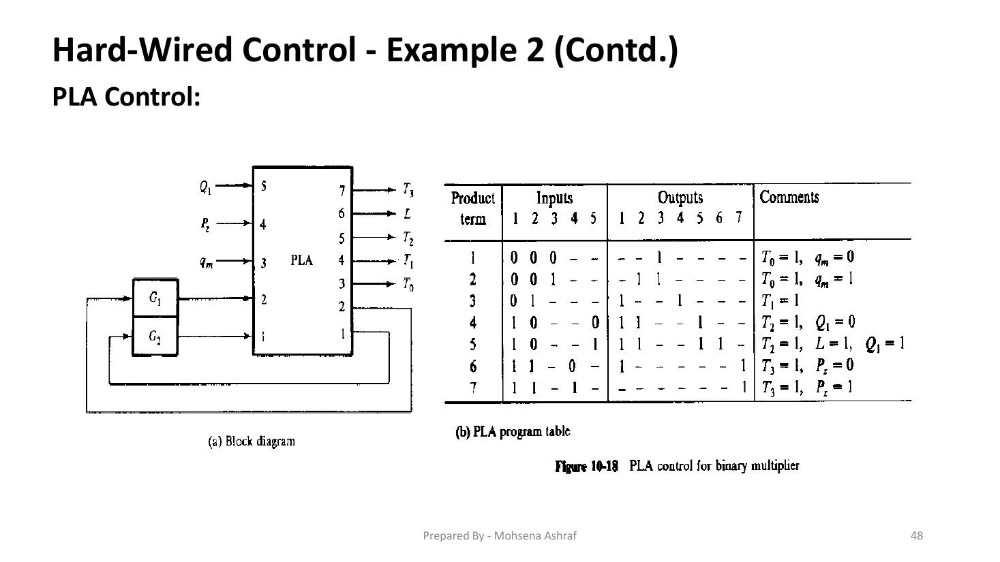

Reading a PLA program table: each row = one AND term (product term). A dash `–` under Inputs means that input is not connected to that AND gate (don't care). A dash under Outputs means that output is not driven by that term. Example: row 1 `000––` → output `– – 1 – – – –` means "when `G2G1qm=000` (any `Pz,Q1`), assert only `T0`" i.e. `T0=1, qm=0`, matching "idle, waiting". This is the standard way PLA-based control questions are graded: can you translate a state table row into (a) the AND inputs it needs and (b) which OR outputs it should feed.

---

## 6. Quick Revision Checklist

- Four control methods: **FF-per-state, counter+decoder, PLA, microprogram** — know which are hard-wired vs ROM/LSI-based and why that affects "ease of modification".
- Can redraw **Control & Data-processor interaction** diagram and explain each arrow.
- Given a flowchart, can produce **a** valid state diagram (not necessarily the only one) respecting the "check a flag only one state after it's computed" rule.
- Can go from a state diagram to **D flip-flop equations** (next-state) and **output equations** (OR of states that assert that output).
- Can go from a state diagram to a **microprogram ROM table** (outputs + next address + select bits).
- Can assign binary codes to states and build a **JK excitation table**, then simplify to `J`/`K` equations.
- Can read/write a **PLA program table** with don't-cares.
- Worked Example 1 (adder/subtractor, 8 states) and Example 2 (multiplier, 4 states) are the two reference designs — expect exam questions to be variations of these (e.g. division, 2's complement arithmetic) using the exact same 5-step method.
