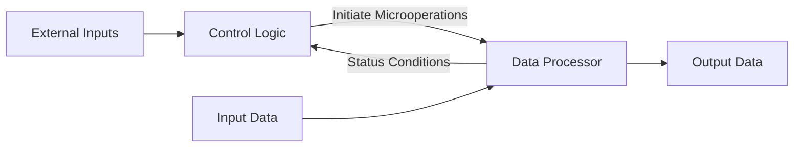

# DSD Lecture 10 — Control Logic Design

---

## 1. Control Unit Role

Binary information in registers is either **data** or **control information**.

The control unit:
- Generates binary variables that select/enable registers
- Provides a time sequence of signals that initiates all microoperations
- Determines the next state based on status conditions from the data processor

### Control and Data Processor Interaction

---

## 2. Control Organization Methods

| # | Method | Hardware Type | Modifiable Without Rewiring? |
|---|---|---|---|
| I | One flip-flop per state | SSI/MSI (Hard-wired) | No |
| II | Sequence register + decoder | SSI/MSI (Hard-wired) | No |
| III | PLA control | LSI (Programmable) | Yes — replace ROM |
| IV | Microprogram control | LSI (ROM) | Yes — replace ROM |

> Hard-wired (I, II): any change requires physical rewiring.
> PLA/Microprogram (III, IV): change by swapping the ROM chip.

---

## 3. One Flip-Flop per State Method

![[one_ff_per_state.png]]

| Property | Detail |
|---|---|
| FF count | One per state (maximum — e.g. 12 states = 12 FF) |
| Active FFs at once | Exactly 1 (all others cleared) |
| Propagation | Single '1' propagates under decision logic |
| State output | Q output of each FF = Ti directly |
| Special case | No external inputs → reduces to ring counter |

**Advantages:** Operational simplicity, less combinational logic needed.
**Disadvantages:** More flip-flops = higher system cost.

**Comparison:** 12 states needs 12 FF here vs only 4 FF with binary encoding (since 2³ < 12 < 2⁴).

---

## 4. Sequence Register and Decoder Method

![[seq_reg_decoder.png]]

| Property | Detail |
|---|---|
| FF count | n FF → 2ⁿ states (minimum) |
| Decoder | n-to-2ⁿ decoder gives one-hot outputs T0…T(2ⁿ-1) |
| Example | 4 FF → 4×16 decoder → 16 outputs |
| State transition | Function of present state + external inputs |
| Also called | Counter-decoder method |

**Why "counter-decoder"?** The sequence register often functions as a binary counter, incrementing each clock cycle unless a branch condition redirects it.

---

## 5. PLA Control

![[pla_control.png]]

| Feature | Detail |
|---|---|
| Structure | Same as sequence register + decoder |
| Difference | Decoder + decision logic both inside a single PLA |
| Benefit | Reduces number of ICs and interconnecting wires |
| Present state | Held in external sequence register |
| PLA inputs | Sequence register state + external conditions |
| PLA outputs | Microoperation initiation signals + next state |

---

## 6. Microprogram Control

![[microprogram_control.png]]

| Term | Definition |
|---|---|
| Microinstruction | One control word stored in ROM |
| Microprogram | A sequence of microinstructions |
| CAR | Control Address Register — holds current ROM address |
| Next address generator | Computes next CAR value from status inputs |
| Dynamic microprogram | Microprogram loadable from auxiliary memory |

**Operation flow:**
1. CAR holds address → ROM outputs that microinstruction
2. Microinstruction initiates microoperations in data processor
3. Next address generator computes next address (sequential or branch)
4. On next clock pulse, next address loads into CAR

---
---

# Example 1 — Sign-Magnitude Adder-Subtractor

**Control method: One flip-flop per state (Hard-Wired)**

---

## Step 1: Problem Statement

Add or subtract two **n-bit sign-magnitude** fixed-point binary numbers.
- Registers A, B each hold: 1 sign bit + (n-1) magnitude bits
- An overflow flip-flop E must capture carry out

---

## Step 2: Equipment Configuration

![[ex1_equipment_config.png]]

| Component | Role |
|---|---|
| A register | n-1 bit magnitude accumulator |
| As | Sign bit of A |
| B register | n-1 bit magnitude of operand B |
| Bs | Sign bit of B |
| E | Overflow / carry flip-flop |
| ALU | Parallel adder (function selected by s2, s1, s0, Cin) |
| qa | External input: initiate Add |
| qs | External input: initiate Subtract |
| x | Control output: operation terminated |

---

## Step 3: Derivation of Algorithm

### Reducing 8 cases to 4

Subtraction is converted to addition by complementing the sign of B:

| Original | Equivalent |
|---|---|
| (±A) − (+B) | (±A) + (−B) |
| (±A) − (−B) | (±A) + (+B) |

This gives 4 cases: **(±A) + (±B)**

### Sign-magnitude arithmetic rules

| Case | Condition | Operation | Result Sign |
|---|---|---|---|
| (+A)+(+B) | Signs same | Add magnitudes | + |
| (−A)+(−B) | Signs same | Add magnitudes | − |
| (+A)+(−B) | Signs differ, A≥B | Subtract: A−B | + |
| (+A)+(−B) | Signs differ, A<B | Subtract: B−A | − |
| (−A)+(+B) | Signs differ, A≥B | Subtract: A−B | − |
| (−A)+(+B) | Signs differ, A<B | Subtract: B−A | + |

**Key flag:** `S = As XOR Bs`
- S = 0 → signs alike → add magnitudes
- S = 1 → signs differ → subtract magnitudes

**Detecting A vs B magnitude:** After computing `A + ~B + 1`:
- Cout (E) = 1 → A ≥ B
- Cout (E) = 0 → A < B → result needs negating

---

## Step 4: Flowchart and Data Processor

![[ex1_flowchart.png]]

![[ex1_data_processor.png]]

**Control signals to data processor:**

| Signal | Function |
|---|---|
| s2, s1, s0 | ALU function select |
| Cin | ALU carry input |
| L | Load A register and E from ALU |
| y | Complement Bs |
| z | Complement As |
| w | Clear E |

---

## Step 5: Control Logic Design

![[ex1_control_block.png]]

**Control inputs:** qa, qs, As, Bs, E
**S is computed externally:** `S = As XOR Bs`

---

## Step 6: Control State Diagram

![[ex1_state_diagram_1.png]]

![[ex1_state_diagram_2.png]]

| State | Operation | Condition to reach it |
|---|---|---|
| T0 | Initial state, x=1 | qa=0, qs=0 (idle) |
| T1 | Bs ← ~Bs | qs=1 (subtract: complement B sign) |
| T2 | nothing (wait) | qa=1 (add: skip complement) |
| T3 | A←A+B, E←Cout | S=0 from T2 (signs alike) |
| T4 | A←A+~B+1, E←Cout | S=1 from T2 (signs differ) |
| T5 | E←0 | From T4 |
| T6 | A←~A | E=0 at T5 (A<B, complement needed) |
| T7 | A←A+1, As←~As | From T6 |

> **Important:** At T4, `E ← Cout` is NOT registered until the clock pulse fires. After that pulse the system moves to T5. Therefore E must be checked at **T5**, not T4.

> **Alternative valid design:** Check Cout at T4 directly:
> - Cout=1 at T4 → go to T5 (clear E), then T7
> - Cout=0 at T4 → skip T5, go directly to T6

---

## Step 7: Sequence of Microoperations

![[ex1_microop_table.png]]

| State | Operation | x | s2 | s1 | s0 | Cin | L | y | z | w |
|---|---|---|---|---|---|---|---|---|---|---|
| T0 | Initial state x=1 | 1 | 0 | 0 | 0 | 0 | 0 | 0 | 0 | 0 |
| T1 | Bs ← ~Bs | 0 | 0 | 0 | 0 | 0 | 0 | 1 | 0 | 0 |
| T2 | nothing | 0 | 0 | 0 | 0 | 0 | 0 | 0 | 0 | 0 |
| T3 | A←A+B, E←Cout | 0 | 0 | 0 | 1 | 0 | 1 | 0 | 0 | 0 |
| T4 | A←A+~B+1, E←Cout | 0 | 0 | 1 | 0 | 1 | 1 | 0 | 0 | 0 |
| T5 | E←0 | 0 | 0 | 0 | 0 | 0 | 0 | 0 | 0 | 1 |
| T6 | A←~A | 0 | 1 | 1 | 1 | 0 | 1 | 0 | 0 | 0 |
| T7 | A←A+1, As←~As | 0 | 0 | 0 | 0 | 1 | 1 | 0 | 1 | 0 |

**Reading the ALU control lines (s2, s1, s0, Cin):**

| s2 | s1 | s0 | Cin | ALU performs |
|---|---|---|---|---|
| 0 | 0 | 0 | 0 | Transfer A (no change) |
| 0 | 0 | 1 | 0 | A + B (add) |
| 0 | 1 | 0 | 1 | A + ~B + 1 (subtract via 2's complement) |
| 1 | 1 | 1 | 0 | ~A (bitwise complement) |
| 0 | 0 | 0 | 1 | A + 1 (increment) |

---

## Step 8: Boolean Functions (Table 10-1)

![[ex1_boolean_table.png]]

### Flip-flop D input equations

| Flip-flop | Boolean Function | Explanation |
|---|---|---|
| DT0 | qa'qs'T0 + T3 + E·T5 + T7 | Return to T0 when: idle, add done, E=1 at T5, or increment done |
| DT1 | qs·T0 | Go to T1 only when subtract is requested from T0 |
| DT2 | qa·T0 + T1 | Go to T2 when add requested (T0→T2) or after sign complement (T1→T2) |
| DT3 | S'·T2 | Go to T3 when signs are alike (S=0) |
| DT4 | S·T2 | Go to T4 when signs differ (S=1) |
| DT5 | T4 | Always go to T5 after T4 |
| DT6 | E'·T5 | Go to T6 only if E=0 at T5 (A<B) |
| DT7 | T6 | Always go to T7 after T6 |

### Output control equations

| Output | Function | Why |
|---|---|---|
| x | T0 | Operation terminated signal active only at initial state |
| s2 | T6 | Complement operation (s2=1 needed for ~A) |
| s1 | T4 + T6 | Subtract (T4) and complement (T6) both need s1=1 |
| s0 | T3 + T6 | Add (T3) and complement (T6) both need s0=1 |
| Cin | T4 + T7 | Carry in needed for 2's complement subtract and increment |
| L | T3 + T4 + T6 + T7 | Load A from ALU at all states that modify A |
| y | T1 | Complement Bs only at T1 |
| z | T7 | Complement As only at T7 |
| w | T5 | Clear E only at T5 |

---
---

# Example 1 — Microprogram Control Version

**Same adder-subtractor, now implemented with ROM-based control.**

---

## Microprogram Requirements

From the control state diagram, the next address generator needs to handle:

| Requirement | Triggered by |
|---|---|
| Load external address | External signals qa, qs |
| Sequential (increment CAR) | Most transitions |
| Branch on S | At T2: S=0 → T3, S=1 → T4 |
| Branch on E | At T5: E=1 → T0, E=0 → T6 |

---

## ROM Structure: 8 × 14 bits

![[ex1_microprogram_binary.png]]

| Bit position | 1 | 2 | 3 | 4 | 5 | 6 | 7 | 8 | 9 | 10–12 | 13–14 |
|---|---|---|---|---|---|---|---|---|---|---|---|
| Field | x | s2 | s1 | s0 | Cin | L | y | z | w | Address | Select |

---

## Symbolic Microprogram (Table 10-2)

![[ex1_microprogram_symbolic.png]]

| ROM Addr | Microinstruction | Comment |
|---|---|---|
| 0 | x=1; if(qs=1)→1; if(qa=1)→2; if(qs∧qa=0)→0 | Initial: load external address |
| 1 | Bs ← ~Bs | qs=1, start subtraction |
| 2 | if(S=1)→4 | Branch on sign difference |
| 3 | A←A+B, E←Cout; goto 0 | Add magnitudes and return |
| 4 | A←A+~B+1, E←Cout | Subtract magnitudes |
| 5 | if(E=1)→0; E←0 | Terminate if E=1, else clear E |
| 6 | A←~A | E was 0, complement A |
| 7 | A←A+1, As←~As; goto 0 | Increment and fix sign, done |

---

## CAR Select Bits (MUX control)

| Bit 13 | Bit 14 | CAR Action |
|---|---|---|
| 0 | 0 | Increment CAR (sequential) |
| 0 | 1 | Load address from ROM bits 10–12 (unconditional jump) |
| 1 | 0 | Load if S=1, else increment |
| 1 | 1 | Load if E=1, else increment |

---

## Binary Microprogram (Table 10-3)

| ROM Addr | x | s2 | s1 | s0 | Cin | L | y | z | w | Addr[10:12] | Sel[13:14] |
|---|---|---|---|---|---|---|---|---|---|---|---|
| 0 (000) | 1 | 0 | 0 | 0 | 0 | 0 | 0 | 0 | 0 | 000 | 01 |
| 1 (001) | 0 | 0 | 0 | 0 | 0 | 0 | 1 | 0 | 0 | 010 | 01 |
| 2 (010) | 0 | 0 | 0 | 0 | 0 | 0 | 0 | 0 | 0 | 100 | 10 |
| 3 (011) | 0 | 0 | 0 | 1 | 0 | 1 | 0 | 0 | 0 | 000 | 01 |
| 4 (100) | 0 | 0 | 1 | 0 | 1 | 1 | 0 | 0 | 0 | 101 | 01 |
| 5 (101) | 0 | 0 | 0 | 0 | 0 | 0 | 0 | 0 | 1 | 000 | 11 |
| 6 (110) | 0 | 1 | 1 | 1 | 0 | 1 | 0 | 0 | 0 | 111 | 01 |
| 7 (111) | 0 | 0 | 0 | 0 | 1 | 1 | 0 | 1 | 0 | 000 | 01 |

**How to read a row (example — address 4):**
- s1=1, s0=0, Cin=1 → ALU performs A+~B+1 (subtract)
- L=1 → load result into A and E
- Addr=101 (5), Sel=01 → unconditionally jump to address 5 next

---
---

# Example 2 — Sign-Magnitude Binary Multiplier

**Control method: Sequence register + decoder (hard-wired JK FF) and PLA**

---

## Step 1: Problem Statement

Multiply two n-bit sign-magnitude numbers using add-and-shift.

![[ex2_multiply_example.png]]

**Algorithm rule:**

| Multiplier bit Q1 | Action |
|---|---|
| Q1 = 1 | Add multiplicand B to partial product A, then right shift EAQ |
| Q1 = 0 | Only right shift EAQ (no addition) |

**Worked example (23 × 19 = 437):**

| Step | Multiplier bit | Operation | Result |
|---|---|---|---|
| Initial | — | B=10111, Q=10011 | A=00000 |
| Bit 1 | Q1=1 | A←A+B | 10111 → shift → 010111 |
| Bit 2 | Q1=1 | A←A+B | 1000101 → shift → 01000101 |
| Bit 3 | Q1=0 | shift only | 001000101 |
| Bit 4 | Q1=0 | shift only | 0001000101 |
| Bit 5 | Q1=1 | A←A+B, shift | 110110101 = 437 |

![[ex2_problem_statement.png]]

---

## Step 2: Equipment Configuration

![[ex2_equipment_config.png]]

| Register | Content | Notes |
|---|---|---|
| B, Bs | Multiplicand magnitude + sign | n-1 magnitude bits |
| Q, Qs | Multiplier magnitude + sign | Q1 = LSB, shifts right each cycle |
| A, As | Partial product + product sign | Cleared at start |
| E | Carry out from addition | Cleared after each shift |
| P | Bit counter | Loaded with k = number of multiplier bits |

**Sign of product:** `As = Bs XOR Qs`
- Same signs → positive product
- Different signs → negative product

**Composite shift register EAQ:** E, A, Q treated as one register for right-shift operation.
`AQ ← shr EAQ, E ← 0` expands to: `A ← shr A`, `Q ← shr Q`, `Ak ← E`, `Qk ← A1`, `E ← 0`

---

## Step 3: Algorithm — Derivation

![[ex2_flowchart.png]]

| Phase | Action |
|---|---|
| Initialization (T1) | As←Bs⊕Qs, A←0, E←0, P←k |
| Loop check | Inspect Q1 (LSB of multiplier) |
| If Q1=1 (T2) | A←A+B, E←Cout, P←P−1 |
| If Q1=0 (T2) | P←P−1 only |
| Shift (T3) | AQ←shr EAQ, E←0 |
| Termination check | If P=0 → done; else loop back to Q1 check |

---

## Step 4: Control State Diagram

![[ex2_state_diagram.png]]

| State | Operation | Notes |
|---|---|---|
| T0 | Initial state, wait for qm=1 | qm = multiply start signal |
| T1 | As←Bs⊕Qs, A←0, E←0, P←k | Setup |
| T2 | If Q1=1: A←A+B, E←Cout; P←P−1 | Conditional add + decrement |
| T3 | AQ←shr EAQ, E←0; check P | Shift, then branch |

**Branch at T3:**
- Pz = 0 (P ≠ 0): loop back to T2
- Pz = 1 (P = 0): go to T0 (done)

**Pz definition:**
- Pz = 1 if P = 0
- Pz = 0 if P ≠ 0

---

## Step 5a: Hard-Wired Control with JK Flip-Flops

![[ex2_jkff_table.png]]

### State Encoding (2 FF: G2, G1)

| State | G2 | G1 |
|---|---|---|
| T0 | 0 | 0 |
| T1 | 0 | 1 |
| T2 | 1 | 0 |
| T3 | 1 | 1 |

### JK Flip-Flop Excitation Reference

| Present Q | Next Q | J | K |
|---|---|---|---|
| 0 → 0 | 0 | 0 | X |
| 0 → 1 | 1 | 1 | X |
| 1 → 0 | 0 | X | 1 |
| 1 → 1 | 1 | X | 0 |

### Excitation Table (from state diagram)

| State | G2 G1 | Inputs | Next G2 G1 | JG2 | KG2 | JG1 | KG1 |
|---|---|---|---|---|---|---|---|
| T0 | 0 0 | qm=0, Pz=X | 0 0 | 0 | X | 0 | X |
| T0 | 0 0 | qm=1, Pz=X | 0 1 | 0 | X | 1 | X |
| T1 | 0 1 | X, X | 1 0 | 1 | X | X | 1 |
| T2 | 1 0 | X, Pz=X | 1 1 | X | 0 | 1 | X |
| T3 | 1 1 | X, Pz=0 | 1 0 | X | 0 | X | 1 |
| T3 | 1 1 | X, Pz=1 | 0 0 | X | 1 | X | 1 |

### Resulting Flip-Flop Input Equations

| Input | Equation | Explanation |
|---|---|---|
| JG2 | T1 | G2 sets when leaving T1 |
| KG2 | T3·Pz | G2 resets when at T3 and P=0 (done) |
| JG1 | T0·qm + T2 | G1 sets when multiply starts or entering T3 |
| KG1 | 1 (always) | G1 always resets on clock (clears on every transition) |

### Logic Diagram

![[ex2_jkff_logic.png]]

**Additional output:** `L = Q1 · T2` (load sum into A only when Q1=1 during T2)

---

## Step 5b: PLA Control

![[ex2_pla_state_table.png]]

### State Table for PLA

| Present State | Inputs | Next State | Outputs |
|---|---|---|---|
| G2 G1 | qm Pz Q1 | G2 G1 | T0 T1 T2 L T3 |
| 0 0 | 0 X X | 0 0 | 1 0 0 0 0 |
| 0 0 | 1 X X | 0 1 | 1 0 0 0 0 |
| 0 1 | X X X | 1 0 | 0 1 0 0 0 |
| 1 0 | X X 0 | 1 1 | 0 0 1 0 0 |
| 1 0 | X X 1 | 1 1 | 0 0 1 1 0 |
| 1 1 | X 0 X | 1 0 | 0 0 0 0 1 |
| 1 1 | X 1 X | 0 0 | 0 0 0 0 1 |

### PLA Program Table (7 product terms)

![[ex2_pla_table.png]]

| Product Term | Inputs (1=G2, 2=G1, 3=qm, 4=Pz, 5=Q1) | Outputs (1=T0, 2=T1, 3=T2, 4=T3, 5=T2+L, 6=L, 7=T3) | Comment |
|---|---|---|---|
| 1 | G2=0, G1=0, qm=0 | T0=1 | T0 state, qm=0 |
| 2 | G2=0, G1=0, qm=1 | T0=1, T1 next | T0 state, qm=1 |
| 3 | G2=0, G1=1 | T1=1 | T1 state |
| 4 | G2=1, G1=0, Q1=0 | T2=1 | T2, no add |
| 5 | G2=1, G1=0, Q1=1 | T2=1, L=1 | T2, add (Q1=1) |
| 6 | G2=1, G1=1, Pz=0 | T3=1 | T3, loop |
| 7 | G2=1, G1=1, Pz=1 | T3=1 | T3, done |

**How to read the PLA table:**
- Each row = one AND gate (product term)
- `—` = don't care on that input
- Output `1` = that product term drives that output OR gate
- Term 5: at state T2 with Q1=1 → assert both T2 and L (load the sum into A)

---
---

# Hard-Wired vs Microprogram — Comparison

| Feature | Hard-Wired (I, II) | PLA (III) | Microprogram (IV) |
|---|---|---|---|
| Speed | Fastest | Fast | Slower (ROM read per step) |
| Design effort | High (Boolean minimization) | Medium | Lower (write microprogram) |
| Flexibility | None — rewire to change | Reprogram PLA | Replace ROM chip |
| Hardware | SSI/MSI flip-flops + gates | Single PLA chip | ROM + CAR + MUX + NAG |
| Best for | Fixed high-speed logic | Moderate complexity | Complex/changeable ISA |
| IC count | High | Low | Moderate |
