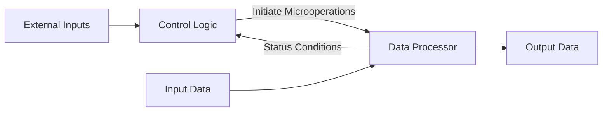
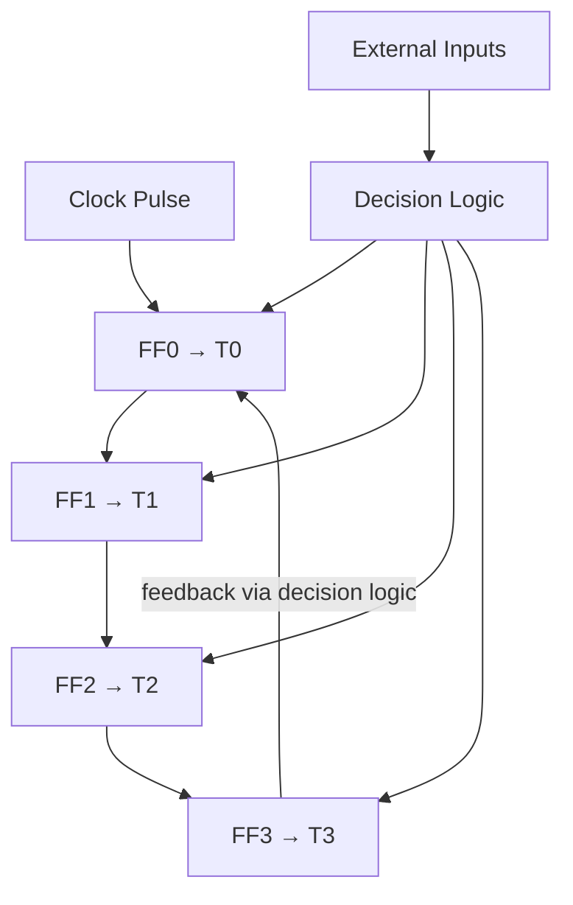
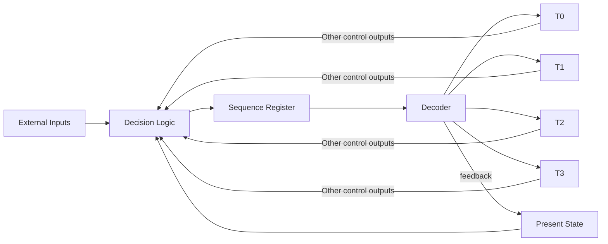
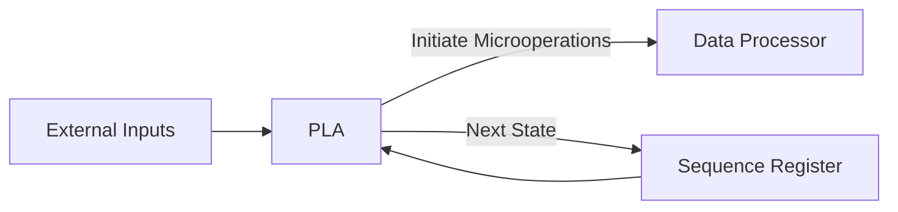
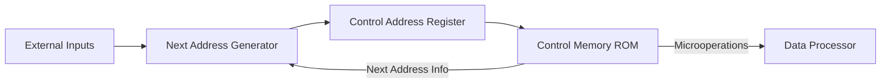
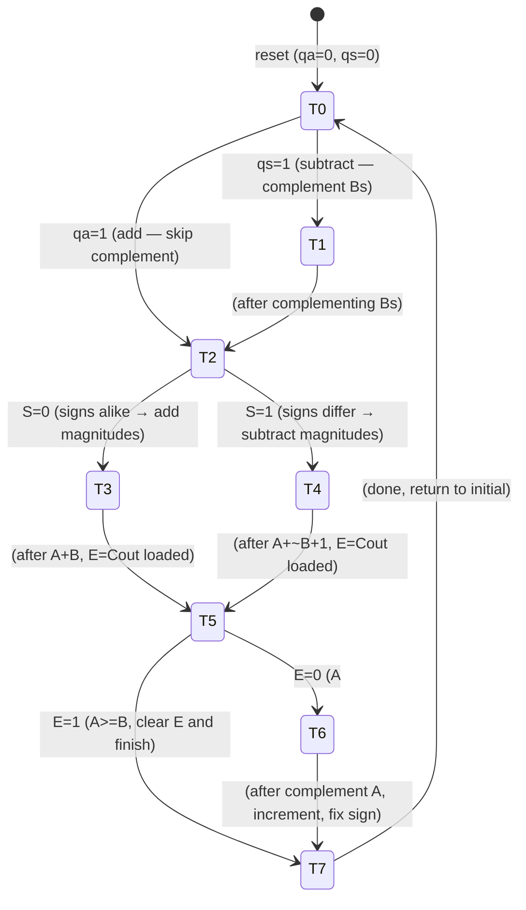
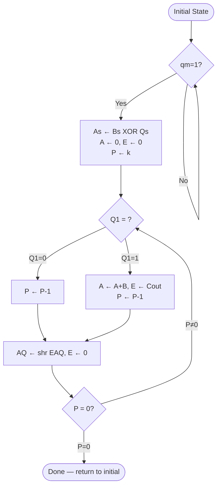
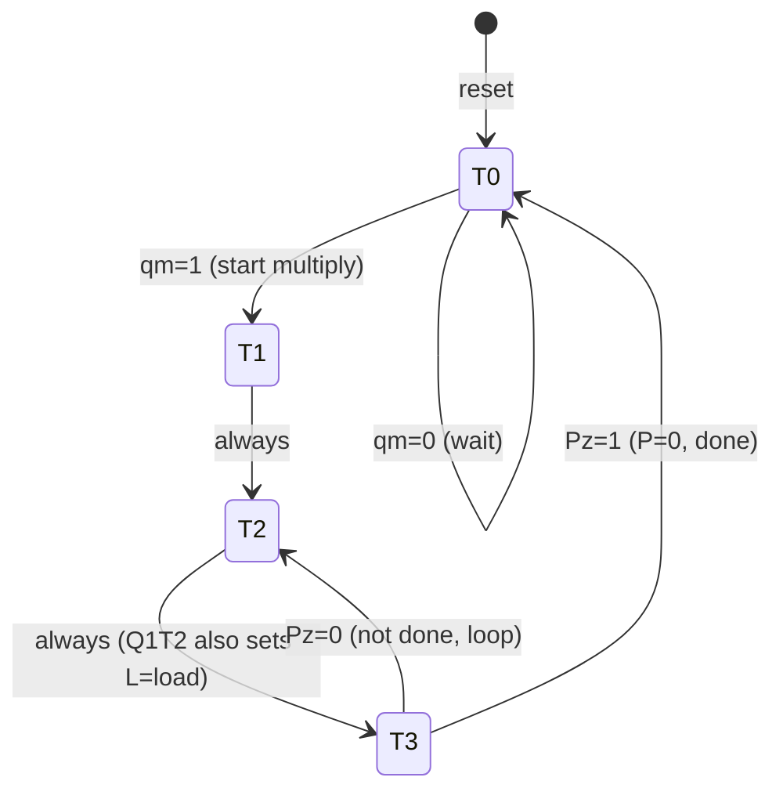
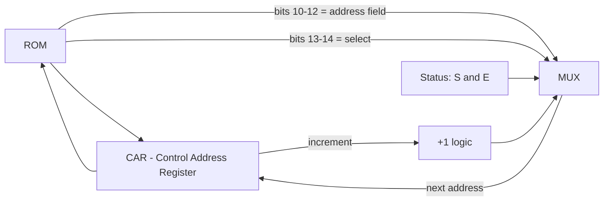

# DSD Lecture 10 — Control Logic Design

---

## 1. What is a Control Unit?

A **control unit** generates binary signals that:
- Select and enable registers in the data processor
- Sequence all microoperations
- Determine the next state of itself

Its internal state changes based on external inputs and status conditions fed back from the data processor.



---

## 2. Control Organization Methods

| Method | Hardware | Modifiable? |
|---|---|---|
| One flip-flop per state | SSI/MSI (hard-wired) | No — rewire needed |
| Sequence register + decoder | SSI/MSI (hard-wired) | No — rewire needed |
| PLA control | LSI (programmable) | Yes — replace ROM |
| Microprogram control | LSI (ROM) | Yes — replace ROM |

---

## 3. One Flip-Flop per State

- One D flip-flop per state; exactly one is SET at any time (like a ring counter)
- A single '1' propagates through flip-flops under decision logic
- Output signals T0, T1, T2… are directly the Q outputs
- **Advantage:** simple, less combinational logic
- **Disadvantage:** many flip-flops (12 states = 12 FF vs 4 for binary encoding)



If no external inputs exist, this simplifies to a **ring counter**.

---

## 4. Sequence Register and Decoder

- Uses **n flip-flops** to encode states in binary → 2^n states
- A decoder converts binary state to one-hot outputs T0…T(2^n - 1)
- 4 flip-flops → 4×16 decoder → 16 state outputs
- Also called **counter-decoder method** because the register can function as a counter



---

## 5. PLA Control

- Identical architecture to Sequence Register + Decoder
- BUT: decision logic + decoder are both implemented inside a single **PLA**
- Reduces IC count and wiring
- Sequence register feeds PLA; PLA outputs microoperation initiation signals AND next state



---

## 6. Microprogram Control

- Control signals stored in **ROM** as microinstructions
- Each ROM word = one microinstruction; a sequence = microprogram
- Control Address Register (CAR) holds current address
- Next Address Generator computes next CAR value



---

---

# Example 1 — Sign-Magnitude Adder-Subtractor (Hard-Wired, One FF per State)

## Step 1: Problem Statement

Design a circuit to add or subtract two **n-bit sign-magnitude numbers**.
Registers A and B hold signed numbers (1 sign bit + n-1 magnitude bits).
An overflow flip-flop E captures the carry out.

---

## Step 2: Equipment Configuration

```
Register layout (n bits each):
+---------+---------------------------+
|  As/Bs  |       A / B magnitude     |
|  1 bit  |          n-1 bits         |
+---------+---------------------------+

Additional:
  E   — overflow/carry flip-flop
  ALU — parallel adder (Table 9-4 from textbook)
  Control inputs to ALU: s2, s1, s0 (function select), Cin (input carry)
  Control inputs to A: L (load), y (complement Bs), z (complement As), w (clear E)
```

---

## Step 3: Algorithm — How to Decide Add or Subtract Magnitudes

Subtraction is converted to addition by complementing B's sign:

```
(±A) - (+B) = (±A) + (-B)
(±A) - (-B) = (±A) + (+B)
```

This reduces all 8 cases to 4: **(±A) + (±B)**

**Rule:**
- Same signs → add magnitudes, keep sign
- Different signs → subtract smaller from larger, sign = sign of larger

| Expression | A >= B | A < B |
|---|---|---|
| (+A)+(+B) | +(A+B) | — |
| (+A)+(-B) | +(A-B) | -(B-A) |
| (-A)+(+B) | -(A-B) | +(B-A) |
| (-A)+(-B) | -(A+B) | — |

**Implementation:** XOR As and Bs to get sign flag S.
- S = 0 → signs alike → add
- S = 1 → signs unlike → subtract (use 2's complement: A + ~B + 1)

---

## Step 4: Flowchart

```mermaid

flowchart TD
    START([Initial State x=1]) --> INIT_CHECK{qs=1?}
    INIT_CHECK -->|Yes| COMP_BS["Bs ← ~Bs (complement B sign)"]
    COMP_BS --> SIGN_CHECK
    INIT_CHECK -->|No, qa=1| SIGN_CHECK

    SIGN_CHECK{As == Bs?\nS = As XOR Bs} -->|S=0 same sign| ADD["A ← A+B, E ← Cout"]
    SIGN_CHECK -->|S=1 diff sign| SUB["A ← A+~B+1, E ← Cout"]

    ADD --> E_CHECK1{E=1?}
    E_CHECK1 -->|No, A>=B| CLEAR_E["E ← 0"]
    E_CHECK1 -->|Yes, overflow| DONE

    SUB --> E_CHECK2{E=0?\n(means A < B)"}
    E_CHECK2 -->|E=0 → A<B| COMP_A["A ← ~A"]
    E_CHECK2 -->|E=1 → A>=B| CLEAR_E2["E ← 0"]
    COMP_A --> INC_A["A ← A+1, As ← ~As"]
    INC_A --> DONE([x=1 Terminate])
    CLEAR_E --> DONE
    CLEAR_E2 --> DONE
```

---

## Step 5: Control State Diagram

8 states: T0 through T7



**Key note:** At T4, `E ← Cout` is registered only after the clock pulse, so E is checked at **T5**, not T4.

---

## Step 6: Microoperation Table

| State | Operation | x | s2 | s1 | s0 | Cin | L | y | z | w |
|---|---|---|---|---|---|---|---|---|---|---|
| T0 | Initial state x=1 | 1 | 0 | 0 | 0 | 0 | 0 | 0 | 0 | 0 |
| T1 | Bs ← ~Bs | 0 | 0 | 0 | 0 | 0 | 0 | 1 | 0 | 0 |
| T2 | nothing | 0 | 0 | 0 | 0 | 0 | 0 | 0 | 0 | 0 |
| T3 | A←A+B, E←Cout | 0 | 0 | 0 | 1 | 0 | 1 | 0 | 0 | 0 |
| T4 | A←A+~B+1, E←Cout | 0 | 0 | 1 | 0 | 1 | 1 | 0 | 0 | 0 |
| T5 | E←0 | 0 | 0 | 0 | 0 | 0 | 0 | 0 | 0 | 1 |
| T6 | A←~A | 0 | 1 | 1 | 1 | 0 | 1 | 0 | 0 | 0 |
| T7 | A←A+1, As←~As | 0 | 0 | 0 | 0 | 1 | 1 | 0 | 1 | 0 |

**Control output signal meanings:**
- `x` — initial state flag (terminates operation)
- `s2,s1,s0` — ALU function select
- `Cin` — carry input to ALU
- `L` — load A and E from ALU output
- `y` — complement Bs
- `z` — complement As
- `w` — clear E

---

## Step 7: Boolean Functions (Table 10-1)

**Flip-flop input (D) functions:**

```
DT0 = qa'qs'T0 + T3 + E·T5 + T7
DT1 = qs·T0
DT2 = qa·T0 + T1
DT3 = S'·T2
DT4 = S·T2
DT5 = T4
DT6 = E'·T5
DT7 = T6
```

**Output control functions:**

```
x    = T0
s2   = T6
s1   = T4 + T6
s0   = T3 + T6
Cin  = T4 + T7
L    = T3 + T4 + T6 + T7
y    = T1
z    = T7
w    = T5
```

**How to read these:**
- `DT0 = qa'qs'T0 + T3 + E·T5 + T7` means: flip-flop T0 gets SET when currently in T0 with no qa/qs input (idle loop), OR after T3 completes (add done), OR at T5 when E=1 (no complement needed), OR after T7 (increment done).
- `s2 = T6` means mode-select bit s2 is high only during state T6 (complement operation uses s2=1).

---

---

# Example 2 — Sign-Magnitude Binary Multiplier (Sequence Register + Decoder + PLA)

## Step 1: Problem Statement

Multiply two n-bit sign-magnitude numbers using the **add-and-shift** method:

```
For each bit of multiplier Q (LSB first):
  if Q1 == 1:  A ← A + B  (add multiplicand to partial product)
               E ← Cout
  P ← P - 1   (decrement bit counter)
  AQ ← shr EAQ, E ← 0   (arithmetic right shift)
Repeat until P = 0
```

**Worked example (23 x 19):**

```
Multiplicand B = 10111  (23)
Multiplier   Q = 10011  (19)

Bit 1 (Q1=1): copy B         →  10111
              shift right     →  010111
Bit 2 (Q1=1): add B+partial  →  10111 + 010111 = 1000110... → 1000101
              shift right     →  01000101
Bit 3 (Q1=0): shift only     →  001000101
Bit 4 (Q1=0): shift only     →  0001000101
Bit 5 (Q1=1): add + shift    →  final → 0110110101

Product = 437 = 110110101
```

---

## Step 2: Equipment Configuration

```
Bs  — sign of multiplicand
B   — magnitude of multiplicand (n-1 bits)
Qs  — sign of multiplier
Q   — magnitude of multiplier (n-1 bits), Q1 = LSB
As  — sign of product
A   — partial product accumulator (n-1 bits)
E   — overflow/carry bit
P   — counter, loaded with k = number of multiplier bits
```

Sign of product: `As = Bs XOR Qs` (product is negative iff signs differ)

**Composite register EAQ** is shifted right as a unit each cycle.

---

## Step 3: Algorithm Flowchart



---

## Step 4: Control State Diagram (4 states only)



**State operations:**
- **T0:** Initial state — wait for `qm=1`
- **T1:** `As ← Bs XOR Qs`, `A ← 0`, `E ← 0`, `P ← k`
- **T2:** If `Q1=1`: `A ← A+B`, `E ← Cout`, `L=1` (load); `P ← P-1`
- **T3:** `AQ ← shr EAQ`, `E ← 0`; check P: if `Pz=1` go to T0, else back to T2

**Flag definitions:**
- `qm` — multiply start signal
- `Pz = 1` if P = 0 (counter done)
- `Q1` — LSB of multiplier register

---

## Step 5a: Hard-Wired Control with JK Flip-Flops

Using sequence register (G2, G1) + 2×4 decoder:

**State encoding:**

| State | G2 | G1 |
|---|---|---|
| T0 | 0 | 0 |
| T1 | 0 | 1 |
| T2 | 1 | 0 |
| T3 | 1 | 1 |

**Excitation table (JK FF transitions):**

| State | Inputs | Next State | JG2 | KG2 | JG1 | KG1 |
|---|---|---|---|---|---|---|
| T0 (00) | qm=0, Pz=X | T0 (00) | 0 | X | 0 | X |
| T0 (00) | qm=1, Pz=X | T1 (01) | 0 | X | 1 | X |
| T1 (01) | X, X | T2 (10) | 1 | X | X | 1 |
| T2 (10) | X, Pz=X | T3 (11) | X | 0 | 1 | X |
| T3 (11) | X, Pz=0 | T2 (10) | X | 0 | X | 1 |
| T3 (11) | X, Pz=1 | T0 (00) | X | 1 | X | 1 |

**Resulting flip-flop input equations:**

```
JG2 = T1
KG2 = T3·Pz

JG1 = T0·qm + T2
KG1 = 1
```

**Logic diagram:**
- G2: J=T1, K=AND(T3, Pz)
- G1: J=OR(AND(T0,qm), T2), K=1 (always resets)
- Decoder output: 2×4 decoder on (G2, G1) → T0, T1, T2, T3
- L (load sum) = AND(Q1, T2)

---

## Step 5b: PLA Control

The PLA replaces the decoder + decision logic entirely.

**State table inputs:** G2, G1, qm, Pz, Q1
**State table outputs:** T0, T1, T2, T3, L (load)
**PLA program table (7 product terms):**

| Term | G2 | G1 | qm | Pz | Q1 | T0 | T1 | T2 | L | T3 |
|---|---|---|---|---|---|---|---|---|---|---|
| 1 | 0 | 0 | 0 | — | — | 1 | 0 | 0 | 0 | 0 |
| 2 | 0 | 0 | 1 | — | — | 1 | 0 | 0 | 0 | 0 |
| 3 | 0 | 1 | — | — | — | 0 | 1 | 0 | 0 | 0 |
| 4 | 1 | 0 | — | — | 0 | 0 | 0 | 1 | 0 | 0 |
| 5 | 1 | 0 | — | — | 1 | 0 | 0 | 1 | 1 | 0 |
| 6 | 1 | 1 | — | 0 | — | 0 | 0 | 0 | 0 | 1 |
| 7 | 1 | 1 | — | 1 | — | 0 | 0 | 0 | 0 | 1 |

**Reading the PLA table:**
- Each row is one AND gate (product term) in the PLA
- `—` = don't care (input not connected to that AND gate)
- A `1` in the output section means that product term drives that output OR gate
- Term 5: when in T2 AND Q1=1 → assert T2=1 AND L=1 (load the sum)

---

---

# Example 1 — Microprogram Control Version

The same adder-subtractor from Example 1 is now implemented using microprogram control (ROM-based).

## ROM Structure

8 microinstructions (addresses 0–7), each 14 bits wide:

| Bit | 1 | 2 | 3 | 4 | 5 | 6 | 7 | 8 | 9 | 10–12 | 13–14 |
|---|---|---|---|---|---|---|---|---|---|---|---|
| Field | x | s2 | s1 | s0 | Cin | L | y | z | w | Address | Select |

**Select bits (13,14) control CAR (Control Address Register):**

| Bit 13 | Bit 14 | CAR action |
|---|---|---|
| 0 | 0 | Increment (sequential) |
| 0 | 1 | Load external address |
| 1 | 0 | Load if S=1, else increment |
| 1 | 1 | Load if E=1, else increment |

## Symbolic Microprogram (Table 10-2)

| ROM Addr | Microinstruction | Comment |
|---|---|---|
| 0 | x=1; if qs=1 goto 1; if qa=1 goto 2; if (qs∧qa=0) goto 0 | Initial: load external addr |
| 1 | Bs ← ~Bs | qs=1, start subtraction |
| 2 | if S=1 goto 4 | qa=1, start addition |
| 3 | A←A+B, E←Cout; goto 0 | Add magnitudes and return |
| 4 | A←A+~B+1, E←Cout | Subtract magnitudes |
| 5 | if E=1 goto 0; E←0 | Operation terminates if E=1 |
| 6 | A←~A | E=0, complement A |
| 7 | A←A+1, As←~As; goto 0 | Done, return to address 0 |

## Binary Microprogram (Table 10-3 — partial key rows)

| ROM Addr | x | s2 | s1 | s0 | Cin | L | y | z | w | Addr[10:12] | Sel[13:14] |
|---|---|---|---|---|---|---|---|---|---|---|---|
| 0 (000) | 1 | 0 | 0 | 0 | 0 | 0 | 0 | 0 | 0 | 000 | 01 |
| 1 (001) | 0 | 0 | 0 | 0 | 0 | 0 | 1 | 0 | 0 | 010 | 01 |
| 2 (010) | 0 | 0 | 0 | 0 | 0 | 0 | 0 | 0 | 0 | 100 | 10 |
| 3 (011) | 0 | 0 | 0 | 1 | 0 | 1 | 0 | 0 | 0 | 000 | 01 |
| 4 (100) | 0 | 0 | 1 | 0 | 1 | 1 | 0 | 0 | 0 | 101 | 01 |
| 5 (101) | 0 | 0 | 0 | 0 | 0 | 0 | 0 | 0 | 1 | 000 | 11 |
| 6 (110) | 0 | 1 | 1 | 1 | 0 | 1 | 0 | 0 | 0 | 111 | 01 |
| 7 (111) | 0 | 0 | 0 | 0 | 1 | 1 | 0 | 1 | 0 | 000 | 01 |

## MUX in CAR Hardware

The hardware uses a MUX to select the CAR input source:



The 4 MUX select conditions (sel 13,14):
- `00` → CAR+1 (sequential)
- `01` → load address from ROM bits 10-12 (jump)
- `10` → load if S=1, else CAR+1 (branch on sign)
- `11` → load if E=1, else CAR+1 (branch on carry)

---

## Quick Comparison: Hard-Wired vs Microprogram

| Feature | Hard-Wired | Microprogram |
|---|---|---|
| Speed | Fast | Slower (ROM access) |
| Flexibility | None (rewire to change) | High (replace ROM) |
| Design effort | High (Boolean minimization) | Lower (write microprogram) |
| Hardware | SSI/MSI flip-flops + gates | ROM + CAR + MUX |
| Use case | High-performance fixed logic | Complex/changeable ISA |
