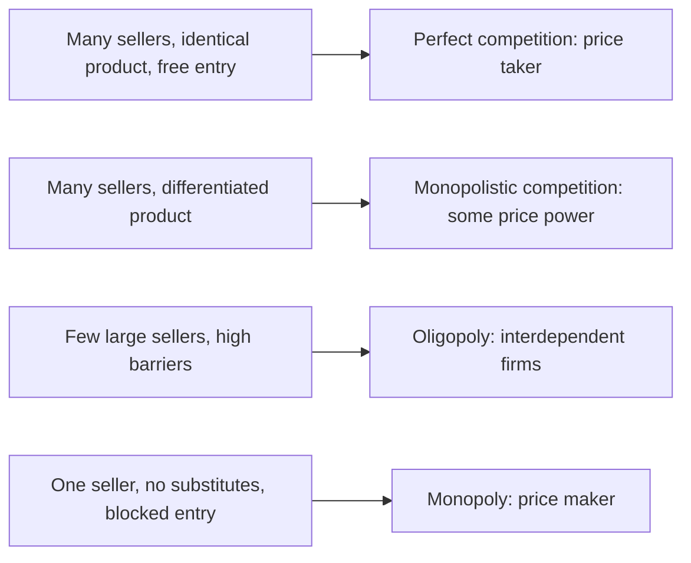
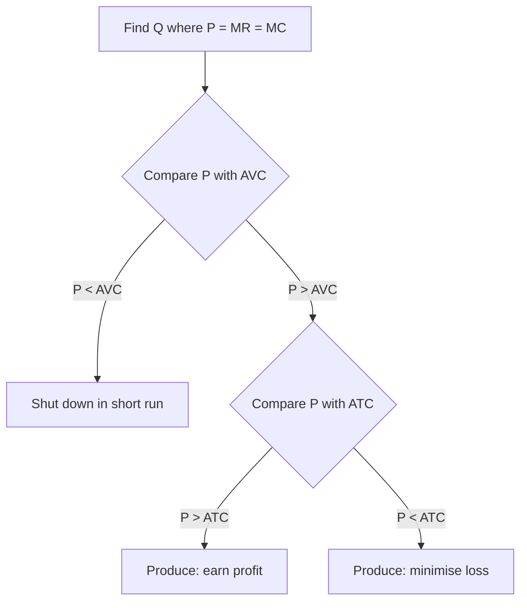
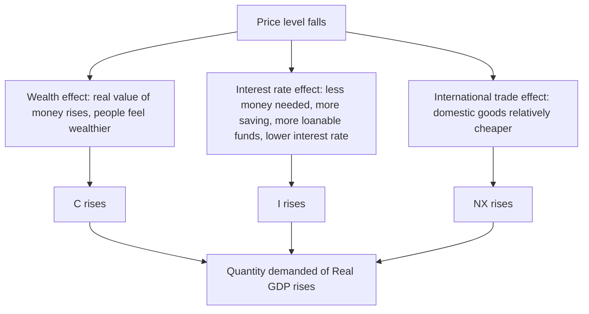

# Economics Exam Notes

Everything below is taken only from the five files you uploaded (notes prepared by Zaheen Ibnat Lamia). Diagrams are redrawn from the slide figures and are saved in the `attachments` folder, so keep that folder next to this file in your vault.

> [!warning] Coverage check against your syllabus list
> Some topics on your list are **not in the uploaded files**. I did not invent them.
>
> | Syllabus item | Status in your files |
> |---|---|
> | 1. Elasticity (price / income, mid-point formula) | Not in the files |
> | 2. Theory of Production, PPF | Covered (section 2) |
> | 3. Cost of Production, average-marginal rule | Covered (section 3). CGPA math is not in the slides; see the flagged analogy in 3.6 |
> | 4. Perfect competition math, MR, MC | Covered (section 4) |
> | 5. Money inflation | Not in the files |
> | 6. GDP | Only one line appears: `Y = C + I + G + NX` (section 7.2). What GDP does or does not capture is not in the files |
> | 7. International trade | Covered (section 5) |
> | 8. SRAS, inflationary and recessionary graphs | Covered (section 6) |
> | 9. Monetary and fiscal policy | Not in the files |
>
> For the missing topics, upload those slides or ask me and I will do them separately.

## Table of contents

1. [[#1. Elasticity (not in files)]]
2. [[#2. Theory of Production and PPF]]
3. [[#3. Cost of Production]]
4. [[#4. Market Structure, Perfect Competition and Monopoly]]
5. [[#5. International Trade]]
6. [[#6. Aggregate Demand and Aggregate Supply]]
7. [[#7. Money, GDP, Monetary and Fiscal Policy]]
8. [[#8. Last-night formula sheet]]

---

## 1. Elasticity (not in files)

None of the five uploaded files covers elasticity. The only related fact is that a perfectly competitive firm faces a **horizontal (perfectly elastic) demand curve** (see 4.2). Upload the elasticity slide to get this section.

---

## 2. Theory of Production and PPF

### 2.1 Production function, inputs, outputs

- **Production function**: the relationship between the amount of input required and the amount of output that can be obtained.
- **Inputs**: commodities or services used to produce goods and services.
- **Outputs**: the useful goods or services that result from production and are either consumed or used in further production.

### 2.2 Total, marginal and average product

| Term | Meaning | Formula |
|---|---|---|
| Total physical product (TP) | Total output produced, in physical units | Q |
| Marginal product (MP) | Extra output from 1 additional unit of an input, other inputs constant | MPL = ΔQ / ΔL |
| Average product (AP) | Total output divided by total units of a specific input | APL = Q / L |

Q is output, L is labor input.

### 2.3 Law of diminishing marginal returns

Beyond a certain point, a firm gets less and less extra output when it adds additional units of an input while other inputs are held fixed. In other words, the **marginal product of each unit of input declines** as the amount of that input increases, holding all other inputs constant.

This law is the reason TVC becomes steeper and MC rises later (see 3.5).

### 2.4 Factors of production

| Factor (input / resource) | Meaning | Return |
|---|---|---|
| Land | All natural resources | Rent |
| Labor | Physical and mental talents | Wage |
| Capital | Already produced goods | Interest |
| Entrepreneurship | Organising the other factors, bearing risk | Profit |

(In the slide the labels in the middle column are scrambled; the matching above is the correct pairing, following the Returns column.)

### 2.5 Production Possibilities Frontier (PPF)

**Definition.** The PPF is a graph that shows the various combinations of output that the economy can possibly produce, given the available factors of production and the available production technology.

![[attachments/01_ppf_points.png]]

**Where are the points located?**

| Point | Location | Meaning |
|---|---|---|
| C | Outside the PPF | Impossible / **unattainable** with current resources and technology |
| F, A, B, E | On the PPF | **Efficient** |
| D | Inside the PPF | **Inefficient** (resources unused or wasted) |

Exam sentence: *"A point outside the PPF is unattainable because the economy does not have enough resources or technology to produce that combination."*

Numbers on the slide graph: PPF intercepts are 3,000 computers and 1,000 cars. A = (600 cars, 2,200 computers), B = (700 cars, 2,000 computers), D = (300 cars, 1,000 computers).

### 2.6 Opportunity cost and the bowed-out shape

**Opportunity cost = What we give up / What we get.**

From A to B: we give up 2,200 − 2,000 = 200 computers to get 700 − 600 = 100 more cars.

OCcars = 200 / 100 = **2 computers** per car.

![[attachments/02_ppf_opportunity_cost.png]]

**Why is the PPF bowed outward?** Because of **increasing opportunity cost**: the slope (ΔY/ΔX) keeps increasing, and the slope *is* the opportunity cost.

### 2.7 Economic growth, balanced vs unbalanced

- Economic growth = increased productive capability of an economy = **outward shift of the PPF**.
- Two major causes: (1) an increase in the quantity of resources, (2) an advance in technology.
- **Balanced growth**: a proportional outward shift of the entire curve; the potential to produce *all goods* rises equally.
- **Unbalanced growth**: if technology allows only *one good* to be produced in greater quantity with the same resources, the PPF **rotates outward**.

![[attachments/03_ppf_growth.png]]

---

## 3. Cost of Production

### 3.1 Revenue, cost and profit

There are two sides to every firm: a **revenue side** and a **cost side**. The firm's objective is to maximise profit.

- Profit = Total Revenue − Total Cost
- Profit-maximising condition: **MR = MC**
- Total Revenue (TR) = Price (P) × Quantity (Q)

Slide example (Xiaomi assembly plant, Gazipur): P = 15,000 BDT, Q = 10,000 units, so TR = 15,000 × 10,000 = 150,000,000 BDT (15 crore BDT).

### 3.2 Explicit vs implicit cost, accounting vs economic profit

- **Explicit cost**: incurred when an actual monetary payment is made.
- **Implicit cost**: value of resources used in production for which no monetary payment is made (resources the owner already owns or contributes).
- **Accounting profit** = TR − explicit cost
- **Economic profit** = TR − (explicit + implicit cost)
- Economic profit is usually lower, **never higher**, than accounting profit.

**Rakib's cookie example (full math)**

| Item | BDT |
|---|---|
| Revenue: 800 boxes × 100 | 80,000 |
| Ingredients | 40,000 |
| Packaging and boxes | 5,000 |
| Electricity | 5,000 |
| **Explicit costs** | **50,000** |
| Implicit cost (lost tutoring income) | 5,000 |
| **Accounting profit** = 80,000 − 50,000 | **30,000** |
| **Economic profit** = 80,000 − (50,000 + 5,000) | **25,000** |

### 3.3 Measures of cost

| Measure | Definition | Formula |
|---|---|---|
| Fixed cost (FC) | Does not vary with output; incurred even at zero output | |
| Variable cost (VC) | Varies with output | |
| Total cost (TC) | Sum of fixed and variable | TC = FC + VC |
| Average fixed cost (AFC) | | FC / Q |
| Average variable cost (AVC) | | VC / Q |
| Average total cost (ATC or AC) | Also called unit cost | TC / Q = AFC + AVC |
| Marginal cost (MC) | Extra TC from one extra unit | ΔTC / ΔQ |

Slide examples: fixed costs of a software startup are office rent, developer workstations, cyber insurance, patent licences. Variable costs are cloud resources, API usage, electricity, freelance developer wages.

ATC tells the cost of a typical unit if total cost is spread evenly. MC tells the increase in total cost from producing one more unit.

### 3.4 The cost table (used for all the curves)

| Q | TFC | AFC | TVC | AVC | TC | ATC | MC |
|---|---|---|---|---|---|---|---|
| 0 | 100 | – | 0 | – | 100 | – | – |
| 1 | 100 | 100 | 50 | 50 | 150 | 150 | 50 |
| 2 | 100 | 50 | 80 | 40 | 180 | 90 | 30 |
| 3 | 100 | 33.33 | 100 | 33.33 | 200 | 66.67 | 20 |
| 4 | 100 | 25 | 110 | 27.50 | 210 | 52.50 | 10 |
| 5 | 100 | 20 | 130 | 26 | 230 | 46 | 20 |
| 6 | 100 | 16.67 | 160 | 26.67 | 260 | 43.33 | 30 |
| 7 | 100 | 14.28 | 200 | 28.57 | 300 | 42.86 | 40 |
| 8 | 100 | 12.50 | 250 | 31.25 | 350 | 43.75 | 50 |
| 9 | 100 | 11.11 | 310 | 34.44 | 410 | 45.56 | 60 |
| 10 | 100 | 10 | 380 | 38 | 480 | 48 | 70 |

How to compute any row (example Q = 4): AFC = 100/4 = 25; AVC = 110/4 = 27.5; TC = 100 + 110 = 210; ATC = 210/4 = 52.5; MC = 210 − 200 = 10.

### 3.5 Shapes of the cost curves and why

![[attachments/09_cost_curves_panels.png]]

| Curve | Shape | Reason |
|---|---|---|
| TFC | Horizontal line (at 100) | Does not change with quantity |
| AFC | Falls continuously: sharply at first, then slowly | Constant TFC is spread over more units |
| TVC | Upward sloping, **inverted S** | Early: rises at a decreasing rate (better use of labor and machinery). Later: rises at an increasing rate as workers and machines become overused (**law of diminishing marginal returns**) |
| AVC | Falls then rises | Initial slow rise of TVC makes AVC fall; later rapid rise of TVC makes AVC rise |
| TC | Starts at 100, same shape as TVC | TC = TFC + TVC; there are fixed costs even at zero output |
| ATC | **U-shaped** | AFC dominates at low output (sharp AFC drop drags ATC down). As AFC's fall slows, AVC becomes the driving force and drags ATC up. A "tug of war" between AFC and AVC |
| MC | Falls then rises | Early: an extra variable input (labor) raises output by a larger amount, so MC falls. Later: fixed inputs reach capacity, extra labor yields less additional output, so MC rises |

The bottom of the ATC U is the quantity that minimises ATC: the **efficient scale** of the firm.

### 3.6 Average-marginal rule

> [!important] Exam favourite
> - If **MC < ATC**, then ATC is **falling**.
> - If **MC > ATC**, then ATC is **rising**.
> - **MC crosses ATC at the minimum of ATC.**
> - The same relationship holds between MC and AVC.
> - There is **no such relationship** between AFC and MC.
>
> Short form: Marginal < Average gives Average down. Marginal > Average gives Average up.

![[attachments/10_average_marginal_rule.png]]

Check with the table: at Q = 4, MC = 10 < ATC = 52.5, so ATC falls from Q=3 (66.67) to Q=4 (52.5). At Q = 8, MC = 50 > ATC = 42.86 (the Q = 7 value), so ATC rises to 43.75. MC crosses ATC between Q = 7 and Q = 8, where ATC is lowest (about 42.86 to 43.75).

> [!note] CGPA analogy (not in the slides; this is just the same rule applied)
> Think of the **semester GPA as the marginal value** and **CGPA as the average**.
> - If a new semester GPA is **above** your current CGPA, your CGPA goes **up**.
> - If a new semester GPA is **below** your current CGPA, your CGPA goes **down**.
> - If it equals your CGPA, the CGPA stays the same (the "minimum point" idea).
>
> Careful: a semester being "high" is not enough in itself. It must be higher than the *current average* to pull the average up. The slides contain no numerical CGPA problem, so I have not made one up.

### 3.7 Short run, long run, LRAC, economies of scale

- **Short run**: a period during which at least one input is fixed (example: a pizza bakery cannot suddenly get a bigger building or three new ovens; it hires extra cooks and stays open later instead).
- **Long run**: a period during which all inputs can be varied (the owner leases a bigger building, installs conveyor ovens, redesigns the process).
- LRAC is a **much flatter U-shape** than SRAC.

| Term | Meaning |
|---|---|
| Economies of scale | LRAC **declines** as output increases |
| Constant returns to scale | LRAC **stays the same** as output changes (implies **replication**) |
| Diseconomies of scale | LRAC **rises** as output increases |

![[attachments/11_lrac.png]]

**Causes**
- Economies of scale: higher production allows **specialisation**; each worker gets better at a task (Ford assembly line).
- Diseconomies of scale: **coordination problems** in any large organisation; managers are stretched and less effective at keeping costs down.
- So LRAC is U-shaped: falling at low output because of increasing specialisation, rising at high output because of increasing coordination problems.

---

## 4. Market Structure, Perfect Competition and Monopoly

### 4.1 The four market structures

A market structure is a firm's environment whose characteristics influence its pricing and output decisions.

| | Perfect competition | Monopolistic competition | Oligopoly | Monopoly |
|---|---|---|---|---|
| Sellers | Many | Many | A few large firms | One |
| Product | Identical (homogeneous) | Slightly differentiated (brand, quality, features) | | No close substitutes |
| Entry | No barriers | Low barriers (biggest is reputation) | Very high (huge capital) | Blocked (patents, licences, control of resources) |
| Information | Perfect | | Firms are interdependent | |
| Price power | Price taker | Some price-making power (brand loyalty) | | Price maker |
| Bangladesh example | Local wholesale vegetable markets, loose rice, small egg farming; commoditised laptop repairs (screen, battery, SSD) | Runner and Walton motorcycles; RFL (Vision), Gazi, Walton 1HP/2HP water pumps | Telecom industry | Bangladesh Railway (state-owned utility and transport) |

### 4.2 Perfect competition: assumptions

1. Many sellers and many buyers; none is large relative to total sales or purchases, so none influences price.
2. Each firm sells a **homogeneous product**; buyers are indifferent between sellers.
3. Buyers and sellers have **all relevant information** (prices, quality, sources of supply).
4. **Easy entry and exit**; no barriers.

### 4.3 The firm is a price taker

A price taker cannot control the price of what it sells and "takes" the market equilibrium price. Its supply is tiny relative to the market. If it raised its price, buyers would buy the identical product from a competitor at the lower market price. It will not charge less because it can already sell all it wants at the market price. Therefore it faces a **horizontal (flat, perfectly elastic) demand curve**.

![[attachments/04_pc_demand_market_vs_firm.png]]

### 4.4 Revenue of a competitive firm (P = AR = MR)

- TR = P × Q
- **AR** = TR / Q = PQ / Q = **P** (true for all firms)
- **MR** = ΔTR / ΔQ = change in TR from one more unit
- For a competitive firm P is fixed, so each extra unit adds exactly P to revenue, hence **MR = P**.

> [!important]
> **Perfect competition: P = AR = MR**

Slide table (P = $6):

| Q | P | TR = P×Q | AR = TR/Q | MR = ΔTR/ΔQ |
|---|---|---|---|---|
| 1 | 6 | 6 | 6 | 6 |
| 2 | 6 | 12 | 6 | 6 |
| 3 | 6 | 18 | 6 | 6 |
| 4 | 6 | 24 | 6 | 6 |
| 5 | 6 | 30 | 6 | 6 |
| 6 | 6 | 36 | 6 | 6 |
| 7 | 6 | 42 | 6 | 6 |
| 8 | 6 | 48 | 6 | 6 |

### 4.5 Price-output decision: MR = MC

Rule: produce where **MR = MC**. For perfect competition: **P = MR = MC**.

![[attachments/05_pc_profit_max.png]]

- At **Q1**: MR > MC, so an extra unit adds more revenue than cost. Profit rises, so **increase output**.
- At **Q2**: MC > MR, so cutting one unit saves more cost than revenue lost. Profit rises, so **decrease output**.
- The firm settles at **Qmax** where the horizontal price line meets the MC curve.

### 4.6 Measuring profit and loss

Profit = TR − TC = (TR/Q − TC/Q) × Q = **(P − ATC) × Q**.

- If P > ATC: profit. The shaded rectangle has height (P − ATC) and width Q.
- If P < ATC: loss. The firm still produces where P = MC, which here **minimises the loss**. Loss = (ATC − P) × Q.

![[attachments/06_pc_profit_loss.png]]

### 4.7 To produce or not to produce (short run)

| Case | Condition | Decision |
|---|---|---|
| 1 | P > ATC (> AVC) | Continue production (profit) |
| 2 | P < AVC (< ATC) | **Shut down** in the short run |
| 3 | AVC < P < ATC | Continue production in the short run (loss, but covers variable cost) |

> [!important] One-line rule
> Compare price with **AVC**: **P > AVC continue; P < AVC shut down.**

### 4.8 Quiz-style math: MR and MC

**MR from a table.** MR = ΔTR / ΔQ.

*Perfect competition* (table in 4.4): MR is always the price, 6.

*Monopoly* (slide table, P = 11 − Q):

| Q (gallons) | P | TR | AR | MR |
|---|---|---|---|---|
| 0 | 11 | 0 | – | |
| 1 | 10 | 10 | 10 | 10 |
| 2 | 9 | 18 | 9 | 8 |
| 3 | 8 | 24 | 8 | 6 |
| 4 | 7 | 28 | 7 | 4 |
| 5 | 6 | 30 | 6 | 2 |
| 6 | 5 | 30 | 5 | 0 |
| 7 | 4 | 28 | 4 | −2 |
| 8 | 3 | 24 | 3 | −4 |

Worked check, 3rd to 4th gallon: ΔTR = 28 − 24 = 4, ΔQ = 1, so MR = 4, while price is 7. The monopolist gets the new price of 7 on the 4th gallon but loses $1 on each of the first 3 gallons (3 × $1 = $3), so MR = 7 − 3 = 4.

**MC from a table.** MC = ΔTC / ΔQ, using the cost table in 3.4. Example: Q from 5 to 6, TC 230 to 260, MC = 30.

**Illustration using the slide's cost table** (the price of 30 is my choice, only to show the steps; the slides give no such numeric question):

1. Competitive firm, P = MR = 30.
2. Find Q where MC = 30: that is **Q = 6** (MC = 30).
3. ATC at Q = 6 is 43.33, so P < ATC: a **loss**. Loss = (43.33 − 30) × 6 = 80. Check: TR = 30 × 6 = 180, TC = 260, loss = 80.
4. AVC at Q = 6 is 26.67, and P = 30 > AVC, so the firm **continues producing in the short run** (Case 3).

### 4.9 Monopoly

**Assumptions:** (1) one seller, the firm is the industry; (2) no close substitutes; (3) extremely high barriers to entry.

**Price maker / price searcher.** Whether a firm is a price taker or price searcher is determined by the demand curve it faces. A monopoly faces the **entire downward-sloping market demand curve**, so it can pick any price-quantity combination on it. No close substitutes lets it raise price without losing all sales, and high barriers stop competitors driving the price down.

**Revenue.** To sell more, the monopolist must cut the price on **all** units. Increasing sales has two effects on TR:
- **Output effect**: Q rises, tends to raise TR.
- **Price effect**: P falls, tends to lower TR.

Hence **MR < P, always (P > MR)**. The MR curve lies below the demand curve, but both start at the same point on the vertical axis (MR of the first unit equals the price).

![[attachments/07_monopoly_d_mr.png]]

**Price-output decision.**
1. Choose the quantity where **MR = MC** (point A).
2. Use the **demand curve** to find the highest price consumers will pay for that quantity (point B).
3. In monopoly, **P > MC**.

At Q1 (MC < MR) produce more; at Q2 (MC > MR) produce less.

**Monopoly profit.** Profit = (P − ATC) × Q. In the diagram this is rectangle **BCDE**: height BC (= ED) is P − ATC, width DC is Qmax.

![[attachments/08_monopoly_price_output_profit.png]]

### 4.10 Perfect competition vs monopoly in one table

| | Perfect competition | Monopoly |
|---|---|---|
| Demand curve faced | Horizontal | Downward sloping (market demand) |
| Price power | Taker | Maker / searcher |
| Relationship | P = AR = MR | P > MR |
| Profit-max rule | MR = MC (so P = MC) | MR = MC, then read price off demand (P > MC) |

---

## 5. International Trade

### 5.1 Why countries trade

Countries have different resources, technologies and natural endowments, so each is more efficient at producing certain goods. By trading, nations get a wider variety of products at lower cost, raising efficiency and living standards.

### 5.2 Comparative vs absolute advantage

- **Comparative advantage**: the advantage a country has when it can produce a good at a **lower opportunity cost** than another country.
- **Absolute advantage**: the ability to produce a higher total quantity of a good with the same or fewer resources.
- Even if one nation has an absolute advantage in everything, trade is still mutually beneficial as long as **opportunity costs differ**.
- Countries then **specialise** where they have comparative advantage, which can give **economies of scale** and maximise global output.

**Slide numerical example.** Opportunity cost = what we give up / what we get.

| Country | Cloth | Computers | OC of cloth | OC of computer |
|---|---|---|---|---|
| Nation A | 1,000 | 1,000 | 1 | 1 |
| Nation B | 2,000 | 4,000 | 2 | 0.5 |

- Absolute advantage: **B in both goods** (2,000 > 1,000 cloth; 4,000 > 1,000 computers).
- Comparative advantage: **A in cloth** (OC 1 computer < B's 2 computers). **B in computers** (OC 0.5 cloth < A's 1 cloth).
- So A should specialise in cloth, B in computers.

### 5.3 Terms of trade

Terms of trade (ToT) measures a country's export prices relative to its import prices.

**ToT = (Export Price Index / Import Price Index) × 100**

### 5.4 Equilibrium without trade; consumer and producer surplus

With no trade (imports and exports banned), the textile market has only domestic buyers and sellers and the domestic price balances domestic supply and demand.

- **Consumers' surplus** = Maximum buying price − Price paid. Area **under the demand curve and above the price**.
- **Producers' surplus** = Price received − Minimum selling price. Area **above the supply curve and under the price**.
- Total surplus = CS + PS = total benefits to buyers and sellers.

### 5.5 World price and comparative advantage

World price (Pw) = the price prevailing in world markets.

- **Pw > Pe (domestic equilibrium price): country EXPORTS.**
- **Pw < Pe: country IMPORTS.**

Why: the domestic price reflects opportunity cost. A low domestic price means a low cost of producing textiles, so the country has a comparative advantage in textiles. A high domestic price means foreign countries have the advantage.

### 5.6 Welfare effects of trade (small open economy)

Small economy assumption: its trade policy does not affect the world price; it is a price taker in the world economy. Once trade is allowed, the domestic price becomes the world price.

#### Exporting country (Pw > Pe)

Domestic price **rises** to Pw. Quantity supplied exceeds quantity demanded; the excess is exported.

![[attachments/12_trade_exporter.png]]

| | Before trade | After trade | Change |
|---|---|---|---|
| Consumer surplus | A + B | A | −B |
| Producer surplus | C | B + C + D | +(B + D) |
| Total surplus | A + B + C | A + B + C + D | **+D** |

- Producers are **better off**, consumers are **worse off**.
- Gains of winners exceed losses of losers by **area D**: trade raises national economic well-being.

#### Importing country (Pw < Pe)

Domestic price **falls** to Pw. Quantity demanded exceeds quantity supplied; the difference is imported.

![[attachments/13_trade_importer.png]]

| | Before trade | After trade | Change |
|---|---|---|---|
| Consumer surplus | A | A + B + D | +(B + D) |
| Producer surplus | B + C | C | −B |
| Total surplus | A + B + C | A + B + C + D | **+D** |

- Consumers are **better off**, producers are **worse off**.
- Gains of buyers exceed losses of sellers by **area D**: total surplus rises.

### 5.7 Trade restrictions: the tariff

- **Protectionism**: government policies (tariffs, quotas) that limit imports and shield domestic industries from foreign competition.
- **Tariff** (duty or tax): a tax on imported goods. Types: **specific** (fixed amount per unit) and **ad valorem** (percentage of value).
- **Quota**: a physical limit on the quantity of a good that can be imported in a period.

A tariff matters only if the nation is an **importer**. Under free trade, domestic price = Pw. With a tariff t, **Pt = Pw + t**. Domestic sellers can charge the world price plus the tariff, so the price of both imported and domestic textiles rises, moving closer to the no-trade price.

Effects: quantity demanded falls from Q1D to Q2D; quantity supplied rises from Q1S to Q2S; imports fall.

![[attachments/14_tariff.png]]

| | Before tariff | After tariff | Change |
|---|---|---|---|
| Consumer surplus | A+B+C+D+E+F | A + B | −(C+D+E+F) |
| Producer surplus | G | C + G | +C |
| Government revenue | None | E | +E |
| Total surplus | A+B+C+D+E+F+G | A+B+C+E+G | **−(D + F)** |

- Government revenue = after-tariff imports × tariff = area E.
- **Deadweight loss = D + F.**
  - **D** = deadweight loss from **overproduction** (domestic producers expand from Q1S to Q2S).
  - **F** = deadweight loss from **underconsumption** (consumers cut back from Q1D to Q2D).

### 5.8 Arguments for restricting trade, and the economist's response

| Argument | What protectionists say | Response given in the slides |
|---|---|---|
| **Jobs** | Trade destroys domestic jobs; when cheaper imports lower the price, domestic output and employment fall | Free trade creates jobs at the same time it destroys them. Buying foreign products gives partners resources to buy our exports, shifting workers into industries with comparative advantage and raising living standards despite short-term hardship |
| **National security** | Vital industries (e.g. defence materials) should be protected to avoid dependence on foreign suppliers | Can be appropriate when concerns are legitimate, but beware: producers exaggerate their role in defence to gain protection. Be wary when the claim comes from industry rather than the defence establishment |
| **Infant industry** | New industries need temporary protection to mature and compete later | Economists are sceptical: hard to implement. Government must pick which industries will become profitable and whether benefits exceed the cost to consumers. Politically powerful industries get protected, and the "temporary" policy is hard to remove |
| **Unfair competition** | Free trade is desirable only if all play by the same rules (e.g. a foreign government subsidises its textile industry with tax breaks) | (Presented as the argument; no counterargument is given in the slide) |
| **Bargaining chip** | The threat of a trade restriction can force a trading partner to remove its own restriction | The threat may not work. Then the country must either carry it out (hurting its own welfare) or back down (losing prestige) |

**When should trade be protected?** From the slides: when there are **legitimate national-security concerns**, and (with scepticism) for infant industries or unfair foreign subsidies. Economists generally doubt these cases because of the dead-weight loss and political abuse.

### 5.9 Bangladesh trade agreements (from the slides)

Context: Bangladesh is preparing for **LDC graduation in late 2026** and is shifting its trade strategy to avoid high tariffs abroad afterwards.

| Agreement | Key points |
|---|---|
| **Import Policy Order (2026–2029)** | Removes mandatory Letter of Credit (LC) for standard commercial imports; trade possible via purchase/sales contracts without value ceilings; sets up Free Trade Zones and Central Bonded Warehouses to boost re-exporting logistics |
| **Bangladesh-Bhutan PTA** | "Positive List" of duty-free goods: 100 Bangladeshi products (e.g. garments, fruit juices) and 34 Bhutanese products (e.g. ginger, boulders) |
| **SAFTA** | South Asian Free Trade Area among SAARC members; regional FTA; customs duties cut to 0%–5% for almost all products |
| **APTA** | Asia-Pacific Trade Agreement; members give each other discounts on existing taxes on thousands of items; lets many Bangladeshi raw materials enter Chinese and Korean markets at lower cost |
| **Japan-Bangladesh EPA** | Deeper than a trade deal: drops taxes on goods like cars and textiles and also covers investment, services and e-commerce rules |
| **US-Bangladesh Agreement on Reciprocal Trade (ART)** | Signed 9 February 2026. US reciprocal tariff on Bangladeshi goods set at **19%** (down from a proposed 37%); **0%** for qualifying apparel made from US cotton and man-made fibres; Bangladesh eases access for US products such as LNG, machinery, soy, dairy |

---

## 6. Aggregate Demand and Aggregate Supply

The AD-AS model focuses on two variables: **real GDP** (output) and the **average price level**. It has three parts: **AD**, **SRAS**, **LRAS**.

### 6.1 Aggregate demand (AD)

- AD = quantity demanded of all goods and services (Real GDP) at different price levels, ceteris paribus.
- The AD curve shows the quantity of goods and services that households, firms, the government and customers abroad want to buy at each price level. It is **downward sloping**: a fall in the price level (P1 to P2) raises the quantity demanded (Y1 to Y2).

![[attachments/15_ad_curve.png]]

### 6.2 Why AD slopes downward

GDP identity: **Y = C + I + G + NX** (consumption + investment + government purchases + net exports).

| Effect | Chain (price level falls) |
|---|---|
| **Wealth (real balance) effect** | P down, real wealth up, C up, Y up. (A rise in P does the reverse: money buys less, consumers feel poorer, spend less) |
| **Interest rate effect** | P down, households need to hold less money, savings up, loanable funds up, interest rate down, I up, Y up. (A rise in P pushes interest rates up and discourages investment) |
| **International trade effect** | P down, domestic goods relatively cheaper than foreign goods, Bangladeshis and foreigners buy more domestic goods, NX up, Y up. (A rise in P makes BD goods relatively expensive, so quantity demanded of BD Real GDP falls) |

### 6.3 Aggregate supply and the SRAS curve

- Aggregate supply = quantity supplied of all goods and services (Real GDP) at various price levels, ceteris paribus. It includes SRAS and LRAS.
- **SRAS is upward sloping**: a fall in the price level from P1 to P2 reduces the quantity supplied from Y1 to Y2. This positive relationship is due to **sticky wages, sticky prices, or misperceptions**, and is only **temporary** because wages, prices and perceptions adjust over time.

![[attachments/16_sras_lras.png]]

### 6.4 Why is the SRAS curve upward sloping? (three theories)

**1. Sticky wage theory.** Wages are inflexible, e.g. locked in by multi-year labor contracts. Firms pay nominal wages but hire based on **real wage = nominal wage / price level**.

P down, nominal wage sticky, real wage up, firms hire fewer workers, quantity supplied of Real GDP (Y) down.

**2. Sticky price theory.** Prices of some goods adjust slowly because of **menu costs** (costs of changing prices). Some firms do not cut prices immediately, so their prices are too high.

P down, some firms' prices stay the same due to menu costs, their sales fall, production falls, Y down.

**3. Misperceptions theory.** If overall prices and nominal wages fall proportionally, the real wage is unchanged, but workers notice only their nominal pay cut and mistakenly think the real wage has fallen.

Nominal wages and P fall by an equal percentage, real wage constant, but workers think it fell, so they reduce labor supply, output falls, Y down.

### 6.5 LRAS and natural real GDP

- **LRAS**: output the economy produces when wages and prices have adjusted to final equilibrium levels and workers have no relevant misperceptions.
- It is a **vertical line at Natural Real GDP (YN)**.
- **Natural Real GDP (natural rate of output)** = the Real GDP produced at the **natural unemployment rate**; production the economy achieves in the long run when unemployment is at its normal rate.
- In the long run, output depends on quantities of labor, capital and natural resources and on technology. It does **not** depend on the overall price level, hence vertical.

### 6.6 Short-run equilibrium, long-run equilibrium, disequilibrium

![[attachments/17_sr_lr_equilibrium.png]]

- **Short-run equilibrium**: AD meets SRAS. Quantity supplied equals quantity demanded at Q1.
- **Long-run equilibrium**: economy produces **QN** (Natural Real GDP).
- **Disequilibrium**: the state while the economy moves from one short-run equilibrium to another, or from short-run to long-run equilibrium. Quantity supplied and demanded of Real GDP are **not equal**.
- Difference between SR and LR equilibrium: in long-run equilibrium output equals Natural Real GDP; in short-run equilibrium it is either more or less than Natural Real GDP.

### 6.7 Recessionary and inflationary gap

![[attachments/18_recessionary_inflationary_gap.png]]

| | Recessionary gap (panel a) | Inflationary gap (panel b) |
|---|---|---|
| Real GDP vs Natural Real GDP | Real GDP **less than** Natural (Q1 < QN) | Real GDP **greater than** Natural (Q1 > QN) |
| Unemployment rate | **Greater than** natural unemployment rate | **Less than** natural unemployment rate |
| Where is short-run equilibrium | AD and SRAS intersect at point 1, **to the left** of LRAS | AD and SRAS intersect at point 1, **to the right** of LRAS |
| Meaning | Producing below potential output | Producing above potential output |

---

## 7. Money, GDP, Monetary and Fiscal Policy

### 7.1 Money inflation (not in files)

Not covered in the uploaded files.

### 7.2 GDP (only this is in the files)

GDP (Y) is the sum of consumption, investment, government purchases and net exports:

**Y = C + I + G + NX**

The files do not discuss which parts of economic activity GDP captures or leaves out. Upload that slide for this answer.

### 7.3 Monetary and fiscal policy (not in files)

Not covered, and the files contain no "indicators of fiscal policy in Bangladesh". The only Bangladesh policy content is the trade agreements in 5.9.

---

## 8. Last-night formula sheet

**Production and PPF**
- MPL = ΔQ / ΔL, APL = Q / L
- Opportunity cost = what we give up / what we get
- On PPF = efficient; inside = inefficient; outside = unattainable
- Bowed out = increasing opportunity cost; outward shift = growth (resources or technology)

**Costs**
- TC = FC + VC, AFC = FC/Q, AVC = VC/Q, ATC = TC/Q = AFC + AVC, MC = ΔTC/ΔQ
- Accounting profit = TR − explicit; Economic profit = TR − (explicit + implicit)
- MC < ATC gives ATC falling; MC > ATC gives ATC rising; MC cuts ATC at its minimum
- LRAC falls (economies), flat (constant), rises (diseconomies)

**Firms**
- Profit = TR − TC = (P − ATC) × Q
- Maximise profit at MR = MC
- Perfect competition: P = AR = MR = MC; horizontal demand; shut down if P < AVC
- Monopoly: P > MR; MR = MC gives Q, demand gives P; P > MC

**Trade**
- Pw > Pe: export. Pw < Pe: import.
- Export: PS up by B + D, CS down by B, net +D
- Import: CS up by B + D, PS down by B, net +D
- Tariff: Pt = Pw + t; government gets E; deadweight loss D + F
- Arguments for protection: jobs, national security, infant industry, unfair competition, bargaining chip

**AD-AS**
- AD down-sloping: wealth, interest rate, international trade effects
- SRAS up-sloping: sticky wages, sticky prices, misperceptions
- LRAS vertical at natural real GDP (YN)
- Recessionary gap: Q < QN, unemployment above natural. Inflationary gap: Q > QN, unemployment below natural.
