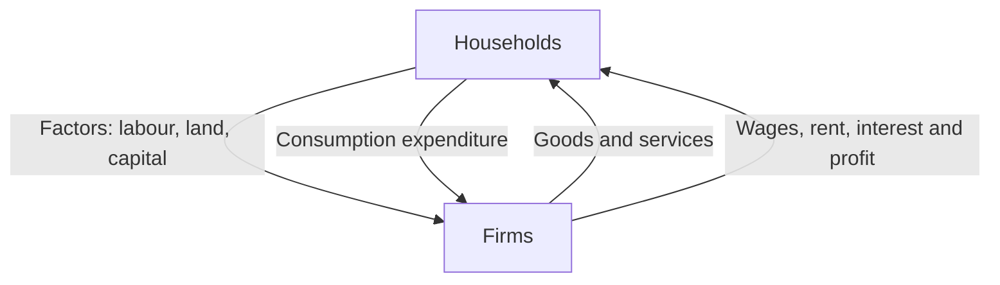

# Economics — Exam Crash Notes

> **Basis:** These notes are prepared from the lecture PDFs uploaded in this chat. I have kept the slides' terminology, examples, numerical values and Bangladesh indicators. I have not added outside explanations to fill gaps.
>
> **Important source gap:** The uploaded slides do **not** contain a CGPA formula or a CGPA numerical example. I have marked that topic rather than inventing a method that may differ from your teacher's method.

## How to use this tonight

1. Learn the **bold definitions** and the one-line exam explanations.
2. Memorise the formulas in the formula sheet.
3. Practise the worked numerical examples without looking at the solutions.
4. Redraw the PPF, cost curves, import-welfare graph and AD–SRAS gap diagrams from memory.

---

# 1. Theory of Elasticity

## 1.1 Meaning of elasticity

**Elasticity measures how responsive one economic variable is to a change in another variable.**

For demand, it measures how strongly quantity demanded responds when price, income, or the price of another good changes.

**Exam explanation:** Elasticity measures the percentage responsiveness of quantity demanded or supplied to a percentage change in another relevant variable.

## 1.2 Price elasticity of demand (Ed)

Price elasticity of demand measures the responsiveness of quantity demanded to a change in the price of the same good.

\[
E_d=\frac{\%\Delta Q_d}{\%\Delta P}
\]

The lecture uses the **midpoint formula** because ordinary percentage changes can give different answers depending on whether the price rises or falls.

\[
E_d=
\frac{(Q_2-Q_1)/[(Q_1+Q_2)/2]}
{(P_2-P_1)/[(P_1+P_2)/2]}
\]

A convenient rearrangement is:

\[
E_d=\frac{Q_2-Q_1}{P_2-P_1}
\times
\frac{(P_1+P_2)/2}{(Q_1+Q_2)/2}
\]

Where:
- \(P_1,Q_1\): initial price and quantity demanded.
- \(P_2,Q_2\): final price and quantity demanded.
- \(\Delta P=P_2-P_1\).
- \(\Delta Q=Q_2-Q_1\).

### Worked example from the slide

Price falls from \$12 to \$10. Quantity demanded rises from 50 to 100 units.

| Item | Value |
|---|---:|
| Initial price \(P_1\) | 12 |
| Final price \(P_2\) | 10 |
| Initial quantity \(Q_1\) | 50 |
| Final quantity \(Q_2\) | 100 |
| \(\Delta P\) | \(10-12=-2\) |
| \(\Delta Q\) | \(100-50=50\) |
| Average price | \((12+10)/2=11\) |
| Average quantity | \((50+100)/2=75\) |

\[
E_d=\frac{50}{-2}\times\frac{11}{75}=-3.67
\]

\[
|E_d|=3.67>1
\]

**Interpretation:** Demand is elastic because the absolute value of price elasticity is greater than 1; quantity demanded changes proportionately more than price.

### Why does the demand answer have a negative sign?

Price and quantity demanded move in opposite directions:
- Price rises → quantity demanded falls.
- Price falls → quantity demanded rises.

The negative sign records this inverse relationship. The lecture says economists conventionally use the **absolute value** when classifying price elasticity of demand.

### Demand elasticity classification

| Absolute value | Classification | Meaning |
|---|---|---|
| \(E_d>1\) | Elastic | Quantity demanded changes proportionately more than price. |
| \(E_d<1\) | Inelastic | Quantity demanded changes proportionately less than price. |
| \(E_d=1\) | Unit elastic | Percentage changes are equal. |
| \(E_d=\infty\) | Perfectly elastic | A very small price change is associated with an extremely large change in quantity demanded. |
| \(E_d=0\) | Perfectly inelastic | Quantity demanded does not change when price changes. |

**One-line interpretation templates:**
- If \(|E_d|>1\): “Demand is elastic because quantity demanded changes by a greater percentage than price.”
- If \(|E_d|<1\): “Demand is inelastic because quantity demanded changes by a smaller percentage than price.”
- If \(|E_d|=1\): “Demand is unit elastic because quantity demanded and price change by the same percentage.”

## 1.3 Price elasticity of supply (Es)

Price elasticity of supply measures the responsiveness of quantity supplied to a change in price.

\[
E_s=\frac{\%\Delta Q_s}{\%\Delta P}
\]

Use the same midpoint method, replacing quantity demanded with quantity supplied:

\[
E_s=
\frac{(Q_{s2}-Q_{s1})/[(Q_{s1}+Q_{s2})/2]}
{(P_2-P_1)/[(P_1+P_2)/2]}
\]

### Worked example from the slide

Quantity supplied rises from 120 to 140 as price rises from \$4 to \$5.50.

\[
\Delta Q_s=140-120=20,\qquad \Delta P=5.5-4=1.5
\]

\[
\bar Q_s=(120+140)/2=130,\qquad \bar P=(4+5.5)/2=4.75
\]

\[
E_s=\frac{20}{1.5}\times\frac{4.75}{130}=0.487
\]

**Interpretation:** Supply is inelastic because \(E_s=0.487<1\); quantity supplied changes proportionately less than price.

Supply classifications in the slides:
- \(E_s>1\): elastic supply.
- \(E_s<1\): inelastic supply.
- \(E_s=1\): unit elastic supply.
- \(E_s=\infty\): perfectly elastic supply; horizontal supply curve.
- \(E_s=0\): perfectly inelastic supply; vertical supply curve.

## 1.4 Cross-price elasticity of demand (Ec)

Cross elasticity measures how the quantity demanded of **one good** responds to a price change in **another good**.

\[
E_c=\frac{\%\Delta Q_y}{\%\Delta P_x}
\]

Midpoint form:

\[
E_c=
\frac{(Q_{y2}-Q_{y1})/[(Q_{y1}+Q_{y2})/2]}
{(P_{x2}-P_{x1})/[(P_{x1}+P_{x2})/2]}
\]

The sign is the important part:

| Sign | Relationship | Meaning |
|---|---|---|
| \(E_c>0\) | Substitutes | The two goods move in the same direction in the cross-price calculation. |
| \(E_c<0\) | Complements | The two goods move in opposite directions in the cross-price calculation. |

### Slide example 1: complements

Price of Good X rises from \$120 to \$160. Quantity demanded of Good Y falls from 80 to 60.

\[
\Delta Q_y=-20,\quad \Delta P_x=40,\quad \bar Q_y=70,\quad \bar P_x=140
\]

\[
E_c=\frac{-20}{40}\times\frac{140}{70}=-1
\]

**Interpretation:** The goods are complements because cross-price elasticity is negative.

### Slide example 2: substitutes

Price of commercial antivirus software rises from \$640.50 to \$825.50. Use of built-in operating-system security rises from 45 to 57 workstations.

\[
\Delta Q_y=12,\quad \Delta P_x=185,\quad \bar Q_y=51,\quad \bar P_x=733
\]

\[
E_c=\frac{12}{185}\times\frac{733}{51}=0.932
\]

**Interpretation:** The goods are substitutes because cross-price elasticity is positive.

## 1.5 Income elasticity of demand (Ey)

Income elasticity measures the responsiveness of quantity demanded to a change in consumer income.

\[
E_y=\frac{\%\Delta Q_d}{\%\Delta Y}
\]

Midpoint form:

\[
E_y=
\frac{(Q_2-Q_1)/[(Q_1+Q_2)/2]}
{(Y_2-Y_1)/[(Y_1+Y_2)/2]}
\]

**Sign interpretation from the lecture:**
- \(E_y>0\): normal good. Demand increases when income increases.
- \(E_y<0\): inferior good. Demand decreases when income increases.

### Slide example 1: normal good

Income rises from \$60,000 to \$75,000. Annual subscriptions rise from 2 to 3.

\[
\Delta Q=1,\quad \bar Q=2.5,\quad \Delta Y=15000,\quad \bar Y=67500
\]

\[
E_y=\frac{1/2.5}{15000/67500}
=\frac{0.4}{0.2222}
=1.8
\]

**Interpretation:** \(E_y=1.8>0\), so the subscriptions are a normal good in this example.

### Slide example 2: inferior good

Income rises from \$30,000 to \$40,000. Annual use of refurbished desktop computers falls from 8 to 5.

\[
\Delta Q=5-8=-3,\quad \bar Q=6.5
\]

\[
\Delta Y=10000,\quad \bar Y=35000
\]

\[
E_y=\frac{-3/6.5}{10000/35000}
=\frac{-0.4615}{0.2857}
\approx -1.615
\]

**Interpretation:** \(E_y<0\), so refurbished desktop computers behave as an inferior good in this example.

> **Exam warning:** Do not confuse the signs. For income elasticity, positive means normal and negative means inferior. For cross-price elasticity, positive means substitutes and negative means complements. For price elasticity of demand, the raw result is normally negative because price and quantity demanded move in opposite directions; use its absolute value for elastic/inelastic classification.

---

# 2. Theory of Production and Production Possibilities Frontier

## 2.1 Production function

**A production function is the relationship between the amount of input required and the amount of output that can be obtained.**

It specifies the maximum output that can be produced with a given quantity of inputs, for a given state of technology.

- **Inputs:** Commodities or services used to produce goods and services.
- **Outputs:** Useful goods or services resulting from production.

**Exam explanation:** A production function shows the maximum output obtainable from given inputs and existing technology.

## 2.2 Total, marginal and average product

- **Total product (TP or Q):** Total physical output produced.
- **Marginal product (MP):** Extra output from one additional unit of an input, holding other inputs constant.
- **Average product (AP):** Total output divided by units of a particular input.

For labour:

\[
MP_L=\frac{\Delta Q}{\Delta L}
\qquad
AP_L=\frac{Q}{L}
\]

## 2.3 Law of diminishing returns

Beyond a certain point, adding more units of one input while holding other inputs fixed produces smaller and smaller additional output.

**Simple example:** If a factory has a fixed number of machines, adding workers initially helps production. After the machines become crowded, each additional worker contributes less extra output.

**Exam explanation:** The law of diminishing returns states that marginal product eventually declines as more of a variable input is added to fixed inputs.

## 2.4 Factors of production and their rewards

| Factor | Meaning in the slide | Reward |
|---|---|---|
| Land | Natural resources: minerals, forests, water and unimproved land | Rent |
| Labour | Physical and mental talents used in production | Wage |
| Capital | Produced goods used as inputs in further production, such as machinery and buildings | Interest |
| Entrepreneurship | Organising land, labour and capital; finding opportunities and new methods | Profit |

## 2.5 Production Possibilities Frontier (PPF)

**The Production Possibilities Frontier (PPF), also called the Production Possibilities Curve (PPC), shows the combinations of output an economy can possibly produce using its available factors of production and technology.**

The slide uses an economy producing only **cars and computers**:
- All resources in cars: 1,000 cars and 0 computers.
- All resources in computers: 0 cars and 3,000 computers.
- Point A: 600 cars and 2,200 computers.
- Point B: 700 cars and 2,000 computers.

### Where are the points located?

| Point | Location | Meaning |
|---|---|---|
| A, B, E, F | On the PPF | Efficient and attainable |
| D | Inside the PPF | Inefficient but attainable |
| C | Outside the PPF | Impossible/unattainable with current resources and technology |

**The direct answer to the exam question:** An unattainable point is outside the PPF. The economy cannot produce it with its current resources and technology.

### PPF diagram — redraw this

```text
Computers
   ^
   |       C  Unattainable
   |          *
3000|*----------------------  Endpoint: 0 cars, 3000 computers
   |  `.
   |    `.        PPF
2200|      * A
   |        `.
2000|          * B
   |     * D    `.
   |  Inefficient `.
   +------------------------------> Cars
      0       600 700          1000
                              Endpoint:
                              1000 cars, 0 computers
```

The curve is bowed outward because of **increasing opportunity cost**. Resources are specialised and are not equally suitable for producing both goods.

### Efficient, inefficient and unattainable

- **On the PPF — efficient:** The economy is using its scarce resources fully. Producing more of one good requires producing less of the other.
- **Inside the PPF — inefficient:** The economy is producing less than it could, possibly because of unemployment or unused resources. It can increase production of both goods by using resources more effectively.
- **Outside the PPF — unattainable:** Current resources and technology are insufficient to produce that combination.

### Opportunity cost

Opportunity cost is what must be given up to obtain something.

\[
OC=\frac{\text{What we give up}}{\text{What we get}}
\]

Moving from A to B:
- Cars increase by 100.
- Computers decrease by 200.

\[
OC_{\text{1 car}}=\frac{200\text{ computers}}{100\text{ cars}}
=2\text{ computers}
\]

Conversely:

\[
OC_{\text{1 computer}}=\frac{100\text{ cars}}{200\text{ computers}}
=0.5\text{ car}
\]

### Economic growth and PPF

Economic growth means increased productive capabilities. It is shown by an **outward shift** of the PPF.

The two causes listed in the slide:
1. Increase in the quantity of resources.
2. Advance in technology.

- **Balanced growth:** The whole PPF shifts outward proportionally.
- **Unbalanced growth:** If technology improves production of only one good, the PPF rotates outward toward that good.

---

# 3. Cost of Production

## 3.1 The firm's objective

A firm aims to maximise profit.

\[
\text{Profit}=TR-TC
\]

\[
TR=P\times Q
\]

The profit-maximising condition used throughout the slides is:

\[
MR=MC
\]

- **Total revenue (TR):** Price multiplied by quantity sold.
- **Total cost (TC):** Total cost of producing output.
- **Marginal revenue (MR):** Change in total revenue from selling one additional unit.
- **Marginal cost (MC):** Change in total cost from producing one additional unit.

## 3.2 Explicit cost, implicit cost and profit

- **Explicit cost:** A cost involving an actual monetary payment.
- **Implicit cost:** The value of resources used in production for which no actual monetary payment is made.

\[
\text{Accounting Profit}=TR-\text{Explicit Costs}
\]

\[
\text{Economic Profit}=TR-(\text{Explicit Costs}+\text{Implicit Costs})
\]

The lecture's cookie example:
- 800 boxes sold at BDT 100 each.
- Total revenue = BDT 80,000.
- Ingredients = BDT 40,000.
- Packaging = BDT 5,000.
- Electricity = BDT 5,000.
- Explicit costs = BDT 50,000.
- Tutoring income forgone = BDT 5,000 implicit cost.

\[
\text{Accounting Profit}=80,000-50,000=30,000
\]

\[
\text{Economic Profit}=80,000-(50,000+5,000)=25,000
\]

Economic profit is usually lower than accounting profit.

## 3.3 Fixed cost, variable cost and total cost

- **Fixed cost (FC):** Does not vary with output and is incurred even when output is zero.
- **Variable cost (VC):** Changes as output changes.
- **Total cost (TC):** Sum of fixed and variable costs.

\[
TC=FC+VC
\]

## 3.4 Average cost and marginal cost formulas

| Measure | Formula | Meaning |
|---|---|---|
| Average Fixed Cost (AFC) | \(AFC=FC/Q\) | Fixed cost per unit |
| Average Variable Cost (AVC) | \(AVC=VC/Q\) | Variable cost per unit |
| Average Total Cost (ATC or AC) | \(ATC=TC/Q\) | Total cost per unit |
| Average Total Cost | \(ATC=AFC+AVC\) | Sum of average fixed and variable cost |
| Marginal Cost (MC) | \(MC=\Delta TC/\Delta Q\) | Extra cost from extra output |

**Difference to memorise:**
- Average cost tells you the cost **per unit across all units**.
- Marginal cost tells you the **additional cost of the next unit**.

## 3.5 Shapes of cost curves

### Total Fixed Cost (TFC)
Horizontal line: total fixed cost does not change as output changes.

### Average Fixed Cost (AFC)
Continuously falls as output rises. The same fixed cost is spread over more units. It falls sharply at first and then more slowly.

### Total Variable Cost (TVC)
Rises as output rises. It initially rises at a decreasing rate as labour and machinery are used more efficiently; later it rises at an increasing rate as inputs become overused. The slide describes this as an inverted S-shape.

### Average Variable Cost (AVC)
Initially falls and then rises. It reflects the initial slow increase and later faster increase in total variable cost.

### Total Cost (TC)
Equals TFC plus TVC. It does not start at zero because fixed costs exist even when output is zero. Otherwise, it follows the shape of TVC.

### Average Total Cost (ATC)
U-shaped:
1. At low output, AFC is high because fixed cost is spread over only a few units.
2. As output increases, AFC falls and pulls ATC down.
3. Eventually AVC starts rising and pulls ATC upward.
4. The bottom of the U is the minimum-ATC output, called the **efficient scale**.

### Marginal Cost (MC)
The MC curve first declines and then rises:
- Early production: additional labour can raise output more efficiently, reducing the extra cost per unit.
- Later production: fixed inputs reach capacity and diminishing returns cause MC to rise.

### Cost curves — schematic

```text
Cost
 ^
 |                         MC
 |                        /
 |              ATC      /
 |             \   \____/
 |              \__/    /
 |          AVC  \______/ 
 |          \____/
 | AFC  \____________
 +----------------------------> Output (Q)
```

The important exam relationship is not the exact drawing scale; it is where MC crosses the average curves.

## 3.6 Average–marginal rule

This rule is essential for numerical and interpretation questions.

- If marginal cost is below average total cost, average total cost falls.
- If marginal cost is above average total cost, average total cost rises.
- MC crosses ATC at the minimum point of ATC.
- The same relationship holds between MC and AVC.
- The slide says there is no such relationship between AFC and MC.

\[
MC<ATC\Rightarrow ATC\downarrow
\]

\[
MC>ATC\Rightarrow ATC\uparrow
\]

\[
MC=ATC\Rightarrow ATC\text{ is at its minimum}
\]

The slide pack does not give a CGPA formula or a CGPA calculation exercise. The average–marginal rule above is a cost-curve relationship, not a substitute for a university CGPA calculation.

## 3.7 Worked cost calculation from Mathematical Applications

Given:

\[
TC=160+4Q+Q^2
\]

At \(Q=10\):

**Step 1 — Fixed cost**

At \(Q=0\), \(TC=160\), so \(TFC=160\).

**Step 2 — Average fixed cost**

\[
AFC=\frac{160}{10}=16
\]

**Step 3 — Variable cost and average variable cost**

\[
TVC=4Q+Q^2
\]

\[
AVC=\frac{4Q+Q^2}{Q}=4+Q=4+10=14
\]

**Step 4 — Average cost**

\[
AC=\frac{TC}{Q}=\frac{160}{10}+4+10=30
\]

**Step 5 — Marginal cost**

Differentiate total cost with respect to output:

\[
MC=\frac{dTC}{dQ}=4+2Q
\]

\[
MC=4+2(10)=24
\]

**Final answer:** AFC = 16, AVC = 14, AC = 30, MC = 24.

---

# 4. Perfect Competition and MR–MC Mathematics

## 4.1 Perfect competition

The lecture identifies four main assumptions:
1. Many buyers and sellers; no individual buyer or seller can influence market price.
2. Firms sell homogeneous (identical) products.
3. Buyers and sellers have relevant market information.
4. Firms can enter and exit easily; there are no barriers to entry or exit.

A firm in perfect competition is a **price taker**. It accepts the market price rather than choosing its own price.

Because the firm can sell its output at the market price, its demand curve is horizontal (perfectly elastic).

For a perfectly competitive firm:

\[
P=AR=MR
\]

- **Total Revenue (TR):** \(TR=P\times Q\)
- **Average Revenue (AR):** \(AR=TR/Q=P\)
- **Marginal Revenue (MR):** Change in total revenue from one additional unit sold.

## 4.2 Profit maximisation

\[
\boxed{MR=MC}
\]

If \(MR>MC\), producing one more unit adds more revenue than cost, so increasing output raises profit.

If \(MC>MR\), the extra unit costs more than the revenue it brings; reducing output can raise profit.

The firm reaches its profit-maximising output where MR equals MC.

## 4.3 Mathematical Applications — Question 1

Given:

\[
TC=160+4Q+Q^2,\qquad MR=180
\]

For perfect competition, \(P=MR\).

\[
P^*=180
\]

Find MC:

\[
MC=\frac{dTC}{dQ}=4+2Q
\]

Set \(MR=MC\):

\[
180=4+2Q
\]

\[
2Q=176
\]

\[
\boxed{Q^*=88}
\]

Now calculate profit.

\[
TR=P\times Q=180\times88=15,840
\]

\[
TC=160+4(88)+88^2=8,256
\]

\[
\text{Profit}=TR-TC=15,840-8,256
\]

\[
\boxed{\text{Maximum Profit}=7,584}
\]

The slide also calculates:

\[
ATC(88)=\frac{160}{88}+4+88\approx93.82
\]

The price is 180 and average total cost is about 93.82, so the positive per-unit margin is represented by the profit rectangle in the lecture's diagram.

## 4.4 Mathematical Applications — Question 2

Given:

\[
TC=250+80Q+3Q^2
\]

\[
TR=1000Q-6Q^2
\]

**Step 1 — Find MC**

\[
MC=\frac{dTC}{dQ}=80+6Q
\]

**Step 2 — Find MR**

\[
MR=\frac{dTR}{dQ}=1000-12Q
\]

**Step 3 — Set MR = MC**

\[
1000-12Q=80+6Q
\]

\[
920=18Q
\]

\[
\boxed{Q^*=51.11\text{ units}}
\]

**Step 4 — Calculate profit**

Using the slide's rounded output:

\[
TR=1000(51.11)-6(51.11)^2=35,436.61
\]

\[
TC=250+80(51.11)+3(51.11)^2=12,175.50
\]

\[
\boxed{\text{Profit}=35,436.61-12,175.50=23,261.11}
\]

## 4.5 Fast MR and MC question method

1. If total revenue is given, differentiate it to get MR.
2. If total cost is given, differentiate it to get MC.
3. Set \(MR=MC\).
4. Solve for \(Q\).
5. If asked for price, use the demand equation; for a perfectly competitive firm, use \(P=MR\).
6. If asked for profit, calculate \(TR-TC\).

---

# 5. Money and Inflation

## 5.1 What is money?

**Money is any good that is widely accepted for purposes of exchange and repayment of debt.**

### Three functions of money

1. **Medium of exchange:** Used to buy and sell goods and services. It avoids the need for barter and a double coincidence of wants.
2. **Unit of account:** A common measure in which the values of goods and services are expressed.
3. **Store of value:** Allows purchasing power to be transferred from the present to the future.

**Exam explanation:** Money makes exchange easier, provides a common measure of value, and stores purchasing power for future use.

## 5.2 Value of money

The price level is the average price of goods and services. The value of money is its purchasing power.

\[
V_m=\frac{1}{P}
\]

When the overall price level rises, the value of money falls because one unit of money buys fewer goods and services.

## 5.3 Price level and Consumer Price Index (CPI)

- A **price** is the price of one item.
- The **price level** is a weighted average of prices of goods and services in the economy.
- A **price index** measures the price level.
- The **Consumer Price Index (CPI)** is a weighted average of prices of a specific market basket purchased by a typical household.

The slide lists eight CPI basket categories:
1. Food and beverages.
2. Housing.
3. Apparel.
4. Transportation.
5. Medical care.
6. Recreation.
7. Education and communication.
8. Other goods and services.

The **base year** is the benchmark year used to compare prices.

\[
CPI=
\frac{\text{Current-year market-basket expenditure}}
{\text{Base-year market-basket expenditure}}
\times100
\]

### CPI interpretation from the slide

A CPI of 249 means the standard basket costs 2.49 times as much as in the base year, or is 149% more expensive.

If the basket cost Tk 100 in the base year, it costs Tk 249 at the measured CPI.

## 5.4 What is inflation?

**Inflation is an increase in the overall price level, usually measured annually.**

The inflation rate is the positive percentage change in the price level on an annual basis.

\[
\text{Inflation Rate}=
\frac{CPI_{\text{current}}-CPI_{\text{previous}}}
{CPI_{\text{previous}}}\times100
\]

**Exam explanation:** Inflation means the general price level is rising, reducing the purchasing power of money.

### Nominal income and real income

- **Nominal income:** Current money amount of income.
- **Real income:** Nominal income adjusted for price changes.

\[
\text{Real Income}=
\frac{\text{Nominal Income}}{CPI}\times100
\]

The lecture's interpretation:
- If income rises by the same percentage as inflation, it keeps up with inflation.
- If income rises by a smaller percentage, it does not keep up.
- If income rises by a greater percentage, it rises faster than inflation.

---

# 6. Gross Domestic Product (GDP)

## 6.1 Definition

**Gross Domestic Product (GDP) is the market value of all final goods and services produced within a country in a given period of time.**

GDP measures two things at once:
- Total income earned in the economy.
- Total expenditure on the economy's output.

For the economy as a whole:

\[
\text{Total Income}=\text{Total Expenditure}
\]

This is because one person's expenditure becomes another person's income.

## 6.2 Break down the definition

| Phrase | Meaning |
|---|---|
| Market value | Uses market prices to combine different goods and services into one measure. |
| All | Attempts to include all legally sold market production. |
| Final | Counts final goods and services, not intermediate inputs separately. |
| Goods and services | Includes tangible goods and intangible services. |
| Produced | Counts current production, not items produced in the past. |
| Within a country | Based on geographic location of production. |
| Given period | Usually a year or a quarter (three months). |

- **Final good:** In the hands of its final user, e.g. a laptop sold to a consumer.
- **Intermediate good:** An input used to produce a final good, e.g. a microprocessor purchased by a laptop manufacturer.

## 6.3 What GDP captures and what it does not capture

### GDP captures

- Legally sold goods and services produced in the country during the measured period.
- Tangible goods and intangible services.
- Final goods and services.
- Market transactions, valued at market prices.
- Production within the country's geographic boundaries.

### GDP does not capture, according to the slides

| Omitted item | Why it is omitted |
|---|---|
| Nonmarket household services | Unpaid household work, such as family members cooking or cleaning for themselves, is not an official market transaction. |
| Underground activities | Unreported legal or illegal activity is not recorded in official statistics. |
| Sales of used goods | The item was counted when originally produced; resale is not current production. |
| Financial transactions | Buying and selling stocks and bonds transfers ownership of financial assets; it does not create current output. |
| Government transfer payments | The recipient does not provide a current good or service in exchange. |
| Leisure time | It provides well-being but is not included as market production. |

**Exam explanation:** GDP measures current market production, not every activity that creates value or improves well-being.

## 6.4 Four components of GDP — expenditure approach

\[
\boxed{Y=C+I+G+NX}
\]

| Component | What it includes |
|---|---|
| Consumption (C) | Durable goods, nondurable goods and services purchased by households. |
| Investment (I) | Newly produced capital goods, changes in business inventories and new residential housing. |
| Government purchases (G) | Government purchases of goods and services, including government workers' salaries and public works. |
| Net exports (NX) | Exports minus imports. |

\[
NX=EX-IM
\]

**Important:** Government transfer payments are not government purchases because they are not payments for currently supplied goods or services.

## 6.5 Nominal GDP, real GDP and per-capita GDP

- **Nominal GDP:** Output valued at current prices.
- **Real GDP:** Output valued at constant/base-year prices; adjusted for price changes.
- **Per-capita GDP:** GDP divided by population.

\[
\text{Per-capita GDP}=\frac{GDP}{\text{Population}}
\]

## 6.6 Income circular flow

The simplified slide model has households and firms:
- Households own factors of production and supply them to firms.
- Firms use those factors to produce goods and services.
- Households buy the goods and services.
- Firms use sales revenue to pay wages, rent and other factor income; the remaining profit goes to firm owners.

The inner loop represents the flow of inputs and outputs. The outer loop represents the corresponding flow of money.



## 6.7 Other national income measures in the slide

- **Gross National Product (GNP):** Final goods and services produced by a country's residents and businesses, regardless of where production occurs. It focuses on ownership rather than location.

\[
GNP=GDP+\text{Income earned from rest of world}
-\text{Income earned by rest of world}
\]

- **Capital consumption allowance (depreciation):** Cost of replacing capital goods used up through wear, obsolescence or destruction.
- **Net Domestic Product (NDP):**

\[
NDP=GDP-\text{Depreciation}
\]

- **Net National Product (NNP):**

\[
NNP=GNP-\text{Depreciation}
\]

---

# 7. International Trade

## 7.1 Why do countries trade?

Countries have different resources, technologies and natural endowments. They trade instead of trying to produce everything domestically.

## 7.2 Comparative advantage

**Comparative advantage exists when a country can produce a good at a lower opportunity cost than another country.**

Do not confuse:
- **Absolute advantage:** Producing a greater quantity with the same or fewer resources.
- **Comparative advantage:** Producing at a lower opportunity cost.

The lecture's example:

| Country | Cloth output | Computer output | Opportunity cost of cloth | Opportunity cost of computer |
|---|---:|---:|---:|---:|
| Nation A | 1,000 | 1,000 | 1 computer | 1 cloth |
| Nation B | 2,000 | 4,000 | 2 computers | 0.5 cloth |

Nation B has an absolute advantage in both goods because it can produce more of both.

But:
- Nation A has comparative advantage in cloth: opportunity cost is 1 computer, compared with Nation B's 2 computers.
- Nation B has comparative advantage in computers: opportunity cost is 0.5 cloth, compared with Nation A's 1 cloth.

Therefore, Nation A should specialise in cloth and Nation B in computers.

## 7.3 Terms of trade

Terms of trade measure a country's export prices relative to its import prices.

\[
ToT=\frac{\text{Export Price Index}}{\text{Import Price Index}}\times100
\]

## 7.4 World price: importer or exporter?

Compare the world price (\(P_w\)) with the domestic no-trade equilibrium price (\(P_e\)).

| Comparison | Result |
|---|---|
| \(P_w>P_e\) | The country exports. |
| \(P_w<P_e\) | The country imports. |

If the world price is higher, domestic producers want to sell abroad. If the world price is lower, domestic consumers want to buy from foreign sellers.

## 7.5 Welfare effect of imports

When the world price is below the domestic no-trade price:
1. Domestic price falls to the world price.
2. Domestic quantity demanded increases.
3. Domestic quantity supplied decreases.
4. The gap between quantity demanded and quantity supplied is imported.
5. Domestic consumers gain; domestic producers lose.

The slide's welfare conclusion:
- Consumer surplus increases by areas **B + D**.
- Producer surplus falls by area **B**.
- Consumers' gains exceed producers' losses.
- Total surplus increases by area **D**.

**Exam explanation:** Imports make domestic consumers better off because the price falls, while domestic producers are worse off because they receive a lower price; the gains to consumers exceed the losses to producers.

### Import graph — schematic

```text
Price
  ^
  |        S
  |       /
Pe|------/------\------ Domestic no-trade price
  |     /        \
Pw|----/----------\---- World price (lower)
  |   /            \
  |  /              \ D
  +------------------------------> Quantity
      Qs             Qd

At Pw: Qs < Qd
Imports = Qd - Qs
```

The graph shows the key quantities and price relationship. In the lecture's welfare diagram, the gains and losses are labelled by areas B and D.

## 7.6 Trade protection: tariff and quota

**Protectionism** means government policies designed to limit imports and shield domestic industries from foreign competition.

- **Tariff:** A tax on imported goods.
  - Specific tariff: fixed amount per unit.
  - Ad valorem tariff: percentage of the good's value.
- **Import quota:** A physical limit on the quantity of a good that can be imported during a period.

### Effect of a tariff

\[
P_t=P_w+t
\]

Where \(P_t\) is the price after tariff, \(P_w\) is world price, and \(t\) is the tariff.

A tariff:
- Raises domestic price.
- Reduces domestic quantity demanded.
- Increases domestic quantity supplied.
- Reduces imports.
- Benefits domestic producers.
- Harms domestic consumers.
- Gives the government tariff revenue.

In the slide:
- Government revenue is area E.
- Total surplus falls by areas D + F.
- This loss is called **deadweight loss**.
- Area D is the loss from overproduction.
- Area F is the loss from underconsumption.

## 7.7 Arguments for restricting trade

Learn the argument **and** the slide's qualification/limitation.

1. **Jobs argument:** Free trade may reduce jobs in an import-competing domestic industry. The slide's counterargument is that trade also creates jobs in industries where the country has comparative advantage; foreign buyers use income from exports to buy domestic products.
2. **National-security argument:** Protect industries important for defence or essential national security. The slide warns that industries may exaggerate their security importance to obtain protection.
3. **Infant-industry argument:** Temporarily protect new industries until they mature and can compete. The slide notes that it is difficult for government to identify future winners, protection costs consumers, and temporary protection may become permanent.
4. **Unfair-competition argument:** Protect domestic firms when foreign firms benefit from different rules or government subsidies. Example in the slide: foreign textile firms receiving large tax breaks.
5. **Bargaining-chip argument:** Threaten trade restrictions to persuade another country to remove its restrictions. The slide warns the threat may fail, leaving the country to impose harmful restrictions or back down.

**When should trade be protected?** The slides recognise a case for protection where there is a legitimate national-security concern, and present temporary infant-industry protection as an argument. They also emphasise the risks and costs of protection. Do not write that protection is always beneficial.

---

# 8. Short-Run Aggregate Supply (SRAS) and AD–AS

## 8.1 The AD–AS framework

The model focuses on:
- Real Gross Domestic Product (Real GDP), measuring the economy's output.
- The average price level.

Its three parts are:
1. Aggregate Demand (AD).
2. Short-Run Aggregate Supply (SRAS).
3. Long-Run Aggregate Supply (LRAS).

## 8.2 Aggregate demand (AD)

Aggregate demand is the quantity of all goods and services demanded at different price levels, other things equal.

AD slopes downward. The lecture gives three reasons:

1. **Wealth effect:** A lower price level increases the real value of money, makes consumers wealthier and increases consumption.
2. **Interest-rate effect:** A lower price level means households need less money for purchases; savings and loanable funds rise, interest rates fall, and investment rises.
3. **International-trade effect:** A lower domestic price level makes domestic goods relatively cheaper, increasing demand for domestic goods and net exports.

The lecture's chain summaries:

```text
Price level falls
    -> Real wealth rises -> Consumption rises -> Real GDP demanded rises

Price level falls
    -> Savings/funds rise -> Interest rate falls
    -> Investment rises -> Real GDP demanded rises

Price level falls
    -> Domestic goods become relatively cheaper
    -> Domestic demand for them rises -> Net exports rise
    -> Real GDP demanded rises
```

## 8.3 Short-run aggregate supply (SRAS)

**The SRAS curve shows the quantity of all goods and services (Real GDP) supplied at different price levels, other things equal.**

SRAS is upward sloping: in the short run, a higher price level is associated with a higher quantity of output supplied.

### Why is SRAS upward sloping?

The lecture gives three theories.

#### 1. Sticky-wage theory

Nominal wages may be fixed for a period, for example by labour contracts.

\[
\text{Real Wage}=\frac{\text{Nominal Wage}}{\text{Price Level}}
\]

If the price level falls while nominal wages are sticky, real wages rise. Firms hire fewer workers and supply less output.

```text
Price level falls
 -> Sticky nominal wage means real wage rises
 -> Firms hire fewer workers
 -> Quantity of Real GDP supplied falls
```

#### 2. Sticky-price theory

Some firms adjust prices slowly because changing prices involves **menu costs**. If other prices fall but a firm's price remains high, its sales fall. The firm reduces production and employment.

```text
Price level falls
 -> Some firms keep prices unchanged because of menu costs
 -> Sales fall -> Production falls -> Real GDP supplied falls
```

#### 3. Misperceptions theory

Workers may notice a fall in nominal wages but misunderstand the size of the overall price-level fall. They may mistakenly believe their real wage has fallen and reduce labour supplied. Firms then produce less.

```text
Nominal wages and price level fall by the same percentage
 -> Actual real wage is unchanged
 -> Workers mistakenly think real wage fell
 -> Labour supplied falls -> Output falls
```

**Exam explanation:** SRAS slopes upward in the short run because sticky wages, sticky prices and misperceptions make output supplied respond positively to the price level before wages, prices and expectations fully adjust.

### SRAS graph — schematic

```text
Price level
    ^
    |             SRAS
    |            /
 P1 |-----------/ 
    |          /
 P2 |---------/ 
    |        /
    +----------------------> Real GDP
             Y2   Y1

Higher price level P1 is associated with higher output Y1.
Lower price level P2 is associated with lower output Y2.
```

## 8.4 Long-run aggregate supply (LRAS)

LRAS shows output after wages and prices have adjusted and workers have no relevant misperceptions.

- LRAS is vertical.
- It is at Natural Real GDP (\(Y_N\)).
- Natural Real GDP is the output produced at the natural unemployment rate.
- In the long run, output depends on labour, capital, natural resources and technology, not the overall price level.

## 8.5 Short-run and long-run equilibrium

- **Short-run equilibrium:** AD intersects SRAS; quantity supplied equals quantity demanded at that output.
- **Long-run equilibrium:** Output equals Natural Real GDP (\(Y_N\)); AD, SRAS and LRAS meet at the long-run equilibrium.
- **Disequilibrium:** The economy is moving between short-run and long-run equilibrium; quantity supplied and demanded are not equal during the adjustment.

## 8.6 Recessionary gap

**A recessionary gap exists when actual Real GDP is below Natural Real GDP and unemployment is above the natural unemployment rate.**

\[
Y_1<Y_N
\]

```text
Price level
    ^
    |        SRAS
    |       /
    |      /   AD
    |     /   /
    |    *---/
    |   Y1  | YN
    +-------|-------------> Real GDP
        Actual output < potential output

Recessionary gap = YN - Y1
```

**Interpretation:** The economy is producing below its natural/potential output level and unemployment is higher than its natural rate.

## 8.7 Inflationary gap

**An inflationary gap exists when actual Real GDP is above Natural Real GDP and unemployment is below the natural unemployment rate.**

\[
Y_1>Y_N
\]

```text
Price level
    ^
    |              SRAS
    |             /
    |        AD  /
    |       /   *
    |      /    | 
    |     /     | YN
    +-----------|----Y1----> Real GDP
                Potential  Actual output

Inflationary gap = Y1 - YN
```

**Interpretation:** The economy is producing above its natural/potential output level and unemployment is below its natural rate.

## 8.8 Comparison: recessionary vs inflationary gap

| Point | Recessionary gap | Inflationary gap |
|---|---|---|
| Actual Real GDP | Below Natural Real GDP | Above Natural Real GDP |
| Output comparison | \(Y_1<Y_N\) | \(Y_1>Y_N\) |
| Unemployment | Above natural unemployment rate | Below natural unemployment rate |
| Basic condition | Underproduction relative to natural output | Output above natural level |

---

# 9. Monetary Policy and Fiscal Policy

## 9.1 Monetary policy

**Monetary policy is a set of tools used by a country's central bank to control the overall money supply.**

The three main tools in the slide:

1. **Reserve requirements:** Minimum reserves banks must hold against checkable deposits.
2. **Interest rates:** Cost of borrowing money or earnings from lending.
3. **Open Market Operations (OMO):** Buying and selling government securities by the central bank.

### Types of monetary policy

**Expansionary monetary policy**
- Central bank increases money supply.
- Interest rate falls.
- Quantity of goods and services demanded rises at each price level.
- AD shifts right.

**Contractionary monetary policy**
- Central bank decreases money supply.
- Interest rate rises.
- Quantity of goods and services demanded falls at each price level.
- AD shifts left.

## 9.2 Bangladesh monetary indicators stated in the slides

> These are the figures and dates printed in your uploaded lecture slide. They are reproduced as course material, not independently verified current figures.

| Indicator in the slide | Figure stated |
|---|---|
| Cash Reserve Ratio (CRR) | 4% on a bi-weekly average basis, with a 3% daily requirement (March 2026) |
| Statutory Liquidity Ratio (SLR), conventional banks | 13% |
| SLR, Shariah-based Islamic banks | 5.5% |
| Policy/repo rate | 9.50% (August 2026) |
| Open Market Operations | Government securities such as treasury bills and bonds; the slide says repo facilities were limited to 7 days in 2026, compared with 14 or 28 days historically |

Definitions:
- **CRR:** Cash reserve maintained by a bank.
- **SLR:** Minimum percentage of deposits maintained in liquid assets such as gold or government securities.
- **Policy/repo rate:** Rate at which commercial banks borrow from the central bank.
- **OMO:** Central bank purchase and sale of government securities.

## 9.3 Fiscal policy

**Fiscal policy consists of changes in government expenditure and/or taxes to achieve economic goals such as low unemployment, stable prices and economic growth.**

Fiscal policy is managed by the government/Ministry of Finance in the lecture's comparison.

### Types of fiscal policy

**Expansionary fiscal policy**
- Government expenditure rises (\(G\uparrow\)) and/or taxes fall (\(T\downarrow\)).
- AD shifts right.

**Contractionary fiscal policy**
- Government expenditure falls (\(G\downarrow\)) and/or taxes rise (\(T\uparrow\)).
- AD shifts left.

**Discretionary fiscal policy:** Deliberate changes in government expenditure and/or taxes.

**Automatic fiscal policy:** Changes that stimulate aggregate demand without a deliberate new policy decision. The slide's example is that tax collected falls automatically during an economic downturn as economic activity and taxable income fall.

## 9.4 Bangladesh fiscal measures stated in the slides

> These are the course-slide statements and figures. Treat them as the slide's exam material, not as independently verified live budget information.

The slide contrasts monetary policy (central bank controls money supply) with fiscal policy (government uses spending and taxation).

Measures and examples listed:
- Total FY2025–26 budget: approximately Tk 9.38 trillion (Tk 9,38,000 crore).
- The slide describes the FY2026–27 budget framework as expansionary overall to revive output growth.
- Government expenditure: public spending and Annual Development Programme (ADP) infrastructure allocations, including Dhaka Metro Rail expansion, expressway links and renewable energy grids.
- The slide mentions the 9th National Pay Scale 2026 and phased salary increases.
- Tax measure: source tax on essential and agricultural products reduced to a uniform 0.5%.
- The slide also lists contractionary revenue measures: replacing an initial 5% income-tax bracket with 10%, and broadening the tax base through Taxpayer Identification Number (TIN) and Business Identification Number (BIN) requirements in specified contexts.
- It also mentions a 15% capital gains tax on profits from declared gold, jewellery, precious stones and high-value physical assets.

### Monetary vs fiscal policy — comparison

| Monetary policy | Fiscal policy |
|---|---|
| Controlled by central bank | Government/Ministry of Finance |
| Controls money supply | Uses government expenditure and taxation |
| Tools: reserve requirements, interest rates, OMO | Tools: government spending and taxes |
| Expansionary: money supply rises; AD shifts right | Expansionary: \(G\uparrow\) and/or \(T\downarrow\); AD shifts right |
| Contractionary: money supply falls; AD shifts left | Contractionary: \(G\downarrow\) and/or \(T\uparrow\); AD shifts left |

---

# 10. Final formula sheet

| Topic | Formula |
|---|---|
| Price elasticity of demand | \(E_d=\%\Delta Q_d/\%\Delta P\) |
| Price elasticity of supply | \(E_s=\%\Delta Q_s/\%\Delta P\) |
| Cross elasticity | \(E_c=\%\Delta Q_y/\%\Delta P_x\) |
| Income elasticity | \(E_y=\%\Delta Q_d/\%\Delta Y\) |
| Midpoint percentage change | \(\Delta X/[(X_1+X_2)/2]\) |
| Marginal product of labour | \(MP_L=\Delta Q/\Delta L\) |
| Average product of labour | \(AP_L=Q/L\) |
| Opportunity cost | What we give up / What we get |
| Total cost | \(TC=FC+VC\) |
| Average fixed cost | \(AFC=FC/Q\) |
| Average variable cost | \(AVC=VC/Q\) |
| Average total cost | \(ATC=TC/Q=AFC+AVC\) |
| Marginal cost | \(MC=\Delta TC/\Delta Q\) |
| Total revenue | \(TR=P\times Q\) |
| Average revenue | \(AR=TR/Q=P\) |
| Profit | \(TR-TC\) |
| Profit-maximising condition | \(MR=MC\) |
| CPI | Current basket expenditure / Base-year basket expenditure × 100 |
| Inflation rate | \((CPI_c-CPI_p)/CPI_p\times100\) |
| Real income | Nominal income / CPI × 100 |
| GDP expenditure approach | \(Y=C+I+G+NX\) |
| Net exports | \(NX=EX-IM\) |
| Per-capita GDP | GDP / Population |
| Terms of trade | Export Price Index / Import Price Index × 100 |
| Tariff-inclusive price | \(P_t=P_w+t\) |
| Value of money | \(V_m=1/P\) |

---

# 11. Last-minute exam checklist

- [ ] Elasticity: know the midpoint formula and calculate averages before dividing.
- [ ] Elasticity: write a one-line interpretation after every numerical answer.
- [ ] Income elasticity: positive = normal good; negative = inferior good.
- [ ] Cross-price elasticity: positive = substitutes; negative = complements.
- [ ] PPF: on = efficient; inside = inefficient; outside = unattainable.
- [ ] PPF: explain increasing opportunity cost and why the curve is bowed outward.
- [ ] Cost: memorise AFC, AVC, AC/ATC and MC formulas.
- [ ] Average–marginal rule: marginal below average pulls average down; marginal above average pulls it up.
- [ ] Perfect competition: price taker; \(P=AR=MR\); maximise profit where \(MR=MC\).
- [ ] Numerical: practise both cost-function questions in Section 4.
- [ ] Inflation: define it and calculate the inflation rate from CPI.
- [ ] GDP: learn the definition phrase by phrase, four components and exclusions.
- [ ] Imports: price falls; consumers gain; producers lose; total surplus rises.
- [ ] Tariff: price rises; imports fall; government earns revenue; deadweight loss occurs.
- [ ] SRAS: explain sticky wages, sticky prices and misperceptions.
- [ ] Gaps: recessionary means \(Y<Y_N\); inflationary means \(Y>Y_N\).
- [ ] Policy: distinguish central-bank monetary tools from government fiscal tools.
- [ ] Bangladesh: memorise the indicators and fiscal examples exactly as your slide states them.

## Topics not supplied in the uploaded slides

1. **CGPA-related calculation:** No CGPA formula or worked CGPA question was present in the uploaded PDFs. The average–marginal rule is explained above, but it is not a replacement for a credit-weighted CGPA formula.
2. **“Cost price elasticity”:** The elasticity PDF contains price elasticity of demand, price elasticity of supply, cross-price elasticity and income elasticity. It does not use a separate heading called “cost price elasticity.” If your instructor meant price elasticity, use Sections 1.2 and 1.3.
