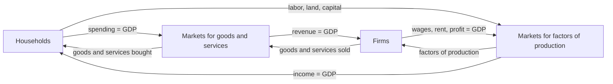

# Economics Exam Notes

All content below comes from the six slide decks you gave me. Topics from your syllabus list that are **not in those slides** are flagged in the coverage table, and I did not invent content for them.

## Coverage check: syllabus vs your slides

| Syllabus item | In your slides? | Where |
|---|---|---|
| 1. Elasticity (price, cross, income, mid-point, +/- interpretation) | Yes | Theory of Elasticity |
| 2. Theory of Production, PPF, points, unattainable | Yes | Theory of Production |
| 3. Cost of production: average and marginal rule, CGPA math | **Missing** (only AFC/AVC/AC/MC calculation in Mathematical Applications) | See section 3 |
| 4. Perfect competition math, MR, MC | Yes | Mathematical Applications |
| 5. Money and inflation | Yes | Money, Inflation and Unemployment |
| 6. GDP and what it captures or omits | Yes | National Income Accounting |
| 7. International trade (welfare effect, protection) | **Missing** | Ask for that slide |
| 8. Short-run aggregate supply curve (inflationary, recessionary graphs) | **Missing** | Ask for that slide |
| 9. Monetary and fiscal policy, Bangladesh indicators | Yes | Monetary and Fiscal Policy |

Missing slides: International Trade, Short-Run Aggregate Supply, and the Cost of Production (average-marginal) slide. Send those and I will add them in the same style.

---

# 1. Theory of Elasticity

## 1.1 Price elasticity of demand

The law of demand says price and quantity demanded move in opposite directions, but not by how much. Price elasticity of demand measures **how responsive quantity demanded is to a change in price**. Remember: it is **percentage change**, not just change.

$$E_d = \frac{\%\Delta Q}{\%\Delta P}$$

### Mid-point formula (use this in the exam)

Plain percentage changes give conflicting answers depending on whether price rises or falls, so the mid-point formula is used:

$$E_d = \frac{Q_2-Q_1}{P_2-P_1}\cdot\frac{(P_1+P_2)/2}{(Q_1+Q_2)/2} = \frac{\Delta Q}{\Delta P}\cdot\frac{P_{avg}}{Q_{avg}}$$

### Why we take the absolute value

Price and quantity demanded move in opposite directions, so the raw number is negative. Example: price up 10 percent, quantity down 20 percent gives -20/10 = -2. By convention economists drop the minus sign and say Ed = 2.

### Types of demand

| Type | Value | Meaning | Example from slide |
|---|---|---|---|
| Elastic | Ed > 1 | %change Q > %change P | 10% price rise gives 20% fall in Q (Ed = 2) |
| Inelastic | Ed < 1 | %change Q < %change P | 10% price rise gives 4% fall in Q (Ed = 0.4) |
| Unit elastic | Ed = 1 | %change Q = %change P | 10% price rise gives 10% fall in Q |
| Perfectly elastic | Ed = infinity | tiny price change, quantity goes from all to nothing | Unbranded rice at a Gazipur wholesale market: raise price from 60 to 61 taka and sales drop to zero |
| Perfectly inelastic | Ed = 0 | quantity does not change at all | Insulin, emergency medical services |

![[elasticity_demand.png]]

### Worked example (from slide)

Price falls from 12 to 10, quantity rises from 50 to 100. Find Ed.

- P1 = 12, P2 = 10, Q1 = 50, Q2 = 100
- Change in Q = 50, change in P = -2
- P average = (12+10)/2 = 11, Q average = (50+100)/2 = 75
- Ed = (50 / -2) x (11 / 75) = -3.67
- |Ed| = 3.67 > 1, so **demand is elastic**.

## 1.2 Price elasticity of supply

$$E_s = \frac{\%\Delta Q_s}{\%\Delta P}$$

Same method (mid-point) as demand.

| Type | Value | Meaning |
|---|---|---|
| Elastic | Es > 1 | %change Qs > %change P |
| Inelastic | Es < 1 | %change Qs < %change P |
| Unit elastic | Es = 1 | %change Qs = %change P |
| Perfectly elastic | Es = infinity | supply curve is horizontal. Slide example: local labor market at the minimum wage; pay a fraction below it and labor supply drops to zero |
| Perfectly inelastic | Es = 0 | supply curve is vertical. Slide example: land in a specific area |

![[elasticity_supply.png]]

### Worked example (from slide)

Quantity supplied rises from 120 to 140 as price rises from 4 to 5.50.

- Change in Q = 20, change in P = 1.5
- P average = (4+5.5)/2 = 4.75, Q average = (120+140)/2 = 130
- Es = (20 / 1.5) x (4.75 / 130) = **0.487**
- 0.487 < 1, so **supply is inelastic**.

## 1.3 Cross elasticity of demand

Responsiveness of the quantity demanded of one good to a change in the price of **another** good.

$$E_c = \frac{\%\Delta Q_x}{\%\Delta P_y}$$

| Sign | Meaning |
|---|---|
| Ec > 0 (positive) | goods are **substitutes** |
| Ec < 0 (negative) | goods are **complements** |

### Negative example (from slide): complements

Price of Good X rises from 120 to 160 per user/month; the firm's use of Good Y falls from 80 TB to 60 TB.

- Change in Qy = 60 - 80 = -20, change in Px = 40
- Px average = 140, Qy average = 70
- Ec = (-20 / 40) x (140 / 70) = **-1**
- Ec is negative, so the goods are **complements**.

### Positive example (from slide): substitutes

Commercial Antivirus (Good X) fee rises from 640.50 to 825.50; workstations on Built-in OS Security (Good Y) rise from 45 to 57.

- Change in Qy = 12, change in Px = 185
- Px average = 733, Qy average = 51
- Ec = (12 / 185) x (733 / 51) = **0.932**
- Ec is positive, so Antivirus and Built-in OS Security are **substitutes**.

## 1.4 Income elasticity of demand

$$E_y = \frac{\%\Delta Q_d}{\%\Delta Y} = \frac{\Delta Q_d / Q_{avg}}{\Delta Y / Y_{avg}}$$

| Sign | Meaning |
|---|---|
| Ey > 0 (positive) | **normal good**: demand rises when income rises |
| Ey < 0 (negative) | **inferior good**: demand falls when income rises |

### Practice questions from the slide (the slide left these unsolved, solved here with the slide's formula)

**Positive case: software developer.** Salary 60,000 to 75,000; subscriptions 2 to 3 per year.

- Change in Q = 1, Q average = 2.5; change in Y = 15,000, Y average = 67,500
- Ey = (1 / 2.5) / (15,000 / 67,500) = 0.4 / 0.2222 = **1.8**
- Ey > 0, so online learning subscriptions are a **normal good** (and Ey > 1, so demand responds more than proportionately to income).

**Negative case: junior IT support staff.** Salary 30,000 to 40,000; refurbished desktop use 8 to 5 times per year.

- Change in Q = -3, Q average = 6.5; change in Y = 10,000, Y average = 35,000
- Ey = (-3 / 6.5) / (10,000 / 35,000) = -0.4615 / 0.2857 = **-1.62**
- Ey < 0, so refurbished desktops are an **inferior good**.

### Exam checklist for any elasticity question

1. Write the mid-point formula.
2. Find change in Q, change in P (or Y), and the two averages.
3. Compute the value.
4. Write the 1 or 2 line interpretation (elastic/inelastic, substitutes/complements, normal/inferior).

---

# 2. Theory of Production

## 2.1 Production function

The relationship between the amount of **input** required and the amount of **output** that can be obtained. It gives the **maximum output** for a given quantity of inputs, for a given state of technical knowledge. Firms are assumed to produce efficiently.

- **Inputs**: commodities or services used to produce goods and services.
- **Outputs**: useful goods and services that result and are consumed or used in further production.

## 2.2 Total, marginal and average product

- **Total product (TP or Q)**: total output in physical units.
- **Marginal product** of an input: extra output from 1 more unit of that input, other inputs held constant. MPL = change in Q / change in L.
- **Average product**: total output divided by total units of an input. APL = Q / L.

## 2.3 Law of diminishing returns

Beyond a certain point, adding more units of an input while holding other inputs fixed gives less and less extra output. Marginal product of each unit declines. Total output still increases but **at a decreasing rate**. Reason: the extra labor has less and less of the fixed land and machinery to work with.

## 2.4 Factors of production and their returns

| Factor | Meaning | Reward |
|---|---|---|
| Land | natural resources: minerals, forests, water, unimproved land | Rent |
| Labor | physical and mental talents people contribute | Wage |
| Capital | produced goods used for further production: factories, machinery, tools, computers, buildings | Interest |
| Entrepreneurship | talent for organizing land, labor and capital, seeking opportunities | Profit |

## 2.5 Production Possibilities Frontier (PPF)

The PPF (also called production possibilities curve, PPC) is a graph showing the **various combinations of output the economy can possibly produce** given the available factors of production and technology.

Slide example: an economy producing only cars and computers.

- All resources in cars: 1,000 cars, 0 computers.
- All resources in computers: 3,000 computers, 0 cars.
- Point A: 600 cars and 2,200 computers.
- Point B: 700 cars and 2,000 computers.

![[ppf.png]]

### Where the points are located

| Location | Points | Meaning |
|---|---|---|
| **Outside** the PPF | C | **Unattainable / impossible**. Resources are scarce, so no allocation can reach it with the available factors and technology |
| **On** the PPF | A, B, E, F | **Efficient**. The economy gets all it can from its resources; more of one good means less of the other |
| **Inside** the PPF | D | **Inefficient**. For example, widespread unemployment. Slide: D is 300 cars and 1,000 computers; removing the inefficiency moves the economy to A (600 cars, 2,200 computers), so output of both goods rises |

### Unattainable point (short answer)

An unattainable point lies outside the PPF (point C). Given the available technology, the economy does not have enough factors of production to support that level of output, so it is impossible.

## 2.6 PPF and opportunity cost

The cost of something is what you give up to get it.

$$\text{Opportunity cost} = \frac{\text{what we give up}}{\text{what we get}}$$

Moving from A to B: give up 200 computers to get 100 more cars.

- OC of a car = 200 / 100 = **2 computers**
- Going back from B to A: OC of a computer = 100 / 200 = **1/2 car**

## 2.7 Why is the PPF bowed outward?

- For most goods, opportunity costs **increase** as more of the good is produced. This is the **law of increasing opportunity costs**.
- The PPF is bowed outward because **resources are specialized, not identical**.
- When an economy starts producing a good it uses the resources **best suited** for it first, so output is high at a low opportunity cost.
- As it produces more, it runs out of those resources and has to move resources from other goods (for example redirecting farmland to industrial manufacturing).
- These resources are **less suited**, so production costs a higher opportunity cost.

Slide example (not required reading): going from 60 to 70 houses forfeits 5 units of good X, but going from 110 to 120 houses forfeits 20 units.

## 2.8 PPF and economic growth

Economic growth is the increased productive capability of an economy, shown by an **outward shift of the PPF**. Two major causes:

1. An increase in the **quantity of resources** (for example discovery of new resources).
2. An **advance in technology** (more output from fixed resources, or same output with fewer resources).

![[ppf_growth.png]]

- **Balanced growth**: capacity to produce all goods rises simultaneously and proportionally; a parallel outward shift (panel a).
- **Unbalanced (biased) growth**: technology or resources rise disproportionately for one good (panel b). In the slide, technology only improves civilian goods, so the maximum military goods stays the same while maximum civilian goods rises.

---

# 3. Cost of Production

Your slides do **not** contain the "average and marginal rule" or the CGPA example. I have not added them from outside. What the slides do contain is the cost calculation at a given output (Mathematical Applications, Question 1b):

Cost function: TC = 160 + 4Q + Q^2, at Q = 10.

| Measure | Formula | Value |
|---|---|---|
| TFC | the constant term | 160 |
| AFC | TFC / Q | 160/10 = 16 |
| TVC | 4Q + Q^2 | |
| AVC | TVC / Q = 4 + Q | 4 + 10 = 14 |
| AC (ATC) | TC / Q = 160/Q + 4 + Q | 16 + 4 + 10 = 30 |
| MC | dTC/dQ = 4 + 2Q | 4 + 20 = 24 |

Is it short run or long run? **Short run**: at least one input is fixed, so there is a fixed cost. Check: at Q = 0, TC = 160, and that constant term is the TFC.

Note the graph shapes used in the slides: ATC and AVC are U-shaped, and MC rises and cuts through them (see the cost graphs in section 4). Send the Cost of Production slide for the average-marginal rule and CGPA example.

---

# 4. Perfect Competition and Monopoly Math

Slide source: Mathematical Applications.

## 4.1 Rules to remember

- **MR = dTR/dQ**, **MC = dTC/dQ**.
- Profit-maximizing condition: **MR = MC**.
- Perfectly competitive firm: **P = MR** (price taker).
- Monopolist: find Q from MR = MC, then get price by substituting Q into the **demand function**.
- Profit = TR - TC. Compare price with average variable cost for the shutdown decision.
- Shutdown rule (short run): if **P > AVC**, continue operating; if **P < AVC**, shut down.

## 4.2 Perfect competition, profit (Question 1)

Unbranded USB-C cables, TC = 160 + 4Q + Q^2, MR = 180.

- MC = 4 + 2Q. Set 4 + 2Q = 180, so Q* = 88.
- P* = MR = 180.
- TR = 180 x 88 = 15,840. TC = 160 + 4(88) + 88^2 = 8,256.
- **Profit = 15,840 - 8,256 = 7,584.**
- ATC at 88 = 160/88 + 4 + 88 = 93.82.

![[pc_profit.png]]

## 4.3 Aluminium engine blocks (Question 2)

TC = 250 + 80Q + 3Q^2, TR = 1000Q - 6Q^2.

- MC = 80 + 6Q. MR = 1000 - 12Q.
- MR = MC: 1000 - 12Q = 80 + 6Q, so 18Q = 920, **Q = 51.11**.
- TR = 35,436.61, TC = 12,175.50, **Profit = 23,261.11**.

## 4.4 Monopoly, Windows (Question 3)

Demand P = 10 - Q, TR = 10Q - Q^2, TC = 3 + Q + 0.5Q^2.

- MR = 10 - 2Q. MC = 1 + Q.
- MR = MC: 10 - 2Q = 1 + Q, so **Q* = 3**. Price: P = 10 - 3 = **7**.
- TR = 7 x 3 = 21. TC = 3 + 3 + 0.5(9) = 10.5. **Profit = 10.5**.
- ATC = 3/3 + 1 + 0.5(3) = 3.5.

![[monopoly_q3.png]]

## 4.5 Monopoly, gas turbines (Question 4)

Demand P = -2Q + 81, TC = 3Q^2 + Q + 12.

- TR = 81Q - 2Q^2, so MR = 81 - 4Q. MC = 6Q + 1.
- MR = MC: 81 - 4Q = 6Q + 1, so 10Q = 80, **Q = 8**. P = 81 - 16 = **65**.
- TR = 65 x 8 = 520. TC = 3(64) + 8 + 12 = 212. **Profit = 308**.
- The slide told you to calculate ATC and draw the diagram yourself: ATC = 3Q + 1 + 12/Q = 24 + 1 + 1.5 = 26.5 at Q = 8. Check: (65 - 26.5) x 8 = 308.

![[monopoly_q4.png]]

## 4.6 Perfect competition, loss (Question 5)

TR = 20Q, TC = Q^2 + 8Q + 100.

- MR = 20 so P* = 20. MC = 2Q + 8.
- 20 = 2Q + 8, so **Q* = 6**.
- TR = 120. TC = 36 + 48 + 100 = 184. **Profit = -64** (a loss of 64).
- ATC = Q + 8 + 100/Q = 30.67 at Q = 6.
- Shutdown check: AVC = Q + 8 = 14. Since **P (20) > AVC (14)**, the firm **continues operating** in the short run.

![[pc_loss.png]]

## 4.7 Perfect competition, USB drives (Question 6)

TR = 12Q, TC = Q^3 - 6Q^2 + 24Q + 30.

- P* = MR = 12. MC = 3Q^2 - 12Q + 24.
- 3Q^2 - 12Q + 24 = 12 gives Q^2 - 4Q + 4 = 0, so (Q - 2)^2 = 0, **Q* = 2**.
- TR = 24. TC = 8 - 24 + 48 + 30 = 62. **Profit = -38**.
- ATC = Q^2 - 6Q + 24 + 30/Q = 31 at Q = 2.
- AVC = Q^2 - 6Q + 24 = 16. Since **P (12) < AVC (16)**, the firm **shuts down**.

![[pc_q6.png]]

## 4.8 Quick quiz-style recipe (MR and MC)

1. Differentiate TR to get MR. If TR = P x Q with P from demand, substitute first.
2. Differentiate TC to get MC.
3. Set MR = MC, solve Q.
4. Perfect competition: P = MR. Monopoly: P from demand.
5. TR = P x Q, TC from the cost function, Profit = TR - TC.
6. Compare P with AVC if asked about shutdown.

---

# 5. Money and Inflation

## 5.1 What is money?

Any good that is **widely accepted for purposes of exchange and the repayment of debt**.

## 5.2 Three functions of money

1. **Medium of exchange**: without money you need barter, which requires a **double coincidence of wants** (find someone with a shirt who wants your bread). Money makes exchange easier and faster.
2. **Unit of account**: a common measure in which values are expressed. In barter, every good is priced in terms of every other good (1 horse = 100 bushels of wheat = 20 pairs of shoes...). With money you need only the money price.
3. **Store of value**: lets people move purchasing power from the present to the future. Money is not the only store of value and this is its least exclusive function.

## 5.3 Value of money

- The price level P is the amount of money needed to buy a basket of goods and services.
- Value of money = purchasing power = **Vm = 1/P**.
- When the price level rises, the value of money falls.

## 5.4 Price level and price index

- **Price** is a single price (apples). **Price level** is a weighted average of all prices in the economy.
- **Price index**: a measure of the price level.
- **Consumer Price Index (CPI)**: the weighted average of prices of a specific market basket bought by a typical household. Eight categories: food and beverages, housing, apparel, transportation, medical care, recreation, education and communication, other goods and services.

$$CPI = \frac{\text{Expenditure on basket in current year}}{\text{Expenditure on basket in base year}}\times 100$$

Base year = benchmark year used for comparison.

**Slide example**: basket of 10 pens, 5 shirts, 3 pairs of shoes.

- Current year: 10 x 0.70 + 5 x 14 + 3 x 30 = 7 + 70 + 90 = 167
- Base year: 10 x 0.20 + 5 x 7 + 3 x 10 = 2 + 35 + 30 = 67
- CPI = 167 / 67 x 100 = **249**

Interpretation: the basket is 149 percent more expensive (2.49 times the price) than in the base year. A basket costing 100 taka in the base year costs 249 taka now.

## 5.5 Inflation

Inflation is an **increase in the price level**, usually measured annually.

$$\text{Inflation rate} = \frac{CPI_{current}-CPI_{previous}}{CPI_{previous}}\times 100$$

Compare it with your income growth: your income rises by (1) the same percentage as inflation (keeping up), (2) a smaller percentage (not keeping up), or (3) a greater percentage (more than keeping up).

- **Nominal income**: current money amount of income.
- **Real income** = (Nominal income / CPI) x 100.
- Converting old salary to today's terms: Salary today = Salary past x (CPI current / CPI past).

## 5.6 Unemployment

Adults (16 or older) fall into three groups:

- **Employed**: paid employees, own business, unpaid family business workers, full or part time, and those temporarily absent (vacation, illness, weather).
- **Unemployed**: not employed, available for work and tried to find work in the previous four weeks; also those waiting to be recalled after a layoff.
- **Not in the labor force**: students, homemakers, retirees.

| Measure | Formula |
|---|---|
| Labor force | Employed + Unemployed |
| Employment rate | Employed / Total adult population x 100 |
| Unemployment rate | Unemployed / Labor force x 100 |
| Labor-force participation rate | Labor force / Adult population x 100 |

### Types of unemployment

- **Frictional**: natural frictions as qualified people with transferable skills change jobs. Example: firm A (computers) lays off workers as demand falls while firm B hires; the workers take time to move.
- **Structural**: structural changes eliminate some jobs and create others the unemployed are unqualified for; they lack transferable skills. Example: laid-off automobile workers when demand rises for computer analysts.
- **Natural** unemployment rate = frictional rate + structural rate. Economists estimate it at 4.0 to 6.5 percent.
- **Cyclical**: temporary job loss from economic downturns. Cyclical rate = actual unemployment rate - natural rate.

## 5.7 Phillips curve

Shows the relationship between inflation and unemployment. It slopes **downward** (negative association): low unemployment goes with high aggregate demand, which pushes up wages and prices.

![[phillips.png]]

- Point A: low inflation (2%), high unemployment (7%).
- Point B: high inflation (6%), low unemployment (4%).
- Policymakers would like both low, but historical data say that is impossible, so they face a **short-run trade-off** between inflation and unemployment.

---

# 6. GDP (National Income Accounting)

## 6.1 Definition

**GDP is the market value of all final goods and services produced within a country in a given period of time.**

GDP measures two things at once: total income of everyone in the economy and total expenditure on the economy's output. They are the same, because for the economy as a whole **income equals expenditure**.

### Breaking the definition down

| Phrase | Meaning |
|---|---|
| Market value | uses market prices to add different products together |
| All | all items produced and sold legally in markets |
| Final | only final goods (a laptop sold to a consumer), not intermediate goods (the microprocessor bought by a laptop brand) |
| Goods and services | tangible (food, cars) and intangible (haircuts, doctor visits) |
| Produced | currently produced, not past production |
| Within a country | geographic location of production |
| In a given period | usually a year or a quarter |

## 6.2 What GDP captures and what it omits

**Captures**: market transactions in final goods and services produced currently inside the country, including both goods and services.

**Omits**:

| Omitted item | Why |
|---|---|
| Nonmarket goods and services | no money changes hands. Hiring a cleaner counts; family members doing the same cleaning do not |
| Underground activities (legal and illegal) | no official records: illegal drugs, gambling, and legal services paid in unreported cash (for example a gardener, to evade tax) |
| Sales of used goods | not current production; a used car's value was counted when it was made |
| Financial transactions and government transfer payments | trading stocks and bonds only shifts ownership; transfers (Social Security, veterans' benefits) are not payment for current goods or services |
| Leisure time | has value but is entirely excluded |

## 6.3 Nominal GDP, real GDP, per-capita GDP

- **Nominal GDP**: output valued at **current prices**.
- **Real GDP**: output valued at **constant (base-year) prices**; inflation-adjusted.
- **Per-capita GDP** = GDP / population.

Slide example (one-good economy, base year 1 with price 10):

| Year | Price | Quantity | Nominal GDP | Real GDP |
|---|---|---|---|---|
| 1 (base) | 10 | 100 | 10 x 100 = 1,000 | 10 x 100 = 1,000 |
| 2 | 12 | 120 | 12 x 120 = 1,440 | 10 x 120 = 1,200 |
| 3 | 14 | 140 | 14 x 140 = 1,960 | 10 x 140 = 1,400 |

## 6.4 Components of GDP (expenditure approach)

$$Y = C + I + G + NX$$

- **Consumption (C)**: durable goods (last more than three years: refrigerators, cars), nondurable goods (food), services (lawn care, car repair, entertainment).
- **Investment (I)**: new capital goods + new residential housing (together **fixed investment**) + changes in business inventories (**inventory investment**). Investment = fixed + inventory investment.
- **Government purchases (G)**: spending on goods and services by local and central governments, including salaries and public works. **Transfer payments are excluded.**
- **Net exports**: NX = EX - IM.

## 6.5 Circular flow of income

Simple closed economy: only **firms and households**, all goods are bought by households, and households spend all their income.

- **Inner loop**: flow of inputs and outputs (households sell labor, land and capital; firms sell goods and services).
- **Outer loop**: flow of money (households spend on goods; firms pay wages, rent and profit).
- In goods and services markets: households buy, firms sell. In factor markets: households sell, firms buy.
- GDP = total household spending = total wages + rent + profit. All expenditure becomes someone's income, so GDP is the same either way.

## 6.6 Other measures

- **GNP** = market value of final goods and services produced by a country's **residents** wherever production occurs (ownership, not location).
  GNP = GDP + income earned from the rest of the world - income earned by the rest of the world.
- **Capital consumption allowance (depreciation)**: cost to replace capital worn out, obsolete or destroyed.
- **NDP** = GDP - capital consumption allowance.
- **NNP** = GNP - depreciation.

---

# 7. International Trade

**Not in the slides you gave me.** No welfare effect of imports graph, no protection arguments are in any of the six PDFs. Send that slide and I will add it.

---

# 8. Short-Run Aggregate Supply

**Not in the slides you gave me.** The only related content is the aggregate demand (AD) shifts in the policy slides, covered in section 9.

---

# 9. Monetary and Fiscal Policy

## 9.1 Monetary policy

A set of tools used by a nation's **central bank** to control the overall **money supply**. Three main tools:

1. **Reserve requirements**: minimum amount of reserves a bank must hold against checkable deposits.
2. **Interest rates**: cost of borrowing or earnings from lending, as a percentage of the loan.
3. **Open market operations (OMO)**: buying and selling of government securities by the central bank.

| Type | What the central bank does | Effect |
|---|---|---|
| **Expansionary** | increases money supply | lowers interest rate, raises quantity of goods demanded at each price level, **AD shifts right** |
| **Contractionary** | decreases money supply | raises interest rate, reduces quantity demanded, **AD shifts left** |

### Bangladesh: current monetary indicators

The slide says Bangladesh Bank is maintaining a strict **contractionary (tight)** policy to fight high inflation.

- **CRR (Cash Reserve Ratio)**: 4% on a bi-weekly average basis (3% daily requirement), as of March 2026.
- **SLR (Statutory Liquidity Ratio)**: 13% for conventional banks, 5.5% for Shariah-based Islamic banks. SLR is held as assets such as gold or government securities.
- **Policy (repo) rate**: the rate at which commercial banks borrow from the central bank; 9.50% (slide states "as of August 2026").
- **OMO**: in 2026 repo facilities were limited to **7 days** (previously 14 or 28 days) to reduce cash flow.

## 9.2 Fiscal policy

Changes in **government expenditures and/or taxes** to achieve goals such as low unemployment, stable prices and economic growth. Managed by the Ministry of Finance.

| Type | Action | Effect |
|---|---|---|
| **Expansionary** | G up and/or T down | AD shifts right |
| **Contractionary** | G down and/or T up | AD shifts left |
| **Discretionary** | deliberate changes, for example raising spending by 10 billion taka | |
| **Automatic** | changes that stimulate AD without deliberate action. Example: in a downturn tax collection falls automatically because taxes are tied to economic activity | |

## 9.3 Bangladesh: key fiscal policy indicators

Background: historically expansionary fiscal policy to fuel growth; FY2024-25 and FY2025-26 saw a prolonged **contractionary** stance against near double-digit inflation; the **FY2026-27 budget** is **expansionary overall** to revive output, while the central bank stays tight (source on slide: CPD, 2026).

**Government expenditure (G)**

- Total budget FY2025-26 is about **Tk 9.38 trillion** (Tk 9,38,000 crore), larger than the previous year.
- **9th National Pay Scale 2026** (Service Pay and Allowances Order, 2026): basic salaries of civil servants, public school teachers and state employees raised by **100% to 142%**, phased across FY2026-27 and FY2027-28 to manage deficit risk.
- FY2026-27 **Annual Development Programme (ADP)** funds large infrastructure: Dhaka Metro Rail expansion, expressway links, renewable energy grids.

**Tax (T)**

- **Source tax cut** on essential and agricultural products to a uniform **0.5%** to reduce inflation and cost of living.
- Selective contractionary tax measures to fund spending and keep the deficit manageable:
  - Initial **5% income tax bracket removed and replaced with 10%**, raising direct tax from lower-to-middle income earners.
  - **Expanding the tax base**: **TIN** compulsory for opening general bank accounts; **BIN** mandatory for MFS merchant accounts, utilities and trade licenses.
  - **15% Capital Gains Tax** (FY2026-27 Finance Bill) on profits from selling declared gold, jewellery, precious stones and high-value physical assets.

---

# Last-minute memory list

- Elasticity: use mid-point, drop the minus sign, interpret in one line. Ec positive = substitutes, negative = complements. Ey positive = normal, negative = inferior.
- PPF: on = efficient, inside = inefficient, outside = unattainable. Bowed out because resources are specialized (increasing opportunity cost). Shift out = growth.
- MR = MC always. Perfect competition P = MR. Monopoly price from demand. Shut down if P < AVC.
- GDP = final goods, produced now, inside the country, at market prices. Omits nonmarket, underground, used goods, financial and transfers, leisure.
- Y = C + I + G + NX.
- CPI = basket now / basket in base year x 100.
- Phillips curve: short-run trade-off, downward sloping.
- Contractionary monetary = AD left. Expansionary fiscal = G up or T down = AD right.
