# 🧠 Memory Interfacing: the complete beginner-friendly guide

> [!abstract] What this note is
> A from-zero explanation of **every slide** of Lecture 6. Each topic has: the idea in plain words, the slide image (in `attachments/`), a "how to read this diagram" guide, memory tricks, and exam-style recipes.
> Questions in the exam are expected to be of three kinds, so every section is tagged:
> - 🧠 **Concept**: "what is / why / explain / compare"
> - 🧩 **Design**: "design a circuit / decoder for this address range"
> - 🔧 **Implementation**: "show how it is built / wired / programmed / calculated"

> [!info] Notation used in this note
> - A **bar over a signal** in the slides means *active-low* (the signal does its job when it is **0**). In text and drawings I write that as a leading slash: `/CS`, `/OE`, `/WE`, `/RD`, `/WR`, `/BHE`.
> - `H` after a number means hexadecimal (e.g. `FF800H`). `K` = 1024 (2¹⁰). `M` = 1,048,576 (2²⁰) when talking about memory.
> - **Slide N** = page N of the lecture PDF. All 36 slides are saved as `attachments/slide-NN.png`.

---

## 📑 Table of contents

1. [[#1. The big picture: why "interfacing" exists]]
2. [[#2. Memory unit basics (RAM vs ROM)]]
3. [[#3. Pins of a memory chip]]
4. [[#4. ROM chip example: 2716 EPROM]]
5. [[#5. SRAM chip example: TMS4016]]
6. [[#6. SRAM vs DRAM (cells, read/write, refresh)]]
7. [[#7. Address decoding (the heart of the lecture)]]
8. [[#8. PLA (Programmable Logic Array)]]
9. [[#9. PLD and ROM/RAM interface using a PLD]]
10. [[#10. 8088/80188 memory interface (8-bit data bus)]]
11. [[#11. 8086/80286/80386SX memory interface (16-bit data bus)]]
12. [[#12. Error detection and correction (Hamming, SEC, DED, 74LS636)]]
13. [[#13. Design cookbook (step-by-step recipes)]]
14. [[#14. Cheat sheet: numbers and rules to memorize]]
15. [[#15. Typos / things to be careful about in the slides]]
16. [[#16. Practice questions with answers]]
17. [[#17. Glossary]]

### Topic map

| # | Topic | Slides | Type |
|---|-------|--------|------|
| 1 | Memory hierarchy and the "mismatch" problem | 2 | 🧠 |
| 2 | Memory unit, RAM, ROM | 3 | 🧠 |
| 3 | Memory pin connections | 4 | 🧠 |
| 4 | 2716 EPROM | 5 | 🧠 🔧 |
| 5 | TMS4016 SRAM | 6 | 🧠 |
| 6 | SRAM vs DRAM, DRAM read/write, refresh | 7-10 | 🧠 |
| 7 | Address decoding: NAND, 74LS138, 74LS139, simple system | 11-16 | 🧩 🔧 |
| 8 | PLA | 17-18 | 🧠 🧩 |
| 9 | PLD and ROM/RAM interface using a PLD | 19-20 | 🔧 |
| 10 | 8088/80188 interface, EPROM + SRAM, wait states | 21-23 | 🧩 🔧 |
| 11 | 8086/80286/80386SX interface, memory banks, write strobes | 24-28 | 🧩 🔧 |
| 12 | Error correction: Hamming, SEC, DED, 74LS636 | 29-36 | 🧠 🧩 🔧 |

---

## 1. The big picture: why "interfacing" exists

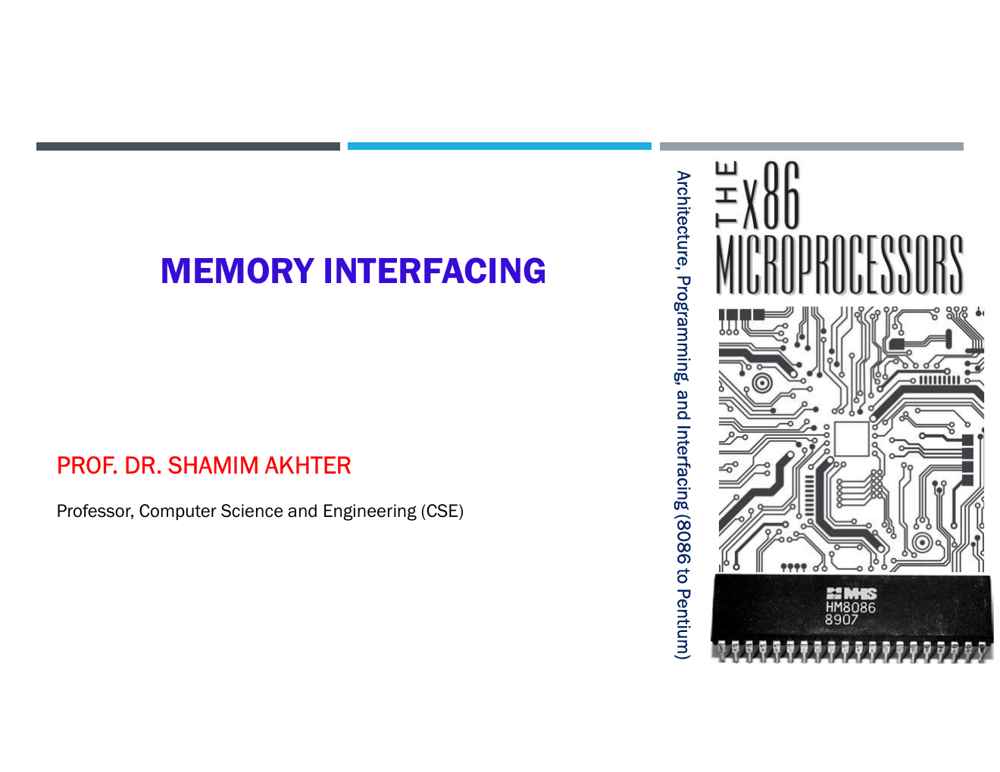

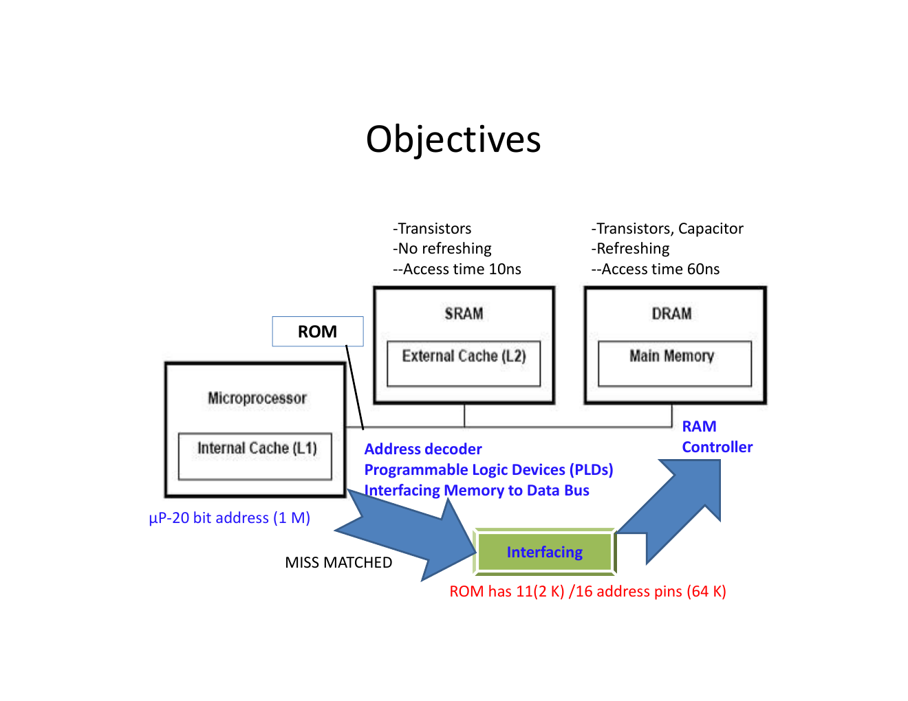

### 1.1 What is a microprocessor doing with memory?
The CPU (8086/8088 here) runs programs that live in memory. To fetch an instruction or a data byte it does three things:

1. Puts a **number (an address)** on the **address bus**: "I want the byte stored at location X".
2. Raises a **control signal** such as `RD` (read) or `WR` (write), and says if it means memory or I/O (`IO/M` or `M/IO`).
3. Reads (or sends) the actual value over the **data bus**.

**Memory interfacing = wiring memory chips to those three buses so that, when the CPU asks for address X, exactly the right chip answers with the right byte.**

### 1.2 Memory hierarchy (what the Objectives slide draws)

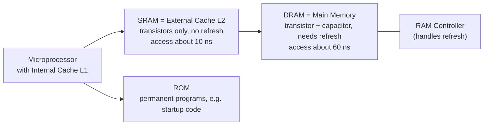

| Level | Technology | Key facts from the slide |
|---|---|---|
| L1 cache | inside the CPU | fastest, tiny |
| L2 cache | **SRAM** | transistors only, **no refreshing**, access ≈ **10 ns** |
| Main memory | **DRAM** | transistors **+ capacitor**, **refreshing needed**, access ≈ **60 ns** |
| ROM | read-only | keeps program even when power is off |

### 1.3 The "MISS-MATCH" (the big arrow in the slide)
The slide says the CPU and the memory chip **do not match**. There are three mismatches, and the rest of the lecture is the cure for each one:

| Mismatch | Example | Cure | Where in this note |
|---|---|---|---|
| **Address** | CPU has **20 address pins** (1 M locations); a ROM chip has only **11 pins** (2 K) or **16 pins** (64 K) | **Address decoder** (NAND gate, 74LS138, 74LS139, PLD) | §7, §9 |
| **Data width** | 8086 has a **16-bit** data bus but memory chips are **8 bits** wide | **Memory banks** (odd/even) | §11 |
| **Speed** | EPROM is slower than the CPU can wait | **Wait states** | §10 |

> [!tip] Memory trick: "Low bits WIRE, High bits DECIDE"
> The **lower** address bits go **straight** to the chip's address pins (the chip uses them to pick a byte *inside* itself). The **upper** address bits go to a **decoder**, which decides *which chip* is awake. Almost every design question is this one sentence.

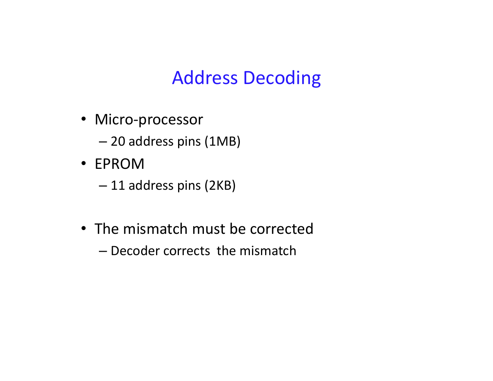

---

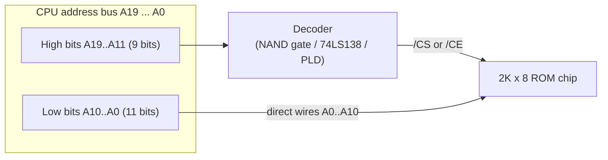

---

## 2. Memory unit basics (RAM vs ROM) 🧠

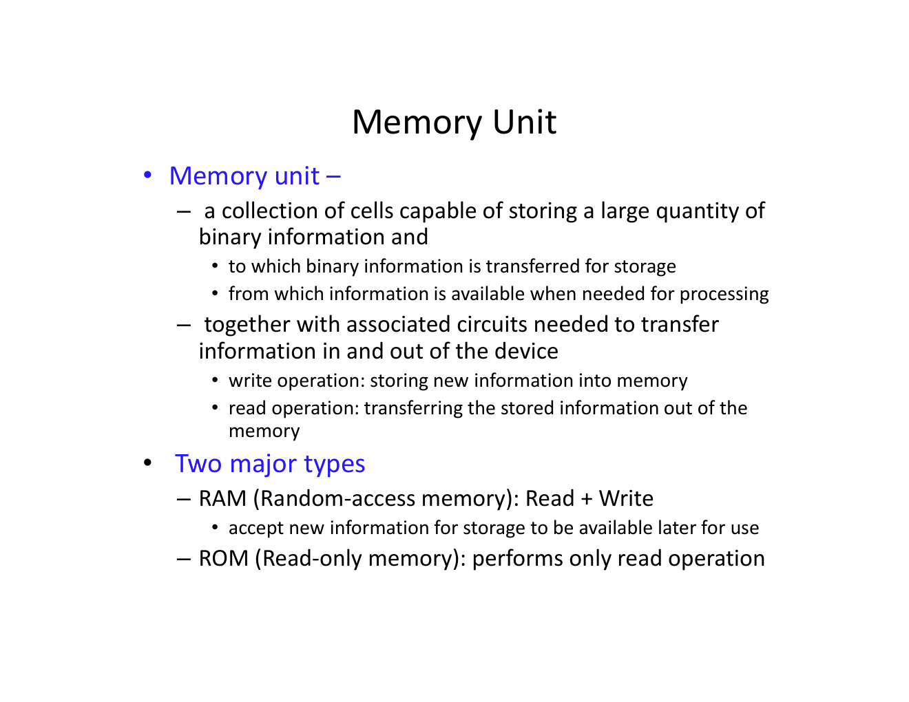

- **Memory unit** = a collection of **cells** that can store a large amount of **binary** information, plus the circuits needed to move information **in and out**.
- **Write operation** = store new information into memory.
- **Read operation** = transfer stored information out of memory.
- Two major types:

| | **RAM** (Random-Access Memory) | **ROM** (Read-Only Memory) |
|---|---|---|
| Operations | **Read + Write** | **Read only** |
| Purpose | accepts new information to be used later | fixed information (programs/tables) |
| Power off | usually loses data (volatile) | keeps data |

> [!note] "Random access" 
> Means you can jump to **any** location directly by its address in about the same time (unlike a tape you must wind).

---

## 3. Pins of a memory chip 🧠

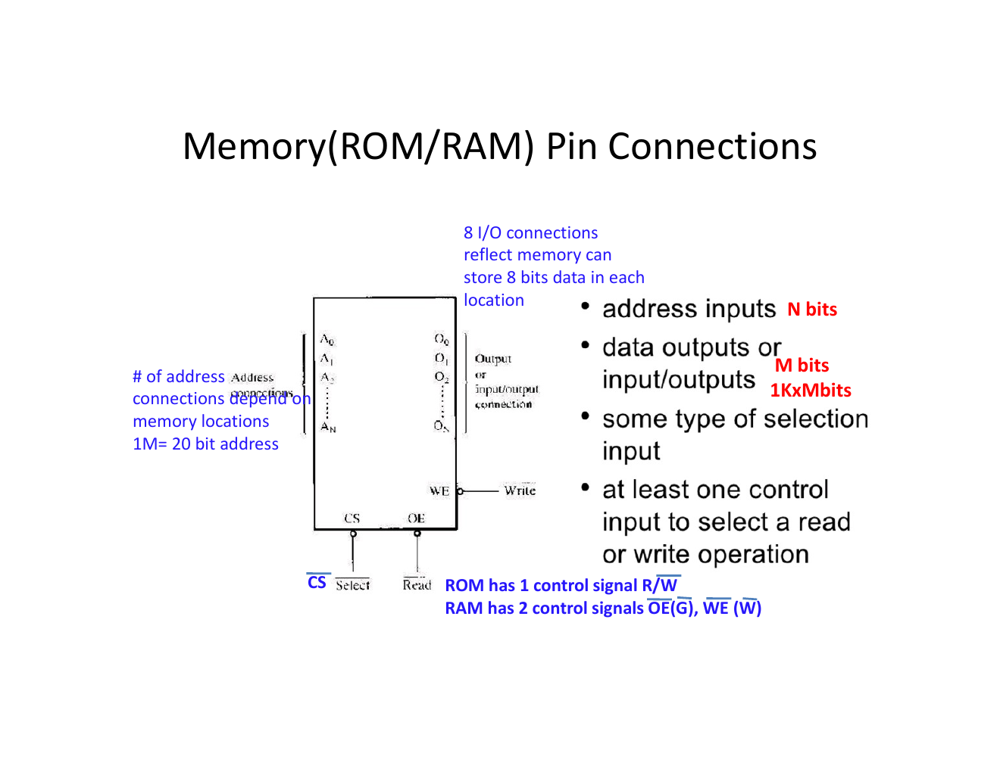

### How to read this diagram
The box is a generic ROM/RAM chip. Left side = **address in**, right side = **data**, bottom = **controls**.

| Pin group | Names | Meaning | Rule |
|---|---|---|---|
| **Address inputs** | A0 … AN (**N bits**) | choose one location | N pins → **2ᴺ** locations |
| **Data pins** | O0 … O7 (outputs for ROM) or D0 … D7 / DQ0 … DQ7 (in/out for RAM) | the stored value | **M bits** → each location holds M bits ("1K × M bits") |
| **Selection input** | `/CS` (also called `/CE`, `/S`) | wakes the chip up | chip ignores everything unless selected |
| **Control inputs** | `/OE` (also `/G`, read enable), `/WE` (also `/W`, write enable) | choose read or write | **ROM has 1 control signal**, **RAM has 2** (`/OE` and `/WE`) |

- The slide says: "8 I/O connections reflect that memory can store **8 bits** in each location".
- "# of address connections depends on memory locations. **1 M = 20 bit address**."

### Address-pin table (memorize!)
Each extra address pin **doubles** the locations.

| Size | Pins | Hex size | Example chip |
|---|---|---|---|
| 1K | 10 | 400H | |
| **2K** | **11** (A0-A10) | 800H | 2716, TMS4016 |
| 4K | 12 | 1000H | 2732 |
| **8K** | **13** (A0-A12) | 2000H | 2764 |
| 16K | 14 | 4000H | 27128 |
| **32K** | **15** (A0-A14) | 8000H | 27256, 62256 |
| **64K** | **16** (A0-A15) | 10000H | |
| **128K** | **17** (A0-A16) | 20000H | 271000, 621000 |
| 256K | 18 | 40000H | |
| 512K | 19 | 80000H | |
| **1M** | **20** (A0-A19) | 100000H | whole 8086/8088 memory |

> [!tip] Chip-name trick
> For the **27xxx / 62xxx** families, the number is the size in **Kbit**. Divide by 8 to get K×8:
> 2716 = 16 Kbit = **2K×8**, 2732 = 32 Kbit = **4K×8**, 2764 = 64 Kbit = **8K×8**, 27128 = **16K×8**, 27256 = **32K×8**, 271000 / 621000 = 1 Mbit = **128K×8**.

---

## 4. ROM chip example: 2716 EPROM 🧠🔧

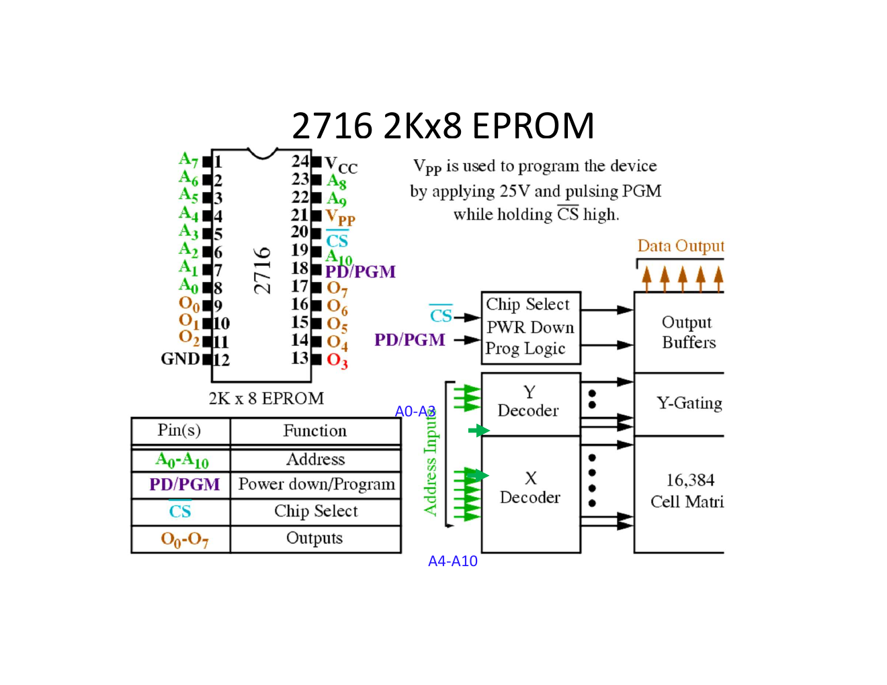

**EPROM** = Erasable Programmable ROM (erased with ultraviolet light, then reprogrammed). **2716 = 2K × 8** = 2048 locations × 8 bits = **16,384 bits**.

### Pin table from the slide

| Pin(s) | Function |
|---|---|
| A0-A10 | Address (11 pins → 2¹¹ = 2048 locations) |
| O0-O7 | Data outputs |
| `/CS` | Chip select |
| PD/PGM | Power down / Program |
| VCC, GND | power |
| VPP | programming voltage: **apply 25 V and pulse PGM while holding CS high** to program the device |

### How to read the internal block diagram
Follow the signal from the left to the right:

```
A0..A3  ───►  Y decoder ──► Y-gating ─┐
(4 bits, picks 1 of 16 columns)        ├─► 16,384-cell matrix ──► Output buffers ──► O0..O7
A4..A10 ───►  X decoder ───────────────┘       (128 rows x 16 x 8 ...)
(7 bits, picks 1 of 128 rows)

/CS , PD/PGM ─► Chip-select / Power-down / Program logic ─► enables the Output buffers
```

- The 11 address bits are **split**: **A4-A10 (7 bits)** feed the **X (row) decoder** (2⁷ = 128 rows) and **A0-A3 (4 bits)** feed the **Y (column) decoder** (2⁴ = 16). 128 × 16 = **2048** locations.
- Why split? A single 11-to-2048 decoder would be huge. Two small decoders in a grid (row × column) are much cheaper. (This "row and column" idea comes back in DRAM.)
- `/CS` low turns on the output buffers; if `/CS` is high the outputs float (disconnected), so many chips can share one data bus.

> [!tip] Memory trick
> 2716 → "**27**" = EPROM family, "**16**" = 16 Kbit → 2K × 8 → **11** address pins (2¹¹ = 2048) → **24**-pin package.

---

## 5. SRAM chip example: TMS4016 🧠

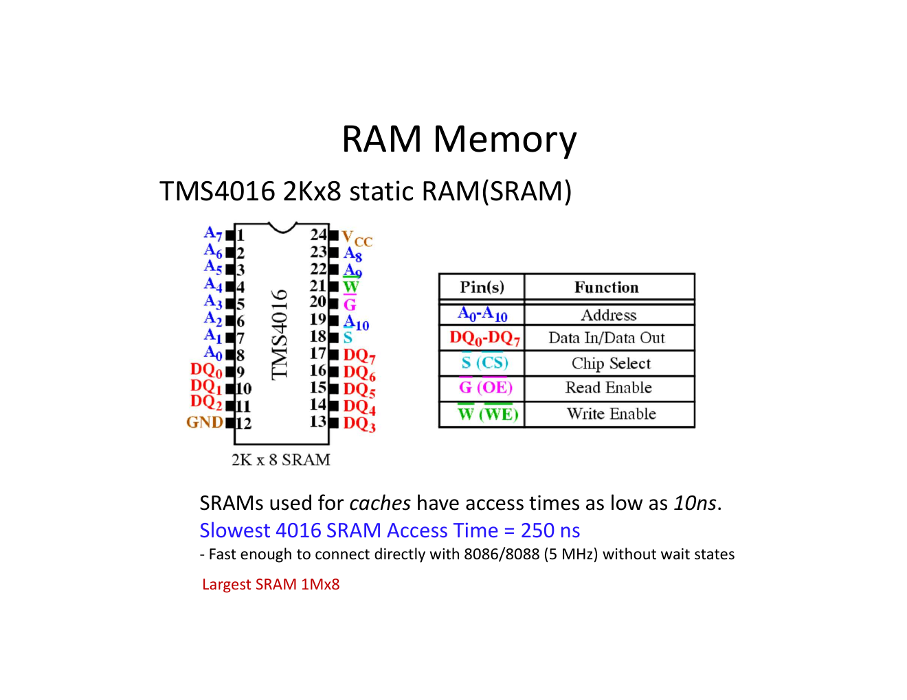

**TMS4016 = 2K × 8 static RAM (SRAM).** Looks like the 2716 but data pins are bidirectional and there is a write control.

| Pin(s) | Function |
|---|---|
| A0-A10 | Address (11 pins) |
| DQ0-DQ7 | Data **in / out** |
| `/S` (= `/CS`) | Chip select |
| `/G` (= `/OE`) | **Read** enable |
| `/W` (= `/WE`) | **Write** enable |

Facts to remember:
- SRAMs used for **caches** can have access times as low as **10 ns**.
- The **slowest 4016** has access time **250 ns**, which is **fast enough to connect directly to an 8086/8088 (5 MHz) with no wait states** (the CPU allows ~460 ns, see §10).
- The **largest SRAM** mentioned: **1M × 8**.

> [!note] Read vs write with a RAM chip
> **Read:** `/CS`=0, `/OE`=0, `/WE`=1 → chip drives data onto the bus.
> **Write:** `/CS`=0, `/WE`=0 → chip takes data from the bus and stores it.
> `/OE` and `/WE` are never both active at the same time.

---

## 6. SRAM vs DRAM (cells, read/write, refresh) 🧠

### 6.1 The comparison slide

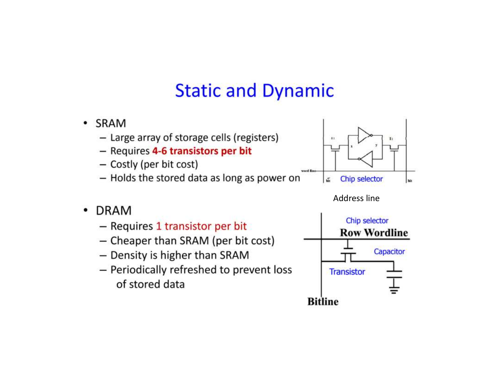

| Feature | **SRAM** (Static) | **DRAM** (Dynamic) |
|---|---|---|
| Cell | a **latch** (two inverters) + 2 access transistors | **1 transistor + 1 capacitor** |
| Transistors per bit | **4-6** | **1** |
| Cost per bit | costly | **cheaper** |
| Density (bits per chip area) | lower | **higher** |
| Holds data | as long as power is on | **only if refreshed periodically** |
| Speed (from Objectives slide) | ≈ **10 ns** | ≈ **60 ns** |
| Typical use | cache (L1, L2) | main memory |

> [!tip] Memory trick
> **S**tatic = **S**tays by itself (no refresh) = **S**peedy but **S**pendy.
> **D**ynamic = **D**ies (leaks) unless refreshed = **D**ense and **D**irt-cheap.

### 6.2 DRAM cell: reading and writing

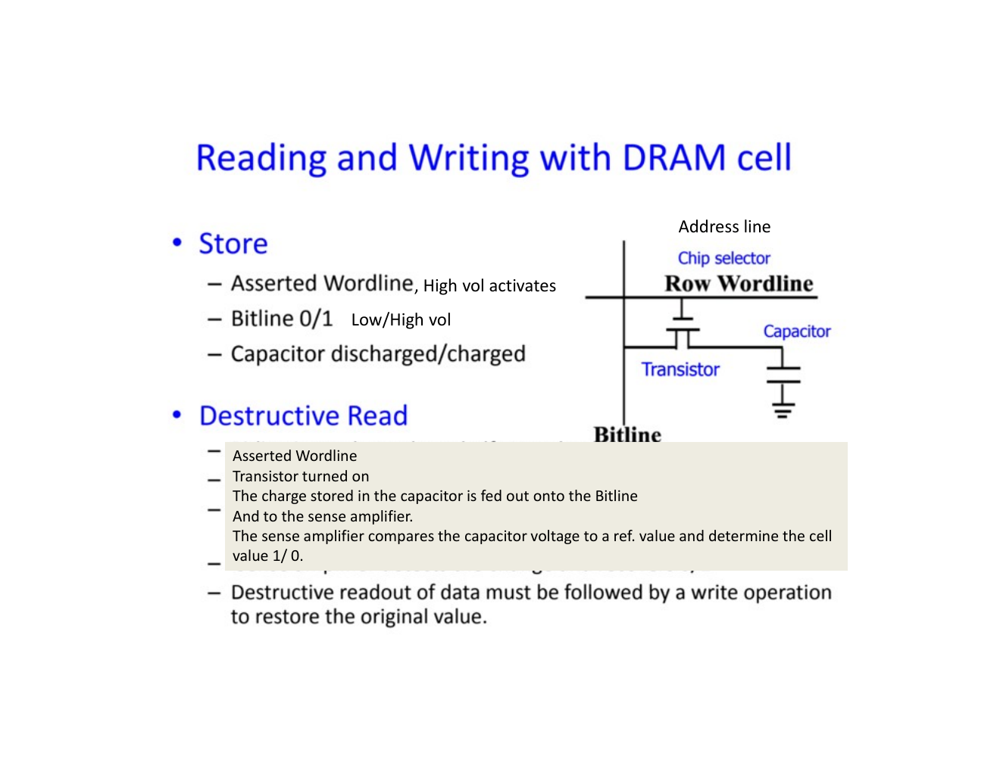

The DRAM cell is a **bucket (capacitor) with a tap (transistor)**:
- **Wordline** (row line, driven by the address decoder / chip selector) = the hand that turns the tap.
- **Bitline** = the pipe that carries water in or out.
- **Capacitor** = the bucket: **charged = 1**, **discharged = 0**.

**Store (write):**
1. Assert the **wordline** (high voltage) → the transistor turns **ON**.
2. Put **0 or 1** on the **bitline** (low or high voltage).
3. The capacitor **discharges (0)** or **charges (1)**.

**Destructive read:**
1. Assert the wordline → transistor ON.
2. The charge stored in the capacitor flows **out onto the bitline** and to the **sense amplifier**.
3. The **sense amplifier compares** the capacitor voltage with a **reference value** and decides the cell was **1 or 0**.
4. Reading **drains the bucket**, so the data is destroyed. **A write must follow the read to restore the original value.**

### 6.3 Why DRAM must be refreshed; why SRAM is faster, DRAM is denser

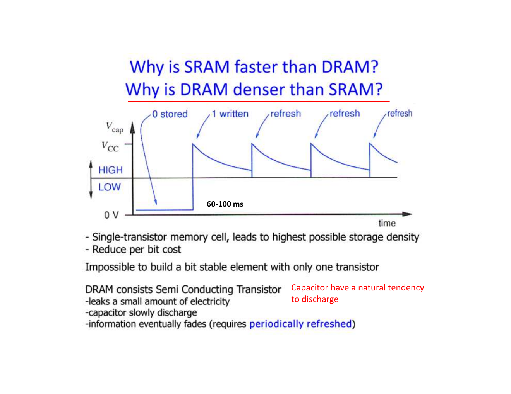

### How to read the graph
- Vertical axis = capacitor voltage `Vcap`. Horizontal = time. A horizontal line splits the area into **HIGH (above, reads as 1)** and **LOW (below, reads as 0)**.
- **"0 stored"**: voltage is at 0 V (low).
- **"1 written"**: voltage jumps up to **VCC**, then **slowly sags** because the capacitor **leaks** (a capacitor has a natural tendency to discharge).
- Before it sags below the HIGH/LOW line, a **refresh** rewrites it back to VCC. The saw-tooth shape = refresh, leak, refresh, leak. The slide labels the time scale **60-100 ms**, i.e. refresh must happen again and again within about that kind of time.

**Why is DRAM denser?** A **single-transistor** cell takes the least area → highest possible storage density → lowest cost per bit.

**Why is DRAM not just "1 transistor, done"?** The slide says it is *impossible to build a bit-stable element with only one transistor*. The transistor only switches; the **capacitor** holds the bit, and it leaks, so the information eventually fades and must be **periodically refreshed**.

**Why is SRAM faster?** (extra explanation, not written on the slide) The SRAM cell is a latch that **actively drives** the bitlines with a strong, clear 0/1: no tiny charge to sense, no refresh pauses, no restore-after-read step. DRAM has to detect a very small charge and then rewrite it.

### 6.4 SRAM read and write

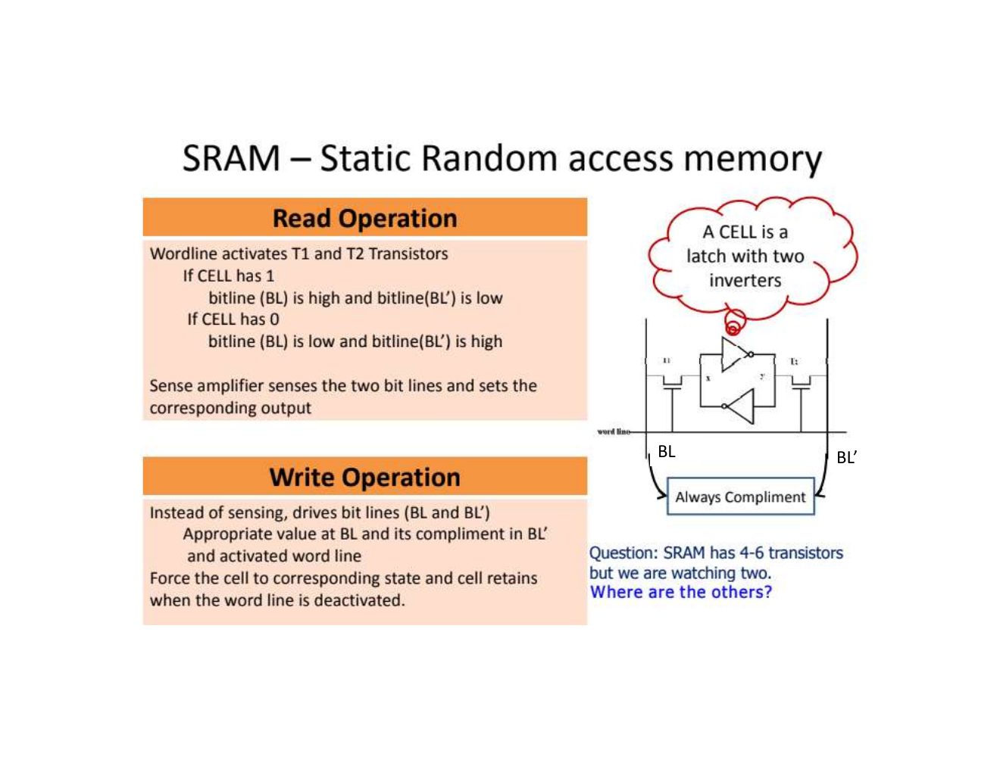

### How to read the diagram
- The cell is **two inverters facing each other** (a latch: each one's output feeds the other's input) → it keeps a **1** or a **0** by itself as long as power is on.
- **T1 and T2** are the two access transistors on the left and right, switched by the **word line**.
- **BL** and **BL'** are the two bit lines. They are **always complements** ("Always Compliment" box): when one is 1 the other is 0.

**Read operation**
1. Word line activates T1 and T2.
2. If the cell has **1**: BL is **high**, BL' is **low**. If the cell has **0**: BL is **low**, BL' is **high**.
3. A **sense amplifier** looks at the two bit lines and sets the output accordingly. (Reading does **not** destroy the data.)

**Write operation**
1. Instead of sensing, the circuit **drives** BL with the wanted value and BL' with its complement.
2. The word line is activated → the cell is **forced** into that state.
3. When the word line is deactivated, the cell **keeps** the state.

> [!question] Slide question: "SRAM has 4-6 transistors but we are watching two. Where are the others?"
> Each of the two **inverters** is made of **2 transistors** (one PMOS + one NMOS, CMOS style) = **4**. Add the **2 access transistors** T1 and T2 → **6 transistors** total. (Simpler designs use 4 by replacing the inverters' pull-up transistors with resistors, which is why the slide says "4-6".)

---

## 7. Address decoding (the heart of the lecture) 🧩🔧


### 7.1 The idea (analogy)
Think of a street with 1,048,576 houses (the 1 MB address space). A small ROM chip is a **tiny block of 2,048 houses**. The CPU shouts a full 20-digit house number. The block only needs to know the **last 11 bits** (which house *inside* the block). Somebody must also check that the **first 9 bits** are the block's own address (is this *my* block?). That "somebody" is the **address decoder**.

- Microprocessor: **20** address pins (1 MB).
- EPROM (2716): **11** address pins (2 KB).
- The **mismatch must be corrected**; the **decoder corrects the mismatch**.

### 7.2 The universal rule

```
Total CPU address bits     = 20   (A19 ... A0)
Chip address pins          = n    (A(n-1) ... A0)  ── connect DIRECTLY to chip
Remaining upper bits       = 20 - n                 ── go to the DECODER
Decoder output (active low)= /CS  (or /CE) of the chip
```

### 7.3 NAND-gate decoder (one chip, one fixed range) 🧩

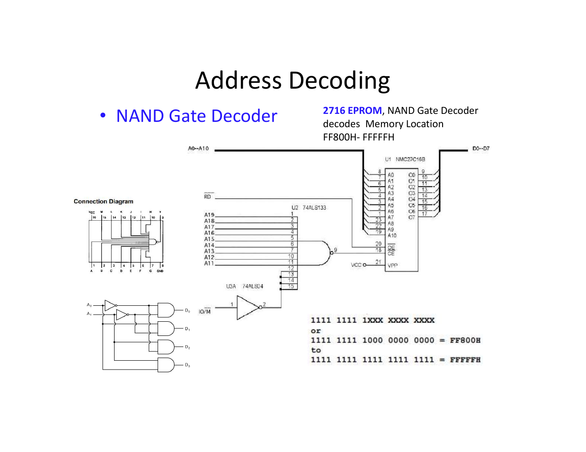

**Goal (from the slide):** decode the 2716 EPROM so it occupies **FF800H - FFFFFH**.

**Step 1: size.** FFFFFH - FF800H + 1 = 800H = 2048 bytes = **2K** ✔ (matches 2716).
**Step 2: write the range in binary.**

```
FF800H = 1111 1111 1000 0000 0000
FFFFFH = 1111 1111 1111 1111 1111
         ^^^^ ^^^^ ^ ^^^ ^^^^ ^^^^
         A19..A11 fixed = all 1s   |  A10..A0 = X (free, any value)
Pattern: 1111 1111 1xxx xxxx xxxx
```

**Step 3: connect.**
- **A10 … A0** (11 lines) → straight to the ROM's A0 … A10.
- **A19 … A11** (9 lines) → inputs of a big **NAND gate** (74ALS133, 13-input NAND). A NAND outputs **0 only when ALL inputs are 1**, so its output goes to `/CE` (active-low): the chip wakes up only when A19…A11 are all 1.
- The inverted `IO/M` (through the 74ALS04 inverter) is also fed in (and the unused NAND inputs are tied to it), so the chip is selected only for **memory** cycles, not I/O.
- `/RD` → `/OE` of the ROM so the ROM drives the data bus only during a read.
- Data pins O0-O7 → data bus D0-D7. VCC → VPP.

### How to read the slide's circuit
Look at the **centre of the page**: nine address lines A19…A11 run into the NAND (74ALS133). Its output "9" runs right and enters the ROM at pin `CE`. `RD` enters at `OE`. The **big bus A0-A10** at the top goes to the ROM address pins. On the left bottom the **small AND-gate drawing** is just an extra 2-to-4 style example, and the **truth table text** below shows the three representations of the same range.

> [!tip] Memory trick
> "**NAND = all ones.**" A NAND decoder can only select a block whose upper bits are **all 1**. For a block whose fixed upper bits include 0s, put an **inverter** on those lines first (or use an OR/NOR form).

### 7.4 The 3-to-8 line decoder: 74LS138 🔧

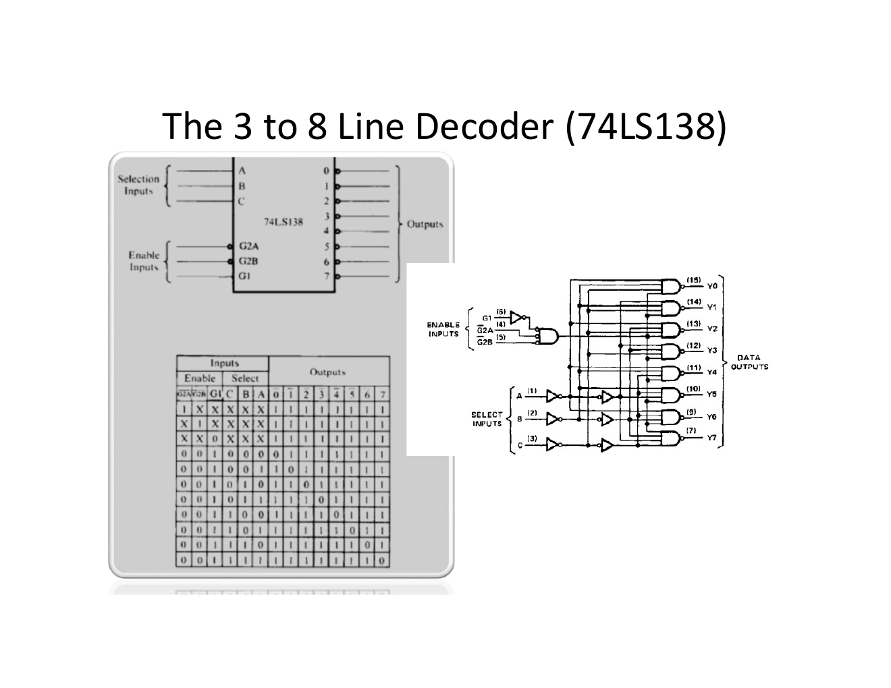

A **decoder** turns an n-bit binary input into a **one-hot** output: exactly one of 2ⁿ output lines becomes active.

**74LS138 pins:**

| Group | Pins | Notes |
|---|---|---|
| **Select inputs** | **A, B, C** (A = LSB, C = MSB) | which output to activate |
| **Enable inputs** | **G1** (active **HIGH**), **/G2A**, **/G2B** (active **LOW**) | all three must be satisfied |
| **Outputs** | **/Y0 … /Y7** | **active LOW** (the selected one goes to 0, the others stay 1) |

> [!important] Enable rule (very common exam fact)
> The chip works **only if G1 = 1 AND /G2A = 0 AND /G2B = 0.** Otherwise **all outputs are 1** (nothing selected).

**Truth table (when enabled):**

| C | B | A | Active (low) output |
|---|---|---|---|
| 0 | 0 | 0 | **Y0** |
| 0 | 0 | 1 | **Y1** |
| 0 | 1 | 0 | **Y2** |
| 0 | 1 | 1 | **Y3** |
| 1 | 0 | 0 | **Y4** |
| 1 | 0 | 1 | **Y5** |
| 1 | 1 | 0 | **Y6** |
| 1 | 1 | 1 | **Y7** |

How to read the slide: the **left** drawing is the symbol (selection inputs A-B-C on top, enable inputs G2A, G2B, G1 below, outputs 0-7 on the right). The **table** shows the first rows with X ("don't care") meaning: if any enable is wrong, outputs are all 1 no matter what C-B-A is. The **right** drawing is the internal gates: three inverters on A, B, C and 8 NAND gates; the enable inputs are combined (AND) and gate all eight NANDs.

> [!tip] Memory trick: "1-0-0"
> **G1 = 1, G2A = 0, G2B = 0** → "one-zero-zero". G**1** is the "positive" enable; the two **G2** lines have a bar, so they need **0**.

### 7.5 Design problem with 74LS138 (**exam-style**) 🧩

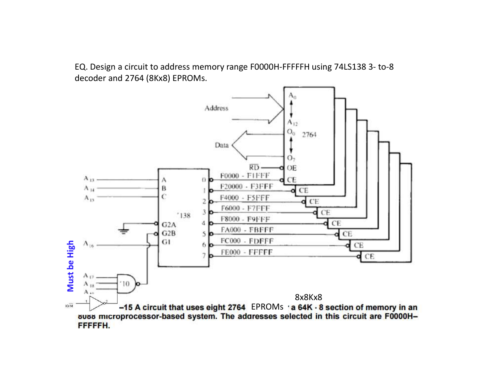

> [!question] Question from the slide
> Design a circuit to address memory range **F0000H - FFFFFH** using a **74LS138** 3-to-8 decoder and **2764 (8K × 8) EPROMs**.

**Solution, step by step**

1. **Total size** = FFFFFH - F0000H + 1 = 10000H = **64 KB**.
2. **Chip size** = 8K × 8 → **2¹³** → chip uses **A0 … A12** (13 pins).
3. **Number of chips** = 64K / 8K = **8 chips** ("8 × 8K × 8" in the slide).
4. One 138 has 8 outputs → **one chip per output** → perfect.
5. **Select lines:** the next three address bits **A13, A14, A15** go to **A, B, C** of the 138 (they choose *which* 8K block).
6. **Fixed bits for F0000H…FFFFFH:** A19 A18 A17 A16 = **1 1 1 1** → these must be **high** (the slide writes "Must be High"). They (together with memory-cycle `IO/M`) form the **enable**:
   - **A16 → G1** (needs 1).
   - **A17, A18, A19** (and inverted `IO/M`) → a **NAND** gate ('10, a 74LS10 3-input NAND) whose output (low only when they are all 1) → **/G2B**.
   - **/G2A → ground** (always satisfied).
7. **Each output Yn → `/CE` of one 2764**; **`/RD` → `/OE` of all chips**; **A0-A12 → A0-A12 of all chips**; **O0-O7 → data bus**.

**Resulting address map**

| A15 A14 A13 (C B A) | Output | Chip range |
|---|---|---|
| 000 | Y0 | **F0000 - F1FFF** |
| 001 | Y1 | F2000 - F3FFF |
| 010 | Y2 | F4000 - F5FFF |
| 011 | Y3 | F6000 - F7FFF |
| 100 | Y4 | F8000 - F9FFF |
| 101 | Y5 | FA000 - FBFFF |
| 110 | Y6 | FC000 - FDFFF |
| 111 | Y7 | **FE000 - FFFFF** |

How to read the diagram: the big stack of boxes on the right is the **eight 2764 chips** (drawn like stacked cards; each shows only its `CE`). Each horizontal green label (e.g. "F0000 - F1FFF") is the range selected by that decoder output. On the left, **A13, A14, A15 enter A, B, C**; the **ground symbol** is on G2A; **A16** goes to G1; the **'10 NAND** combines A17-A19 (and the inverter of `IO/M` at the very bottom) into /G2B.

> [!warning] The slide cuts off the very bottom of this drawing
> The inverter on `IO/M` is at the bottom edge. Logically the enable must be: **A19=A18=A17=A16=1 AND memory cycle**. If an exam asks "why the inverter?" → because 8088's `IO/M` is **high for I/O** and **low for memory**, while the NAND needs a **1** to mean "this is a memory access".

### 7.6 The dual 2-to-4 line decoder: 74LS139 🔧

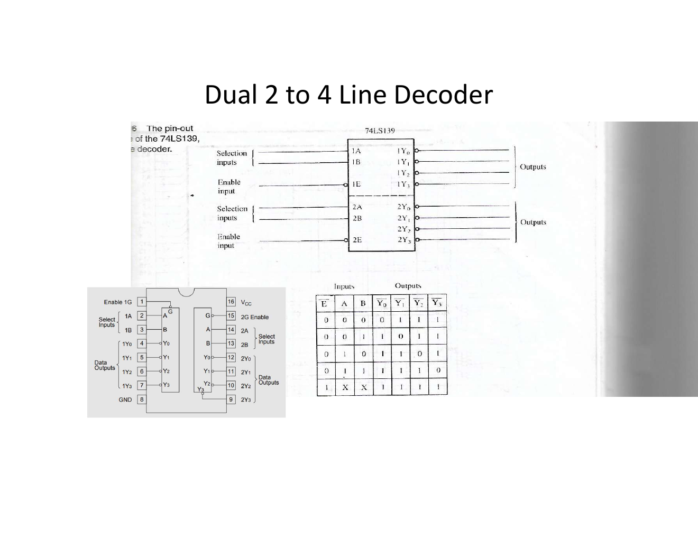

**74LS139 = TWO independent 2-to-4 decoders in one 16-pin chip.**

| Part | Pins (decoder 1 / decoder 2) |
|---|---|
| Select inputs | 1A, 1B / 2A, 2B |
| Enable input (**active low**) | 1E (or 1G) / 2E (or 2G) |
| Outputs (**active low**) | 1Y0-1Y3 / 2Y0-2Y3 |

**Truth table (each half):**

| /E | A | B | /Y0 | /Y1 | /Y2 | /Y3 |
|---|---|---|---|---|---|---|
| 0 | 0 | 0 | **0** | 1 | 1 | 1 |
| 0 | 0 | 1 | 1 | **0** | 1 | 1 |
| 0 | 1 | 0 | 1 | 1 | **0** | 1 |
| 0 | 1 | 1 | 1 | 1 | 1 | **0** |
| 1 | X | X | 1 | 1 | 1 | 1 |

(Same idea as 138: enable must be 0, selected output goes 0, everything else 1.)

### 7.7 Simple memory system with the 74HCT139 🔧

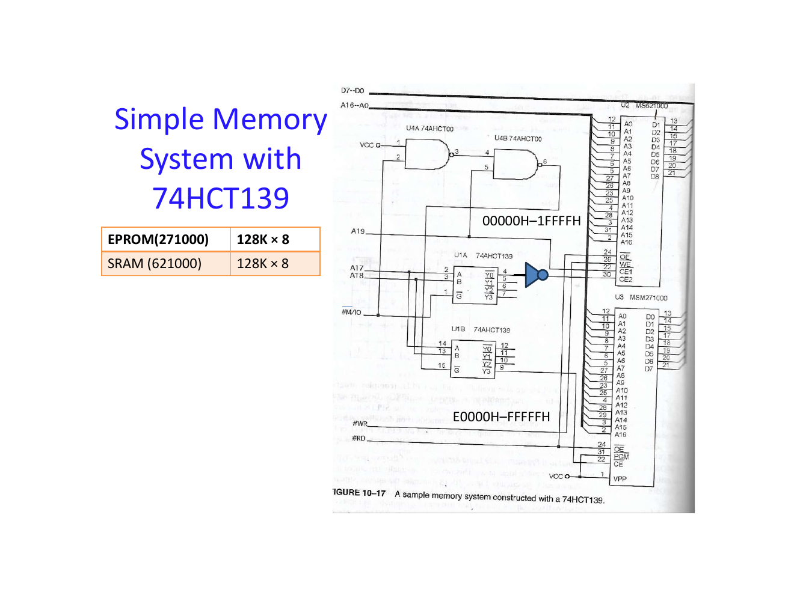

**What the system contains (from the slide):**

| Chip | Part | Size | Address range |
|---|---|---|---|
| **SRAM** | 621000 (MS621000) | **128K × 8** | **00000H - 1FFFFH** |
| **EPROM** | 271000 (MSM271000) | **128K × 8** | **E0000H - FFFFFH** |

**Why those ranges?**
- 128K = 2¹⁷ → both chips use **A0 … A16** (17 pins, the bus "A16-A0" goes to both).
- Remaining upper bits: **A19 A18 A17**.
  - SRAM: A19 A18 A17 = **0 0 0** → 00000H … 1FFFFH ✔
  - EPROM: A19 A18 A17 = **1 1 1** → E0000H … FFFFFH ✔

**How it is wired (how to read the diagram)**
- **A17, A18** go to the select inputs **A, B** of **both halves** (U1A and U1B) of the 74HCT139.
- **A19** and the memory/IO signal are combined by the two 74HCT00 NAND gates (U4A, U4B) to produce the **enable** of each half: the **SRAM half** is enabled only for **A19 = 0** and memory cycles; the **EPROM half** only for **A19 = 1** and memory cycles.
- The SRAM half's output **Y0** (A18 A17 = 00) goes through the **inverter** (blue triangle) to the SRAM's chip-enable so the polarity matches the chip. The EPROM half's output **Y3** (A18 A17 = 11) goes to the EPROM's `/CE`.
- `#RD` → `/OE` of both chips; `#WR` → `/WE` of the SRAM only (a ROM can't be written); the EPROM's PGM pin and VPP are tied high (VCC).
- Data bus **D7-D0** is common to both chips.

> [!tip] Memory trick
> "**Two high bits pick the chip, one more bit pairs the halves**": here 2 bits (A18, A17) go into the 139 and A19 gates the enable. Use the 139 when you only have **2 select bits (up to 4 chips)**, the 138 when you have **3 (up to 8 chips)**.

---

## 8. PLA (Programmable Logic Array) 🧠🧩

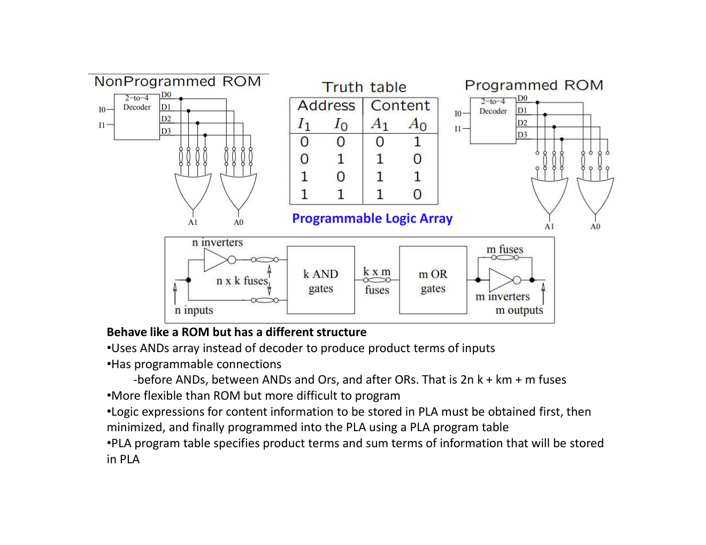

### 8.1 First understand a ROM as logic
A ROM is just a **truth table in hardware**:

- The **address** is the input (I1 I0), the **content** is the output (A1 A0).
- Inside, a **decoder** turns the address into **one-hot lines D0-D3**. Each line goes through **fuses** to **OR gates** (one OR per output bit).
- **Non-programmed ROM** = all fuses intact (every connection present). **Programmed ROM** = some fuses **blown** to create the wanted pattern.

Truth table on the slide:

| I1 | I0 | A1 | A0 |
|---|---|---|---|
| 0 | 0 | 0 | 1 |
| 0 | 1 | 1 | 0 |
| 1 | 0 | 1 | 1 |
| 1 | 1 | 1 | 0 |

So the programmed ROM realizes **A1 = D1 + D2 + D3** (rows where A1 = 1) and **A0 = D0 + D2** (rows where A0 = 1): keep those fuses, blow the rest.

### 8.2 What is different in a PLA?
> **A PLA behaves like a ROM but has a different structure.**

| | ROM | PLA |
|---|---|---|
| First stage | **fixed decoder** (makes **all** 2ⁿ minterms) | **programmable AND array** (makes only the **product terms you need**) |
| Second stage | programmable OR | programmable OR |
| Flexibility | less | **more flexible** |
| Programming | easy (just the truth table) | **more difficult to program** |

- The PLA has **programmable connections in three places**: **before the ANDs** (which input/complement goes to which AND), **between the ANDs and ORs**, and **after the ORs** (output polarity).
- Fuses: with **n** inputs, **k** AND gates, **m** outputs: **2n·k + k·m + m** fuses (slide: "2n k + km + m").
  - `n inverters` give each input in true and complement form (2n lines) × `k` ANDs = **2nk** fuses (the slide draws "n×k fuses" per polarity).
  - `k × m` fuses between the ANDs and the OR gates.
  - `m` fuses + `m` inverters at the outputs (choose output true or inverted).
- **How a PLA is programmed (procedure on the slide):**
  1. Get the **logic expressions** for the content (the truth table).
  2. **Minimize** them.
  3. Program them into the PLA using a **PLA program table**, which lists the **product terms** and **sum terms** to store.

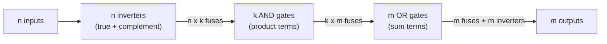

### 8.3 PLA example (slide 18)

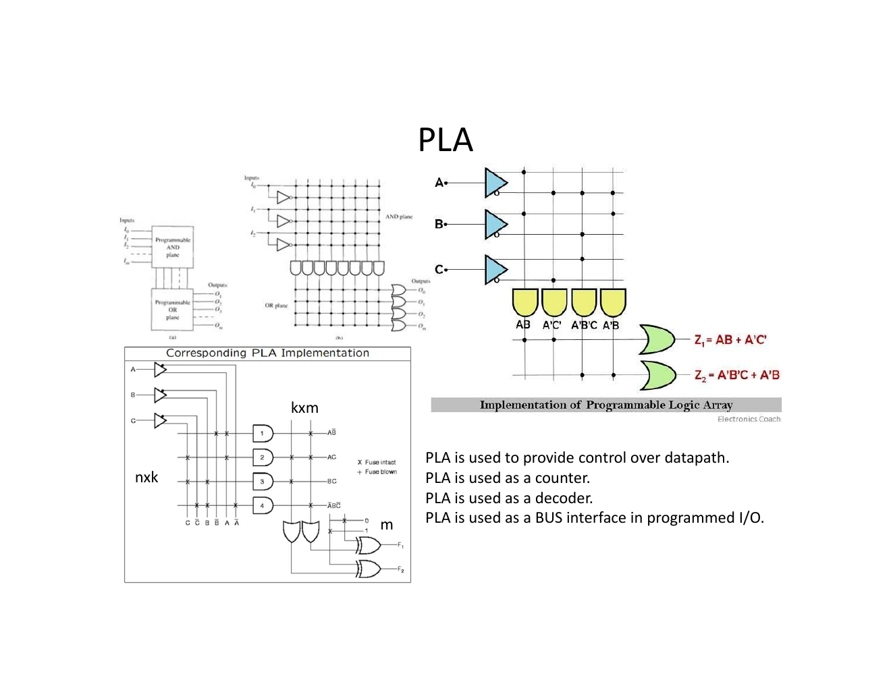

### How to read the right-hand drawing (best one to memorize)
- Inputs **A, B, C** each pass through a **buffer that also gives the complement** (the triangle with a small circle).
- Vertical lines carry A, A', B, B', C, C'. The **dots** on a vertical line show which signals are connected into each **AND gate** (the four yellow gates).
- The four AND gates produce the **product terms**: **AB**, **A'C'**, **A'B'C**, **A'B**.
- The two green **OR** gates add them up using dots again:
  - **Z1 = AB + A'C'**
  - **Z2 = A'B'C + A'B**

### How to read the left-hand "Corresponding PLA implementation"
- Columns on the bottom: **C, C', B, B', A, A'**: this is the **n × k** (input × AND) fuse grid ("nxk").
- Four AND gates **1-4**. To their right a second grid **k × m** ("kxm") connects the AND outputs to the OR gates.
- At the far right, XOR-style output stages with a fuse that selects polarity ("**m**").
- **× = fuse intact (connected), + = fuse blown** (legend on the slide). The product terms written beside the gates are **AB', AC, BC, A'B'C'**.
- Top-left drawings (a) and (b) show the same thing as **block diagram**: a **programmable AND plane** feeding a **programmable OR plane**.

### 8.4 What PLAs are used for (slide list)
- Provide **control over the datapath**.
- Used as a **counter**.
- Used as a **decoder**.
- Used as a **BUS interface in programmed I/O**.

> [!tip] Memory trick
> **ROM = fixed AND + programmable OR. PLA = programmable AND + programmable OR.** (Both end in OR gates.)

---

## 9. PLD and ROM/RAM interface using a PLD 🔧

### 9.1 What is a PLD?
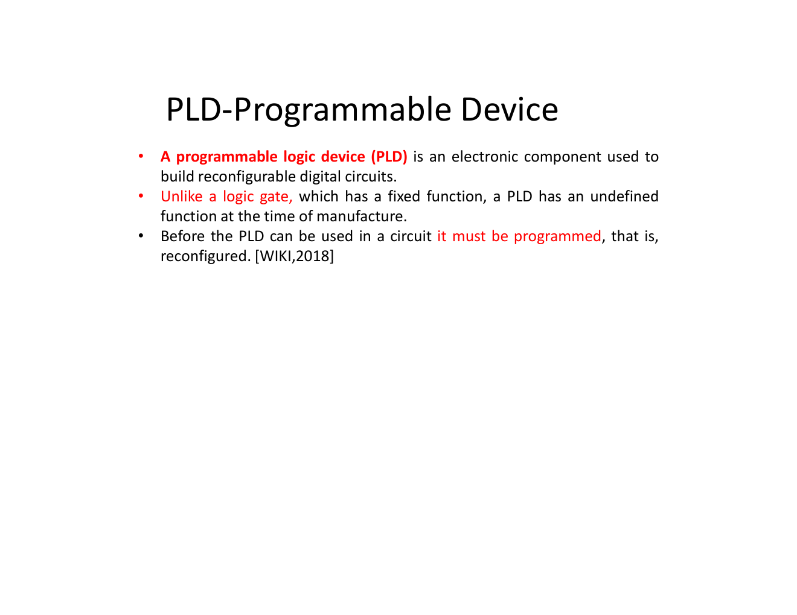

- A **Programmable Logic Device (PLD)** is an electronic component used to build **reconfigurable digital circuits**.
- A normal **logic gate has a fixed function**; a PLD has an **undefined function at manufacture**.
- **Before use, it must be programmed (reconfigured).** (Source quoted on the slide: Wikipedia 2018.)
- The PLA of §8 is one kind of PLD. The device in the next slide is a **GAL22V10**, another kind.

**Why use a PLD as a decoder?** One chip replaces a whole bunch of NAND/inverter/138 chips, and you can **change the memory map just by re-programming**, with no rewiring.

### 9.2 ROM and RAM interface using a PLD

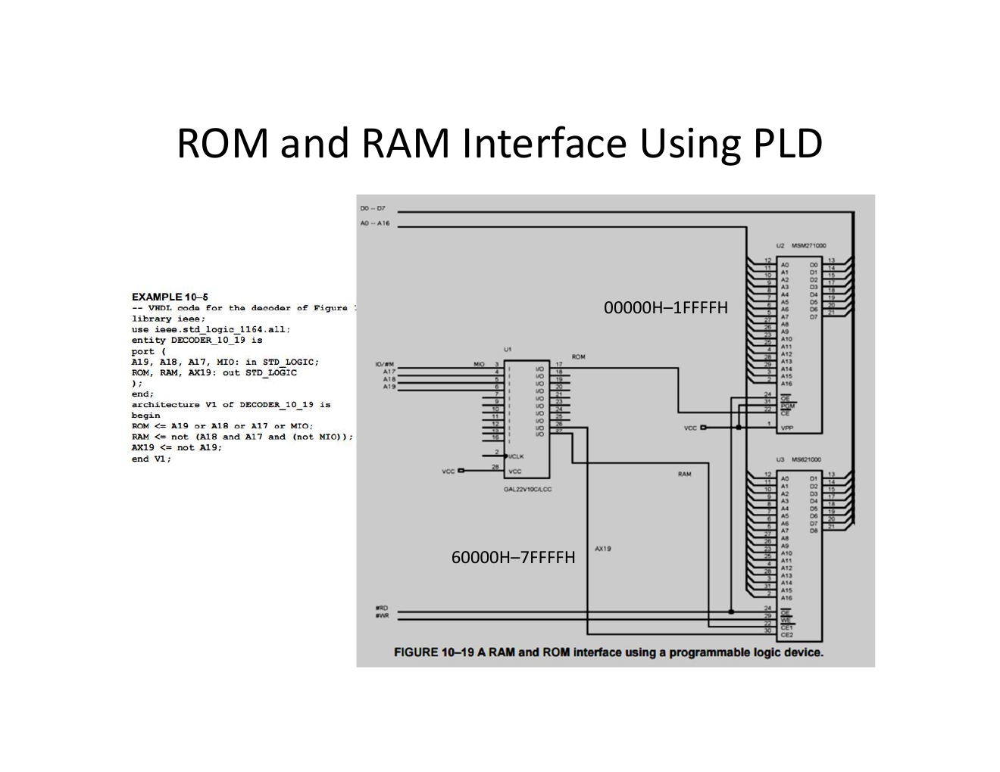

**Hardware (from the slide):**

| Chip | Size | Address range |
|---|---|---|
| **U2 MSM271000 (ROM)** | 128K × 8 | **00000H - 1FFFFH** |
| **U3 MS621000 (RAM)** | 128K × 8 | **60000H - 7FFFFH** |
| **U1 GAL22V10C** (PLD) | decoder | produces `ROM`, `RAM`, `AX19` |

Both memories take **A0-A16** directly (128K = 17 pins) and share **D0-D7**. The PLD receives **A17, A18, A19** and the memory/IO signal **MIO** (it is the `IO/M` pin).

**The VHDL code (Example 10-5) explained line by line**

```vhdl
ROM <= A19 or A18 or A17 or MIO;
RAM <= not (A18 and A17 and (not MIO));
AX19 <= not A19;
```

| Line | Reading | Result |
|---|---|---|
| `ROM <= A19 or A18 or A17 or MIO` | OR is **0 only when all inputs are 0** → A19 = A18 = A17 = 0 **and** MIO = 0 (memory cycle). `ROM` goes to the ROM's active-low `/CE`. | ROM selected for **A19A18A17 = 000** → **00000H-1FFFFH** ✔ |
| `RAM <= not (A18 and A17 and (not MIO))` | inside the bracket is **1 only when A18 = 1, A17 = 1 and MIO = 0** → `RAM` is **0** (active) in that case. Goes to RAM `/CE1`. | needs A18 A17 = 11 |
| `AX19 <= not A19` | high when A19 = 0. Goes to RAM's other enable **CE2** (active high). | needs A19 = 0 |

So the RAM is selected when **A19 A18 A17 = 0 1 1** = `0110 0000 0000 0000 0000` = **60000H** up to `0111 1111 ...` = **7FFFFH** ✔.

Also in the code: `entity DECODER_10_19` declares **inputs** `A19, A18, A17, MIO` and **outputs** `ROM, RAM, AX19`; `architecture V1` contains the three equations. (VHDL is a hardware-description language: the three lines are *not* a program executed step by step; they describe three gates.)

> [!tip] Memory trick
> **OR-form decoder:** the chip is selected (output 0) when every input is **0**. To require a bit to be **1**, put `not` on it.
> **AND/NAND-form decoder:** the chip is selected (output 0) when every input is **1**.

---

## 10. 8088/80188 memory interface (8-bit data bus) 🧩🔧

### 10.1 What the processor offers (slide 21 text)

| Item | 8088 / 80188 |
|---|---|
| Clock | **5 MHz** (8088) |
| Address lines | **20** (A19 - A0) |
| Data bus | **8 bits** (AD7 - AD0) |
| Control signals | **IO/M, RD, WR** (3) |

Memory used in the example:

| Memory | Chip | Size / quantity | Addresses |
|---|---|---|---|
| **EPROM** | **27256** (32K × 8) | 3 chips, **U1, U2, U3** | **U1 = E8000H-EFFFFH**, **U2 = F0000H-F7FFFH**, **U3 = F8000H-FFFFFH** |
| **SRAM** | **62256** (32K × 8) | **16 chips** | **00000H - 7FFFFH** |
| Decoder | **74LS138 / 74HCT138** (3-to-8) | | |

> [!warning] Slide text vs. figure
> The slide text says "3 **2732** (32K × 8) EPROMs", but the figure uses **27256** chips (32K × 8). A real 2732 is only 4K × 8. Use **27256** = 32K × 8.

### 10.2 Three 27256 EPROMs on the 8088 (slide 22)

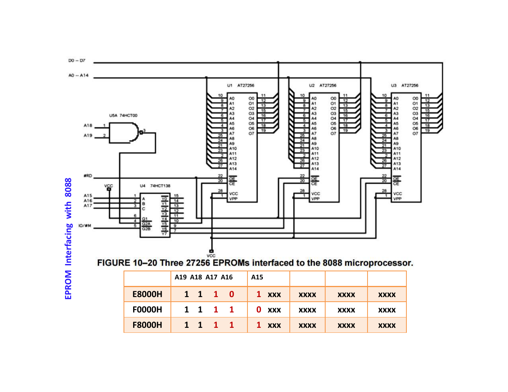

**Design reasoning**

1. **27256 = 32K × 8** → needs **15 address pins A0-A14** (those go straight to all three chips: "A0-A14" bus on the slide).
2. Three chips occupy **3 × 32K = 96K** in the top of memory. Look at the address table on the slide:

| Chip | Start | A19 A18 A17 A16 | A15 | A14…A0 |
|---|---|---|---|---|
| U1 | **E8000H** | 1 1 1 0 | **1** | xxx xxxx xxxx xxxx |
| U2 | **F0000H** | 1 1 1 1 | **0** | xxx xxxx xxxx xxxx |
| U3 | **F8000H** | 1 1 1 1 | **1** | xxx xxxx xxxx xxxx |

3. **A19 = A18 = 1 for all three**, and the three differ in **A17 A16 A15** = **101**, **110**, **111**.
4. So use a **74HCT138** with **A = A15, B = A16, C = A17** (C B A = A17 A16 A15):
   - E8000H → C B A = 1 0 1 → **Y5** → chip **U1**
   - F0000H → 1 1 0 → **Y6** → chip **U2**
   - F8000H → 1 1 1 → **Y7** → chip **U3**
5. **Enable of the 138:** **G1 = VCC** (always 1), **/G2A = output of a NAND of (A18, A19)** (a 74HCT00, U5A: goes low only when **A18 = A19 = 1**), **/G2B = IO/M** (low for a memory cycle).
6. `/RD` → `/OE` of all three EPROMs. **VPP/VCC** tied high. **D0-D7** shared.

How to read the diagram: three tall chips (U1, U2, U3) side by side, each with address pins A0-A14 on the left and `O0-O7` on the right. The **thick buses** along the top are **D0-D7** and **A0-A14** (shared). The **U4 74HCT138** is at lower left; its inputs A15, A16, A17 come from the left; the **U5A NAND** (A18, A19) is above it, feeding the enable. Three wires leave outputs Y5, Y6, Y7 and run up to the `CE` pins of U1, U2, U3.

### 10.3 Timing: why the EPROM needs a wait state ⏱

From the slide:
- EPROM **access time = 450 ns**.
- **74LS138** decode delay = **8 ns**.
- The 8088 at **5 MHz** allows only **460 ns** for memory to deliver the data.
- **One wait state** adds **200 ns** (= one clock period: 1 / 5 MHz = 200 ns).

Reasoning: needed time = 450 + 8 = **458 ns**, which is practically **equal to the 460 ns allowed**: no safety margin (real circuits also add buffer/latch delays), so the **EPROM requires the generation of a wait state**. With one wait state the CPU waits up to **460 + 200 = 660 ns**.

> [!tip] Exam recipe: "Does this memory need a wait state?"
> 1. Add: **memory access time + decoder delay (+ other delays)**.
> 2. Compare with the **time the CPU allows** (460 ns for the 5 MHz 8088 here).
> 3. If it is **greater or has no margin → insert wait state(s)**, each adds **one clock** (200 ns at 5 MHz).
> Compare the SRAM: slowest TMS4016 = 250 ns ≪ 460 ns → **no wait state needed** (slide 6).

### 10.4 The 16 SRAMs (62256) on the 8088 + buffers (slide 23)

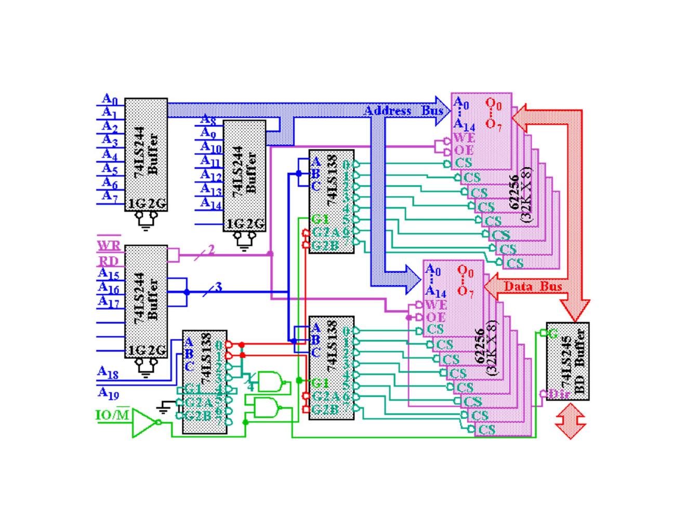

**Capacity check:** 16 × 32K = 512K = **80000H** bytes → addresses **00000H - 7FFFFH** ✔.

**Design reasoning**
- Each 62256 has A0-A14 (15 pins) → **A0-A14 go to all 16 chips** (via buffers).
- Remaining bits to choose among 16 chips: **A15, A16, A17** (3 bits → 8 chips) **and A18, A19** (which half).
- **Two-level decoding:**
  - **First-level decoder (lower-left 74LS138):** inputs **A18, A19** (+ `IO/M` inverted for "memory cycle"). Its outputs **Y0 and Y1** (red wires) enable the two second-level decoders: Y0 → first block (A19 A18 = 00 → 00000H-3FFFFH), Y1 → second block (A19 A18 = 01 → 40000H-7FFFFH).
  - **Second-level decoders (two 74LS138s):** inputs **A15, A16, A17** (A, B, C) → each of their 8 outputs selects **one 32K chip**. 8 chips × 32K = 256K per decoder.
  - The other outputs of the first decoder (and the two NAND gates) are available for other regions such as the EPROMs.
- Each chip also gets `/RD` → `/OE` and `/WR` → `/WE` (via buffer).

**Buffers (why the extra chips?)**

| Chip | Role |
|---|---|
| **74LS244** (octal buffer) | one-way buffer for **address lines** and **control lines (WR, RD)** so the CPU pins are not overloaded by 16 chips |
| **74LS245** (octal bus transceiver, "BD Buffer" = bidirectional) | **bidirectional** buffer on the **data bus**; its **DIR** pin sets the direction (read or write) and **G** enables it |

(Explanation of "why buffers": a processor pin can only drive a few chip inputs, so many-chip systems add buffers.)

---

## 11. 8086/80286/80386SX memory interface (16-bit data bus) 🧩🔧

### 11.1 What is different from the 8088? (slide 24)

| | 8088 / 80188 | 8086 / 80186 / 80286 / 80386SX |
|---|---|---|
| Data bus | **8 bits** | **16 bits** (80286, 80386SX have a **24-bit address**) |
| Memory/IO signal | `IO/M` | **`M/IO`** (8086, 80186) |
| Extra control | none | **`BHE`** and **`A0`** (or **`BLE`**) |
| Read/write strobes | `RD`, `WR` | **`MRDC`, `MWTC`** (80286, 80386SX) instead of `RD`, `WR` |

**The challenge:** the processor can work on **8 bits (a byte) or 16 bits (a word)** at once. But memory chips are 8 bits wide. Solution: build memory as **two 8-bit sections called banks**, side by side.

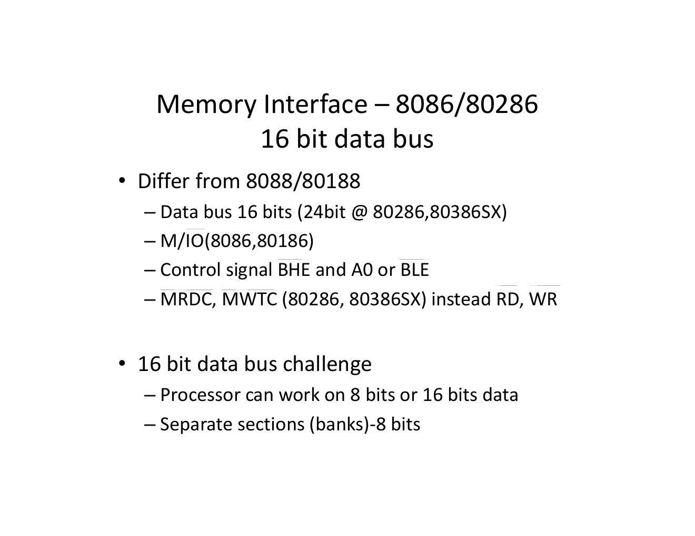

### 11.2 Even (low) bank and odd (high) bank (slide 25)

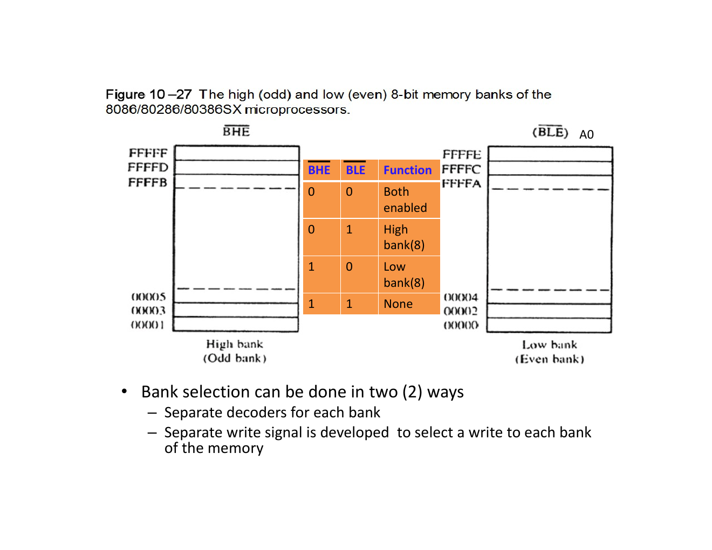

### How to read the diagram
Two tall columns of memory.
- **Right column = LOW bank = EVEN bank.** It holds addresses **00000, 00002, 00004, … FFFFE** and is wired to data lines **D0-D7**. Selected by **A0** (called **BLE** on the 80386SX).
- **Left column = HIGH bank = ODD bank.** It holds addresses **00001, 00003, 00005, … FFFFF** and is wired to **D8-D15**. Selected by **BHE**.

```
            address ->   FFFFF  FFFFE
 HIGH bank (odd, D8-D15)  [ ]    [ ]  LOW bank (even, D0-D7)
 selected by /BHE         ...    ...   selected by A0 (/BLE)
                          00001  00000
```

**Bank-select table (memorize!)** (both signals are **active low**)

| /BHE | A0 (/BLE) | Function | What is enabled |
|---|---|---|---|
| 0 | 0 | **Both enabled** | 16-bit word (even address) → D0-D15 |
| 0 | 1 | **High bank (8)** | odd byte only → D8-D15 |
| 1 | 0 | **Low bank (8)** | even byte only → D0-D7 |
| 1 | 1 | **None** | nothing |

> [!tip] Memory trick: "BHE = High side, A0 = even side"
> **/BHE = 0 → HIGH (odd) bank is enabled (D8-D15).** **A0 = 0 → LOW (even) bank is enabled (D0-D7).** Both 0 → full 16-bit word.

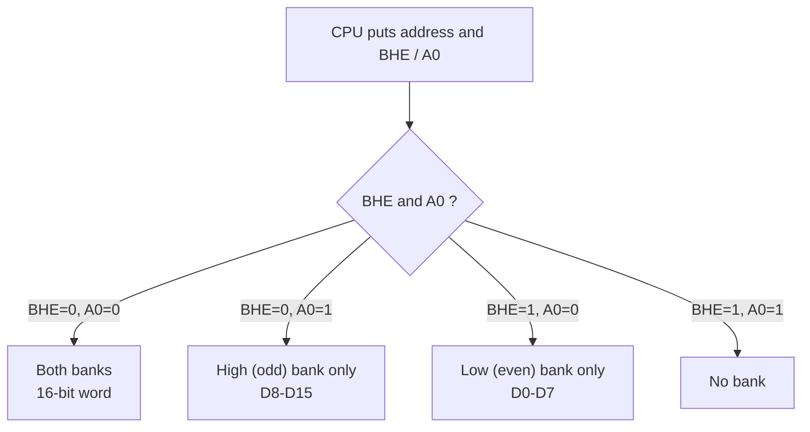

(Extra, not on the slide: a 16-bit word stored at an **odd** address needs **two** bus cycles because its two bytes sit in different rows of the banks.)

**Two ways to do bank selection (slide 25 text)**
1. **Separate decoders for each bank.** (§11.3)
2. **Separate write signal for each bank**, with one common decoder. (§11.4)

### 11.3 Method 1: Separate bank decoders (slide 26) 🧩

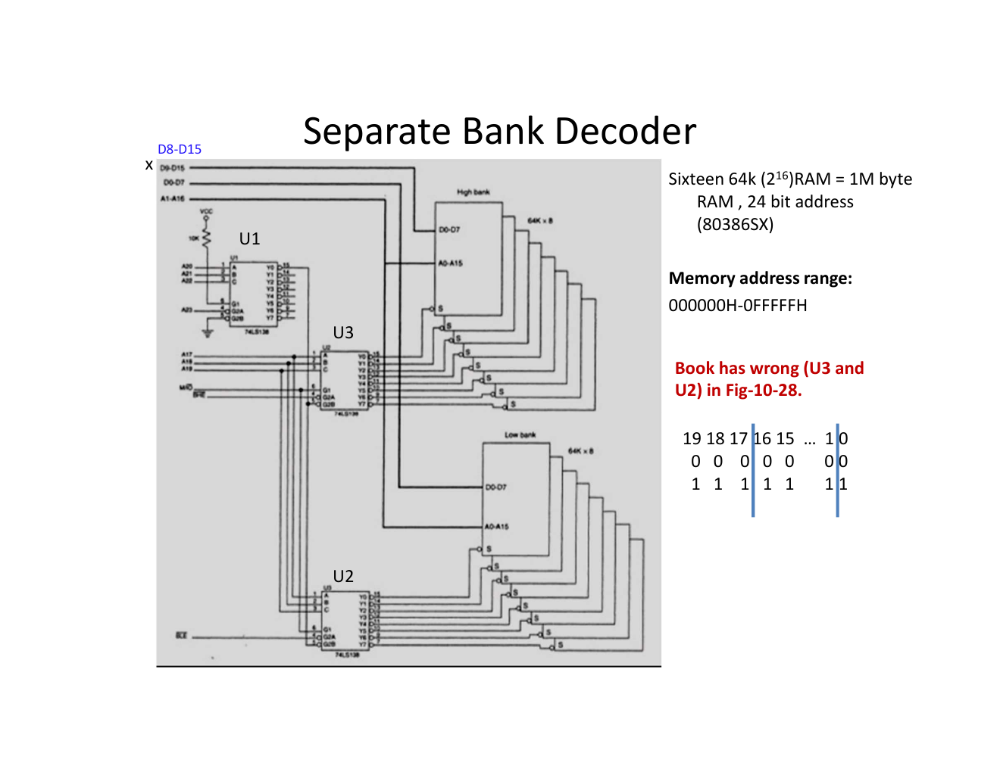

**Specification (from the slide):** **Sixteen 64K (2¹⁶) RAMs = 1 MB RAM**, with a **24-bit address (80386SX)**. **Memory address range: 000000H - 0FFFFFH**.

**Design reasoning**
1. **16 chips of 64K × 8** = 1 MB total. Split into two banks: **8 chips in the high bank (D8-D15)** and **8 chips in the low bank (D0-D7)**.
2. Each chip is 64K = **16 address pins**. The chips use address lines **A1-A16** (labelled "A1-A16" on the slide, shown as chip pins A0-A15). **A0 is not wired to the chips**: it only selects the bank.
3. Within each bank, **8 chips** → **3 select bits**: **A17, A18, A19** → go to **A, B, C** of the bank's 74LS138.
4. **Upper bits A23 … A20** must be **0000** for the range 000000H-0FFFFFH → **U1 (74LS138)** looks at A20-A23 and produces the **enable** that is passed on to the bank decoders.
5. **Two 138s for banks:** one for the **high bank** whose enable includes **BHE**, one for the **low bank** whose enable includes **A0 (BLE)**; both also need the memory cycle signal `M/IO`.

How to read the diagram: **U1** (top left) is the "range" decoder (A20-A22 on its A-B-C, A23 on G2A, a 10 K pull-up resistor to VCC on G1). The other two big decoder chips at the **middle (U3)** and **bottom (U2)** each drive **8 chip-select lines** (the stairs of boxes). The **upper stack = High bank** (data D8-D15 → `D0-D7` of each chip), the **lower stack = Low bank** (data D0-D7).

> [!warning] The slide says: "Book has wrong (U3 and U2) in Fig 10-28"
> The book labels **U3 and U2 the wrong way round**. The corrected assignment in the slide: **U3** drives the **High bank** (enabled by `/BHE`), **U2** drives the **Low bank** (enabled by A0/`/BLE`).

**The 3-way split of the 20 address bits** (the slide's little "19 18 17 | 16 15 … 1 | 0" table):

```
bit:      19 18 17 | 16 15 ......... 1 | 0
role:    ---3 bits-+---16 bits -------+--1 bit
         to 138 decoders | to chip pins A0-A15 | bank select (BHE/A0)
lowest : 0  0  0  | 0  0 ......... 0 | 0   (000000H)
highest: 1  1  1  | 1  1 ......... 1 | 1   (0FFFFFH)
```

> [!tip] Memory trick for 16-bit designs
> **Bit 0 picks the BANK, the next bits pick the BYTE-IN-CHIP, the top bits pick the CHIP.**

### 11.4 Method 2: Separate bank write strobes (slide 27) 🔧

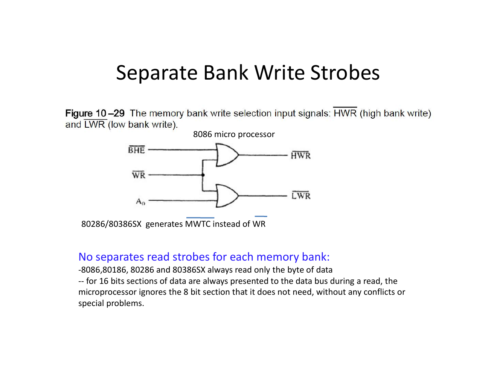

Use **one** decoder for the whole 16-bit-wide memory, and make **two different write signals** so that only the wanted byte is written:

| Signal | Equation (two OR gates) | Meaning |
|---|---|---|
| **/HWR** (high bank write) | `/BHE OR /WR` | goes **low** only when **BHE = 0 and WR = 0** |
| **/LWR** (low bank write) | `A0 OR /WR` | goes **low** only when **A0 = 0 and WR = 0** |

- On the **8086** the strobe is **WR**. On the **80286/80386SX** it is **MWTC** instead of WR (so replace WR by MWTC in the equations).
- **/HWR → `/WE` of the high-bank chips; /LWR → `/WE` of the low-bank chips.**

**Why no separate read strobes?** (slide text)
- For a read, **both banks can safely put data on the bus** at the same time: the 16 bits are always presented to the data bus during a read and the **microprocessor simply ignores the 8-bit half it does not need**, without conflicts or special problems.
- Writes are different: writing the unwanted half would **destroy good data**. So **writes need separate strobes; reads do not.**

**Example:** write one byte to an **even** address → BHE = 1, A0 = 0 → /HWR = 1 OR … = **1** (inactive), /LWR = 0 OR 0 = **0** (active) → **only the low bank is written** ✔.

### 11.5 Example: 16-bit-wide memory at 060000H - 06FFFFH (slide 28) 🔧

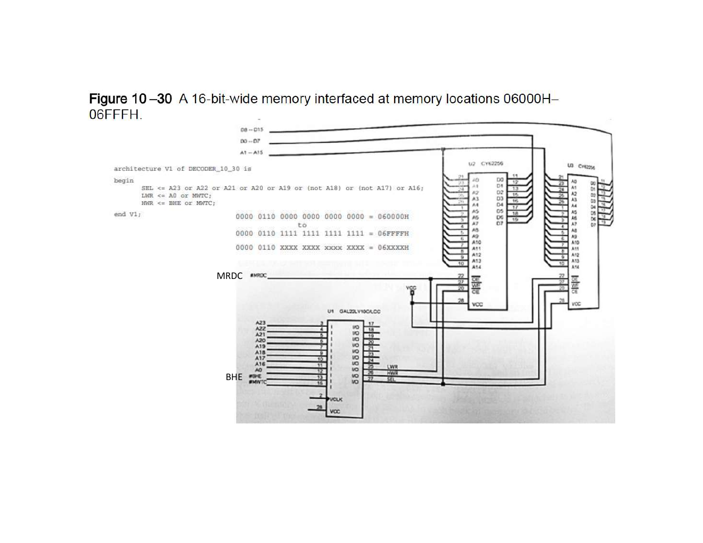

This is **Method 2 using a PLD** (GAL22V10). It shows the **VHDL equations** for the three outputs:

```vhdl
SEL <= A23 or A22 or A21 or A20 or A19 or (not A18) or (not A17) or A16;
LWR <= A0  or MWTC;
HWR <= BHE or MWTC;
```

**Reading `SEL` (the chip select):** it is an OR → low only when **every term is 0**:
A23 = A22 = A21 = A20 = A19 = **0**, **(not A18) = 0 → A18 = 1**, **(not A17) = 0 → A17 = 1**, A16 = **0**.

```
0000 0110 0000 0000 0000 0000 = 060000H
        to
0000 0110 1111 1111 1111 1111 = 06FFFFH
0000 0110 xxxx xxxx xxxx xxxx = 06XXXXH
```
→ the address range is **060000H - 06FFFFH** (the figure's title writes it as 06000H-06FFFH, a shortened typo).

**Hardware:** two **CY62256** (32K × 8) chips U2 and U3 → 2 × 32K bytes = 64 KB = 10000H ✔ (matches the range). The chips use **A1-A15** (15 pins); **A0 is only used inside `LWR`**.
- **U2 (low bank, D0-D7)**: `/WE` ← **LWR**
- **U3 (high bank, D8-D15)**: `/WE` ← **HWR**
- **Both**: `/CE` ← **SEL**, `/OE` ← **MRDC** (the 80286/386SX memory-read strobe; "MRDC" label at left)
- **U1 GAL22V10** has inputs **A23…A16, A0, BHE, MWTC** and outputs **LWR, HWR, SEL**.

---

## 12. Error detection and correction (Hamming, SEC, DED, 74LS636) 🧠🧩🔧

### 12.1 Why do we need it?
Memory bits can flip because of noise. To protect data we store **extra bits (check bits)** alongside the data. When we read, we can **detect** (and sometimes **fix**) the error.

### 12.2 Error-Correcting Code function (block diagram, slide 29)

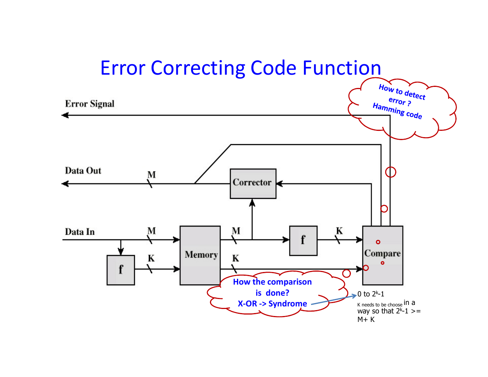

### How to read the diagram (follow the arrows)
**On WRITE (left side, "Data In"):**
1. **M data bits** come in.
2. One copy goes straight into **Memory**.
3. Another copy goes through function **f** → produces **K check bits** → also stored in Memory.

**On READ:**
4. Memory gives back **M data bits** and **K check bits**.
5. The M data bits go **again through f** → new **K check bits**.
6. **Compare** box: it compares the *old* (stored) K check bits with the *new* (recomputed) K check bits.
   - *How is the comparison done?* → **XOR**. The result is called the **syndrome** (range **0 to 2ᴷ - 1**).
7. If the syndrome is 0 → no error. Otherwise → an **Error Signal** goes out, and the syndrome tells the **Corrector** which bit to flip, so **Data Out (M bits)** is the corrected data.

> [!important] How to choose K
> K must be chosen so that **2ᴷ - 1 ≥ M + K**. (The syndrome must be able to point to any of the **M + K** bit positions.)
> 
> "How to detect an error?" → **Hamming code** (slide's cloud).

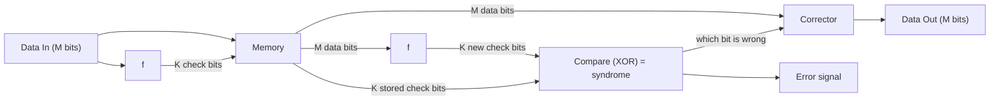

### 12.3 Hamming code idea (Venn diagram, slide 30)

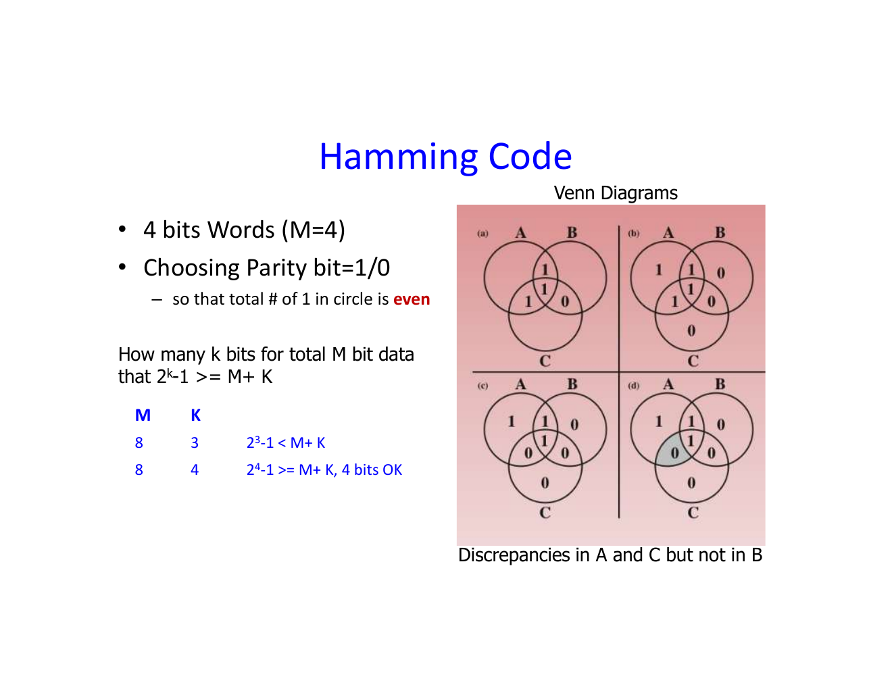

**How many check bits? (table on the slide)** Condition: **2ᴷ - 1 ≥ M + K**

| M (data bits) | K | Test | OK? |
|---|---|---|---|
| 8 | 3 | 2³ - 1 = 7 < 8 + 3 = 11 | ✘ too few |
| 8 | **4** | 2⁴ - 1 = 15 ≥ 8 + 4 = 12 | ✔ **4 bits OK** |
| 4 | 3 | 2³ - 1 = 7 ≥ 4 + 3 = 7 | ✔ |

(Extra values: M = 16 → K = 5, M = 32 → K = 6, M = 64 → K = 7.)

### How to read the Venn diagrams (4-bit words, M = 4)
- Three overlapping circles **A, B, C** make **7 regions**.
- The **4 data bits** go in the **4 overlap regions** (the centre + the three "two-circle" overlaps).
- The **3 parity bits** go in the **3 "circle-only" regions**.
- **Rule:** choose each parity bit (1 or 0) so that the **number of 1s inside each circle is EVEN** (even parity).
- **(a)** data placed: centre 1, A∩B 1, A∩C 1, B∩C 0. **(b)** parity bits are filled in (A-only = 1, B-only = 0, C-only = 0); check: circle A has 1+1+1+1 = 4 ones (even ✔), B has 0+1+1+0 = 2 ✔, C has 0+1+1+0 = 2 ✔.
- **(c)** one data bit flips (the A∩C region goes 1 → 0). Now circle **A** has 3 ones (odd ✘), circle **C** has 1 (odd ✘), circle **B** still has 2 (even ✔).
- **(d)** The gray region is where the **wrong** circles overlap: **"Discrepancies in A and C but not in B"** → the error must be in the region **inside A and C but outside B** → that one bit is the culprit → **flip it back**.

> [!tip] Memory trick
> **"Each wrong circle is a witness."** The bad bit is where all the **complaining** circles overlap and the **happy** circles don't.

### 12.4 Where do the check bits sit? (slide 31)

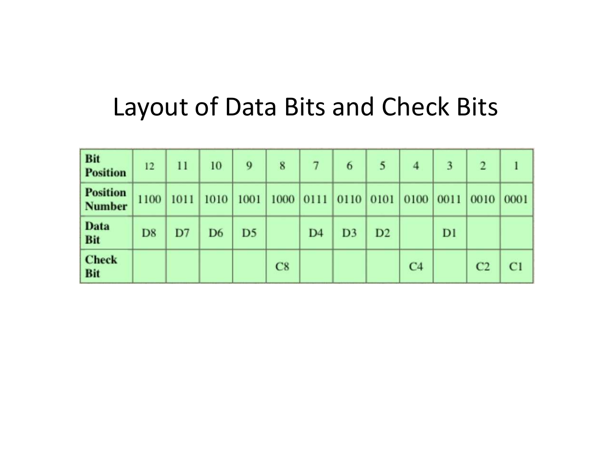

For **8 data bits + 4 check bits = 12 positions**. **Check bits live at positions 1, 2, 4, 8 (powers of 2)**; data bits fill the rest.

| Bit position | 12 | 11 | 10 | 9 | 8 | 7 | 6 | 5 | 4 | 3 | 2 | 1 |
|---|---|---|---|---|---|---|---|---|---|---|---|---|
| Position number (binary) | 1100 | 1011 | 1010 | 1001 | 1000 | 0111 | 0110 | 0101 | 0100 | 0011 | 0010 | 0001 |
| Data bit | D8 | D7 | D6 | D5 | | D4 | D3 | D2 | | D1 | | |
| Check bit | | | | | **C8** | | | | **C4** | | **C2** | **C1** |

**Which bits does each check bit cover?** A check bit **Cn** covers every position whose **binary position number has a 1 in the Cn place**:

| Check bit | Covers positions | Data bits covered (XOR formula) |
|---|---|---|
| **C1** (place 0001) | 1, 3, 5, 7, 9, 11 | **D1 ⊕ D2 ⊕ D4 ⊕ D5 ⊕ D7** |
| **C2** (place 0010) | 2, 3, 6, 7, 10, 11 | **D1 ⊕ D3 ⊕ D4 ⊕ D6 ⊕ D7** |
| **C4** (place 0100) | 4, 5, 6, 7, 12 | **D2 ⊕ D3 ⊕ D4 ⊕ D8** |
| **C8** (place 1000) | 8, 9, 10, 11, 12 | **D5 ⊕ D6 ⊕ D7 ⊕ D8** |

> [!tip] Memory trick: "positions as binary, then match the 1s"
> Write the position in binary. The check bits whose place is 1 in that number are exactly the ones that watch that bit. E.g. **D3 is at position 6 = 0110** → watched by **C4 and C2**. **D1 at position 3 = 0011** → watched by **C2 and C1**.
> **XOR (⊕) of bits = 1 when the count of 1s is odd.** So "C = XOR of its bits" makes the total number of 1s (including C) **even**.

### 12.5 Single-Error-Correcting (SEC) example (slides 32-33) 🔧

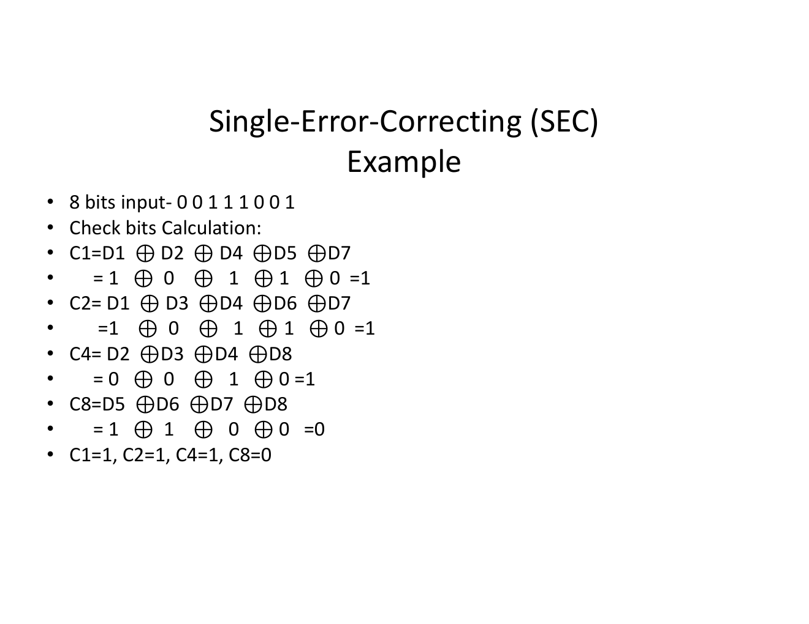

**Input 8 bits (written D8…D1): `0 0 1 1 1 0 0 1`** → D8 = 0, D7 = 0, D6 = 1, D5 = 1, D4 = 1, D3 = 0, D2 = 0, **D1 = 1**.

| Check bit | Calculation | Result |
|---|---|---|
| C1 = D1⊕D2⊕D4⊕D5⊕D7 | 1 ⊕ 0 ⊕ 1 ⊕ 1 ⊕ 0 | **1** |
| C2 = D1⊕D3⊕D4⊕D6⊕D7 | 1 ⊕ 0 ⊕ 1 ⊕ 1 ⊕ 0 | **1** |
| C4 = D2⊕D3⊕D4⊕D8 | 0 ⊕ 0 ⊕ 1 ⊕ 0 | **1** |
| C8 = D5⊕D6⊕D7⊕D8 | 1 ⊕ 1 ⊕ 0 ⊕ 0 | **0** |

→ **Stored check bits: C1 = 1, C2 = 1, C4 = 1, C8 = 0** (C8 C4 C2 C1 = **0111**).

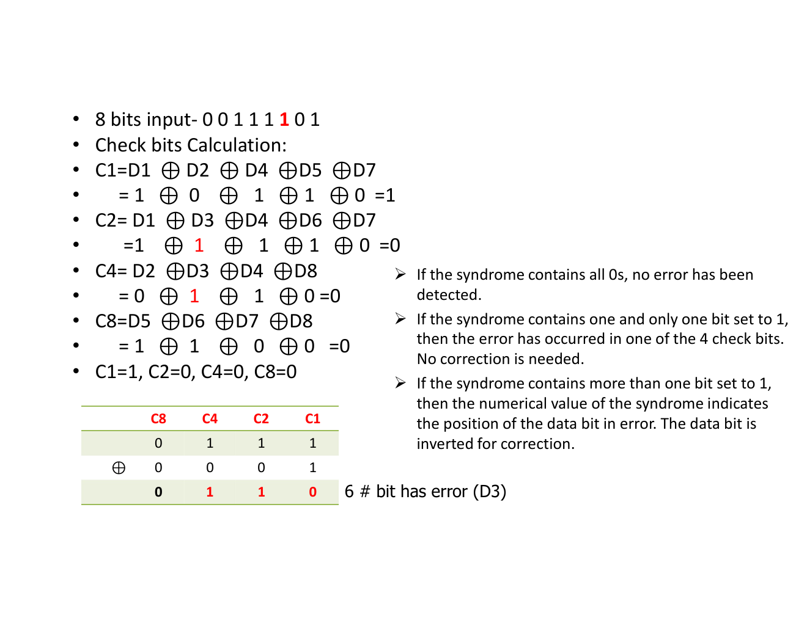

**Now it is read back with one error:** `0 0 1 1 1 `**`1`**` 0 1` → **D3 changed from 0 to 1**.

Recompute the check bits from the **received** data:

| Check bit | Calculation (received) | Result |
|---|---|---|
| C1 | D1⊕D2⊕D4⊕D5⊕D7 = 1⊕0⊕1⊕1⊕0 | **1** |
| C2 | D1⊕D3⊕D4⊕D6⊕D7 = 1⊕**1**⊕1⊕1⊕0 | **0** |
| C4 | D2⊕D3⊕D4⊕D8 = 0⊕**1**⊕1⊕0 | **0** |
| C8 | D5⊕D6⊕D7⊕D8 = 1⊕1⊕0⊕0 | **0** |

New check bits C8 C4 C2 C1 = **0 0 0 1**.

**Syndrome = stored ⊕ recomputed:**

```
            C8 C4 C2 C1
stored       0  1  1  1
recomputed   0  0  0  1     (⊕)
------------------------
syndrome     0  1  1  0   = binary 0110 = 6
```
**Syndrome 6 → bit position 6 → that is D3** (from the layout table: position 6 = D3) ✔. **Flip D3 back** to 0 → corrected.

**Decision rules for SEC (on the slide)**

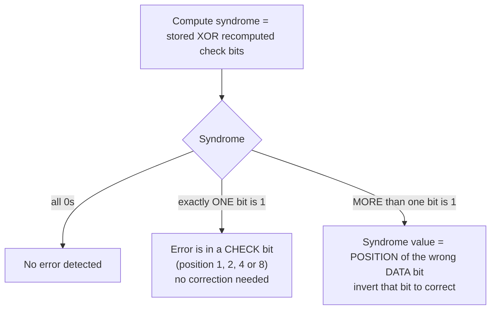

> [!tip] Why "one 1 = check bit"?
> A syndrome with a single 1 is 0001, 0010, 0100 or 1000 = positions **1, 2, 4, 8** = exactly the **check-bit positions**. Any other number (3, 5, 6, 7, 9, 10, 11, 12) is a **data-bit** position.

### 12.6 Double-Error-Detection (DED) extension (slides 34-35) 🔧

**Problem:** SEC can *correct* one error, but if **two** bits flip it may "correct" the wrong bit. To **detect double errors** we add one more bit: the **General Parity bit (GP)**.

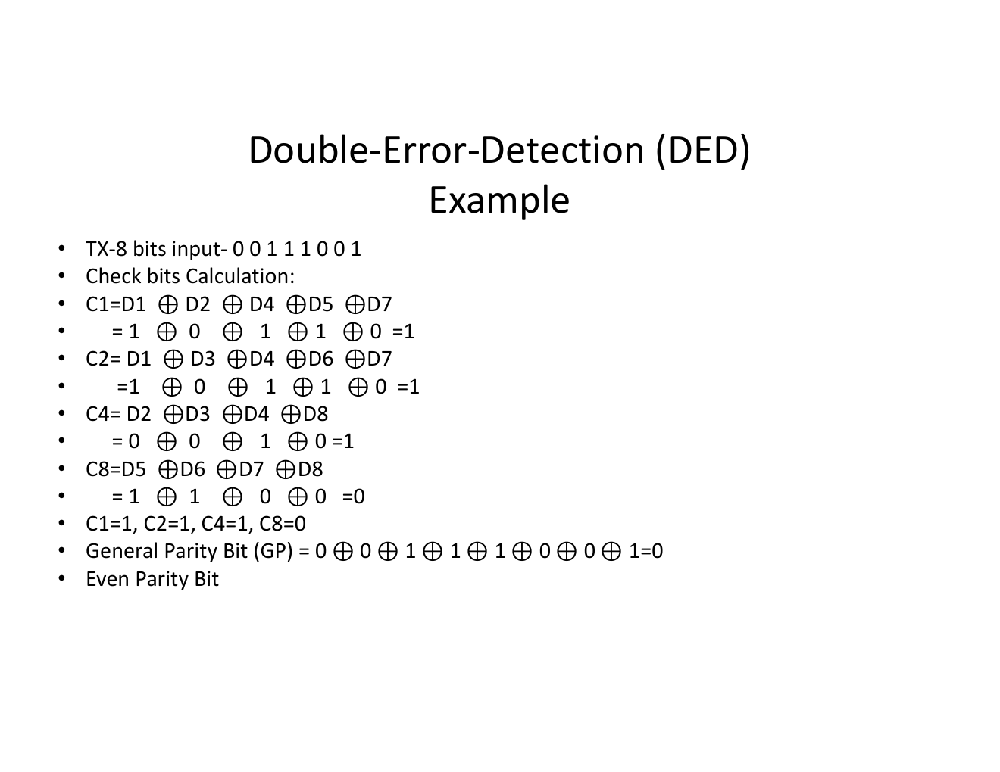

**Transmit (TX):** data `0 0 1 1 1 0 0 1` → same check bits **C1 = 1, C2 = 1, C4 = 1, C8 = 0**, plus **GP = even parity of the 8 data bits** = 0 ⊕ 0 ⊕ 1 ⊕ 1 ⊕ 1 ⊕ 0 ⊕ 0 ⊕ 1 = **0** (four 1s → even → 0).

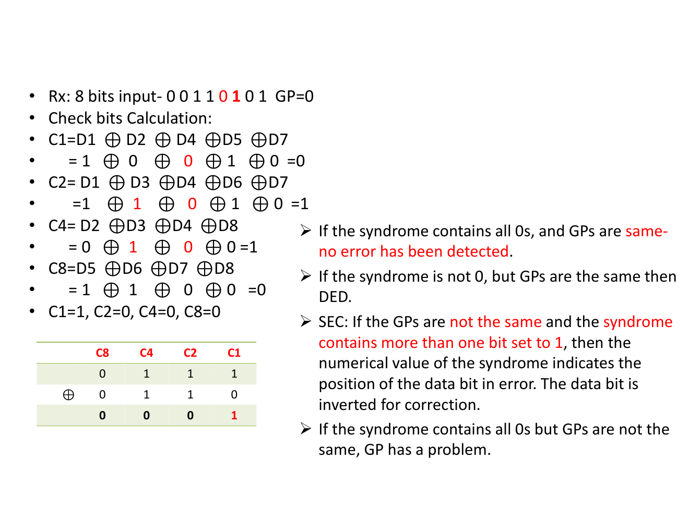

**Receive (RX):** `0 0 1 1 `**`0 1`**` 0 1`, GP = 0 → **two bits changed (D4: 1→0 and D3: 0→1)**.

| Check bit | Calculation (received) | Result |
|---|---|---|
| C1 | D1⊕D2⊕D4⊕D5⊕D7 = 1⊕0⊕**0**⊕1⊕0 | **0** |
| C2 | D1⊕D3⊕D4⊕D6⊕D7 = 1⊕**1**⊕**0**⊕1⊕0 | **1** |
| C4 | D2⊕D3⊕D4⊕D8 = 0⊕**1**⊕**0**⊕0 | **1** |
| C8 | D5⊕D6⊕D7⊕D8 = 1⊕1⊕0⊕0 | **0** |

```
            C8 C4 C2 C1
stored       0  1  1  1
recomputed   0  1  1  0     (⊕)
------------------------
syndrome     0  0  0  1   ← NOT zero
```
The recomputed **GP** of the received data = 0 ⊕ 0 ⊕ 1 ⊕ 1 ⊕ 0 ⊕ 1 ⊕ 0 ⊕ 1 = 0 = the **received GP (0)** → **GPs are the same**. Syndrome ≠ 0 **and** GPs same → **double error detected (DED)**: it is detected but **cannot be corrected** (a single-error "fix" would pick the wrong bit).

> [!note] The slide's line "C1=1, C2=0, C4=0, C8=0" at the bottom of slide 35
> It is a leftover from the previous slide; the **table** (recomputed 0110, syndrome 0001) is what the slide actually uses.

**Decision rules with GP (on slide 35)**

| Syndrome | GP comparison | Conclusion |
|---|---|---|
| **all 0s** | same | **No error** |
| **not 0** | **same** | **Double error detected (DED)**, cannot correct |
| **>1 bit set to 1** | **not the same** | **Single error (SEC)**: syndrome value = position of the wrong **data** bit → **invert** it |
| **all 0s** | **not the same** | **GP bit itself** has the problem |

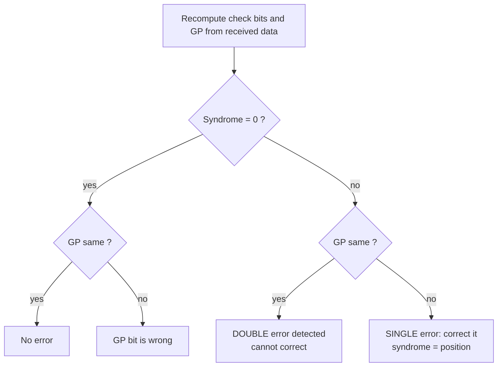

> [!warning] Exam tip about GP
> This lecture computes **GP over the 8 data bits** and uses the table above. (In many textbooks the overall parity covers *all* bits, data + check bits. Follow the slide's version in this course.)

### 12.7 The error-correcting chip: 74LS636 (slide 36) 🔧

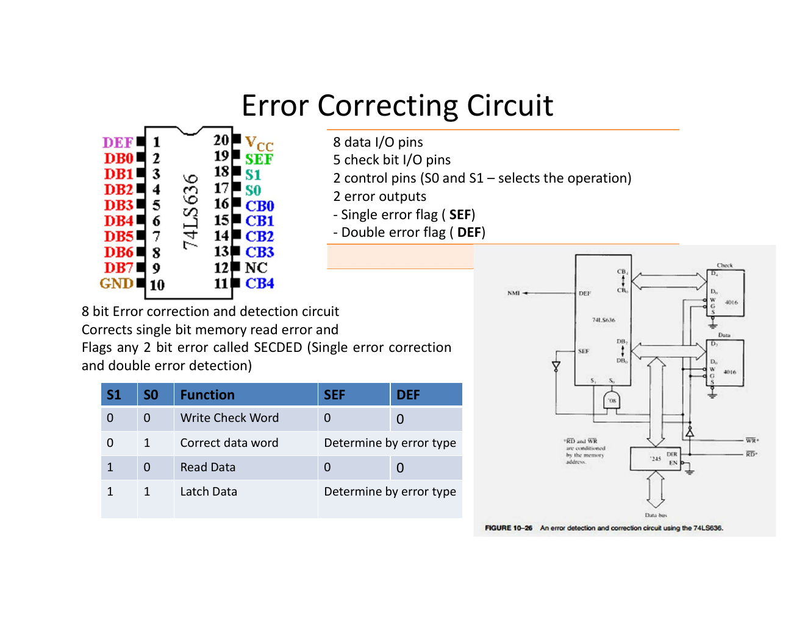

**74LS636** = **8-bit error detection and correction circuit**. It **corrects single-bit memory read errors** and **flags any 2-bit error**. This is called **SECDED** (Single Error Correction, Double Error Detection).

| Pin group | Count | Pins |
|---|---|---|
| **Data I/O** | **8** | DB0 - DB7 |
| **Check-bit I/O** | **5** | CB0 - CB4 (**4 Hamming check bits + 1 general parity**) |
| **Control** | **2** | **S0, S1**: select the operation |
| **Error outputs** | **2** | **SEF** = Single-Error Flag, **DEF** = Double-Error Flag |
| Power | | VCC, GND, (NC) |

**Function table (select by S1 S0)**

| S1 | S0 | Function | SEF | DEF |
|---|---|---|---|---|
| 0 | 0 | **Write check word** | 0 | 0 |
| 0 | 1 | **Correct data word** | determined by error type | determined by error type |
| 1 | 0 | **Read data** | 0 | 0 |
| 1 | 1 | **Latch data** | determined by error type | determined by error type |

### How to read the system figure (Fig 10-26)
- Two **4016 SRAM** blocks: one stores the **Data** (D7-D0), the other stores the **Check** bits (CB4-CB0).
- The **74LS636** sits in the middle, connected to both blocks (check bits on the top bus, data bits on the lower bus).
- A **74LS245** at the bottom connects the system **data bus** (with `DIR` and `EN`).
- `/RD` and `/WR` are **conditioned by the memory address** (only used for this memory range).
- **DEF** (double error) goes out to **NMI** (non-maskable interrupt) of the processor: an uncorrectable error interrupts the CPU. **SEF** is the single-error flag.

> [!tip] Memory trick
> **S**ingle error = **S**EF → corrected silently. **D**ouble error = **D**EF → **D**anger, interrupt the CPU (NMI).

---

## 13. Design cookbook (step-by-step recipes) 🧩

### Recipe A: Decode ONE chip at a fixed range (NAND / OR gate)

```
1. size  = end - start + 1        (must equal the chip size)
2. n     = log2(chip size)        -> A0..A(n-1) go DIRECTLY to chip
3. Write start address in binary. Upper (20 - n) bits are FIXED.
4. Make /CS = LOW when those upper bits match AND it is a memory cycle:
      all fixed bits are 1  -> NAND gate
      mixed 0s and 1s       -> NAND with inverters on the 0 bits
                               (or OR form: OR the 0-bits, OR NOT of the 1-bits)
5. Memory cycle: use IO/M inverted (8088: IO/M low = memory),
                 or M/IO directly (8086: M/IO high = memory).
6. /RD -> /OE ,  /WR -> /WE (RAM only) ,  data pins -> D bus.
```
*Example:* 2716 at FF800H → A19…A11 = all 1 → 9-input NAND (+ memory-cycle line) → `/CE`.

### Recipe B: Several equal chips in one block (74LS138 / 139)

```
1. total size, chip size  ->  number of chips  = total / chip
2. n = log2(chip size): A0..A(n-1) -> every chip
3. Next log2(#chips) address bits  -> select inputs  (A,B,C of a 138 or A,B of a 139)
   (lowest of those bits goes to input A)
4. The remaining higher address bits (and memory-cycle) -> ENABLE inputs
      138: G1 = 1,  /G2A = 0,  /G2B = 0
      139: /E = 0
5. Output Yi -> /CE of chip i.      /RD -> all /OE.     /WR -> all /WE (RAM).
6. Build the address map table (one row per output) and verify the first/last address.
```

### Recipe C: Unequal blocks / mix of ROM and RAM
Use the **top-level bits (A19, A18, A17)** to split the 1 MB into regions; either:
- a **139/138** with NAND enables (slide 16), or
- a **PLD** with VHDL equations (slide 20), or
- **two-level decoding** (slide 23: first decoder splits A19A18, second splits A17A16A15).

### Recipe D: 16-bit bus (8086/286/386SX)
```
1. Two banks of 8 bits: LOW (even, D0-D7, select = A0) and HIGH (odd, D8-D15, select = /BHE).
2. Chip address pins use A1 ... A(n) (A0 is NOT given to the chips).
3. Choose method:
   (1) separate decoders per bank (bank decoder enable includes /BHE or A0), or
   (2) ONE decoder + two write strobes:  /HWR = BHE + WR ,  /LWR = A0 + WR   (MWTC on 286/386SX).
4. Reads: no separate strobes needed (CPU ignores the unused half).
```

### Recipe E: Wait-state check
`memory access + decoder delay (+ buffers)` vs `time the CPU allows`. If greater, add **one wait state per extra clock** (200 ns at 5 MHz).

### Recipe F: Hamming SEC/DED calculation
```
1. Pick K with 2^K - 1 >= M + K.
2. Layout: check bits at positions 1,2,4,8; data in the others.
3. Each check bit = XOR of the data bits whose position has that bit set.
4. READ: recompute check bits, XOR with stored => syndrome.
5. Syndrome 0 -> OK.  One 1 -> a check bit is wrong.  Else value = position of the bad data bit -> flip it.
6. (DED) add GP = parity of the data bits. Syndrome != 0 and GP same -> double error (detect only).
```

---

## 14. Cheat sheet: numbers and rules to memorize

| Item | Value |
|---|---|
| 8086/8088 address lines | **20** → **1 MB**, range **00000H - FFFFFH** |
| 80286 / 80386SX address lines | **24** |
| 8088 clock in the examples | **5 MHz** (200 ns/clock), memory gets **460 ns** |
| Wait state | **+200 ns** each |
| SRAM access (cache) | ≈ **10 ns**; DRAM ≈ **60 ns**; slowest 4016 SRAM = **250 ns** |
| EPROM (27256 example) access | **450 ns** |
| 74LS138 decode delay | **8 ns** |
| DRAM refresh time scale | slide labels **60-100 ms** |
| SRAM transistors / bit | **4-6** (2 inverters × 2 + 2 access = 6) |
| DRAM transistors / bit | **1 transistor + 1 capacitor** |
| 74LS138 enables | **G1 = 1, /G2A = 0, /G2B = 0** |
| 74LS138 / 139 outputs | **active low** |
| 2716 EPROM | 2K×8, **A0-A10**, VPP **25 V** programming |
| ROM control signals | **1**; RAM control signals: **2** (`/OE`, `/WE`) |
| Banks | **Low/even** (D0-D7, A0) and **High/odd** (D8-D15, /BHE) |
| Write strobes | **/HWR = BHE OR WR**, **/LWR = A0 OR WR** |
| Hamming condition | **2ᴷ - 1 ≥ M + K** (M=8 → K=4) |
| Check bits positions | **1, 2, 4, 8** |
| C1, C2, C4, C8 equations | D1D2D4D5D7 / D1D3D4D6D7 / D2D3D4D8 / D5D6D7D8 |
| 74LS636 | 8 data + **5** check pins, S0/S1, **SEF**, **DEF** → SECDED |

---

## 15. Typos / things to be careful about in the slides

| Where | What the slide shows | What it should be / note |
|---|---|---|
| Slide 14 labels | "F20000 - F3FFF", "F4000 - F5FFF" … | **F2000 - F3FFF** (extra 0 in the first one). 8K per chip = **2000H** steps |
| Slide 21 text | "3 **2732** (32K × 8) EPROMs" | figure uses **27256** (32K × 8); 2732 is 4K × 8 |
| Slide 26 | "Book has wrong (U3 and U2) in Fig 10-28" | follow the slide's corrected assignment (U3 = high bank, U2 = low bank) |
| Slide 28 title | "06000H-06FFFH" | the VHDL gives **060000H - 06FFFFH** |
| Slide 4 | ROM "has 1 control signal R/W" | a ROM cannot be written, so in practice it is the **read / output-enable (/OE)** line; RAM has `/OE` and `/WE` |
| Slide 33 | last line "C1=1, C2=0, C4=0, C8=0" | recomputed check bits are **C8 C4 C2 C1 = 0001** (table is right) |
| Slide 35 | bottom list "C1=1, C2=0…" | leftover; table shows **0110** recomputed and syndrome **0001** |
| IO/M vs M/IO | 8088 uses **IO/M** (high = I/O); 8086 uses **M/IO** (high = memory) | invert accordingly when you build the enable |

---

## 16. Practice questions with answers

> [!question] Q1 (🧠). How many address pins does a 16K × 8 memory chip need? How many for 1M?
> 16K = 2¹⁴ → **14** pins (A0-A13). 1M = 2²⁰ → **20** pins.

> [!question] Q2 (🧠). State three differences between SRAM and DRAM.
> SRAM: 4-6 transistors per bit, no refresh, fast (~10 ns), costly, lower density, used for caches. DRAM: 1 transistor + capacitor, **needs refresh**, slower (~60 ns), cheaper, higher density, used for main memory, **destructive read**.

> [!question] Q3 (🧠). Why must a DRAM read be followed by a write?
> Reading discharges the capacitor onto the bitline (**destructive read**); the original value must be **written back** to restore it.

> [!question] Q4 (🧩). Decode a 2716 EPROM at **FF800H-FFFFFH** with a NAND gate.
> A10-A0 → chip A0-A10. **A19-A11** (all 1) → NAND input; output → `/CE`; memory-cycle line also in; `/RD` → `/OE`. (§7.3)

> [!question] Q5 (🧩). Use a 74LS138 and 2764 EPROMs to cover **F0000H-FFFFFH**.
> 8 chips, A0-A12 to chips, **A13-A15 → A-B-C**, A16 → G1, NAND(A17, A18, A19, memory cycle) → /G2B, /G2A grounded, Y0…Y7 → CE of chips (F0000-F1FFF … FE000-FFFFF). (§7.5)

> [!question] Q6 (🧩). Design 256 KB of EPROM at **C0000H-FFFFFH** with eight 27256 (32K × 8) and a 74LS138 on an 8088.
> 27256 → A0-A14 to chips. 8 chips → 3 select bits **A15, A16, A17 → A, B, C**. Fixed bits **A19 A18 = 11**: NAND(A18, A19) → /G2A, `IO/M` → /G2B, **G1 = VCC**. Map: Y0 = C0000-C7FFF, Y1 = C8000-CFFFF, … Y7 = F8000-FFFFF. `/RD` → `/OE`. Needs a **wait state** if the EPROM is 450 ns (as in §10.3).

> [!question] Q7 (🧩). How many 62256 chips are needed for 512 KB? What is the address range from 00000H?
> 512K / 32K = **16 chips**; range **00000H-7FFFFH**.

> [!question] Q8 (🔧). In an 8086 system, which bank is enabled for a **byte write to address 00003H**? What are /HWR and /LWR?
> 00003H is **odd** → A0 = 1, BHE = 0 → **high bank only**. /HWR = BHE OR WR = 0 OR 0 = **0 (active)**; /LWR = A0 OR WR = 1 OR 0 = **1 (inactive)**.

> [!question] Q9 (🔧). Explain the VHDL: `ROM <= A19 or A18 or A17 or MIO;` What range does it select?
> Output is 0 only when A19 = A18 = A17 = 0 and MIO = 0 → **00000H-1FFFFH** (128 KB), active-low chip enable for the ROM.

> [!question] Q10 (🔧). Does a 450 ns EPROM need a wait state on a 5 MHz 8088 with a 74LS138 (8 ns) decoder?
> 450 + 8 = 458 ns versus **460 ns allowed**: no margin → **yes, one wait state (+200 ns)**.

> [!question] Q11 (🧠🔧). Find the Hamming check bits for data D8…D1 = `1 0 1 1 0 1 0 0`. Then find the syndrome if D5 flips.
> D1 = 0, D2 = 0, D3 = 1, D4 = 0, D5 = 1, D6 = 1, D7 = 0, D8 = 1.
> C1 = D1⊕D2⊕D4⊕D5⊕D7 = 0⊕0⊕0⊕1⊕0 = **1**
> C2 = D1⊕D3⊕D4⊕D6⊕D7 = 0⊕1⊕0⊕1⊕0 = **0**
> C4 = D2⊕D3⊕D4⊕D8 = 0⊕1⊕0⊕1 = **0**
> C8 = D5⊕D6⊕D7⊕D8 = 1⊕1⊕0⊕1 = **1**  → stored C8 C4 C2 C1 = **1001**.
> After D5 flips (1 → 0): new C1 = 0, C2 = 0, C4 = 0, C8 = 0 → recomputed = 0000. Syndrome = 1001 ⊕ 0000 = **1001 = 9** → position 9 = **D5** ✔ → flip D5 back.

> [!question] Q12 (🧠). Why does the syndrome 0100 mean "no data correction"?
> It has **only one 1** → position **4** = **check bit C4** itself is wrong; the data bits are fine.

> [!question] Q13 (🧠). SEC vs DED: what extra bit is added and what does it buy?
> The **general parity bit (GP)**. With it, a non-zero syndrome and **same GP** = **double error detected** (not correctable); non-zero syndrome and **different GP** = single error, correctable.

> [!question] Q14 (🧠). ROM vs PLA?
> ROM: **fixed AND (decoder, all minterms) + programmable OR**. PLA: **programmable AND + programmable OR**, so it stores only the needed product terms: more flexible but harder to program (derive and minimize the expressions first). Fuses = 2nk + km + m.

> [!question] Q15 (🧠). Why two banks in an 8086 system and how are they selected?
> Memory chips are 8 bits wide but the bus is 16 bits: use **low/even bank** (D0-D7, selected by A0) and **high/odd bank** (D8-D15, selected by /BHE). BHE = 0 & A0 = 0 → both; 0,1 → high only; 1,0 → low only; 1,1 → none.

---

## 17. Glossary

| Term | Meaning |
|---|---|
| **Address bus** | wires carrying the location number (one-way: CPU → memory) |
| **Data bus** | wires carrying the value (two-way) |
| **Control bus** | RD, WR, IO/M … tell what kind of cycle this is |
| **Decoder** | circuit that turns a binary number into one active output line |
| **Chip select (CS/CE)** | pin that wakes up a particular chip |
| **Output enable (OE)** | lets the chip drive the data bus (read) |
| **Write enable (WE)** | tells RAM to store the data on the bus |
| **Active-low** | works when the signal is **0** (bar over its name) |
| **Wait state** | extra clock cycle inserted so a slow memory can answer |
| **SRAM / DRAM** | static / dynamic RAM |
| **EPROM** | erasable programmable ROM |
| **Wordline / Bitline** | the row line that selects a cell / the column line that carries its bit |
| **Sense amplifier** | circuit that decides if a tiny bitline voltage means 1 or 0 |
| **Refresh** | periodically rewriting DRAM cells so they do not fade |
| **PLA / PLD / GAL** | programmable logic array / programmable logic device / generic array logic |
| **VHDL** | language to describe hardware (gates) |
| **Bank (odd/even)** | the two 8-bit halves of a 16-bit memory |
| **BHE / BLE** | bus-high-enable / bus-low-enable |
| **Check bit / parity bit** | extra bit stored to detect errors |
| **Syndrome** | XOR of stored and recomputed check bits; tells *where* the error is |
| **SEC / DED / SECDED** | single-error correction / double-error detection / both |
| **NMI** | non-maskable interrupt (used here to report double errors) |

---

*Source: Lecture 6, "Memory Interfacing", Prof. Dr. Shamim Akhter (The x86 Microprocessors: Architecture, Programming and Interfacing, 8086 to Pentium). All slide images are in the `attachments/` folder next to this note.*
