# 🔌 I/O Interfacing, Interrupts and the 82C55 PPI: the complete beginner-friendly guide

> [!abstract] What this note is
> A from-zero explanation of **every slide** of Lecture 7 (33 slides). Each topic has: the idea in plain words, the slide image (in `attachments/`), a "how to read this diagram" guide, memory tricks and exam-style recipes. It follows the same style as the Lecture 6 (Memory Interfacing) note: **if you know memory decoding, I/O decoding is almost the same game.**
> Every section is tagged with the three question types you expect:
> - 🧠 **Concept**: "what is / why / explain / compare"
> - 🧩 **Design**: "design a decoder / interface circuit"
> - 🔧 **Implementation**: "show the wiring / write the program / calculate the control byte"

> [!info] Notation used in this note
> - A **bar over a signal** in the slides = *active-low* (works when it is **0**). In text I write it with a leading slash: `/CS`, `/RD`, `/WR`, `/STB`, `/OBF`, `/ACK`, `/INTA`, `/IORC`, `/IOWC`, `/BHE`.
> - `H` after a number = hexadecimal. `Port` = an **I/O address** the CPU can read from or write to.
> - **Slide N** = page N of the lecture PDF. All 33 slides are saved as `attachments/slide-NN.png`.

---

## 📑 Table of contents

1. [[#1. The big picture: what is I/O interfacing?]]
2. [[#2. Isolated I/O vs Memory-mapped I/O]]
3. [[#3. The PC I/O address space]]
4. [[#4. I/O port address decoding (8-bit and 16-bit)]]
5. [[#5. 8-bit and 16-bit wide I/O data (banks again)]]
6. [[#6. IN and OUT instructions]]
7. [[#7. Basic input interface (tri-state buffer) and pull-up resistors]]
8. [[#8. Basic output interface (latch and LEDs)]]
9. [[#9. Interrupts: INTR and INTA]]
10. [[#10. Expanding the interrupt structure]]
11. [[#11. Strobe signals]]
12. [[#12. The 82C55 PPI: what it is and its registers]]
13. [[#13. Interfacing the 82C55 to the processor]]
14. [[#14. Programming the 82C55 (command byte A and B)]]
15. [[#15. Mode 0: basic I/O (keyboard matrix)]]
16. [[#16. Mode 1: strobed input]]
17. [[#17. Mode 1: strobed output]]
18. [[#18. Mode 2: bidirectional]]
19. [[#19. Design cookbook (step-by-step recipes)]]
20. [[#20. Cheat sheet]]
21. [[#21. Things to be careful about in the slides]]
22. [[#22. Practice questions with answers]]
23. [[#23. Glossary]]

### Topic map

| # | Topic | Slides | Type |
|---|-------|--------|------|
| 1 | Isolated vs memory-mapped I/O | 2 | 🧠 |
| 2 | PC I/O space and map | 3-4 | 🧠 |
| 3 | 8-bit and 16-bit port decoding (74ALS138, PLD) | 5-6 | 🧩 🔧 |
| 4 | 8/16-bit wide ports, banks, 16-bit in/out ports | 7-9 | 🧠 🧩 🔧 |
| 5 | IN / OUT instructions | 10 | 🔧 |
| 6 | Input port (74ALS244), pull-ups | 11-12 | 🧩 🔧 |
| 7 | Output port (74ALS374 latch, LEDs) | 13-14 | 🧩 🔧 |
| 8 | Interrupts (INTR, INTA, vector from a buffer, 82C55 keyboard) | 15-16 | 🧠 🔧 |
| 9 | Expanding interrupts (244, daisy chain, 8259A), polling ISR | 17-20 | 🧠 🧩 🔧 |
| 10 | Strobe signals | 21 | 🧠 |
| 11 | 82C55 PPI, interfacing, programming | 22-25 | 🧠 🧩 🔧 |
| 12 | Mode 0, Mode 1 input/output, Mode 2 | 26-33 | 🧠 🔧 |

---

## 1. The big picture: what is I/O interfacing?

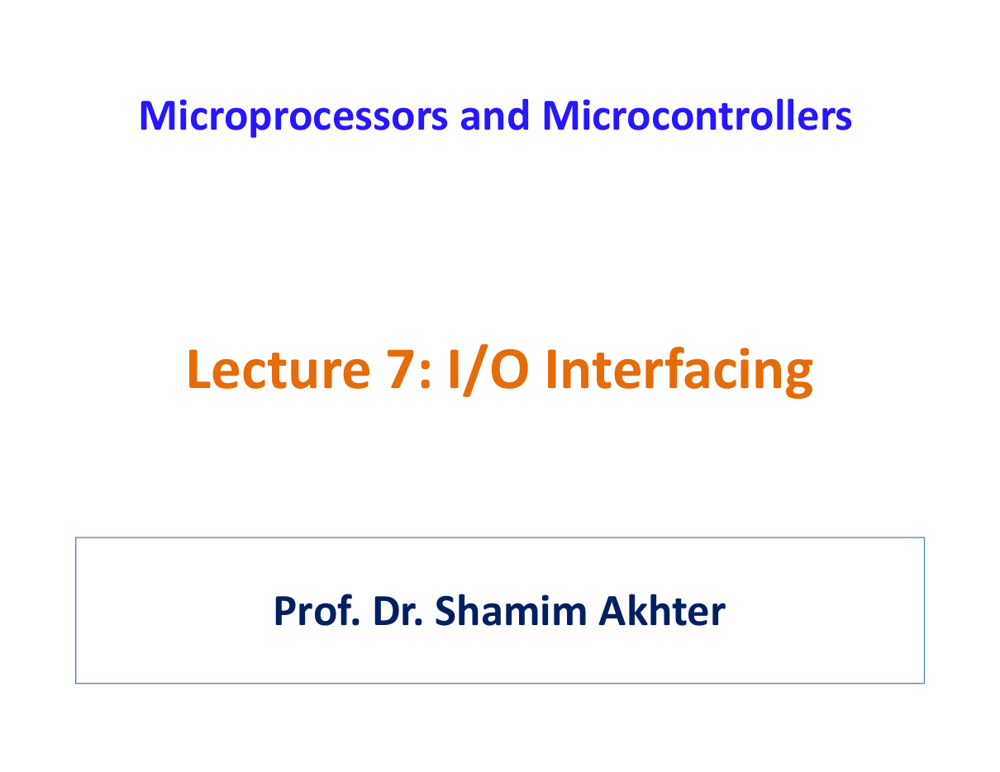

A computer is useless if it cannot talk to the outside world: keyboard, switches, LEDs, printer, hard disk. These are **I/O devices** (input/output). The CPU talks to them through **ports**.

> **A port = a register (or small chip) that the CPU can read or write, and that is wired to the outside world.**

Think of memory as a **filing cabinet** (lots of drawers, each holds data) and I/O ports as **doors and windows** of the house (each one connects to something outside). The CPU needs an **address** for each door/window, just as it needs an address for each drawer. That is why **I/O decoding looks very much like memory decoding** (Lecture 6).

Four problems solved in this lecture:

| Problem | Solution | Section |
|---|---|---|
| How does the CPU *address* an I/O device? | Isolated or memory-mapped I/O + **port decoder** | §2-§4 |
| How do we get data **in** from switches/keyboard? | **Tri-state buffer** (74ALS244) as input port | §7 |
| How do we send data **out** to LEDs/printer? | **Latch** (74ALS374) as output port | §8 |
| How do devices get the CPU's attention, and how do we program a general I/O chip? | **Interrupts** and the **82C55 PPI** | §9-§18 |

---

## 2. Isolated I/O vs Memory-mapped I/O 🧠

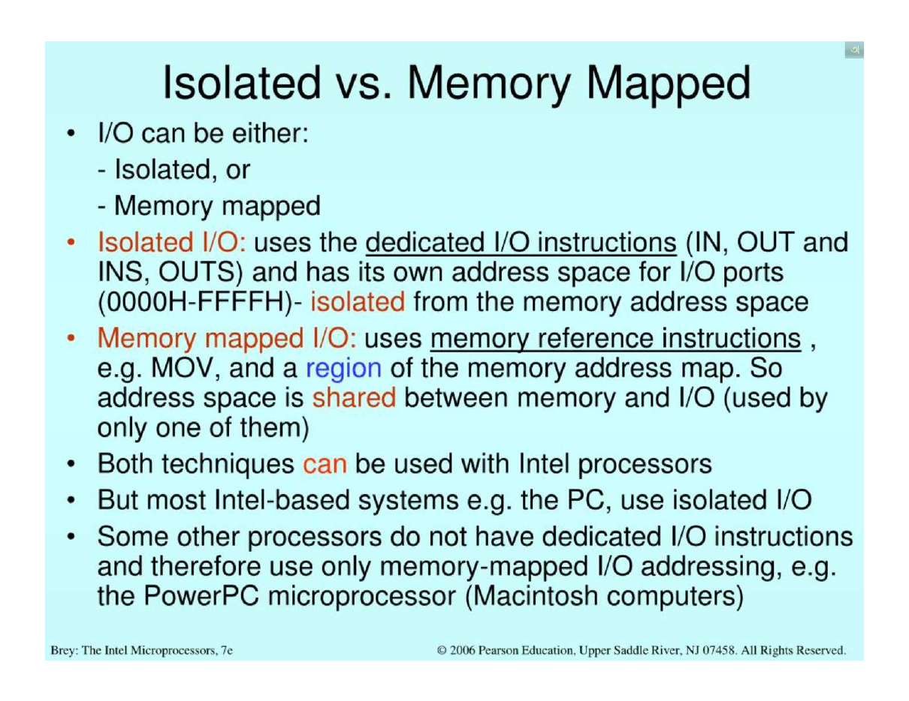

The CPU can talk to I/O in **two ways**:

| | **Isolated I/O** | **Memory-mapped I/O** |
|---|---|---|
| Instructions | **dedicated I/O instructions**: `IN`, `OUT`, `INS`, `OUTS` | **memory-reference instructions**, e.g. `MOV` |
| Address space | **its own** I/O address space for ports: **0000H - FFFFH** (64K ports), *isolated* from the memory address space | uses a **region of the memory address map**; the space is **shared** between memory and I/O (an address is used by only one of them) |
| Control signal | the CPU says "this is I/O" with `M/IO` / `IO/M` (and `IORC`, `IOWC` strobes) | the CPU says "this is memory" (`MRDC`, `MWTC`) |
| Used by | **most Intel systems, e.g. the PC** | processors **without** I/O instructions, e.g. **PowerPC** (Macintosh) |

- **Both techniques can be used** with Intel processors, but the PC uses **isolated I/O**.
- Some other processors have no dedicated I/O instructions, so they **only** use memory-mapped I/O.

> [!tip] Memory trick
> **Isolated = Instructions IN/OUT, Island of its own addresses.** **Memory-mapped = MOV, Merged with memory.**

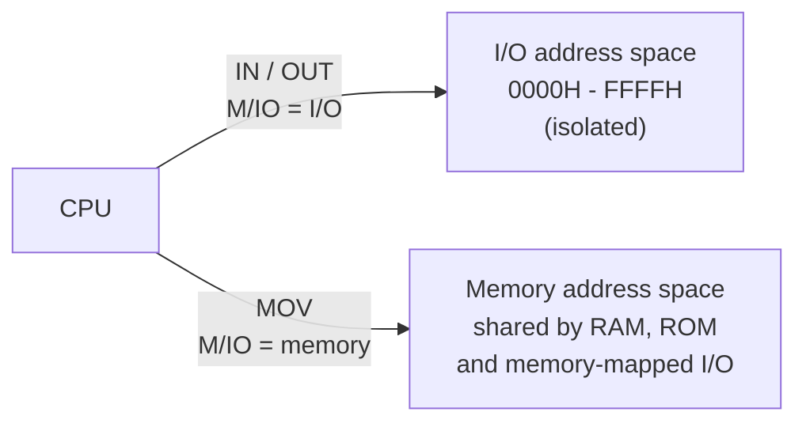

---

## 3. The PC I/O address space 🧠

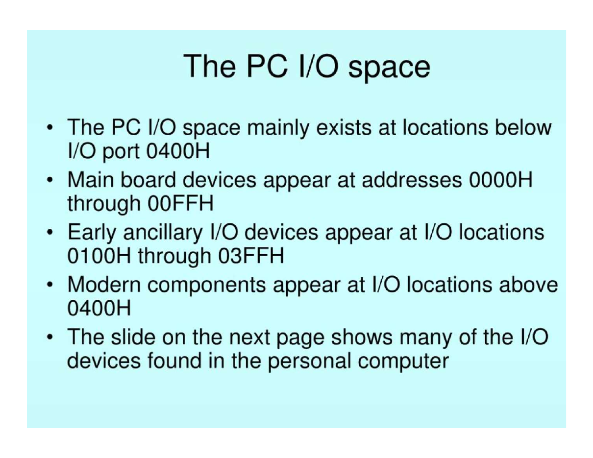

- The PC I/O space mainly exists at locations **below port 0400H**.
- **Main-board devices**: **0000H - 00FFH**.
- **Early ancillary I/O devices**: **0100H - 03FFH**.
- **Modern components**: above **0400H**.

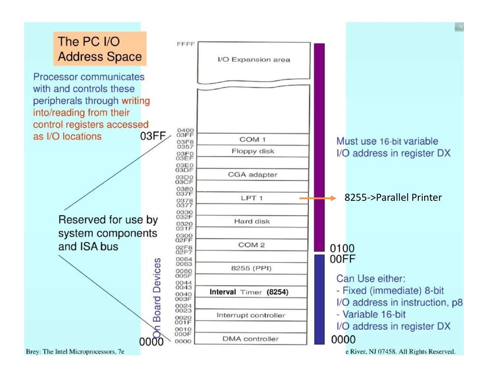

### How to read the map
The tall column is the I/O address space, **0000H at the bottom to FFFFH at the top**. Read from the bottom up:

| Device (as drawn on the slide) | Ports |
|---|---|
| **DMA controller** | 0000H - 000FH |
| **Interrupt controller** | 0020H - 0023H |
| **Interval timer (8254)** | 0040H - 0043H |
| **8255 (PPI)** | 0060H - 0063H |
| COM 2 | 02F8H - 02FFH |
| Hard disk | 0320H - 032FH |
| **LPT 1** (the slide notes: *8255 → parallel printer*) | 0378H - 037FH |
| CGA adapter | 03D0H - 03DFH |
| Floppy disk | 03F0H - 03F7H |
| COM 1 | 03F8H - 03FFH |
| **I/O expansion area** | 0400H up to FFFFH |

Two coloured bars on the right explain **how you can address them**:

| Range | Bar colour | How the program may give the port address |
|---|---|---|
| **0000H - 00FFH** (blue) | "Can use either" | a **fixed (immediate) 8-bit** address in the instruction (`IN AL,60H`) **or** a **variable 16-bit** address in register **DX** |
| **0100H - FFFFH** (purple) | "Must use" | **16-bit variable address in register DX** only |

Also written on the slide: the CPU communicates with and controls these peripherals by **writing into / reading from their control registers**, accessed as I/O locations. The region 0000-03FF is "reserved for use by system components and the ISA bus".

> [!tip] Memory trick
> **"Below 100H you can be lazy (immediate 8-bit); from 100H up you MUST load DX."** (An 8-bit immediate can only hold 00H-FFH.)

---

## 4. I/O port address decoding (8-bit and 16-bit) 🧩🔧

### 4.1 The big idea (same as memory)

> "Memory map similar to Memory address decoding. The difference is in the **address pin number**: memory uses A0-A31, A0-A23 or A0-A19; **isolated I/O uses only A0-A15**."

So: a port decoder = **an address decoder fed by A0-A15** (isolated I/O has only 64K ports), plus the **I/O strobes** (`IORC` for reading, `IOWC` for writing) or the `M/IO` signal.

### 4.2 Decoding 8-bit port addresses: ports F0H - F7H (slide 5) 🧩

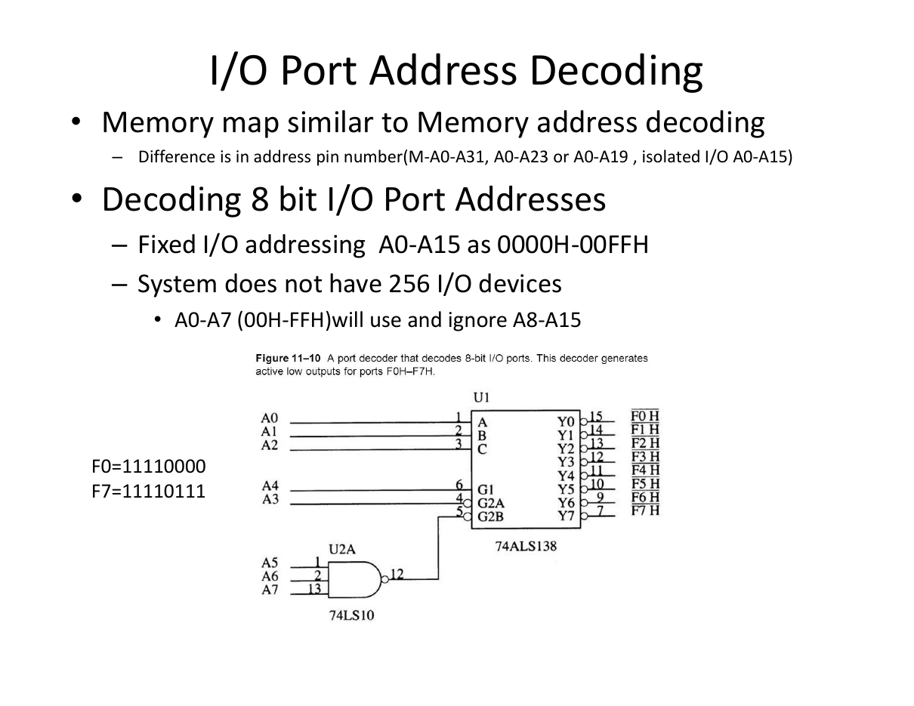

Facts from the slide:
- **Fixed I/O addressing** uses A0-A15 as **0000H - 00FFH**.
- A system **does not have 256 I/O devices**, so we use only **A0-A7 (00H-FFH)** and **ignore A8-A15**.

> [!note] What "ignore A8-A15" means (partial decoding)
> If the decoder does not look at A8-A15, the same port answers at *many* 16-bit addresses (F0H, 01F0H, 02F0H …). That is fine in a small system and saves gates. It is called **partial (or incomplete) decoding**.

**Goal (Figure 11-10):** a decoder with **active-low outputs for ports F0H - F7H**.

**Step 1: write the range in binary.**

```
F0H = 1111 0000
F7H = 1111 0111
      A7..A3 fixed = 1 1 1 1 0 | A2 A1 A0 vary (000..111)
```

**Step 2: connect.** Eight ports → one **74ALS138** (3-to-8 decoder):
- **A0, A1, A2 → A, B, C** (they choose which of the 8 ports).
- Fixed bits **A7 A6 A5 A4 A3 = 1 1 1 1 0**:
  - **A4 → G1** (G1 is active-**high**, needs 1 ✔).
  - **A3 → /G2A** (active-**low**, needs **0** ✔ since A3 = 0).
  - **A5, A6, A7 → a 3-input NAND (74LS10)** whose output → **/G2B** (output is 0 only when A5 = A6 = A7 = 1 ✔).
- **Outputs /Y0 ... /Y7 = /F0H ... /F7H** (active low port-select signals).

| A2 A1 A0 | Output | Port |
|---|---|---|
| 000 | Y0 | F0H |
| 001 | Y1 | F1H |
| 010 | Y2 | F2H |
| 011 | Y3 | F3H |
| 100 | Y4 | F4H |
| 101 | Y5 | F5H |
| 110 | Y6 | F6H |
| 111 | Y7 | F7H |

(In a real circuit these select lines are combined with `/IORC` or `/IOWC` so that a port reacts only to an I/O read or write.)

> [!tip] Memory trick (reuse from Lecture 6)
> **"1-0-0" enable rule of the 74LS138:** `G1 = 1`, `/G2A = 0`, `/G2B = 0`. The three lowest bits pick the port. All other bits are "fixed" and go to the enables.

### 4.3 Decoding 16-bit port addresses: EFF8H - EFFFH with a PLD (slide 6) 🔧

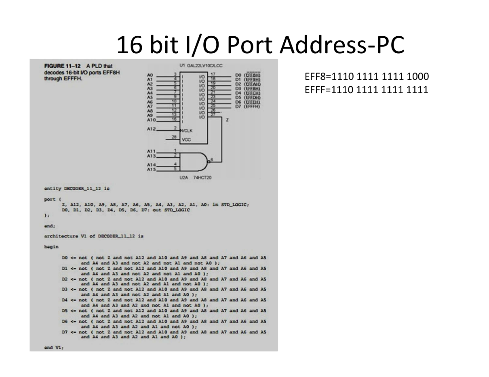

**Goal (Figure 11-12):** decode eight ports **EFF8H - EFFFH** using a **GAL22V10 PLD** and a 4-input NAND (74HCT20).

```
EFF8H = 1110 1111 1111 1000
EFFFH = 1110 1111 1111 1111
        A15 A14 A13 = 1 1 1,  A12 = 0,  A11 = 1,  A10..A3 = all 1,  A2 A1 A0 = 000..111
```

### How to read the circuit
- Four address lines **A11, A13, A14, A15** go into the **NAND gate U2A (74HCT20)**. Its output **Z** is **0 only when all four are 1**. Z goes into the PLD as an extra input (so the PLD needs fewer pins).
- The PLD (U1) receives **A0-A10, A12 and Z**. It outputs eight active-low port selects named **D0 ... D7** (these are *PLD output names*, not the data bus) for ports **EFF8H ... EFFFH**.

**The VHDL equations (one per port).** For example:

```vhdl
D0 <= not ( not Z and not A12 and A10 and A9 and A8 and A7 and A6 and A5
            and A4 and A3 and not A2 and not A1 and not A0 );
D1 <= not ( ... and not A2 and not A1 and A0 );      -- EFF9H
...
D7 <= not ( ... and A2 and A1 and A0 );              -- EFFFH
```

**How to read one equation:** inside the bracket, every condition must be true: `not Z` means Z = 0 (A11, A13, A14, A15 = 1); `not A12` → A12 = 0; A10 ... A3 = 1; and the last three bits `A2 A1 A0` give the port number (D0 = 000 ... D7 = 111). The outer `not` makes the output **active low**.

| Output | A2 A1 A0 | Port |
|---|---|---|
| D0 | 000 | EFF8H |
| D1 | 001 | EFF9H |
| D2 | 010 | EFFAH |
| D3 | 011 | EFFBH |
| D4 | 100 | EFFCH |
| D5 | 101 | EFFDH |
| D6 | 110 | EFFEH |
| D7 | 111 | EFFFH |

> [!tip] Memory trick
> **Use a PLD when there are too many address pins for one gate**: do the "easy all-ones" bits with a NAND (Z) and let the PLD handle the rest.

---

## 5. 8-bit and 16-bit wide data from I/O devices (banks again) 🧠🧩🔧

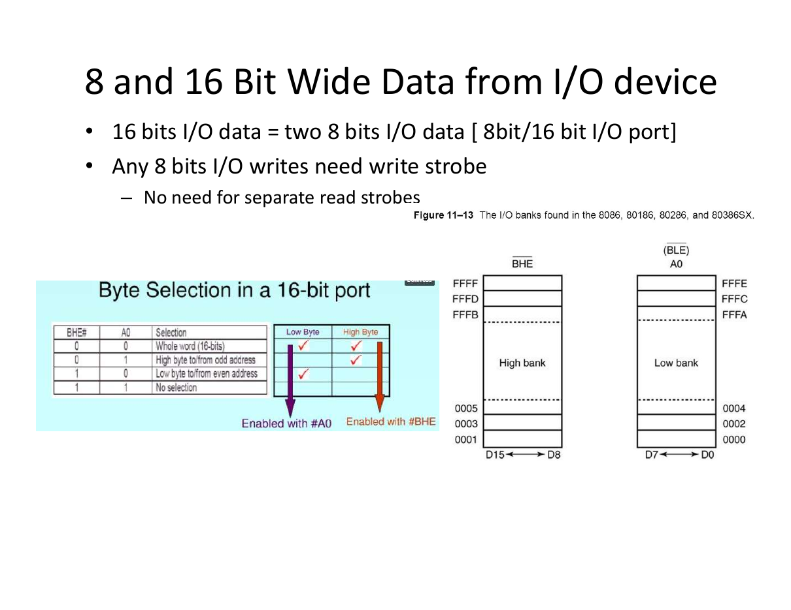

### 5.1 The idea
- A **16-bit I/O port = two 8-bit I/O ports** side by side (same trick as the two memory banks in Lecture 6).
- On the **8086/80186/80286/80386SX** the data bus is 16 bits: **low byte on D0-D7** (**even** port address, selected by **A0**), **high byte on D8-D15** (**odd** port address, selected by **/BHE**).
- **Any 8-bit I/O *write* needs its own write strobe** (so you don't overwrite the other byte). **No separate read strobes are needed** (the CPU just ignores the byte it does not need).

**Byte selection in a 16-bit port (table on the slide):**

| /BHE | A0 | Selection | Low byte (D0-D7) | High byte (D8-D15) |
|---|---|---|---|---|
| 0 | 0 | **Whole word (16 bits)** | ✔ | ✔ |
| 0 | 1 | **High byte** to/from **odd** address | | ✔ |
| 1 | 0 | **Low byte** to/from **even** address | ✔ | |
| 1 | 1 | **No selection** | | |

"Low byte is **enabled with /A0**, high byte is **enabled with /BHE**" (arrows on the slide). The picture on the right of the slide (Fig 11-13) is the same two-bank drawing as memory: **High bank** (addresses 0001, 0003, … FFFF/FFFD/FFFB, data D15-D8) and **Low bank** (0000, 0002, … FFFE/FFFC/FFFA, data D7-D0).

### 5.2 A 16-bit-wide **input** port at 64H and 65H (slide 8) 🔧

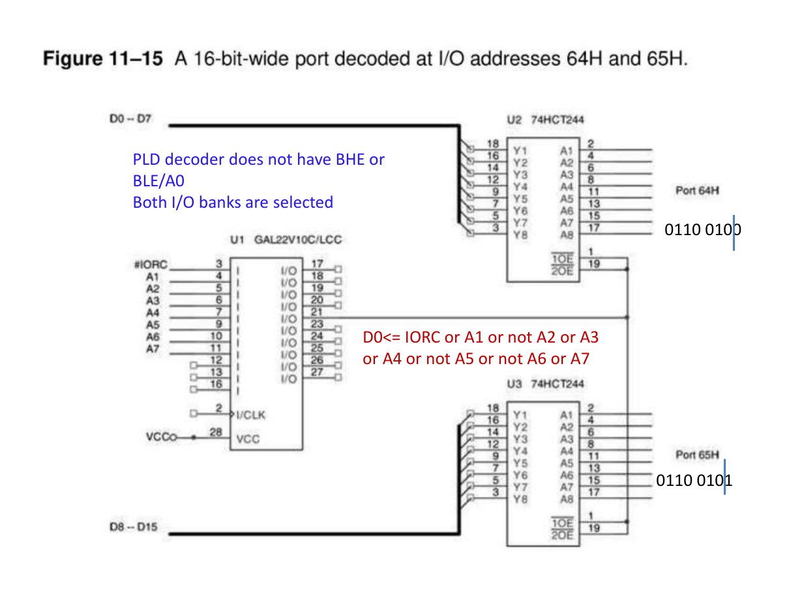

**Hardware:** two **74HCT244** tri-state buffers (**U2 = port 64H**, **U3 = port 65H**) and one **GAL22V10 PLD decoder (U1)**.
- U2's outputs go to **D0-D7**, U3's outputs to **D8-D15**. Their inputs are the 16 external input lines.
- **PLD equation** (output D0):

```
D0 <= IORC or A1 or not A2 or A3 or A4 or not A5 or not A6 or A7
```

**Read it:** the output is **0** (active) only when **every term is 0**:
`IORC = 0` (I/O read), `A1 = 0`, `A2 = 1`, `A3 = 0`, `A4 = 0`, `A5 = 1`, `A6 = 1`, `A7 = 0`.

```
A7 A6 A5 A4 A3 A2 A1 A0
 0  1  1  0  0  1  0  x   = 0110 010x  = 64H or 65H   (A0 = don't care)
```
(The slide marks **0110 0100 = 64H** and **0110 0101 = 65H**.)

**The key remark on the slide:** *"PLD decoder does not have BHE or BLE/A0: **both I/O banks are selected**."* The one output enables **both buffers' output-enable pins (1OE, 2OE)** at the same time, so one `IN AX` reads the **whole 16-bit word** (port 64H on D0-D7 and port 65H on D8-D15). Because reads need no byte separation, that is fine.

### 5.3 A 16-bit **output** port at 40H and 41H (slide 9) 🧩🔧

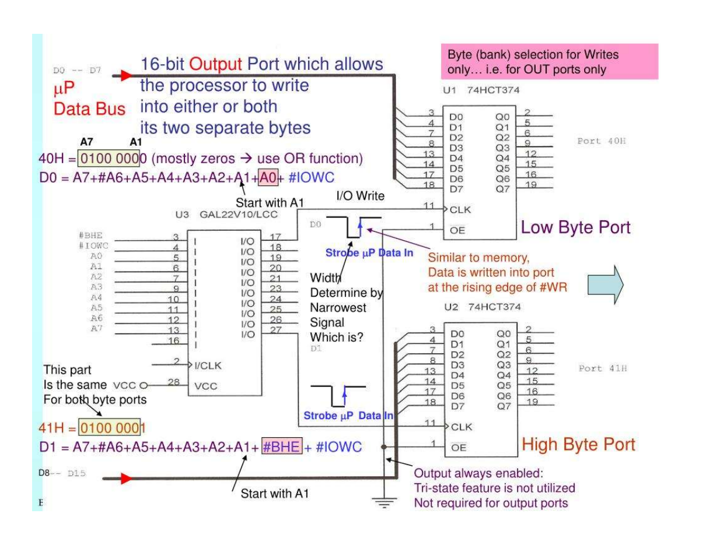

**What it is:** a **16-bit output port that lets the processor write into either one or both of its two separate bytes.** Two **74HCT374** latches:
- **U1 = Low Byte Port = port 40H**, data from D0-D7.
- **U2 = High Byte Port = port 41H**, data from D8-D15.
- A **GAL22V10 (U3)** makes **two strobes: D0 (for 40H) and D1 (for 41H)**. Each strobe goes to the **CLK** pin of its latch.

**The decoding (this is the exam part):**

```
40H = 0100 0000 0   (mostly zeros -> use the OR function!)
41H = 0100 0001
```
- The part that is the **same for both byte ports** is **A7 ... A1** = `0100 000` (start with A1 and go up to A7). Only the last bit (A0) or /BHE differs.
- **D0** (low byte, port 40H): `D0 = A7 + /A6 + A5 + A4 + A3 + A2 + A1 + A0 + /IOWC`
  (`/A6` = "not A6" because A6 must be **1**; every other term must be **0**. **A0** is in the equation: the low byte is only for **even** addresses, A0 = 0.)
- **D1** (high byte, port 41H): `D1 = A7 + /A6 + A5 + A4 + A3 + A2 + A1 + /BHE + /IOWC`
  (here **/BHE** replaces A0: the high byte is enabled when **BHE = 0**.)

> [!tip] Why use the OR function?
> OR output is **0 only when all inputs are 0**. When the address is "mostly zeros" (like 40H), an OR needs few inverters. For "mostly ones" addresses use a NAND instead.

**Timing (the little waveform boxes):**
- Data is written into the port **at the rising edge of /WR** ("similar to memory"). The 74HCT374 is **rising-edge triggered**, so the strobe from the PLD clocks the data in.
- The slide asks: *"Width determined by narrowest signal. Which is?"* → the strobe width equals the **narrowest input** of the OR, which is **/IOWC** (the write pulse). The address lines are stable much longer than the write pulse.
- The **OE pin of each 374 is grounded**: the output is **always enabled**. "Tri-state feature is not utilized; **not required for output ports**."
- The label "Byte (bank) selection for Writes only, i.e. for OUT ports only" repeats that bank selection by separate strobes is **needed for writes only**.

---

## 6. IN and OUT instructions 🔧

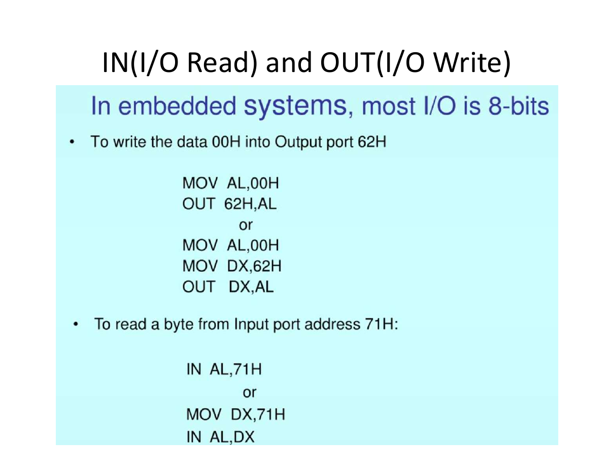

- `OUT port, AL` = **I/O write**: copy AL (or AX/EAX) to the port.
- `IN AL, port` = **I/O read**: copy the port to AL (or AX/EAX).
- The port address is either an **8-bit immediate** (only ports 00H-FFH) or the **16-bit value in DX**.

> "In embedded systems, most I/O is 8 bits."

**Write 00H into output port 62H:**

```asm
MOV AL, 00H
OUT 62H, AL          ; fixed 8-bit port address
; or
MOV AL, 00H
MOV DX, 62H
OUT DX, AL           ; variable 16-bit port address in DX
```

**Read a byte from input port 71H:**

```asm
IN  AL, 71H
; or
MOV DX, 71H
IN  AL, DX
```

> [!warning] Exam trap
> The port address register is **always DX** (never AX/BX/CX). For ports **above FFH** you **must** use DX.

---

## 7. Basic input interface (tri-state buffer) and pull-up resistors 🧩🔧

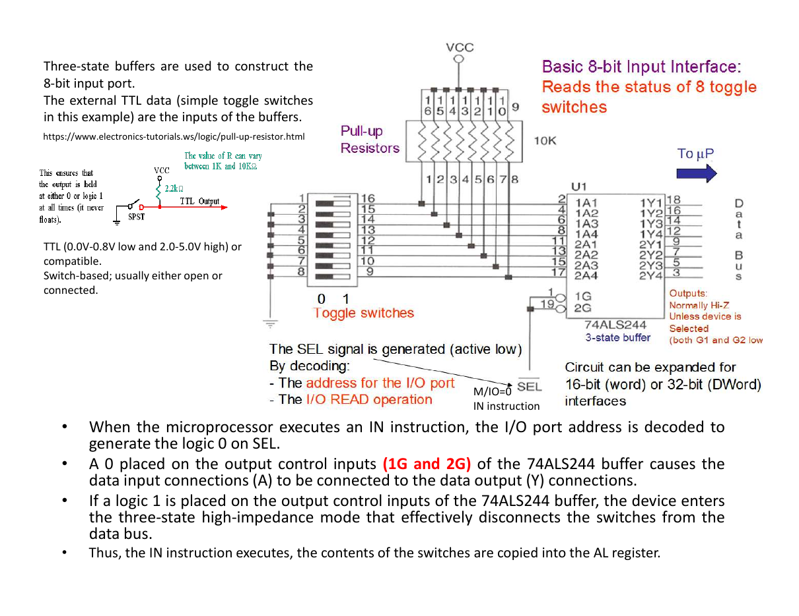

**Purpose:** read the status of **8 toggle switches** (a DIP switch) into the CPU.

### Why a tri-state buffer?
The data bus is **shared**: memory, other ports, the CPU all use it. An input device may only put its data on the bus **while the CPU is reading it**; the rest of the time it must be **disconnected (high impedance, "Hi-Z")**. A **three-state buffer** does that. (This is why the slide says: *a tri-state buffer is used for an input port because it allows multiple inputs to share the same signal line without interfering with each other.*)

### How to read the circuit
- **U1 = 74ALS244** octal three-state buffer: inputs **1A1-1A4, 2A1-2A4** come from the 8 switches; outputs **1Y1-1Y4, 2Y1-2Y4** go to the **data bus (D0-D7 "To µP")**.
- Each switch line has a **pull-up resistor (10K network)** to VCC.
- **1G and 2G** (active-low enables) are tied together to **/SEL**.
- **/SEL (active low)** is generated by **decoding the I/O port address and the I/O READ operation** (i.e. M/IO = I/O, `IN` instruction).

### What happens on an `IN` instruction (bullets from the slide)
1. The CPU executes `IN`; the port address is decoded and **/SEL = 0**.
2. A **0 on 1G and 2G** connects the inputs (A) to the outputs (Y), so the switch levels appear on the **data bus**.
3. If a **1** is on 1G/2G, the buffer is in the **three-state high-impedance** mode, which **disconnects the switches from the data bus**.
4. So when `IN` executes, the **contents of the switches are copied into AL**.
- Outputs are "**normally Hi-Z unless the device is selected (both G1 and G2 low)**".
- The circuit can be **expanded to 16-bit (word) or 32-bit (doubleword)** interfaces by adding more buffers.

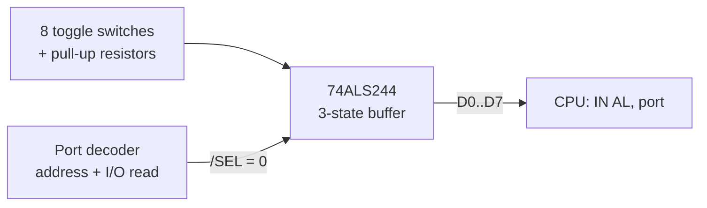

### Pull-up resistors (slides 11 and 12)

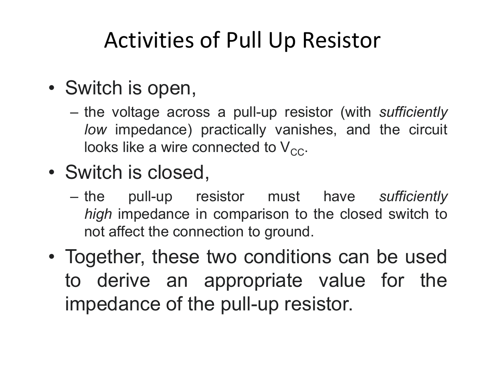

A switch is either **open or closed**. An open switch would leave the input **floating** (undefined: could read 0 or 1). A **pull-up resistor** to VCC fixes that:

| Switch | What happens | Logic level |
|---|---|---|
| **Open** | no current → almost no voltage drop across the resistor → the line "looks like a wire connected to VCC" | **1** |
| **Closed** | the line is shorted to ground; the resistor must have **high enough impedance** compared with the closed switch so that it does not disturb the connection to ground | **0** |

- This "ensures that the output is held at either 0 or logic 1 at all times (**it never floats**)".
- Together these two conditions give the **proper resistor value**: the slide's example uses **2.2 kΩ** and says "R can vary between **1 K and 10 KΩ**" (the circuit uses a **10K** network).
- TTL levels quoted: **low = 0.0 V - 0.8 V, high = 2.0 V - 5.0 V**.

> [!tip] Memory trick
> **Open switch = pulled UP = 1. Closed switch = to ground = 0.** (So on a DIP switch the "ON/closed" position reads **0**; the slide labels the toggle positions "0 1".)

---

## 8. Basic output interface (latch and LEDs) 🧩🔧

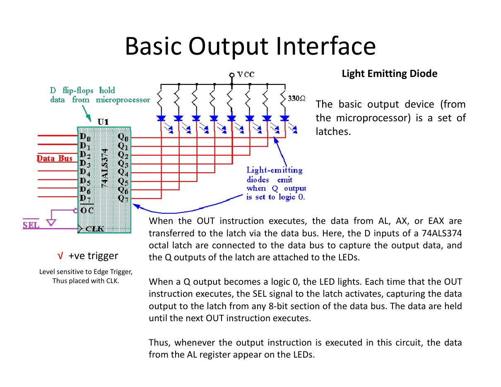

**Purpose:** show the value of AL on **8 LEDs**. "The basic output device (from the microprocessor) is a **set of latches**."

### Why a latch?
During an `OUT` instruction the CPU keeps the data on the bus only for a **very short time**. The LEDs must keep showing the value afterwards, so the data must be **stored**. A **latch / D flip-flop** stores it. (Slide 14: *a latch is used for an output port because it can store and output data.*)

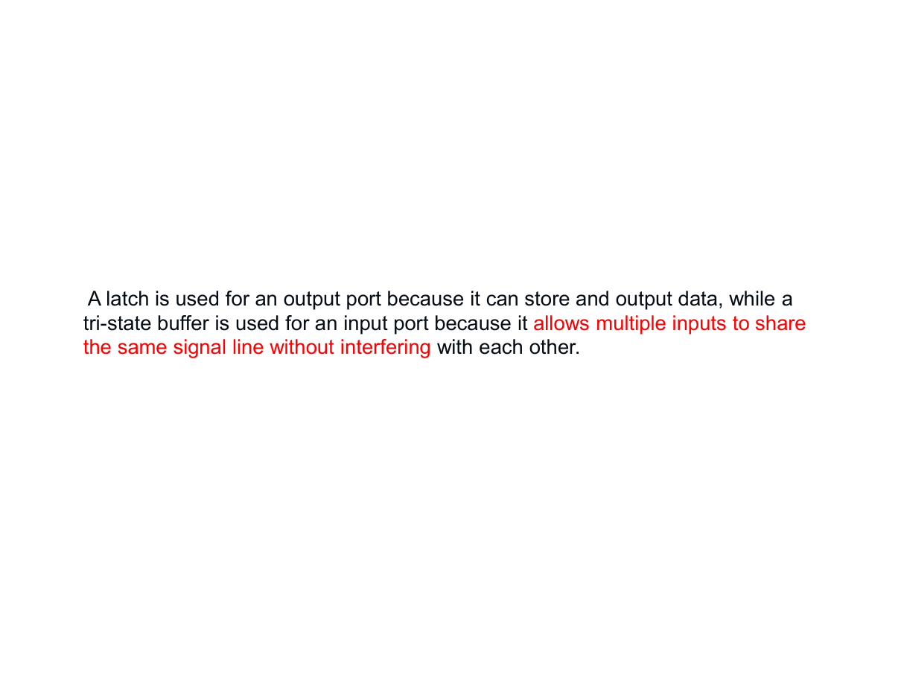

### How to read the circuit
- **U1 = 74ALS374** octal D flip-flop/latch: **D0-D7** connected to the **data bus**.
- **Q0-Q7** go to **LEDs**, each LED with a **330 Ω resistor to VCC**.
- **/OC** (output control) is **grounded** → outputs always enabled.
- **CLK** is driven by **/SEL** (the decoded I/O write strobe). The slide notes "**+ve trigger**: level-sensitive to edge trigger, thus placed with CLK": the 374 is **edge-triggered**, so the data is captured on the **rising edge** of the strobe.
- **An LED lights when its Q output is logic 0** (current flows from VCC through the LED to the low Q output).

**What happens on `OUT`:**
1. Data from **AL, AX or EAX** goes onto the data bus.
2. The **/SEL** pulse (port decoded + I/O write) **clocks** the 374: it **captures** the data from the 8-bit section of the bus.
3. The data is **held until the next OUT** instruction. So whatever is in AL stays on the LEDs.

> [!tip] Input vs output (one-line memory aid)
> **Input port = BUFFER (just a gate, data already stays at the source).** **Output port = LATCH (must remember what the CPU sent).**

| | Input port | Output port |
|---|---|---|
| Chip | 74ALS244 (three-state buffer) | 74ALS374 (octal latch/flip-flop) |
| Why | share the bus; connect only when selected | CPU's data is on the bus only briefly; must be stored |
| Control | /SEL on **output enables** (1G, 2G) | /SEL on **CLK** (OC grounded) |
| Instruction | `IN` | `OUT` |

---

## 9. Interrupts: INTR and INTA 🧠🔧

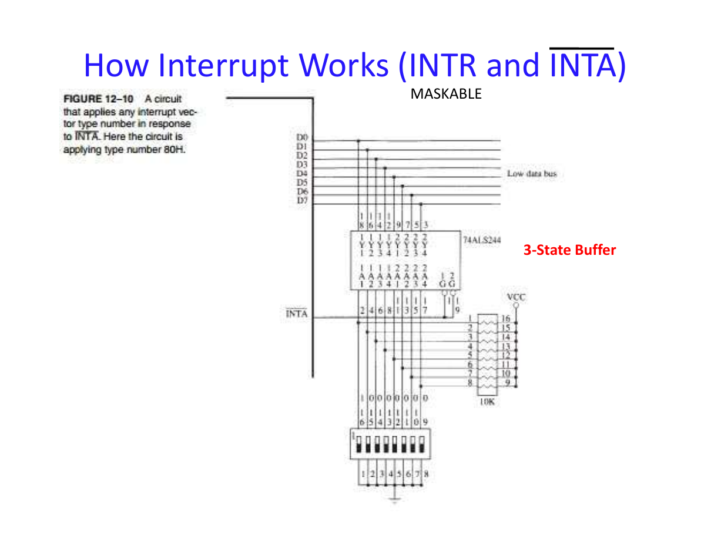

### 9.1 The idea (analogy)
**Polling** = the CPU keeps asking the device "ready yet?" (like checking the oven every minute). An **interrupt** = the device **taps the CPU on the shoulder** when it is ready (the oven rings). The CPU stops what it is doing, serves the device, then returns.

### 9.2 INTR and INTA
- **INTR** = **interrupt request** input pin of the CPU. It is **maskable**: it only works if the interrupt flag **IF = 1** (the slide writes "MASKABLE").
- **/INTA** = **interrupt acknowledge** output of the CPU: "OK, I accept; now tell me **which** device / which **vector number**".

### 9.3 How does the CPU learn *which* interrupt? (Figure 12-10)
During the acknowledge, the interrupting circuit must place an **interrupt vector type number** (an 8-bit number) on the **low data bus D0-D7**.
- The circuit in the slide uses a **74ALS244 3-state buffer** whose enables **1G and 2G are driven by /INTA**.
- The buffer inputs are set by a **DIP switch + 10K pull-up resistors**: closed switch = **0**, open = **1** (pull-up).
- In the figure the pattern is `1 0 0 0 0 0 0 0` = **80H**, so the circuit "applies type number **80H**".
- When /INTA goes low → the buffer turns on → **80H** appears on the data bus → the CPU reads it.

**What the CPU then does** (general 8086 knowledge, not written on the slide): finish the current instruction, push the flags and return address, clear IF, multiply the type number by 4 to find the entry in the **interrupt vector table** (type 80H → address 4 × 80H = **200H**) and jump to the **interrupt service routine (ISR)**.

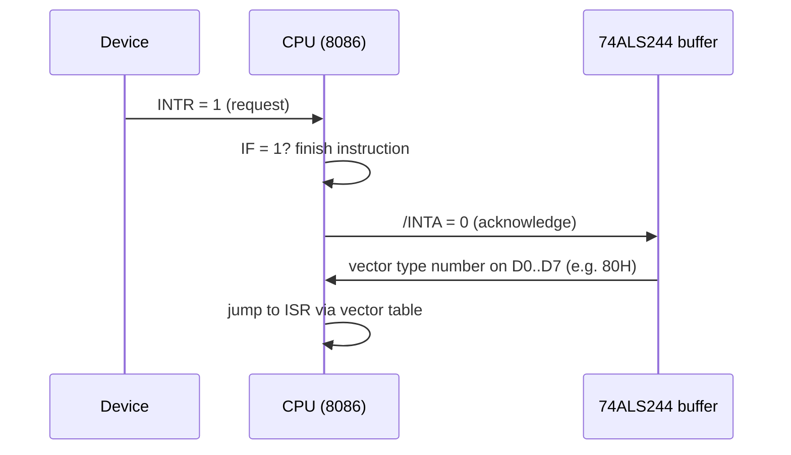

### 9.4 82C55 keyboard interface with interrupt vector 40H (slide 16) 🔧

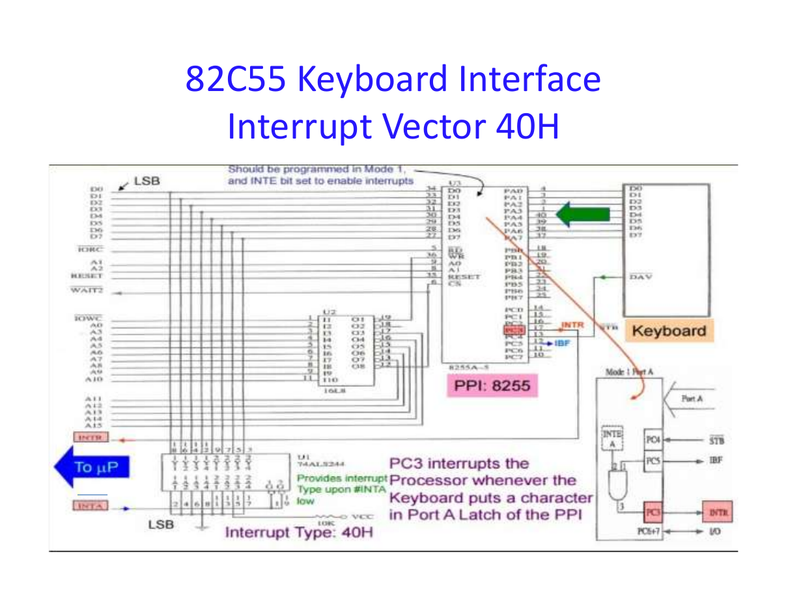

A **keyboard** gives the CPU an **ASCII character** each time a key is pressed. This circuit makes the CPU **interrupt** whenever that happens.

### How to read the circuit
- The **keyboard** sends ASCII on **D0-D7 → PA0-PA7** (Port A of the **8255**) and **/DAV (data available) → STB** (pin **PC4**).
- The **8255 (PPI)** must be programmed in **Mode 1** (strobed input) and its **INTE bit set** to enable interrupts (note on the slide: *"Should be programmed in Mode 1, and INTE bit set to enable interrupts"*).
- Bottom right (box "Mode 1 Port A"): **PC4 = /STB, PC5 = IBF, PC3 = INTR**. The **INTE A** flip-flop gates the interrupt: INTR is output only when INTE is 1.
- **PC3 (INTR) → the `INTR` input of the µP.** Slide says: "**PC3 interrupts the processor whenever the keyboard puts a character in the Port A latch of the PPI**."
- A **74ALS244 (U1)** "**provides interrupt type upon /INTA low**". Its inputs are wired so the type is **40H** = `0100 0000` ("Interrupt Type: 40H").
- A **16L8 PLD (U2)** decodes the address lines for the 82C55 chip select.

> [!tip] Memory trick
> **Strobe in → IBF goes high → INTR to the CPU → CPU sends /INTA → buffer places vector 40H → ISR reads Port A.**

---

## 10. Expanding the interrupt structure 🧠🧩

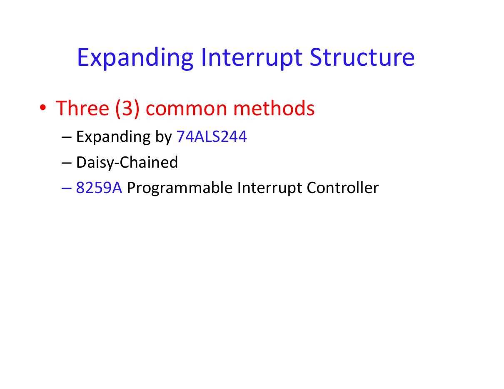

The 8086 has **one** INTR pin, but a system may have many interrupting devices. **Three common methods** to expand:
1. **Expanding by a 74ALS244** (§10.1)
2. **Daisy-chained** (§10.2)
3. **8259A Programmable Interrupt Controller (PIC)** (the professional solution; mentioned only by name on the slide)

### 10.1 Expanding with a 74ALS244 (slide 18) 🧩

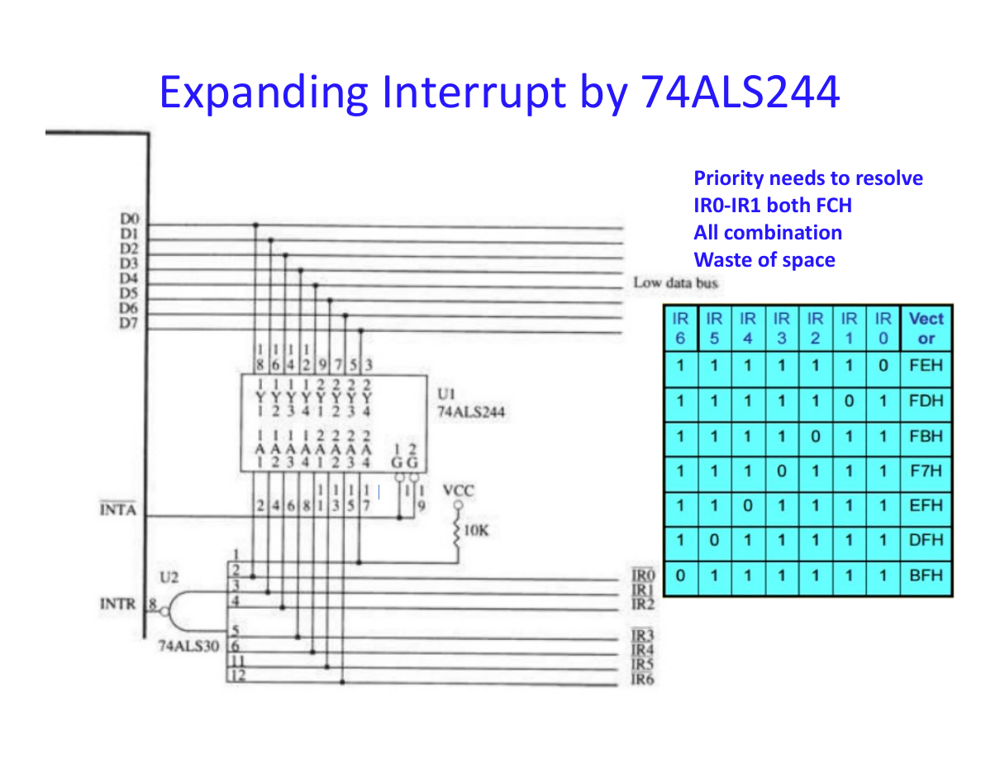

**Idea:** give **each device its own vector number** by putting the device's request lines (IR0-IR6) on the data bus during /INTA.

### How to read the circuit
- Seven active-low request inputs **IR0 - IR6**.
- A **74ALS30 (8-input NAND, "U2")**: its output is **1 when any IR input is 0** → this is the **INTR** signal to the CPU.
- The **same IR lines** also feed the **74ALS244 (U1)** inputs; the **8th input is tied to VCC through a 10K resistor** (so bit D7 = 1).
- On **/INTA** the 244 puts the IR pattern on the data bus: that pattern **is** the vector number.

**Table on the slide** (IR6 IR5 … IR0 → vector):

| IR6 IR5 IR4 IR3 IR2 IR1 IR0 | Active (low) request | Vector |
|---|---|---|
| 1 1 1 1 1 1 **0** | IR0 | **FEH** |
| 1 1 1 1 1 **0** 1 | IR1 | **FDH** |
| 1 1 1 1 **0** 1 1 | IR2 | **FBH** |
| 1 1 1 **0** 1 1 1 | IR3 | **F7H** |
| 1 1 **0** 1 1 1 1 | IR4 | **EFH** |
| 1 **0** 1 1 1 1 1 | IR5 | **DFH** |
| **0** 1 1 1 1 1 1 | IR6 | **BFH** |

(D7 = 1 always, so vector = `1 IR6 … IR0`.)

**Problems (written on the slide):**
- **Priority needs to be resolved**: if **two** requests arrive together (e.g. **IR0 and IR1 both active → FCH**), the vector is a *combination*, not either device's number.
- Every **combination** would need its own vector → **waste of vector-table space**.

### 10.2 Expanding by daisy chain (slide 19) 🧩

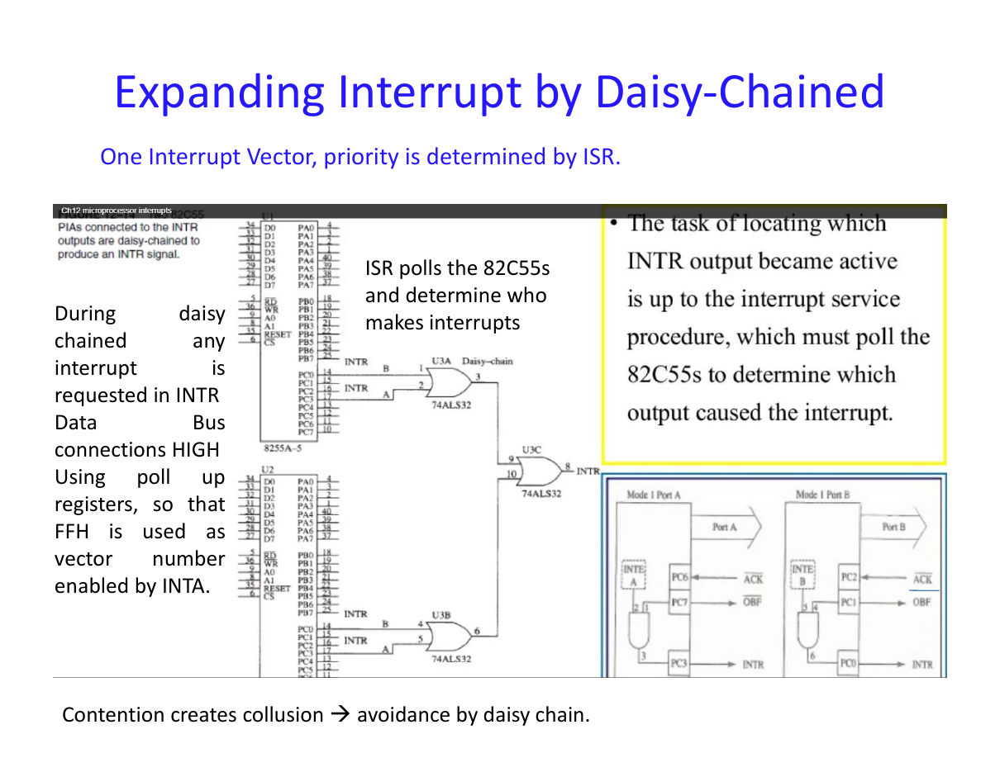

**Idea: one interrupt vector for everybody; the software decides who interrupted.**

### How to read the circuit
- Several **82C55 PPIs** each have **INTR outputs** (PC3 = INTRA, PC0 = INTRB). All the INTR outputs are **OR-ed** with **74ALS32 OR gates** (daisy chain) into **one INTR** line to the CPU.
- **During the interrupt acknowledge the data-bus connections are pulled HIGH** (pull-up resistors), so the CPU reads **FFH** as the **vector number**, enabled by /INTA.
- So any request produces **vector FFH**; "**priority is determined by the ISR**": the **ISR polls the 82C55s** and finds who raised the interrupt. ("The task of locating which INTR output became active is up to the interrupt service procedure, which must poll the 82C55s to determine which output caused the interrupt.")
- Slide note: *"Contention creates collision → avoidance by daisy chain"*: if several devices tried to drive the line/bus at once they would clash; combining them through OR gates avoids this.

### The polling ISR for vector FFH (slide 20) 🔧

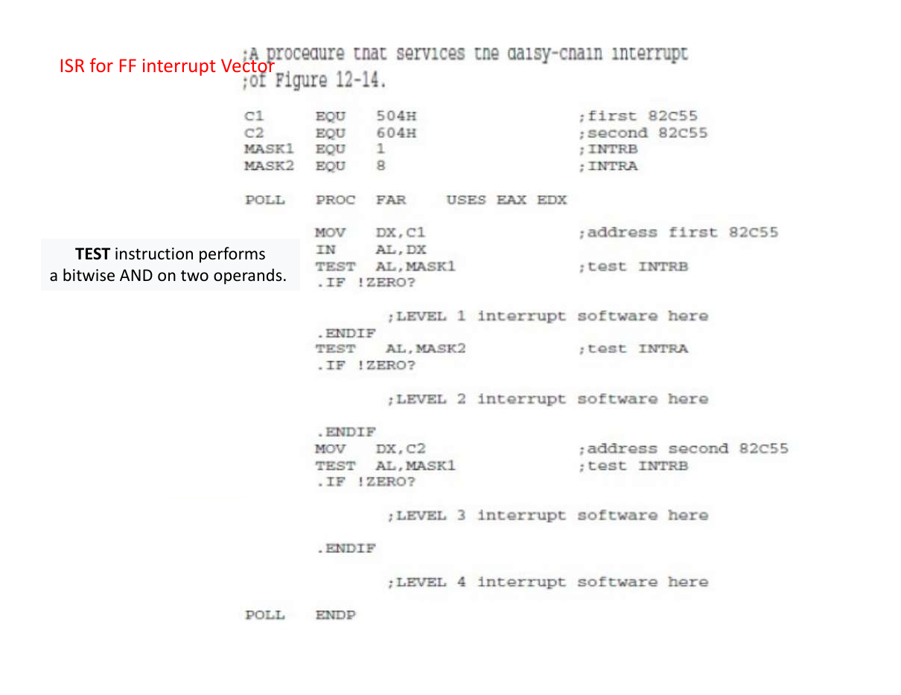

```asm
C1    EQU 504H      ; port C of first 82C55
C2    EQU 604H      ; port C of second 82C55
MASK1 EQU 1         ; INTRB  (PC0, bit 0)
MASK2 EQU 8         ; INTRA  (PC3, bit 3)

POLL PROC FAR USES EAX EDX
     MOV  DX, C1            ; address first 82C55
     IN   AL, DX            ; read its port C
     TEST AL, MASK1         ; test INTRB
     .IF !ZERO?
          ; LEVEL 1 interrupt software here
     .ENDIF
     TEST AL, MASK2         ; test INTRA
     .IF !ZERO?
          ; LEVEL 2 interrupt software here
     .ENDIF
     MOV  DX, C2            ; address second 82C55
     TEST AL, MASK1         ; test INTRB
     .IF !ZERO?
          ; LEVEL 3 interrupt software here
     .ENDIF
          ; LEVEL 4 interrupt software here
POLL ENDP
```

**How to read it**
- `TEST AL,mask` = **bitwise AND** of the two operands that only sets the flags (the result is thrown away). If the tested bit is **1**, the result is non-zero → `ZF = 0`. `.IF !ZERO?` = "if the zero flag is **not** set" = "if the bit is 1" = **that source requested an interrupt**.
- **Priority = order of testing.** The first one tested has the **highest** priority (level 1), the last is the lowest (level 4).
- Each 82C55's **port C bit 0 = INTRB**, **bit 3 = INTRA** (hence masks 1 and 8).

> [!warning] Looks like a missing line in the slide
> After `MOV DX, C2` the listing goes straight to `TEST AL, MASK1`. In a real program you need `IN AL, DX` **after** loading DX with C2, otherwise you are still testing the **first** chip's value. Mention this if you rewrite the program in an exam.

---

## 11. Strobe signals 🧠

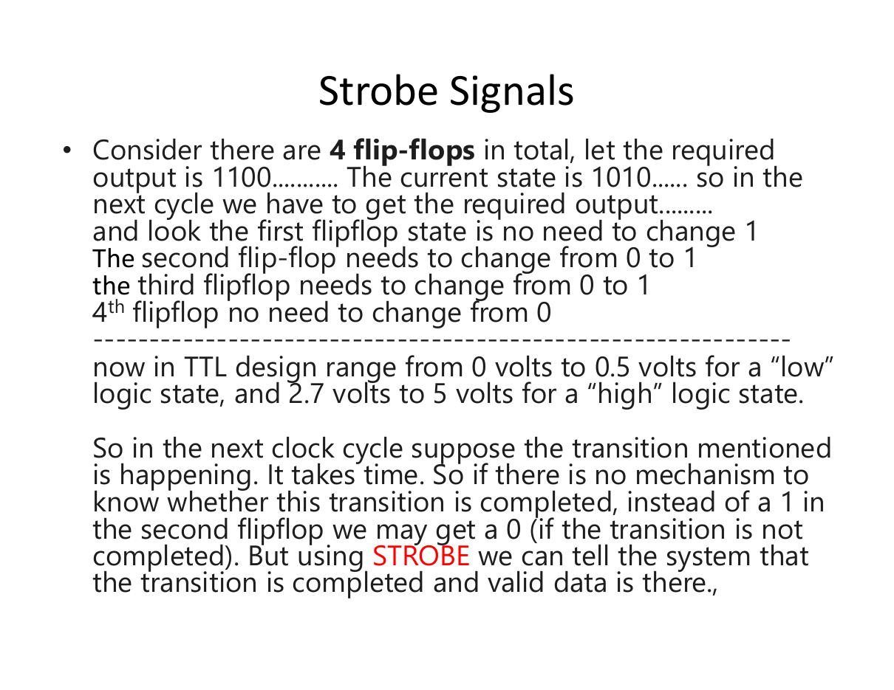

**The problem:** Digital signals do not change **instantly**. TTL levels: roughly **0 - 0.5 V = low** and **2.7 - 5 V = high** (the slide's numbers). When several bits change at once (e.g. a 4-bit value from **1010** to **1100**: the 2nd flip-flop goes 0→1, the 3rd 1→0, …), there is a short time when the bits are **still changing**. If the receiver looks too early it may read a wrong value (a 0 instead of a 1).

**The cure: a strobe.** A **strobe** is an extra **control pulse** that says "**the data is now valid, take it**". The receiver only samples the data when the strobe is active. So:

> **Strobe = "the transition is completed and valid data is there."**

You will see strobes everywhere in this lecture: **/STB** (input strobe), **/ACK** (acknowledge), **/DS** (data strobe), **/IORC, /IOWC** (I/O read/write strobes).

---

## 12. The 82C55 PPI: what it is and its registers 🧠

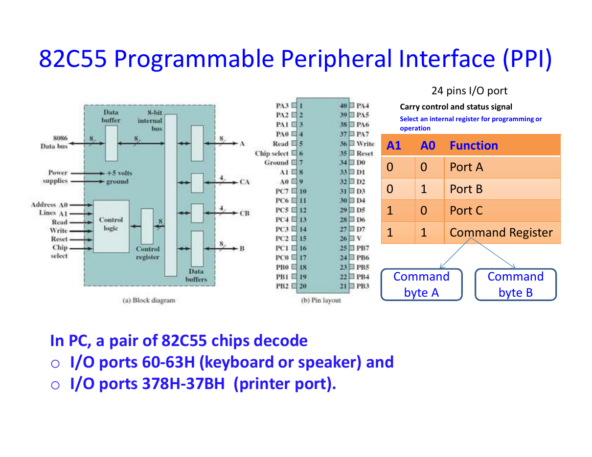

**82C55 = Programmable Peripheral Interface (PPI).** It is a general-purpose **parallel I/O chip**: you **program** it (with a command byte) to say which pins are inputs and which are outputs, and in which mode.

- **24 I/O pins** forming **three 8-bit ports: A, B and C**.
- It carries **control and status signals** (port C pins can also be handshake signals).
- Works with the 8-bit data bus of the CPU; 40-pin chip.

### How to read the block diagram (left of slide)
| Block | Meaning |
|---|---|
| **Data buffer (8)** | connects the chip to the **8086 data bus** (D0-D7), 8 bits |
| **8-bit internal bus** | carries data between the buffer and the ports |
| **Port A (8)** | 8-bit port, pins PA0-PA7 |
| **Port B (8)** | 8-bit port, pins PB0-PB7 |
| **CA (4) and CB (4) = Port C** | port C is **split into two 4-bit halves**: **upper half PC7-PC4 (CA)** goes with Group A, **lower half PC3-PC0 (CB)** goes with Group B |
| **Control logic + control register** | decodes address lines A0, A1, Read, Write, Reset, Chip select |
| **Power** | +5 V and ground |

So the chip has **Group A = Port A + upper Port C** and **Group B = Port B + lower Port C**.

### Pin layout (middle of the slide)
Pins: **PA0-PA7, PB0-PB7, PC0-PC7, D0-D7, /RD, /WR, A0, A1, RESET, /CS, VCC, GND**.

### Register select: A1 A0 (table on the slide)

| A1 | A0 | Function |
|---|---|---|
| 0 | 0 | **Port A** |
| 0 | 1 | **Port B** |
| 1 | 0 | **Port C** |
| 1 | 1 | **Command register** (command byte A or command byte B, see §14) |

"Select an internal register for programming or operation": the two address pins pick **one of 4 registers**, so each 82C55 occupies **4 consecutive I/O addresses** (when its A0/A1 are wired straight to the CPU's lowest address lines).

**Uses in the PC (slide):** "a **pair of 82C55 chips** decode **I/O ports 60-63H (keyboard or speaker)** and **I/O ports 378H-37BH (printer port)**." (This matches the PC map in §3.)

> [!tip] Memory trick: "A1A0 = counting 0-3"
> **00 = A, 01 = B, 10 = C, 11 = Command** → "**A-B-C-Command**", in order.

---

## 13. Interfacing the 82C55 to the processor 🧩🔧

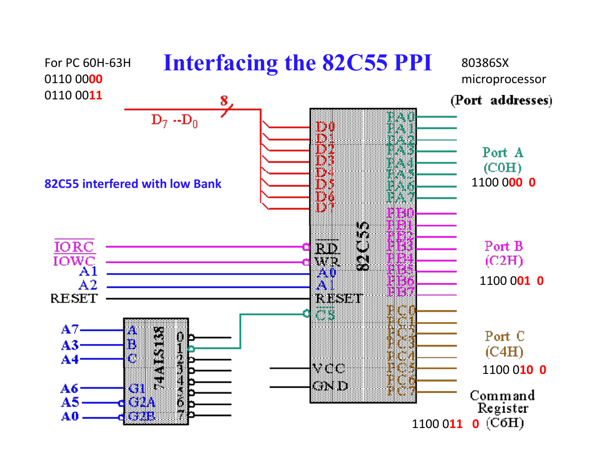

### 13.1 What the slide shows
An **82C55 connected to an 80386SX** (16-bit data bus) at ports **C0H, C2H, C4H, C6H**. The note at the top says "**For PC 60H-63H: 0110 0000 … 0110 0011**" (the PC's 8-bit version, where A1 A0 go straight to the chip and the four ports are 60H-63H consecutive).

### 13.2 How the wiring works (step by step)

1. **Data bus:** the 82C55 has an 8-bit data bus, so it is connected to **D0-D7 = the LOW bank** ("82C55 interfaced with low bank"). Low bank = **even** addresses (A0 = 0).
2. **Register select:** because the CPU's **A0 is used for bank selection**, the chip's **A0 pin ← CPU A1** and the chip's **A1 pin ← CPU A2**. The four registers therefore sit at **even** addresses, **2 apart**:

| CPU address bits (A7 A6 A5 A4 A3 / A2 A1 / A0) | Port | Address |
|---|---|---|
| 1 1 0 0 0 / 0 0 / 0 | **Port A** | **C0H** |
| 1 1 0 0 0 / 0 1 / 0 | **Port B** | **C2H** |
| 1 1 0 0 0 / 1 0 / 0 | **Port C** | **C4H** |
| 1 1 0 0 0 / 1 1 / 0 | **Command register** | **C6H** |

3. **Chip select (/CS)** comes from a **74ALS138**, output **Y1** (the slide marks the connection):
   - Select inputs: **A ← A7, B ← A3, C ← A4** → for Y1 we need C B A = **0 0 1**, i.e. **A4 = 0, A3 = 0, A7 = 1**.
   - Enables: **G1 ← A6** (needs **1**), **/G2A ← A5** (needs **0**), **/G2B ← A0** (needs **0**: even address).
   - So /CS = 0 exactly when **A7 A6 A5 A4 A3 = 1 1 0 0 0** and **A0 = 0**, and A2, A1 are free (register select) → **C0H - C6H (even)** ✔.
4. **Control:** **/IORC → /RD**, **/IOWC → /WR**, system **RESET → RESET**.

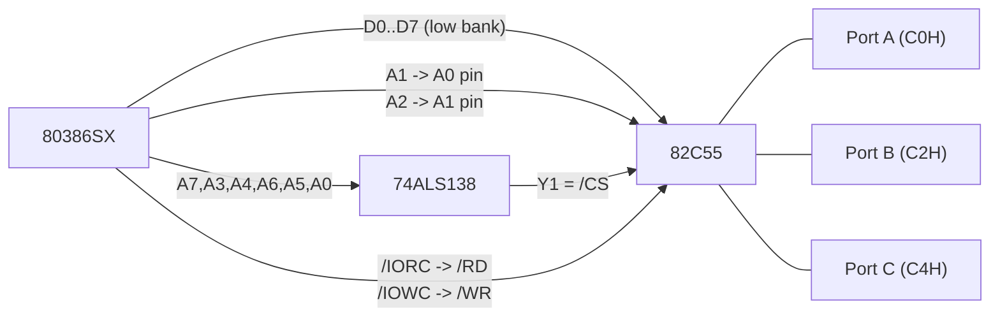

> [!tip] Memory trick for 16-bit systems
> "**8-bit chip on a 16-bit bus: put it on one bank, skip A0, shift the register-select bits up by one.**" Registers then come out 2 apart (C0H, C2H, C4H, C6H).

---

## 14. Programming the 82C55 (command byte A and B) 🔧

The 82C55 is **programmed through two internal command registers** (both written to the **same address**: A1 A0 = 11, the command register). **Bit 7 tells them apart:**

| Bit 7 | Meaning |
|---|---|
| **1** | **Command byte A** (mode/direction definition) |
| **0** | **Command byte B** (bit set/reset of port C) |

### 14.1 Command byte A: choose modes and directions (slide 24) 

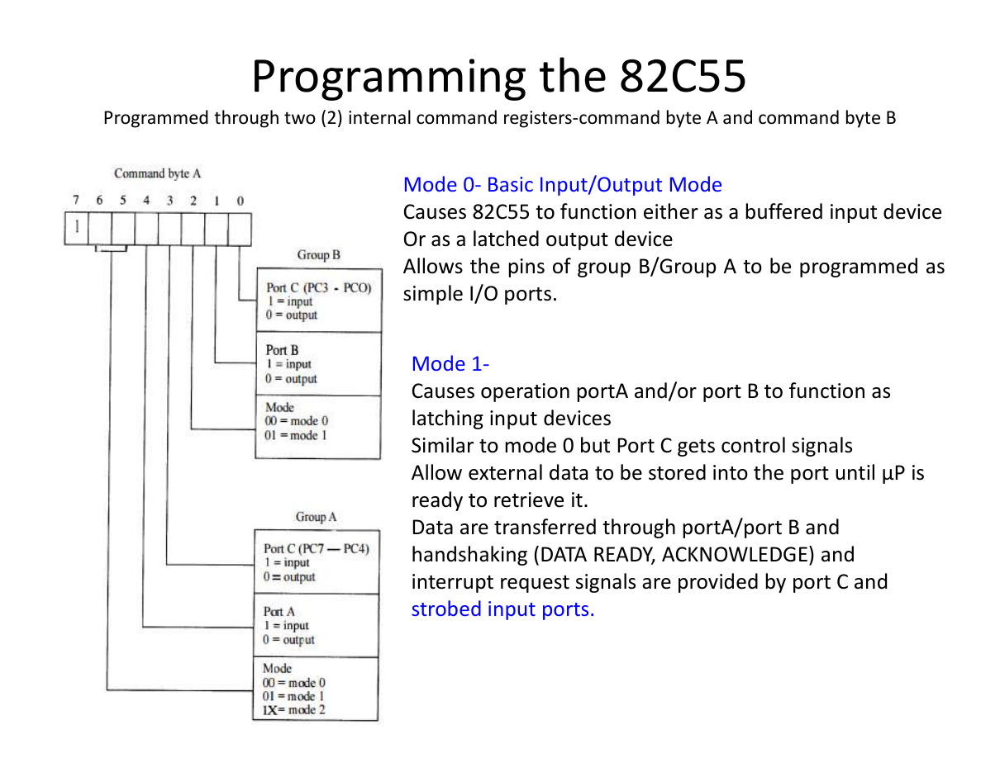

```
 bit:   7    6  5     4        3          2        1        0
      +----+------+--------+---------+--------+--------+---------+
      | 1  |Mode A| Port A | Port C  |Mode B  | Port B | Port C  |
      |    |      |        | PC7-PC4 |        |        | PC3-PC0 |
      +----+------+--------+---------+--------+--------+---------+
 Group A: bits 6-5, 4, 3          Group B: bits 2, 1, 0
 Mode A: 00 = mode 0, 01 = mode 1, 1X = mode 2      Mode B: 0 = mode 0, 1 = mode 1
 Direction bits: 1 = INPUT, 0 = OUTPUT
```

| Bit | Controls | Values |
|---|---|---|
| **D7** | mode-set flag | **1** (command byte A) |
| **D6 D5** | **Group A mode** | 00 = mode 0, 01 = mode 1, **1X = mode 2** |
| **D4** | **Port A** | 1 = input, 0 = output |
| **D3** | **Port C upper (PC7-PC4)** | 1 = input, 0 = output |
| **D2** | **Group B mode** | 0 = mode 0, 1 = mode 1 |
| **D1** | **Port B** | 1 = input, 0 = output |
| **D0** | **Port C lower (PC3-PC0)** | 1 = input, 0 = output |

**The three modes in one sentence each (slide 24):**
- **Mode 0 – basic input/output:** the 82C55 works either as a **buffered input device** or a **latched output device**; the pins of group A/B are simple I/O ports.
- **Mode 1 – strobed (handshake) I/O:** port A and/or port B work as **latching input devices** (or strobed outputs). **Port C supplies control/handshake signals** (DATA READY, ACKNOWLEDGE, interrupt request). External data is **stored in the port until the µP is ready** to read it.
- **Mode 2 – bidirectional:** **group A only**; **port A becomes bidirectional**.

> [!tip] Memory trick: "1-MM-A-C-M-B-C"
> Read the byte left to right as **1 (flag), Mode A (2 bits), Port A, upper C, Mode B, Port B, lower C**. Direction bits: **1 = In (like "I" = 1)**, 0 = Out.

**Worked examples (I computed these from the table above):**

| Wanted | Bits | Byte |
|---|---|---|
| All three ports **output**, mode 0 | 1 00 0 0 0 0 0 | **80H** |
| **Port A input**, B and C output, mode 0 | 1 00 1 0 0 0 0 | **90H** |
| **All ports input**, mode 0 | 1 00 1 1 0 1 1 | **9BH** |
| Port A **output**, Port B **input**, C output, mode 0 | 1 00 0 0 0 1 0 | **82H** |

Program: `MOV AL,90H` then `OUT 0C6H,AL` (command register address from §13) → Port A input, Port B and C output.

### 14.2 Command byte B: bit set/reset on port C (slide 25)

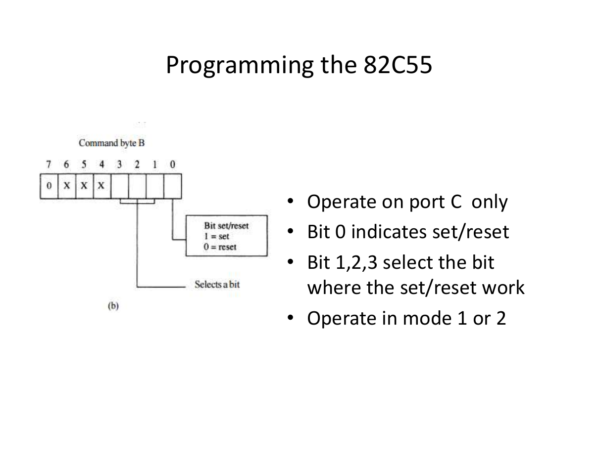

```
 bit:   7    6 5 4     3 2 1        0
      +----+-------+-----------+----------+
      | 0  | X X X | bit select| 1=set    |
      |    |       | (PC0-PC7) | 0=reset  |
      +----+-------+-----------+----------+
```

From the slide:
- It **operates on port C only**.
- **Bit 0** says **set (1) or reset (0)**.
- **Bits 1, 2, 3** **select which bit** of port C (000 = PC0 … 111 = PC7) the set/reset applies to.
- Bits 6-4 are don't-care (X); **bit 7 = 0** marks it as byte B.
- It is used when the chip operates in **mode 1 or 2** (to set the INTE interrupt-enable bits and to generate software strobes).

**Examples (computed):**

| Action | D3 D2 D1 | D0 | Byte |
|---|---|---|---|
| **Set PC4** (e.g. enable INTE for port A input in mode 1) | 100 | 1 | `0000 1001` = **09H** |
| **Reset PC4** | 100 | 0 | `0000 1000` = **08H** |
| **Set PC7** | 111 | 1 | `0000 1111` = **0FH** |
| **Reset PC7** | 111 | 0 | `0000 1110` = **0EH** |

> [!tip] Memory trick
> **Byte A starts with 1, byte B starts with 0.** Byte B = "**0 XXX, which bit (3 bits), set or reset**".

---

## 15. Mode 0: basic I/O (4×4 keyboard matrix) 🧩🔧

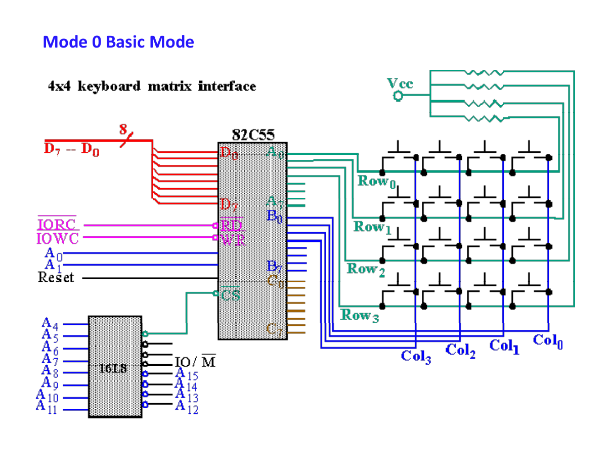

**Mode 0** = plain I/O, **no handshaking**: just read the pins (input) or write the pins (output). Slide example: a **4 × 4 keyboard matrix** (16 keys).

### How to read the circuit
- 16 push-button keys in **4 rows (Row0-Row3, green)** and **4 columns (Col0-Col3, blue)**. A key connects its row line to its column line when pressed.
- The four **rows** go to **Port A** pins and each row has a **pull-up resistor to VCC** (the four resistors at the top). A row line reads **1** when nothing connects it to a column.
- The four **columns** go to **Port B** pins (outputs).
- The chip is selected by a **16L8 PLD** (inputs A4-A15 and IO/M) giving /CS; A0, A1 go to the chip's register select; /IORC → /RD, /IOWC → /WR, Reset.
- Because only row lines are read and only column lines are written, **Port A = input, Port B = output** (e.g. command byte **90H** in mode 0, with ports B and C outputs).

### How the scanning works (standard technique; the slide only shows the circuit)
1. Make **one column 0** and the others 1 (write e.g. `1110` to the column outputs).
2. **Read the rows.** If a key in that column is pressed, its row line is pulled to **0**; otherwise it stays 1 (pull-up).
3. Repeat for the next column. The **column that is low + the row that reads 0 = the key**.

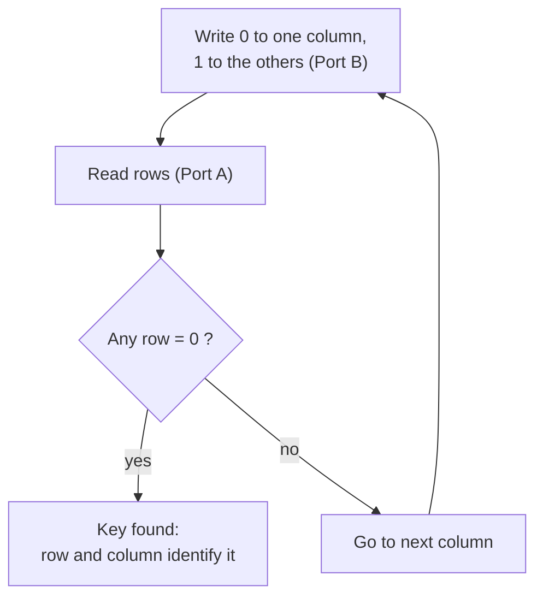

---

## 16. Mode 1: strobed input 🧠🔧

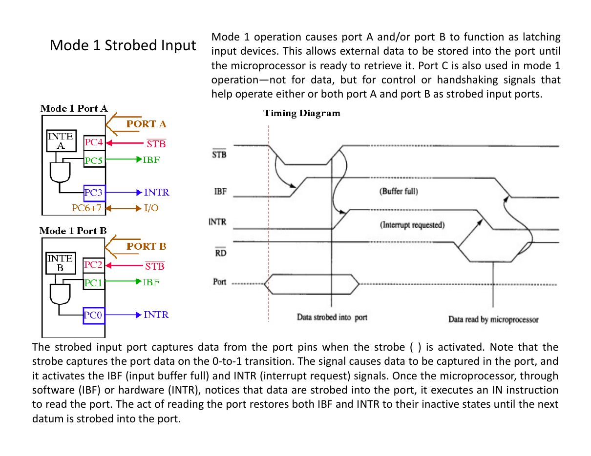

**Mode 1 operation causes port A and/or port B to function as latching input devices.** External data is **stored in the port until the microprocessor is ready to retrieve it**. **Port C is used for control (handshake) signals, not for data.**

### The handshake signals

| Signal | Direction | Meaning | Port A pin | Port B pin |
|---|---|---|---|---|
| **/STB** | input (from the device) | **strobe**: "latch this data now" | **PC4** | **PC2** |
| **IBF** | output | **Input Buffer Full**: data is waiting | **PC5** | **PC1** |
| **INTR** | output | **Interrupt request** to the CPU | **PC3** | **PC0** |
| **INTE A / INTE B** | internal flip-flops | enable the interrupt (set via command byte B) | | |
| spare I/O | | still usable as ordinary I/O | PC6, PC7 | (none: PC0-PC2 are all used) |

### How to read the timing diagram
Read the waveforms from left to right (STB, IBF, INTR, /RD, Port):
1. The **device puts data on the port pins** and then pulses **/STB low** ("Data strobed into port").
2. When **/STB goes low**, **IBF goes high** (buffer full: the data is now latched).
3. When **/STB returns high (0-to-1 transition, the data is captured on this rising edge)**, **INTR goes high** (if INTE is set): "(Interrupt requested)".
4. The CPU notices (by **polling IBF** = software, or by **INTR** = hardware) and executes **`IN`**. The **/RD pulse** ("Data read by microprocessor") **resets both IBF and INTR to inactive**, ready for the next datum.

> The strobed input port captures data from the port pins when the strobe is activated; the strobe captures the port data on the **0-to-1 transition**; it activates **IBF** and **INTR**; the CPU's read **restores both IBF and INTR** to their inactive states until the next datum is strobed in.

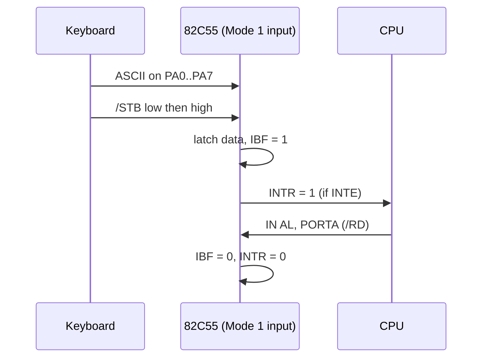

### Strobed input example: keyboard (slide 28) 🔧

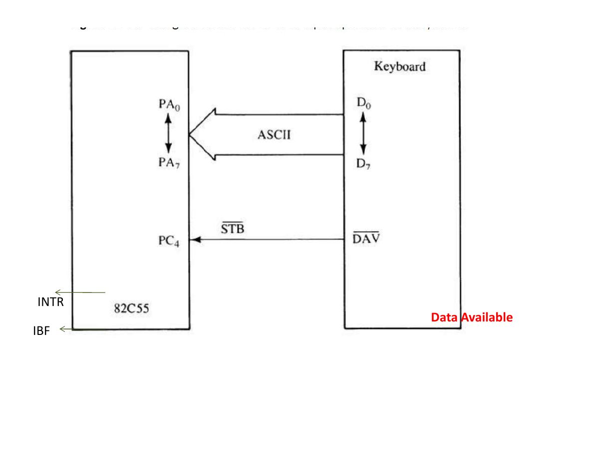

- Keyboard data **D0-D7 (ASCII) → PA0-PA7**.
- Keyboard **/DAV ("Data Available") → /STB = PC4**.
- The 82C55 outputs **IBF** and **INTR** for the CPU.

### The program (Example 11-18, slide 29) 🔧

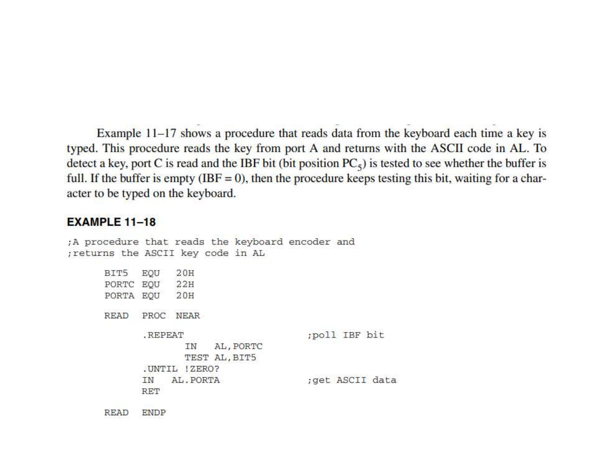

```asm
BIT5  EQU 20H        ; mask for bit 5 (PC5 = IBF)
PORTC EQU 22H
PORTA EQU 20H

READ PROC NEAR
     .REPEAT                    ; poll IBF bit
          IN   AL, PORTC
          TEST AL, BIT5
     .UNTIL !ZERO?
     IN   AL, PORTA             ; get ASCII data
     RET
READ ENDP
```

**How to read it:** keep reading **port C** and test **bit 5 (IBF = PC5)**. `.UNTIL !ZERO?` = loop until the bit is **1** (buffer full = a key was typed). Then `IN AL,PORTA` reads the ASCII code into AL (this read also clears IBF). The procedure **returns the ASCII code in AL**. If the buffer is empty (IBF = 0) it simply keeps testing: "waiting for a character to be typed".

> [!tip] Memory trick (polling recipe)
> **Poll the flag (IBF) → when set, read the data → read clears the flag.**

---

## 17. Mode 1: strobed output 🧠🔧

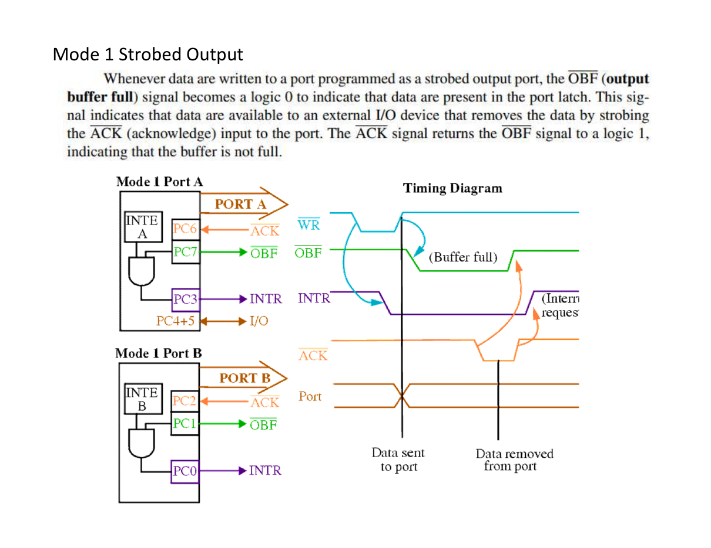

**Idea:** the CPU **writes** a byte to the port; the **external device takes it** and **acknowledges**. Handshake from the *output* point of view.

> Whenever data are written to a port programmed as a strobed output port, the **/OBF (output buffer full)** signal becomes logic **0** to indicate that data are present in the port latch. This signal indicates data are available to an external I/O device that removes the data by strobing the **/ACK** (acknowledge) input to the port. The **/ACK returns /OBF to logic 1**, indicating the buffer is not full.

| Signal | Direction | Meaning | Port A pin | Port B pin |
|---|---|---|---|---|
| **/OBF** | output | **Output Buffer Full** (active low): "data is waiting for you" | **PC7** | **PC1** |
| **/ACK** | input | **Acknowledge** from the device: "I took the data" | **PC6** | **PC2** |
| **INTR** | output | interrupt request: "port is empty again, send more" | **PC3** | **PC0** |
| spare I/O | | ordinary I/O | PC4, PC5 | |

### How to read the timing diagram
1. CPU executes `OUT`: **/WR pulses low**; data appears on the port ("Data sent to port").
2. After /WR, **/OBF goes low** (buffer full) and **INTR goes low** (cleared).
3. The device reads the data and pulses **/ACK low** ("Data removed from port").
4. **/ACK going low then high** makes **/OBF return to 1** and **INTR go high** ("Interrupt request": the CPU may now send the next byte).

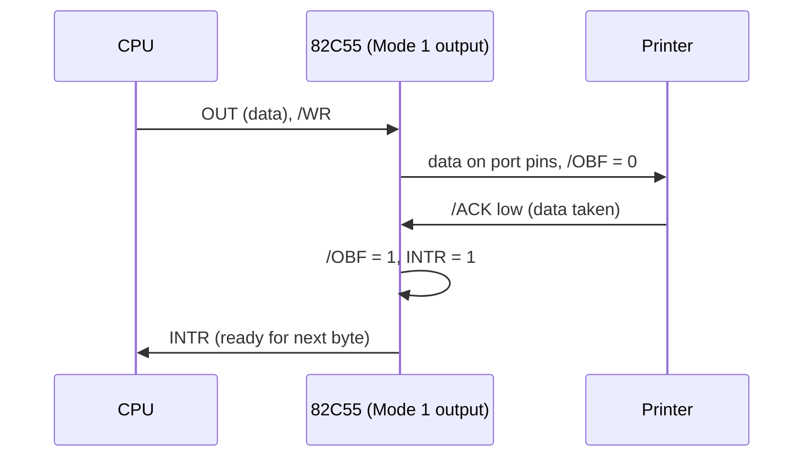

### Strobed output example: printer (slides 31-32) 🔧

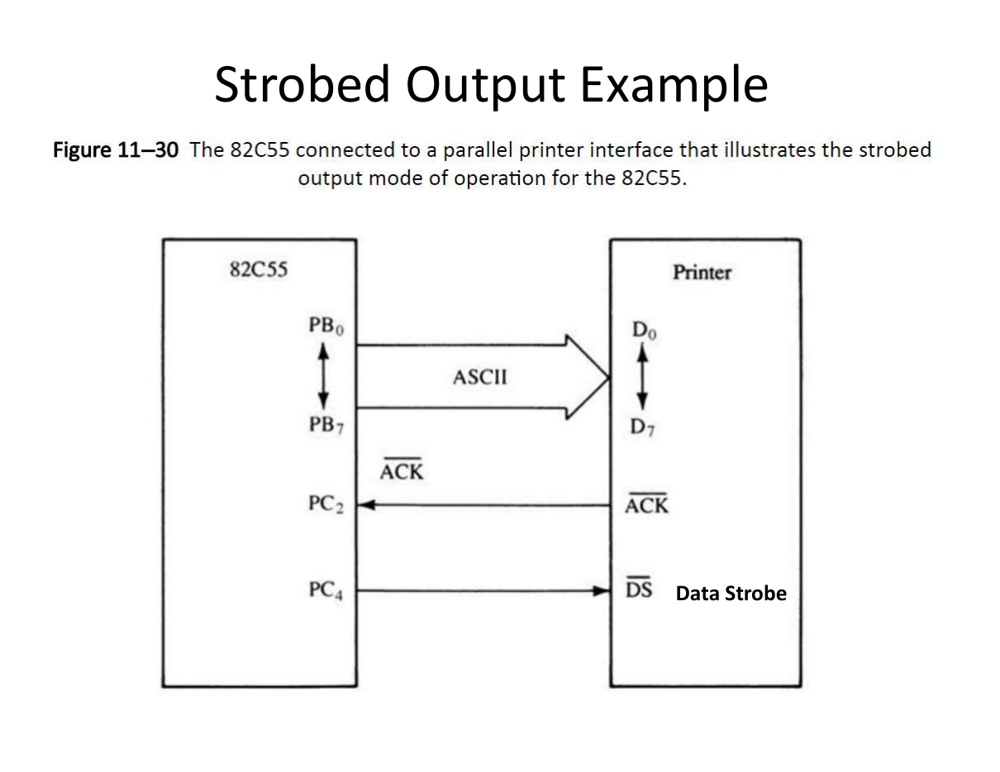

- **PB0-PB7 → printer D0-D7** (the ASCII character).
- Printer **/ACK → PC2** (acknowledge input to the 82C55).
- **PC4 → printer /DS (Data Strobe)**.

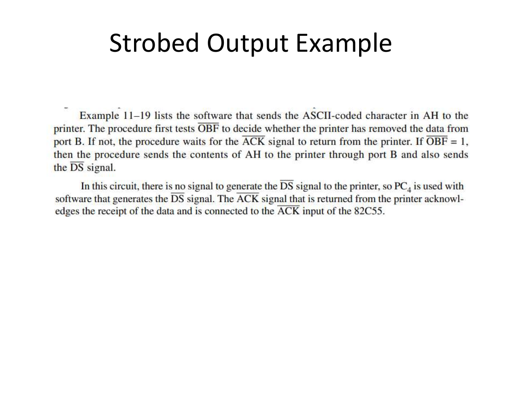

**What the software (Example 11-19) does, from the slide's explanation:**
1. **Test /OBF** to see whether the printer has removed the previous data from port B. If **not**, **wait for /ACK** to return from the printer.
2. If **/OBF = 1** (buffer empty), **send the contents of AH to the printer through port B** and also send the **/DS** signal.
3. **No hardware generates /DS** in this circuit, so **PC4 is used with software that generates /DS** (a bit set/reset on PC4: set → reset → set creates the strobe pulse).
4. The printer's **/ACK** acknowledges receipt and goes to the 82C55's /ACK input.

> [!tip] Memory trick: input vs output handshake
> **Input:** device says **STB** ("here's data"), chip says **IBF** ("I'm full"). **Output:** chip says **OBF** ("I'm full of YOUR data"), device says **ACK** ("got it").
> **B**uffer **F**ull: **I**BF = **I**nput, **O**BF = **O**utput.

---

## 18. Mode 2: bidirectional (interfacing two components) 🧠🔧

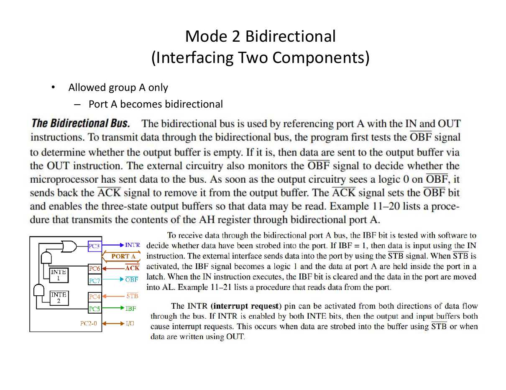

- **Allowed for group A only**; **Port A becomes bidirectional** (it both sends and receives on the same 8 pins).
- The **bidirectional bus is used by referencing port A with the `IN` and `OUT` instructions.**
- Control signals use **PC3-PC7** (from the small diagram): **PC3 = INTR**, **PC4 = /STB**, **PC5 = IBF**, **PC6 = /ACK**, **PC7 = /OBF**; **PC2-PC0 = ordinary I/O**. Two interrupt-enable bits **INTE 1** (output side) and **INTE 2** (input side).

### Transmitting (output direction)
1. The program first **tests /OBF** to see if the output buffer is **empty**.
2. If yes, send the data to the output buffer with **`OUT`**.
3. External circuitry watches /OBF. When it sees **/OBF = 0** (data available), it **removes** the data and sends back **/ACK**.
4. **/ACK** resets /OBF (buffer free again) and **enables the three-state output buffers** so the data can be read by the external device.

### Receiving (input direction)
1. The program tests **IBF** by software to see if data has been strobed in.
2. The external interface sends data with **/STB**; **IBF becomes 1** and the data is **held in a latch** inside the port.
3. If **IBF = 1**, read the data with **`IN`**; this **clears IBF** and moves the data into **AL**.

### Interrupts in Mode 2
The **INTR** pin can be activated from **both directions**. If INTR is enabled by **both INTE bits**, the output and input buffers can both cause interrupt requests: **when data is strobed in with /STB** or **when data has been written with `OUT`** (and then removed).

> [!tip] Memory trick
> **Mode 0 = plain. Mode 1 = handshake one-way (A and B). Mode 2 = handshake both ways on port A only.**

| | Mode 0 | Mode 1 | Mode 2 |
|---|---|---|---|
| Handshake | none | yes (port C signals) | yes (port C signals) |
| Ports | A, B, C (C as two 4-bit halves) | A and/or B as data; C = control | **A only**, bidirectional |
| Direction | each port in or out | each port in **or** out | **A in and out** |
| Interrupt | no | INTR (PC3 / PC0) | INTR (PC3) |
| Example | keyboard matrix, LEDs, switches | keyboard (input), printer (output) | two-way link between two components |

---

## 19. Design cookbook (step-by-step recipes) 🧩

### Recipe A: Decode a block of 8-bit ports (74LS138)
```
1. Write the first and last port address in binary (use A0..A7 for 8-bit ports).
2. The lowest 3 bits that vary (000..111)  -> A, B, C of the 138 (A = least significant).
3. The remaining fixed bits -> enable pins:
      a bit that must be 1  -> G1  (or NAND/AND several together)
      a bit that must be 0  -> /G2A or /G2B
      several fixed 1s      -> NAND them -> /G2B   (low only when all are 1)
4. /Yn outputs = port-select signals. Combine with /IORC (input) or /IOWC (output)
   if you need read/write separation.
```
*Example:* F0H-F7H → A2A1A0 = ABC, A4 → G1, A3 → /G2A, NAND(A5,A6,A7) → /G2B. (§4.2)

### Recipe B: 16-bit port address with many fixed bits (PLD)
Use a NAND (e.g. 74HCT20) for the "all ones" bits → Z; feed Z, the remaining address bits into a **GAL22V10** and write one equation per port: `not( conditions )` with `not` on every bit that must be 0. (§4.3)

### Recipe C: Input port (switches, keys)
```
Source -> 74ALS244 (3-state buffer) -> data bus
Pull-up resistors on every input line (open = 1)
/SEL = decode(port address) AND /IORC   -> 1G and 2G (active low)
Program: IN AL, port
```

### Recipe D: Output port (LEDs, latch)
```
Data bus -> 74ALS374 (octal latch) -> device
/SEL = decode(port address) AND /IOWC   -> CLK (rising edge captures)
/OC grounded (always enabled)
Program: OUT port, AL
LEDs with resistor to VCC: LED ON when Q = 0
```

### Recipe E: 16-bit output port with two byte ports (40H/41H)
`D0 = (all address bits as OR terms) + A0 + /IOWC`  (low byte, even)
`D1 = (same address terms) + /BHE + /IOWC`  (high byte, odd)
→ D0 clocks the low-byte 374, D1 clocks the high-byte 374.

### Recipe F: Connect an 82C55 to a 16-bit bus
```
1. Put the 82C55 data pins on D0-D7 (low bank): CPU A0 must be 0 (even addresses).
2. Chip A0 <- CPU A1,  Chip A1 <- CPU A2   -> registers at base, base+2, base+4, base+6.
3. /CS from a 138/PLD that decodes the upper address bits + A0 = 0.
4. /IORC -> /RD,  /IOWC -> /WR,  RESET -> RESET.
```

### Recipe G: Compute the 82C55 command byte A
```
D7 = 1
D6 D5 = group A mode      D4 = port A dir      D3 = port C upper dir
D2    = group B mode      D1 = port B dir      D0 = port C lower dir
(1 = input, 0 = output)   Write the bits, group them in fours, convert to hex.
```

### Recipe H: Interrupt with a fixed vector (74ALS244)
`/INTA -> 1G and 2G`, buffer inputs = the vector bits (1 = pull-up/open, 0 = to ground). Vector 80H = `1000 0000`, vector 40H = `0100 0000`.

### Recipe I: Polling vs interrupt
- **Polling:** loop `IN` / `TEST` flag / `JZ` until set (e.g. IBF), then read.
- **Interrupt:** enable INTE (bit set on PC4/PC2 for inputs), let the 82C55 **INTR → CPU INTR**, supply a vector with a /INTA-enabled buffer, and read the port in the ISR.

---

## 20. Cheat sheet

| Item | Value |
|---|---|
| Isolated I/O instructions | `IN`, `OUT`, `INS`, `OUTS` |
| Isolated I/O space | **0000H - FFFFH** (A0-A15, 64K ports) |
| Memory-mapped I/O uses | `MOV` (memory-reference instructions) |
| 8-bit immediate port range | 00H - FFH; above that **use DX** |
| PC main-board devices | 0000H - 00FFH |
| PC early/ancillary devices | 0100H - 03FFH |
| PC modern devices | above 0400H |
| PC 8255 (PPI) | **60H - 63H** (keyboard/speaker); **378H - 37BH** printer |
| Input port chip | **74ALS244** (3-state buffer), control on **1G, 2G** (active low) |
| Output port chip | **74ALS374** (octal latch), control on **CLK**, /OC grounded |
| LED on when | **Q = 0** |
| Pull-up | open switch = **1**, closed = **0**; 1K-10K |
| Even port = low byte (D0-D7) | enabled by **A0** |
| Odd port = high byte (D8-D15) | enabled by **/BHE** |
| 16-bit port reads | no separate read strobes; writes need separate strobes |
| Vector from 74ALS244 buffer | placed on D0-D7 when **/INTA = 0** |
| Vector table address | **4 × type number** |
| 82C55 pins | **24 I/O**: Port A (8), Port B (8), Port C (8, two 4-bit halves) |
| A1 A0 select | 00 = A, 01 = B, 10 = C, 11 = Command |
| Command byte | bit 7 = **1** → byte A (modes), bit 7 = **0** → byte B (bit set/reset) |
| Mode 0 | basic I/O, no handshake |
| Mode 1 | strobed (handshake); Port A: **PC4 /STB, PC5 IBF, PC3 INTR** (in); **PC7 /OBF, PC6 /ACK, PC3 INTR** (out); Port B: **PC2 /STB, PC1 IBF, PC0 INTR** (in); **PC1 /OBF, PC2 /ACK, PC0 INTR** (out) |
| Mode 2 | **group A only**, Port A bidirectional; **PC3 INTR, PC4 /STB, PC5 IBF, PC6 /ACK, PC7 /OBF** |
| Command byte B | `0 XXX bbb s`: bbb = which bit of port C, s = 1 set / 0 reset |
| Common command bytes | **80H** all out, **90H** A in, **9BH** all in |
| 74ALS244 interrupt expansion | IR0..IR6 → vectors **FEH, FDH, FBH, F7H, EFH, DFH, BFH** |
| Daisy-chain vector | **FFH** (data bus pulled up), priority by ISR polling order |

---

## 21. Things to be careful about in the slides

| Where | Observation |
|---|---|
| Slide 5 | The figure shows only the address decoder; for real use, combine the select outputs with `/IORC` or `/IOWC`. |
| Slide 6 | PLD outputs are called **D0-D7** but they are **port-select outputs**, not data lines. |
| Slide 9 | The inverted terms (`#A6`, `#BHE`, `#IOWC`) in the equations are written with a `#` meaning "NOT" / active-low signal. |
| Slide 11 | Two voltage definitions of TTL appear in the lecture (0.8 V / 2.0 V on slide 11 and 0.5 V / 2.7 V on slide 21). Use the one the teacher states; the idea is the same. |
| Slide 20 | The listing misses `IN AL,DX` after `MOV DX,C2` (see §10.2). |
| Slide 22 | The block diagram labels port C as **CA (4) / CB (4)** halves; the pin table lists Command byte A / B for A1A0 = 11. |
| Slides 24-25 | Byte A has D7 = 1, byte B has D7 = 0. Memorize this: it is how the chip knows which one you are sending. |
| Slide 16 | "82C55 keyboard interface": the INTE bit for port-A input is controlled by **PC4** using command byte B (bit set). |

---

## 22. Practice questions with answers

> [!question] Q1 (🧠). Differentiate isolated I/O and memory-mapped I/O.
> Isolated: dedicated `IN/OUT/INS/OUTS`, separate I/O address space 0000H-FFFFH, distinguished from memory by `M/IO`; used by the PC. Memory-mapped: ordinary memory instructions (`MOV`), I/O uses a region of the memory map (address shared with memory); used by processors without I/O instructions (PowerPC).

> [!question] Q2 (🧠). Why must a port above 00FFH be accessed through DX?
> The `IN/OUT` instruction has only an **8-bit** immediate port field (00H-FFH). Ports 0100H-FFFFH need a **16-bit variable address in DX**.

> [!question] Q3 (🧩). Design a decoder for 8-bit ports **F0H - F7H**.
> A2 A1 A0 → A B C of a 74ALS138. A4 → G1, A3 → /G2A, NAND(A5, A6, A7) → /G2B. Outputs /Y0-/Y7 = /F0H-/F7H. (§4.2)

> [!question] Q4 (🧩). A block of ports must respond at **A0H - A3H**. How do you decode it with a 74LS138?
> A0H = 1010 0000, A3H = 1010 0011 → A7 A6 A5 A4 A3 A2 = 1 0 1 0 0 0, and A1 A0 vary.
> Use **A2 A1 A0 → C B A** of the 138 and use only **Y0-Y3** (ports A0H-A3H; A2 = 0 for these). Fixed bits: **A7 → G1** (needs 1), **A6 → /G2A** (needs 0), and **/G2B = A4 + A3 + (not A5)** from one OR gate plus one inverter (it is 0 only when A4 = 0, A3 = 0 and A5 = 1). Then /Y0 ... /Y3 = ports A0H ... A3H. (Y4-Y7 would answer at A4H-A7H, so leave them unused.)

> [!question] Q5 (🔧). Decode port **64H / 65H** as a 16-bit input port with a PLD. Write the equation.
> `D0 <= IORC or A1 or not A2 or A3 or A4 or not A5 or not A6 or A7` → 0110 010x. Enable both 74HCT244 buffers (U2 = 64H on D0-D7, U3 = 65H on D8-D15). BHE and A0 are **not** used because both banks are read together.

> [!question] Q6 (🔧). Port 40H is a low-byte output and 41H a high-byte output on a 16-bit bus. Write both strobe equations.
> `D0 = A7 + /A6 + A5 + A4 + A3 + A2 + A1 + A0 + /IOWC`; `D1 = A7 + /A6 + A5 + A4 + A3 + A2 + A1 + /BHE + /IOWC`.

> [!question] Q7 (🔧). Write the program that sends 00H to port 62H and reads a byte from port 71H.
> `MOV AL,00H / OUT 62H,AL` and `IN AL,71H` (or use `MOV DX,port` and `OUT DX,AL` / `IN AL,DX`).

> [!question] Q8 (🧠). Why a buffer for an input port and a latch for an output port?
> Input: external data is stable and must connect to the shared data bus **only while the CPU reads**; a 3-state buffer does that (Hi-Z otherwise). Output: the CPU keeps data on the bus for a very short time, so a **latch** must capture and **hold** it for the device.

> [!question] Q9 (🧠). Why do input switches need pull-up resistors?
> To avoid a floating input: **open switch → resistor pulls the line to VCC = 1**; closed switch → ground = 0. Value 1K-10K (high enough not to disturb the closed switch).

> [!question] Q10 (🧠). Explain INTR and INTA and how the vector number gets to the CPU.
> The device raises **INTR**; if IF = 1 the CPU answers with **/INTA = 0**; /INTA enables a **74ALS244 buffer** which puts the type number (e.g. **80H**) on **D0-D7**; the CPU uses 4 × type as the vector table address and runs the ISR.

> [!question] Q11 (🧩). What are the problems of interrupt expansion with a 74ALS244? How does daisy chain differ?
> Multiple simultaneous requests give **combination vectors** (e.g. IR0 + IR1 → FCH): priority is unresolved and vector table space is wasted. **Daisy chain**: OR the INTR outputs; data bus pulled high → **single vector FFH**; the ISR **polls** the 82C55s in a chosen order (= priority).

> [!question] Q12 (🔧). Find the 82C55 command byte: **Port A input, Port B output, Port C upper input, Port C lower output, all mode 0**.
> D7 = 1, D6D5 = 00, D4 (A) = 1, D3 (C upper) = 1, D2 = 0, D1 (B) = 0, D0 (C lower) = 0 → `1001 1000` = **98H**.

> [!question] Q13 (🔧). Write the command byte to **set PC3** and to **reset PC6**.
> Set PC3: D3D2D1 = 011, D0 = 1 → `0000 0111` = **07H**. Reset PC6: D3D2D1 = 110, D0 = 0 → `0000 1100` = **0CH**.

> [!question] Q14 (🧩). An 82C55 is on the low bank of a 16-bit bus. Why are its ports at **C0H, C2H, C4H, C6H**?
> Its data pins are on D0-D7 (even addresses, A0 = 0). The chip's A0 and A1 pins are connected to CPU **A1 and A2**, so Port A, B, C, Command are 2 apart: 1100 0 00 0, 1100 0 01 0, 1100 0 10 0, 1100 0 11 0.

> [!question] Q15 (🧠). Describe the Mode 1 strobed-input handshake.
> Device puts data and pulses **/STB** low; **IBF** goes high when /STB goes low; data latched on the **rising edge**; **INTR** goes high (if INTE); CPU executes **IN** (via polling IBF or interrupt); the read resets IBF and INTR.

> [!question] Q16 (🧠). Describe the Mode 1 strobed-output handshake.
> CPU writes the byte; **/OBF** goes low (data present); the device takes the data and pulses **/ACK**; /ACK makes **/OBF = 1** and **INTR = 1** so the CPU can send the next byte.

> [!question] Q17 (🔧). Which port C bits are IBF, /STB and INTR for port A input in mode 1?
> **PC5 = IBF, PC4 = /STB, PC3 = INTR** (PC6, PC7 free). For Port B: PC1 = IBF, PC2 = /STB, PC0 = INTR.

> [!question] Q18 (🧠). Which group can use Mode 2 and what is special about it?
> **Group A only.** Port A is **bidirectional**; the five handshake lines PC3-PC7 are used (INTR, /STB, IBF, /ACK, /OBF).

> [!question] Q19 (🔧). Write the keyboard read procedure (strobed input).
> Poll PC5 (IBF) with `IN AL,PORTC / TEST AL,20H` until non-zero; then `IN AL,PORTA` (see §16).

> [!question] Q20 (🧠). Why are strobe signals used?
> Digital signals take time to settle; a strobe tells the receiver **when the transition is complete and the data is valid**, so it samples at the right moment.

---

## 23. Glossary

| Term | Meaning |
|---|---|
| **Port** | an address through which the CPU reads/writes an I/O device |
| **Isolated I/O** | separate I/O address space + IN/OUT instructions |
| **Memory-mapped I/O** | I/O device lives in the memory address space, accessed with MOV |
| **Partial decoding** | ignoring some address lines when decoding (ports repeat at several addresses) |
| **Tri-state (3-state) buffer** | can output 0, 1, or **disconnect (Hi-Z)** |
| **Latch / flip-flop (374)** | stores data on a clock edge |
| **Pull-up resistor** | resistor to VCC that keeps an input at 1 when nothing drives it low |
| **IORC / IOWC** | I/O read control / I/O write control strobes (80286/386SX) |
| **BHE** | bus-high-enable (selects the odd/high byte) |
| **INTR / INTA** | interrupt request (to the CPU) / interrupt acknowledge (from the CPU) |
| **Maskable interrupt** | can be blocked by clearing the IF flag |
| **Vector (type) number** | 8-bit number identifying the interrupt; table entry at 4 × number |
| **ISR** | interrupt service routine |
| **Polling** | repeatedly checking a flag instead of using an interrupt |
| **Daisy chain** | devices' INTR outputs OR-ed into one INTR, priority resolved in software |
| **8259A PIC** | programmable interrupt controller chip for many interrupt sources |
| **Strobe** | a pulse saying "data is valid now" |
| **82C55 PPI** | programmable peripheral interface: 3 ports (A, B, C), 3 modes |
| **IBF / OBF** | input buffer full / output buffer full |
| **STB / ACK** | strobe / acknowledge handshake lines |
| **INTE** | interrupt-enable bit inside the 82C55 (set with command byte B) |
| **Command byte A / B** | mode definition (D7 = 1) / port C bit set-reset (D7 = 0) |
| **Handshaking** | exchange of ready/acknowledge signals between CPU side and device |
| **TEST instruction** | bitwise AND that only sets flags |

---

*Source: Lecture 7, "I/O Interfacing" (CSE3117, Microprocessors and Microcontrollers), Prof. Dr. Shamim Akhter, with figures from Brey, The Intel Microprocessors. All slide images are in the `attachments/` folder next to this note.*
